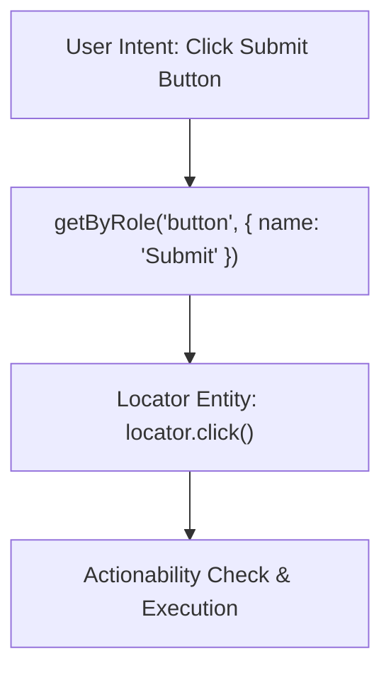
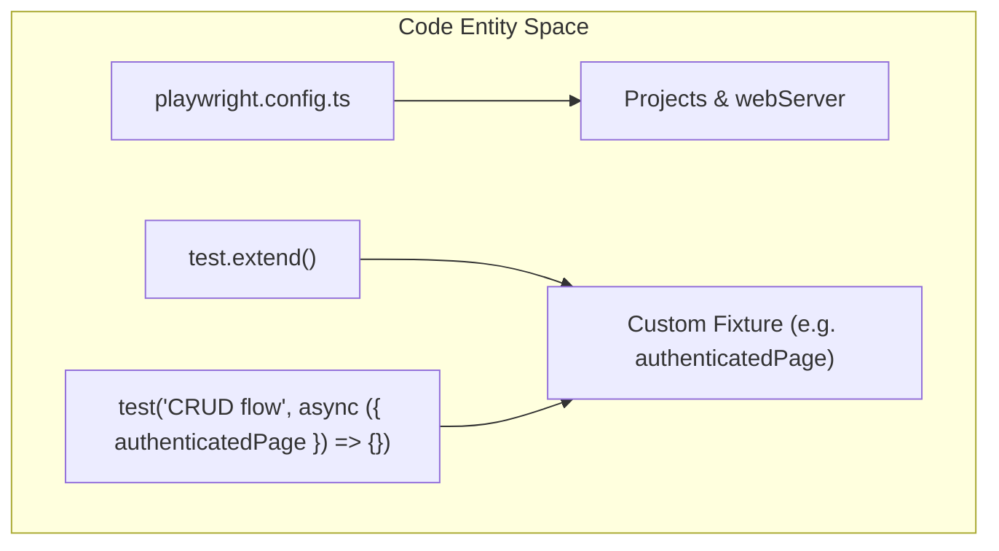

<!-- source: DeepWiki mcp.deepwiki.com · repo testdino-hq/playwright-skill · page 2 Core Test Authoring Guides · fetched 2026-10-27 -->

# Core Test Authoring Guides

Relevant source files

The following files were used as context for generating this wiki page:

- [core/SKILL.md](core/SKILL.md)

The `core/` pack contains 47 production-tested reference guides covering the full Playwright testing surface [core/SKILL.md:6-10](). This parent page provides a high-level overview of test authoring fundamentals, guiding agents and engineers through writing robust end-to-end, component, and API tests using TypeScript and JavaScript.

Sources: `core/SKILL.md:6-10`

---

## 2.1. Locators and Locator Strategy

Resilient test automation begins with robust locator strategies. The core guides emphasize prioritizing semantic user-facing attributes over fragile CSS or XPath selectors [core/SKILL.md:18-20](). 

- **Primary Selector**: `getByRole()` mirrors how users and assistive technologies perceive the application [core/SKILL.md:18-20]().
- **Chaining & Filtering**: Use `.filter()`, `.locator()`, and internal filter options like `{ hasText: ... }` to narrow down scopes precisely.
- **Decision Trees**: Refer to the dedicated deep dive on locator strategy for resolving ambiguous UI components [core/SKILL.md:37]().

For details, see [Locators and Locator Strategy](#2.1).

*Figure 1: Mapping natural language user intent to Playwright locator entities.*

Sources: `core/SKILL.md:18-20`, `core/SKILL.md:37`

---

## 2.2. Assertions and Waiting

Playwright introduces web-first, auto-retrying assertions that eliminate traditional arbitrary delays and flakiness [core/SKILL.md:21-22]().

- **Auto-Retrying**: `expect(locator).toBeVisible()` automatically retries until the condition is met or the timeout expires.
- **Polling Utilities**: Use `expect.poll()` or `expect.toPass()` for asynchronous operations and polling external state changes.
- **Actionability**: Playwright automatically checks element state (visible, enabled, stable) before executing actions like `.click()` or `.fill()`.

For details, see [Assertions and Waiting](#2.2).

Sources: `core/SKILL.md:21-22`, `core/SKILL.md:38`

---

## 2.3. Test Organization, Architecture and Configuration

Structuring test suites correctly ensures maintainability across large codebases and continuous integration environments [core/SKILL.md:40-41]().

- **Configuration**: `playwright.config.ts` manages global settings, projects, web servers, and `baseURL` definitions [core/SKILL.md:24]().
- **Layout**: Adopt a feature-based directory layout keeping tests close to source code or structured logically by testing tier (E2E, API, Component).
- **Metadata**: Utilize test tagging and dynamic selection to run specific subsets during development cycles [core/SKILL.md:39]().

For details, see [Test Organization, Architecture and Configuration](#2.3).

Sources: `core/SKILL.md:24`, `core/SKILL.md:39-41`

---

## 2.4. Fixtures, Hooks and Test Data

State management in Playwright moves away from global variables and traditional test hooks toward modular, type-safe fixtures [core/SKILL.md:27]().

- **Fixtures (`test.extend`)**: Encapsulate setup and teardown logic into reusable, dependency-injected test or worker-scoped fixtures.
- **Test Data Management**: Isolate test execution by generating unique data per test case, avoiding shared state side-effects [core/SKILL.md:23]().

For details, see [Fixtures, Hooks and Test Data](#2.4).

*Figure 2: Fixture dependency architecture linking configuration and test execution.*

Sources: `core/SKILL.md:23`, `core/SKILL.md:27`, `core/SKILL.md:42-43`

---

## 2.5. Authentication and Auth Flows

Optimizing test execution speed requires bypassing repetitive UI login flows [core/SKILL.md:44]().

- **Storage State Reuse**: Capture authentication cookies and `localStorage` using `page.context().storageState()`.
- **Setup Projects**: Configure dedicated setup tests that write state to disk, allowing downstream tests to inject `storageState` instantly.
- **Complex Auth**: Handle multi-factor authentication (2FA), OAuth redirects, and passkeys securely.

For details, see [Authentication and Auth Flows](#2.5).

Sources: `core/SKILL.md:44`

---

## 2.6. UI Interaction Recipes

The core pack provides proven patterns for complex interface interactions [core/SKILL.md:51-56]().

- **Forms & Validation**: Handle complex form inputs, native validations, and error states.
- **CRUD & Search**: Automate data tables, pagination, search filters, and modal CRUD operations.
- **File & Drag Operations**: Manage file uploads, downloads via `download` events, and drag-and-drop interactions [core/SKILL.md:52-55]().

For details, see [UI Interaction Recipes](#2.6).

Sources: `core/SKILL.md:51-56`

---

