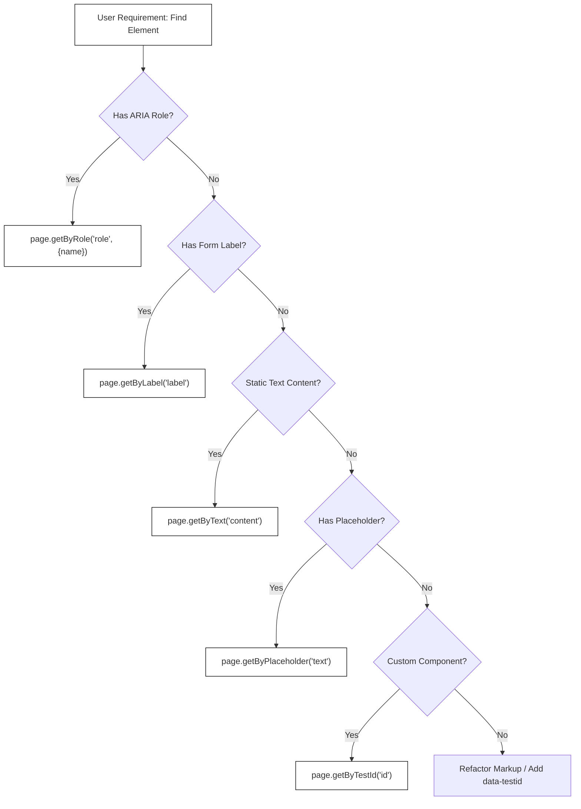
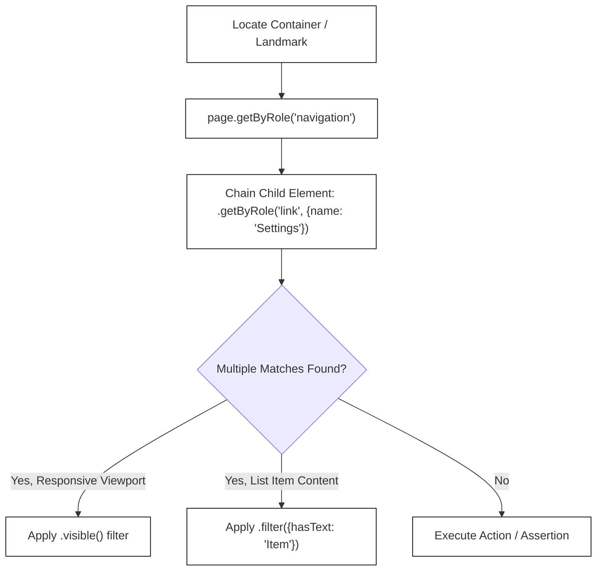

<!-- source: DeepWiki mcp.deepwiki.com · repo testdino-hq/playwright-skill · page 2.1 Locators and Locator Strategy · fetched 2026-10-27 -->

# Locators and Locator Strategy

<details>
<summary>Relevant source files</summary>

The following files were used as context for generating this wiki page:

- [core/drag-and-drop.md](core/drag-and-drop.md)
- [core/error-and-edge-cases.md](core/error-and-edge-cases.md)
- [core/file-upload-download.md](core/file-upload-download.md)
- [core/fixtures-and-hooks.md](core/fixtures-and-hooks.md)
- [core/locator-strategy.md](core/locator-strategy.md)
- [core/locators.md](core/locators.md)

</details>


## Purpose and Scope

This page covers the core selector philosophy and API mechanics for element selection in `playwright-skill` guides. The target architecture enforces a strict `getByRole`-first selection model, avoiding brittle CSS selectors and XPaths. It details the resilient selector decision tree, locator chaining and filtering methods, and recent Playwright features (versions 1.59–1.63) including `page.pickLocator()`, `locator.visible()`, and `locator.normalize()`.

---

## 1. The Resilient Selector Decision Tree

When locating elements, Playwright agents and test authors must follow a strict priority ladder that maps user-facing semantics to Playwright API methods. This hierarchy ensures tests survive internal refactors, class name changes, and component library migrations by mirroring how assistive technologies parse the Document Object Model (DOM).

The decision flow is defined across the core guides as a deterministic sequence where semantic accessibility attributes take precedence over structural selectors [core/locator-strategy.md:7-61]().

### Natural Language to Code Entity Mapping

The following diagram maps natural language selector intentions (Natural Language Space) directly to their corresponding Playwright API methods (Code Entity Space).



*Sources: [core/locator-strategy.md:7-61](), [core/locators.md:9-18]()*

---

## 2. Role-Based Selection (`getByRole`)

The primary mechanism for element selection is `page.getByRole()`. It queries elements based on their ARIA role, supporting built-in HTML semantics as well as explicit `role` attributes [core/locator-strategy.md:83-96]().

### Priority and Implementation Details

```typescript
// Priority order implementation reference
page.getByRole('button', { name: 'Submit' })        // 1. Role (default)
page.getByLabel('Email address')                     // 2. Label (form fields)
page.getByText('Welcome back')                       // 3. Text (non-interactive)
page.getByPlaceholder('Search...')                    // 4. Placeholder
page.getByAltText('Company logo')                    // 5. Alt text (images)
page.getByTitle('Close dialog')                      // 6. Title attribute
page.getByTestId('checkout-summary')                 // 7. Test ID (last semantic option)
```

`getByRole` supports options such as `name`, `level` (for headings), `checked`, `pressed`, `expanded`, `selected`, and accessible descriptions [core/locator-strategy.md:91](). 

Disambiguating controls sharing the same accessible name can be achieved in Playwright 1.60+ via the `description` option or through strict parent chaining [core/locator-strategy.md:99]():

```typescript
await page.getByRole('button', { name: 'Delete', description: 'Removes this project' }).click();
```

*Sources: [core/locators.md:9-18](), [core/locator-strategy.md:83-100]()*

---

## 3. Locator Chaining and Filtering

When a broad selector matches multiple DOM nodes, tests must narrow scope using chaining or filtering rather than resorting to arbitrary index offsets like `.nth(0)` [core/locator-strategy.md:75-78]().

### Filtering and Scoping Flow

The diagram below associates natural language structural relationships with their corresponding locator chaining and filtering methods (`locator.filter()`, nested `getByRole()`, and `locator.visible()`).



### Chaining and Filtering Methods

- **Parent-Child Chaining**: Scopes queries hierarchically to eliminate ambiguity [core/locator-strategy.md:74]():
  ```typescript
  const nav = page.getByRole('navigation', { name: 'Main' });
  await expect(nav.getByRole('link', { name: 'Settings' })).toBeVisible();
  ```
- **Content Filtering (`.filter()`)**: Narrows collections using `hasText` or inner locators `has` [core/locator-strategy.md:78]():
  ```typescript
  const taskC = list.getByRole('listitem').filter({ hasText: 'Task C' });
  ```

*Sources: [core/locator-strategy.md:74-79](), [core/drag-and-drop.md:141-144]()*

---

## 4. Modern Discovery and Refactoring Helpers (Playwright 1.59–1.63)

Playwright provides runtime helpers to assist developers and AI agents in discovering or normalizing selectors during test authoring and maintenance [core/locators.md:24-30]().

### Interactive Locator Picking (`page.pickLocator()`)
Used during debugging or interactive exploration to prompt Playwright to suggest a locator for an element under the cursor [core/locators.md:31-34]():
```typescript
test('pick a locator during debugging', async ({ page }) => {
  await page.goto('/checkout');
  const picked = await page.pickLocator();
  console.log(picked);
  await page.cancelPickLocator();
});
```

### Visible-Only Matching (`locator.visible()`) (Playwright 1.63+)
Narrows a selector match to currently visible elements, replacing the legacy non-chainable `:visible` CSS pseudo-class [core/locators.md:66-69]():
```typescript
// Targets the visible navigation link in responsive layouts where desktop/mobile DOM nodes coexist
await page.getByRole('link', { name: 'Settings' }).visible().click();
```

### Selector Normalization (`locator.normalize()`)
Analyzes brittle CSS or XPath expressions and suggests idiomatic Playwright role/label equivalents during refactoring tasks [core/locators.md:83-86]():
```typescript
const legacy = page.locator('.settings-panel button.save');
const normalized = await legacy.normalize();
console.log(normalized);
```

*Sources: [core/locators.md:20-116]*

---

