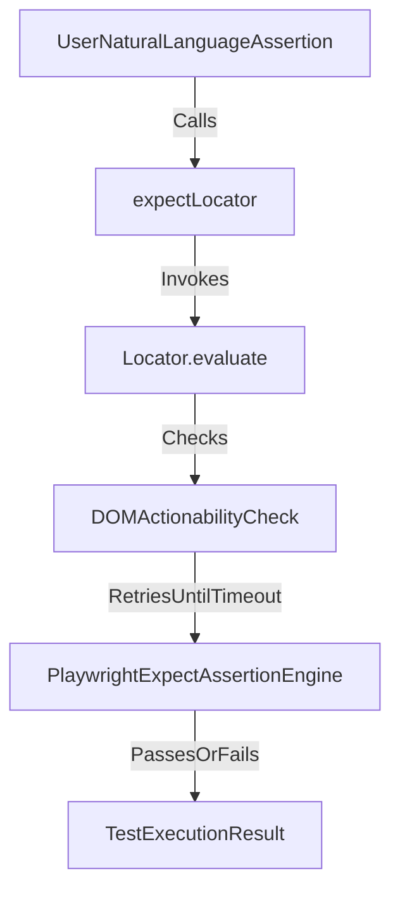
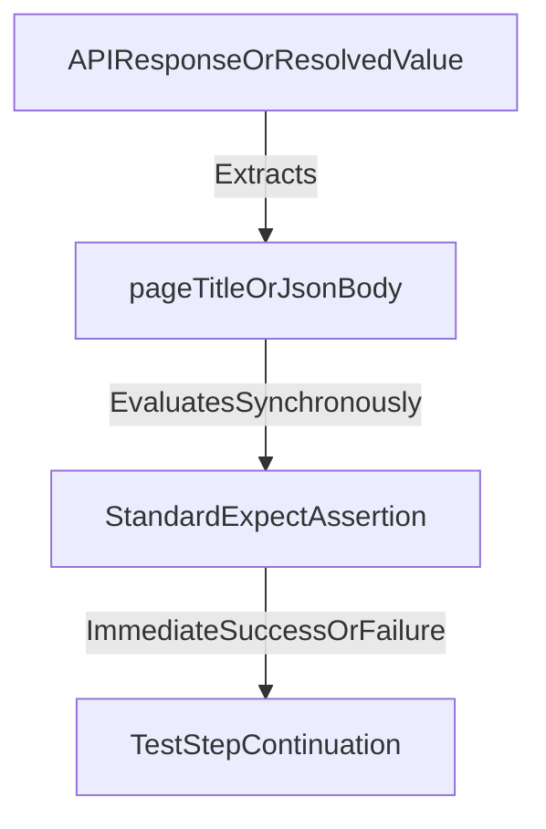

<!-- source: DeepWiki mcp.deepwiki.com · repo testdino-hq/playwright-skill · page 2.2 Assertions and Waiting · fetched 2026-10-27 -->

# Assertions and Waiting

<details>
<summary>Relevant source files</summary>

The following files were used as context for generating this wiki page:

- [core/assertions-and-waiting.md](core/assertions-and-waiting.md)

</details>


## Purpose and Scope

This page covers web-first auto-retrying assertions, non-retrying assertions, advanced polling (`expect.poll`), block retries (`toPass`), soft assertions, actionability checks, and pseudo-element style verification (`toHaveCSS` with the `pseudo` option introduced in Playwright 1.60+). These primitives eliminate race conditions and flakiness in test suites.

Sources: `[core/assertions-and-waiting.md:1-25]()`

---

## Web-First Assertions and Actionability

Web-first assertions automatically retry until the target condition is met or the timeout expires. They form the primary mechanism for validating DOM state without manual `setTimeout` or explicit wait loops. 

Playwright evaluates locators against actionability criteria (such as visibility, attachment, and stability) before performing assertions. For complex styles, such as those applied via pseudo-elements (`::before` or `::after`), the `toHaveCSS()` method accepts a `pseudo` descriptor.

```
Title: Web-First Assertion Evaluation Pipeline
```

Sources: `[core/assertions-and-waiting.md:29-134]()`

---

## Non-Retrying Assertions

When dealing with already-resolved JavaScript primitives, API responses, or static page properties (such as `page.title()` or `page.url()`), auto-retrying assertions are inappropriate. Non-retrying assertions execute once and fail immediately if the condition is unmet.

```
Title: Non-Resolved Value Assertion Flow
```

Sources: `[core/assertions-and-waiting.md:135-181]()`

---

Sources: `[core/assertions-and-waiting.md:1-181]()`

---

