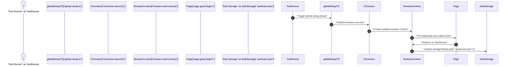
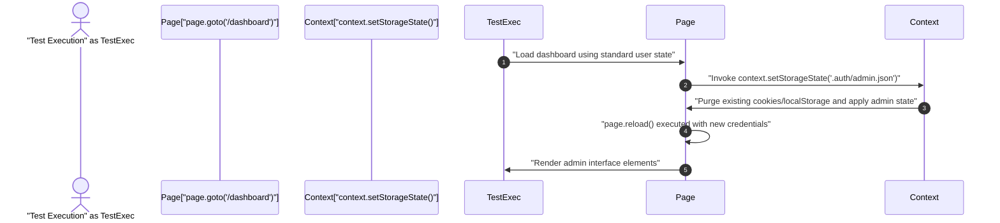

<!-- source: DeepWiki mcp.deepwiki.com · repo testdino-hq/playwright-skill · page 2.5 Authentication and Auth Flows · fetched 2026-10-27 -->

# Authentication and Auth Flows

<details>
<summary>Relevant source files</summary>

The following files were used as context for generating this wiki page:

- [core/accessibility.md](core/accessibility.md)
- [core/auth-flows.md](core/auth-flows.md)
- [core/authentication.md](core/authentication.md)
- [core/configuration.md](core/configuration.md)
- [core/test-organization.md](core/test-organization.md)

</details>


## Purpose and Scope
This leaf page covers authentication strategies and implementation patterns within `playwright-skill`. Efficient authentication is critical for test suite performance; repeating full UI login steps across hundreds of tests introduces massive overhead. This guide details `storageState` persistence, setup projects, global setup routines, role-based multi-user state isolation, in-place state refreshing introduced in Playwright 1.59+, and handling complex auth flows like OAuth, 2FA, and "Remember Me" persistence [core/authentication.md:1-124](), [core/auth-flows.md:1-160]().

---

## 1. Storage State Reuse and Setup Projects

Reusing authentication state avoids executing redundant UI login sequences before every test. Playwright serializes browser cookies, `localStorage`, and `sessionStorage` into a JSON container via `context.storageState()` [core/authentication.md:29-34]().

### Implementation Pattern

To capture and reuse state across your test suite, use a setup script or a dedicated global setup file that runs prior to test execution [core/authentication.md:38-70]():

```typescript
// scripts/save-auth-state.ts
import { chromium } from '@playwright/test';

async function saveAuthState() {
  const browser = await chromium.launch();
  const context = await browser.newContext();
  const page = await context.newPage();

  await page.goto('http://localhost:3000/login');
  await page.getByLabel('Email').fill('user@test.com');
  await page.getByLabel('Password').fill('s3cure!Pass');
  await page.getByRole('button', { name: 'Sign in' }).click();
  await page.waitForURL('/dashboard');

  // Serialize cookies and localStorage
  await context.storageState({ path: '.auth/user.json' });
  await browser.close();
}

saveAuthState();
```
*(Sources: [core/authentication.md:38-58]())*

You can then load this state globally inside `playwright.config.ts`:

```typescript
// playwright.config.ts
import { defineConfig } from '@playwright/test';

export default defineConfig({
  use: {
    baseURL: 'http://localhost:3000',
    storageState: '.auth/user.json',
  },
});
```
*(Sources: [core/authentication.md:61-70]())*

### Diagram: Auth State Serialization and Reuse Flow
This diagram maps high-level authentication setup actions to the underlying code entities executing them.


*(Sources: [core/authentication.md:153-182](), [core/auth-flows.md:7-27]())*

---

## 2. Role-Based State Files and In-Place Refresh

For applications with multiple access tiers (e.g., regular users, administrators, auditors), maintain separate storage state files [core/authentication.md:118-137]().

### Multi-Role Configuration Matrix
- `.auth/user.json`: Standard permissions
- `.auth/admin.json`: Elevated administrative privileges
- `.auth/guest.json`: Unauthenticated or restricted visitor view

### In-Place State Refresh (`setStorageState`)
Playwright 1.59+ introduced `browserContext.setStorageState()`, allowing tests to clear and replace cookies, local storage, and IndexedDB in-place without destroying the running browser context or restarting the page [core/authentication.md:118-124]().

```typescript
import { test, expect } from '@playwright/test';

test('swap to admin state without recreating context', async ({ page, context }) => {
  await page.goto('/dashboard');

  // Replace context storage state in-place (Playwright 1.59+)
  await context.setStorageState('.auth/admin.json');
  await page.reload();

  await expect(page.getByRole('heading', { name: 'Admin dashboard' })).toBeVisible();
});
```
*(Sources: [core/authentication.md:125-137]())*

### Diagram: In-Place Context State Transition
This diagram illustrates how a running browser context swaps credentials dynamically using code-level entities.


*(Sources: [core/authentication.md:118-151]())*

---

## 3. OAuth, 2FA, and Complex Auth Flow Patterns

When testing external identity providers (OAuth/OIDC) or multi-factor authentication (2FA), driving the full third-party UI is slow and brittle. Instead, intercept verification steps or use programmatic API generation [core/authentication.md:19-25](), [core/auth-flows.md:196-207]().

### API-Driven Authentication (Skipping UI)
Bypassing the UI login form entirely via direct API requests speeds up setup routines:

```typescript
const context = await browser.newContext();
const response = await context.request.post('/api/auth/login', {
  data: { email: 'user@test.com', password: 'password' },
});
await context.storageState({ path: '.auth/user.json' });
```
*(Sources: [core/authentication.md:19-25]())*

### Mocking Email Verification and OTP Tokens
For flows requiring email confirmation or Time-based One-Time Passwords (TOTP), intercept the dispatch network request to capture the token programmatically [core/auth-flows.md:196-207]():

```typescript
test('completes signup flow with mocked email verification', async ({ page }) => {
  let verificationToken = '';

  // Intercept verification email or API trigger
  await page.route('**/api/v1/auth/send-verification', async (route) => {
    const response = await route.fetch();
    const json = await response.json();
    verificationToken = json.token; // Capture token generated by backend fixture
    await route.fulfill({ response });
  });

  await page.goto('/signup');
  await page.getByLabel('Email').fill('newuser@example.com');
  await page.getByLabel('Password').fill('SecurePass123!');
  await page.getByRole('button', { name: 'Register' }).click();

  // Use captured token directly in confirmation input or URL
  await page.goto(`/verify?token=${verificationToken}`);
  await expect(page.getByText('Account verified successfully')).toBeVisible();
});
```
*(Sources: [core/auth-flows.md:196-220]())*

### Session Persistence ("Remember Me")
Testing session lifetime across browser restarts requires managing context lifecycles and validating persistent vs session cookies [core/auth-flows.md:91-160]():

```typescript
test('remember me persists session across browser restarts', async ({ browser }) => {
  const context1 = await browser.newContext();
  const page1 = await context1.newPage();

  await page1.goto('/login');
  await page1.getByLabel('Email').fill('user@example.com');
  await page1.getByLabel('Password').fill('SecurePass123!');
  await page1.getByLabel('Remember me').check();
  await page1.getByRole('button', { name: 'Sign in' }).click();

  const storageState = await context1.storageState();
  await context1.close();

  // Restore state into a fresh context
  const context2 = await browser.newContext({ storageState });
  const page2 = await context2.newPage();
  await page2.goto('/dashboard');

  await expect(page2.getByText('Welcome, user@example.com')).toBeVisible();
  await context2.close();
});
```
*(Sources: [core/auth-flows.md:100-128]())*

---
Sources:
- [core/authentication.md:1-199]()
- [core/auth-flows.md:1-220]()
- [core/configuration.md:29-105]()

---

