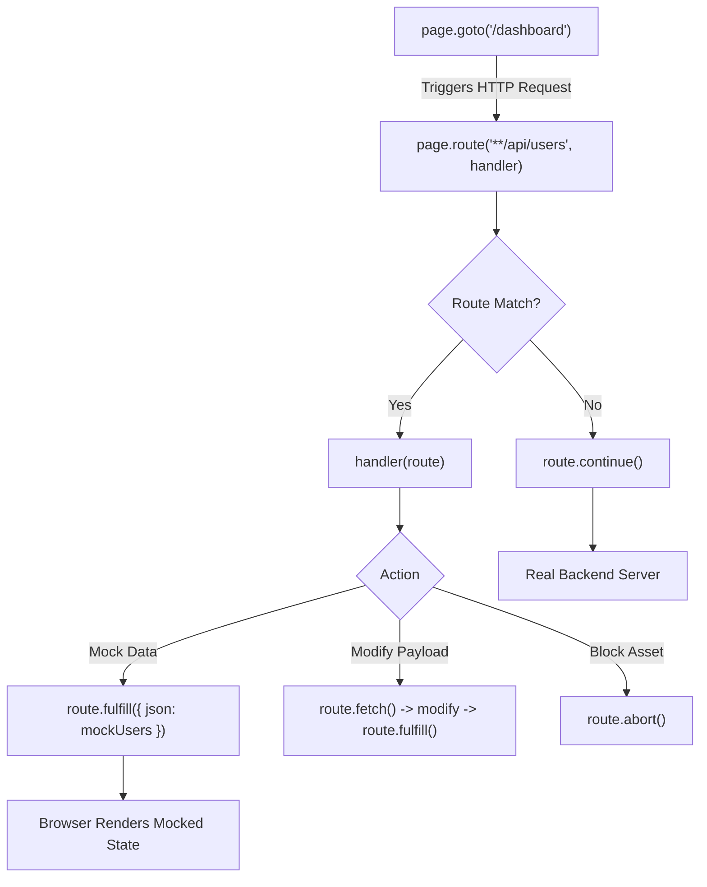

<!-- source: DeepWiki mcp.deepwiki.com · repo testdino-hq/playwright-skill · page 3.1 API Testing and Network Mocking · fetched 2026-10-27 -->

# API Testing and Network Mocking

<details>
<summary>Relevant source files</summary>

The following files were used as context for generating this wiki page:

- [core/api-testing.md](core/api-testing.md)
- [core/network-mocking.md](core/network-mocking.md)
- [core/third-party-integrations.md](core/third-party-integrations.md)
- [core/when-to-mock.md](core/when-to-mock.md)

</details>


This page covers standalone API testing via Playwright's `request` fixture (`APIRequestContext`), typed requests and resource timing features, fine-grained network interception and mocking (`page.route`), HAR-based replay, and the architectural boundary governing when to mock services versus executing real integration calls.

Sources: `core/api-testing.md:1-191`, `core/network-mocking.md:1-207`, `core/when-to-mock.md:1-155`, `core/third-party-integrations.md:1-109`

---

## Standalone API Testing and the `request` Fixture

Playwright provides the `request` fixture to execute REST or GraphQL operations without instantiating a browser context, reducing overhead when seeding test data or verifying backend contracts directly [core/api-testing.md:1-19]. The underlying class is `APIRequestContext`, which inherits configuration settings such as `baseURL` from `playwright.config.ts` [core/api-testing.md:24-29].

```typescript
import { test, expect } from '@playwright/test';

test('CRUD operations via API', async ({ request }) => {
  const listResponse = await request.get('/api/users', {
    params: { page: 1, limit: 10, role: 'admin' },
  });
  expect(listResponse.ok()).toBeTruthy();

  const createResponse = await request.post('/api/users', {
    data: { name: 'Jane Doe', email: 'jane@example.com', role: 'editor' },
  });
  expect(createResponse.status()).toBe(201);
  const created = await createResponse.json();

  const deleteResponse = await request.delete(`/api/users/${created.id}`);
  expect(deleteResponse.status()).toBe(204);
});
```

### Data Flow: Standalone API Request Execution

```mermaid
graph TD
    Test["test('CRUD operations', async ({ request }) => {} )"] -->|Calls method| Req["APIRequestContext (request fixture)"]
    Req -->|HTTP GET/POST/PUT/DELETE| API["Backend Server (baseURL)"]
    API -->|APIResponse| Req
    Req -->|Parses body via .json()| Test
    Test -->|Asserts status and schema| Assert["expect(response.status()).toBe(200)"]
```
Sources: `core/api-testing.md:24-89`

---

## Typed Requests and Resource Timing (Playwright 1.62–1.63)

Playwright supports compile-time generic typing for response payloads and native performance metrics collection per request [core/api-testing.md:157-176].

### Typed Responses (1.63+)
By passing a generic type argument to request methods like `request.get<T>()`, the parsed response body is typed at the call site [core/api-testing.md:157-164]:

```javascript
const response = await request.get<User>('/api/users/42');
const user = await response.json(); // typed as User
```
*Note*: This is purely a compile-time convenience and does not perform runtime schema validation [core/api-testing.md:165-167].

### Resource Timing (1.62+)
`apiResponse.timing()` exposes network performance data for individual backend calls [core/api-testing.md:168-176]:

```javascript
const response = await request.get('/api/orders');
const timing = response.timing();
```

Sources: `core/api-testing.md:157-176`

---

## Route Interception and Network Mocking

When frontend applications interact with APIs, `page.route()` and `context.route()` intercept matching HTTP requests to fulfill mock data, modify transit payloads, or abort unwanted assets [core/network-mocking.md:36-73].

Each route handler must call exactly one resolution function: `route.fulfill()`, `route.continue()`, or `route.abort()` [core/network-mocking.md:41].

```typescript
import { test, expect } from '@playwright/test';

test('route interception basics', async ({ page }) => {
  await page.route('**/api/users', (route) => {
    route.fulfill({
      status: 200,
      contentType: 'application/json',
      body: JSON.stringify([{ id: 1, name: 'Alice' }]),
    });
  });

  await page.goto('/dashboard');
  await expect(page.getByText('Alice')).toBeVisible();
  await page.unroute('**/api/users');
});
```

### Request/Response Interception Pipeline


Sources: `core/network-mocking.md:36-103`, `core/third-party-integrations.md:9-25`

---

## HAR Replay

For complex multi-step interactions or third-party flows, Playwright can record and replay network states using HTTP Archive (HAR) files [core/network-mocking.md:30-32].

```typescript
// Serve recorded responses from HAR archive
await page.routeFromHAR('tests/data/api.har', {
  url: '**/api/**',
  update: false,
});
```
This isolates tests from external network fluctuations and guarantees deterministic data sets.

Sources: `core/network-mocking.md:30-32`

---

## The When-to-Mock Boundary

Establishing clear rules on what to mock prevents tests from drifting away from production realities [core/when-to-mock.md:1-9]. The core architectural principle is: **Mock at the boundary, test your stack end-to-end [core/when-to-mock.md:8].**

### Decision Matrix

| Scenario | Mock Strategy | Rationale | Source Reference |
|---|---|---|---|
| Your own REST/GraphQL API | Never mock | This is the exact integration contract under test | `core/when-to-mock.md:34` |
| Your database via API | Never mock | Round-trips and state persistence validate business logic | `core/when-to-mock.md:35` |
| Stripe / Payment Gateways | Always mock | Prevents real financial charges, rate limits, and network flakiness | `core/when-to-mock.md:37` |
| OAuth Providers (Google, GitHub) | Always mock | Avoids redirect-heavy flows, CAPTCHAs, and external downtime | `core/when-to-mock.md:39` |
| Analytics (Segment, Mixpanel) | Always mock / abort | Fire-and-forget third-party scripts that slow test execution | `core/when-to-mock.md:40` |

Sources: `core/when-to-mock.md:30-46`, `core/third-party-integrations.md:31-109`

---

