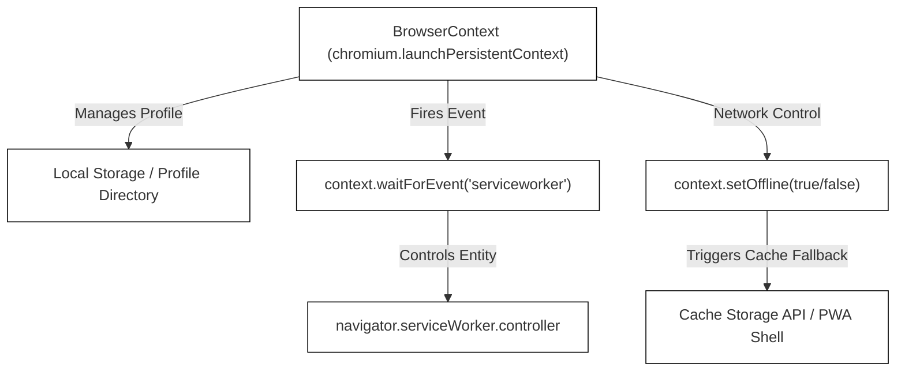
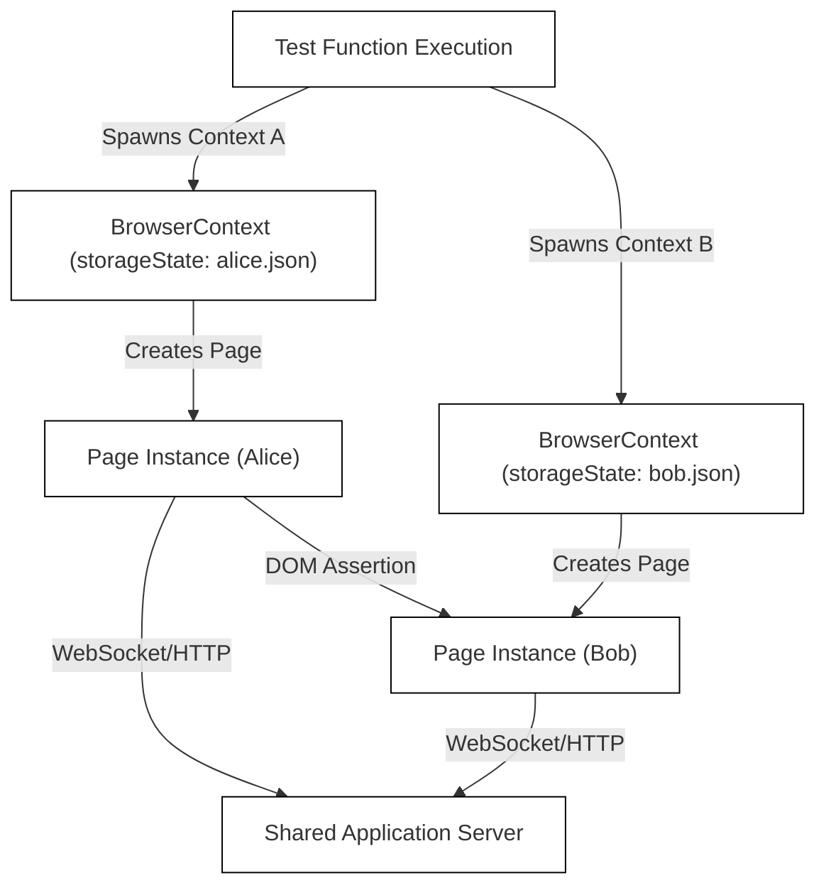

<!-- source: DeepWiki mcp.deepwiki.com · repo testdino-hq/playwright-skill · page 3.3 Browser APIs, Real-time and Advanced Contexts · fetched 2026-10-27 -->

# Browser APIs, Real-time and Advanced Contexts

<details>
<summary>Relevant source files</summary>

The following files were used as context for generating this wiki page:

- [core/angular.md](core/angular.md)
- [core/browser-apis.md](core/browser-apis.md)
- [core/browser-extensions.md](core/browser-extensions.md)
- [core/canvas-and-webgl.md](core/canvas-and-webgl.md)
- [core/clock-and-time-mocking.md](core/clock-and-time-mocking.md)
- [core/common-pitfalls.md](core/common-pitfalls.md)
- [core/iframes-and-shadow-dom.md](core/iframes-and-shadow-dom.md)
- [core/multi-context-and-popups.md](core/multi-context-and-popups.md)
- [core/multi-user-and-collaboration.md](core/multi-user-and-collaboration.md)
- [core/service-workers-and-pwa.md](core/service-workers-and-pwa.md)
- [core/websockets-and-realtime.md](core/websockets-and-realtime.md)

</details>


This page covers testing patterns and implementation details for browser-native APIs, real-time communication channels, embedded frames, visual canvases, progressive web applications, multi-context/multi-user scenarios, and temporal control. These topics correspond to advanced capabilities provided by Playwright agent skills.

Sources: `core/browser-apis.md:1-26`, `core/websockets-and-realtime.md:1-24`, `core/iframes-and-shadow-dom.md:1-20`, `core/canvas-and-webgl.md:1-22`, `core/service-workers-and-pwa.md:1-22`, `core/multi-context-and-popups.md:1-19`, `core/multi-user-and-collaboration.md:1-18`, `core/clock-and-time-mocking.md:1-21`

---

## 1. Permissions, Geolocation, and Storage APIs

Playwright abstracts browser-native permission dialogs and location engines by pre-granting or mocking states at the `BrowserContext` level rather than handling native OS dialogs `[core/browser-apis.md:128-132]`. 

### Key Functions and Configuration
* `browser.newContext({ geolocation, permissions })`: Initializes context with predefined spatial coordinates and granted security permissions `[core/browser-apis.md:10-18]`.
* `context.setGeolocation(geolocation)`: Updates geographic coordinates dynamically mid-test `[core/browser-apis.md:35-36]`.
* `context.grantPermissions(permissions, { origin })`: Grants permissions dynamically during test execution `[core/browser-apis.md:173-174]`.
* `page.evaluate()`: Used for accessing and modifying `localStorage`, `sessionStorage`, or `navigator.clipboard` directly within the page's execution context `[core/browser-apis.md:20-25]`.

```typescript
const context = await browser.newContext({
  geolocation: { latitude: 40.7128, longitude: -74.0060 },
  permissions: ['geolocation', 'clipboard-read', 'notifications'],
});
const page = await context.newPage();
await context.setGeolocation({ latitude: 34.0522, longitude: -118.2437 });
```

Sources: `core/browser-apis.md:9-19`, `core/browser-apis.md:35-36`, `core/browser-apis.md:173-174`

---

## 2. WebSockets, SSE, and Real-Time Testing

Real-time architectures require inspecting or intercepting full-duplex communication streams. Playwright provides native event emitters on `Page` and protocol interception via routing APIs.

### Architecture: WebSocket Observation vs Interception
```mermaid
graph TD
    Test["Test Execution Context"] -->|Listens via page.on| Page["Playwright Page Entity"]
    Page -->|"websocket" event| WsListener["WebSocket Inspector"]
    WsListener -->|Framesent / Framereceived| FrameLog["Message Log Array"]
    Test -->|Interception via| RouteWs["page.routeWebSocket()"]
    RouteWs -->|Mock Server Logic| MockServer["WebSocket Mock Handler"]
    MockServer -->|ws.send()| ClientApp["Target Web Application"]

    classDef default fill:#fff,stroke:#000,stroke-width:1px;
```
Sources: `core/websockets-and-realtime.md:9-24`, `core/websockets-and-realtime.md:42-49`, `core/websockets-and-realtime.md:164-182`

### Key Functions
* `page.on('websocket', callback)`: Intercepts WebSocket creation to attach frame-level listeners (`framesent`, `framereceived`, `close`) `[core/websockets-and-realtime.md:10-16]`.
* `page.routeWebSocket(url, handler)`: Intercepts WebSocket handshakes, allowing custom mocking of incoming messages and server handshakes `[core/websockets-and-realtime.md:18-23]`.

Sources: `core/websockets-and-realtime.md:9-24`, `core/websockets-and-realtime.md:42-49`

---

## 3. Iframes and Shadow DOM

Encapsulated DOM boundaries—such as cross-origin iframes and Web Component Shadow Roots—are handled through specialized locator scopes and automatic traversal mechanisms.

* **Iframes**: Accessed via `page.frameLocator(selector)`, which returns a scoped locator wrapper supporting chaining for deeply nested frames (`outerFrame.frameLocator(innerSelector)`) `[core/iframes-and-shadow-dom.md:9-15]`.
* **Shadow DOM**: Playwright automatically pierces open shadow roots without requiring explicit syntax or XPath extensions during standard locator queries (`page.getByRole(...)` or `page.locator(...)`) `[core/iframes-and-shadow-dom.md:17-19]`.

```typescript
const paymentFrame = page.frameLocator('iframe[title="Secure payment"]');
await paymentFrame.getByLabel('Card number').fill('4242424242424242');
```

Sources: `core/iframes-and-shadow-dom.md:9-20`, `core/iframes-and-shadow-dom.md:39-42`

---

## 4. Canvas and WebGL Testing

Canvas elements do not expose individual nodes to the DOM tree, requiring visual regression techniques or coordinate-based interactions.

### Strategies
1. **Screenshot Baselines**: Comparing rendered canvas outputs using visual assertions (`toHaveScreenshot()`) with pixel-ratio tolerances `[core/canvas-and-webgl.md:9-10]`.
2. **Coordinate Interaction**: Targeting specific locations via mouse events (`canvas.click({ position: { x, y } })`) `[core/canvas-and-webgl.md:12-13]`.
3. **Low-level Inspection**: Querying pixel matrices via `page.evaluate()` and `canvas.getContext('2d').getImageData()` `[core/canvas-and-webgl.md:15-21]`.

Sources: `core/canvas-and-webgl.md:8-22`, `core/canvas-and-webgl.md:45-47`

---

## 5. Service Workers and PWA Testing

Progressive Web Applications (PWAs) and service workers require persistent browser profiles to maintain registration states across page reloads and simulated offline transitions.

### System-to-Code Entity Mapping

Sources: `core/service-workers-and-pwa.md:9-20`, `core/service-workers-and-pwa.md:41-48`, `core/service-workers-and-pwa.md:128-138`

### Implementation Detail
Service workers cannot be tested reliably using temporary default contexts because service worker registrations are tied to worker profile storage. Use `chromium.launchPersistentContext()` combined with `context.setOffline(true)` to simulate offline caching flows `[core/service-workers-and-pwa.md:9-16]`, `[core/service-workers-and-pwa.md:30-31]`.

Sources: `core/service-workers-and-pwa.md:9-21`, `core/service-workers-and-pwa.md:41-48`, `core/service-workers-and-pwa.md:128-138`

---

## 6. Multi-Contexts, Popups, and Multi-User Collaboration

Advanced testing scenarios often require managing multiple pages, isolated browser tabs, third-party authentication popups, or concurrent user sessions within a single test runtime.

### Multi-User Context Architecture

Sources: `core/multi-context-and-popups.md:16-18`, `core/multi-user-and-collaboration.md:10-17`, `core/multi-user-and-collaboration.md:33-40`

### Key Functions
* `page.waitForEvent('popup')`: Intercepts popup windows or new tabs spawned by `window.open()` or `target="_blank"` links `[core/multi-context-and-popups.md:10-12]`, `[core/multi-context-and-popups.md:21-22]`.
* `browser.newContext({ storageState })`: Instantiates isolated browser contexts loaded with specific user authentication state files `[core/multi-user-and-collaboration.md:10-11]`, `[core/multi-user-and-collaboration.md:26-28]`.

Sources: `core/multi-context-and-popups.md:9-18`, `core/multi-user-and-collaboration.md:10-18`, `core/multi-user-and-collaboration.md:26-28`

---

## 7. Clock and Time Mocking

Temporal dependencies such as session timeouts, countdowns, and scheduled cron operations can be controlled programmatically using Playwright's virtual clock API.

### Key Methods
* `page.clock.install({ time })`: Replaces native `Date`, `setTimeout`, `setInterval`, and `requestAnimationFrame` inside the page environment. Must be called prior to `page.goto()` `[core/clock-and-time-mocking.md:10-11]`, `[core/clock-and-time-mocking.md:23-24]`.
* `page.clock.fastForward(duration)`: Advances internal virtual time by a specified duration, firing all pending timers instantly `[core/clock-and-time-mocking.md:14-14]`, `[core/clock-and-time-mocking.md:101-102]`.
* `page.clock.setFixedTime(time)`: Sets the virtual clock to a static point without ticking `[core/clock-and-time-mocking.md:16-17]`, `[core/clock-and-time-mocking.md:30-31]`.

Sources: `core/clock-and-time-mocking.md:9-24`, `core/clock-and-time-mocking.md:38-43`, `core/clock-and-time-mocking.md:101-103`

---

