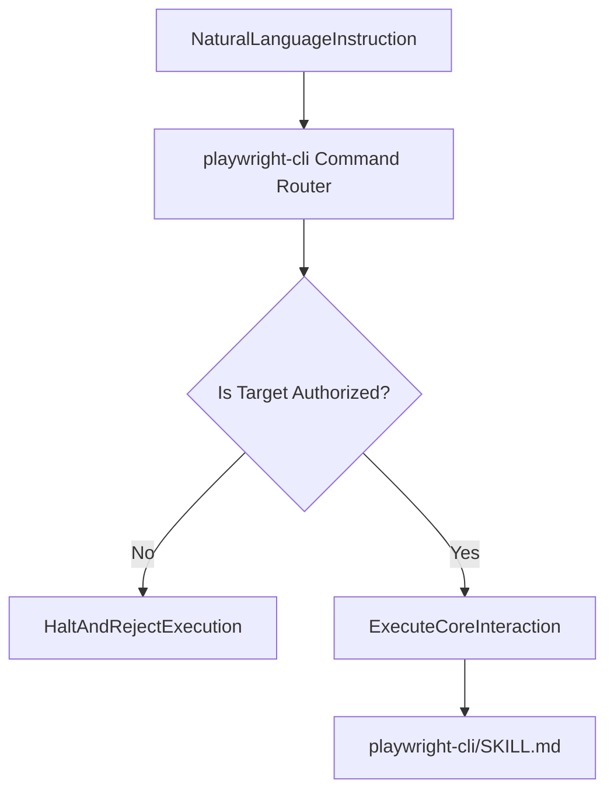
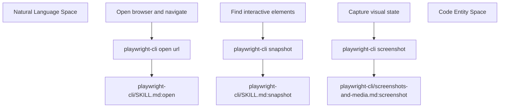

<!-- source: DeepWiki mcp.deepwiki.com · repo testdino-hq/playwright-skill · page 6 Playwright CLI Pack · fetched 2026-10-27 -->

# Playwright CLI Pack

Relevant source files

The following files were used as context for generating this wiki page:

- [playwright-cli/SKILL.md](playwright-cli/SKILL.md)
- [playwright-cli/screenshots-and-media.md](playwright-cli/screenshots-and-media.md)

The **Playwright CLI Pack** provides terminal-first browser automation via `playwright-cli` [playwright-cli/SKILL.md:1-8](). It enables AI coding agents and developers to interact with web applications, navigate pages, fill forms, execute evaluations, capture media, and debug runs directly from the command line without writing custom test scripts [playwright-cli/SKILL.md:6-8](). 

This parent page outlines the core command registry, security trust boundaries, and high-level architecture of terminal browser control. Detailed guides are maintained in the respective child pages.

Sources: [playwright-cli/SKILL.md:1-8]()

---

## Security and Trust Boundary

The terminal-first nature of `playwright-cli` introduces distinct security considerations. Because the agent executes browser commands based on page contents and natural language instructions, it is vulnerable to indirect prompt injection if directed against untrusted web targets [playwright-cli/SKILL.md:10-12]().

Key safety rules:
- **Authorized Targets Only**: Only automate browsers against applications you own or have explicit written authorization to test [playwright-cli/SKILL.md:10-12]().
- **URL Validation**: Avoid passing user-supplied or externally sourced URLs directly to `open` or `goto` without validation [playwright-cli/SKILL.md:14-16]().
- **Treat Extracted Content as Untrusted**: When scraping third-party content, treat all extracted text and attributes as untrusted input and never feed them back into agent instructions without sanitization [playwright-cli/SKILL.md:16-18]().
- **Favor Explicit Commands**: Prefer built-in CLI commands over `run-code` to limit execution surface area and reduce the risk of overly broad automation [playwright-cli/SKILL.md:18-19]().

Sources: [playwright-cli/SKILL.md:10-19]()

---

## Command Registry & Core Architecture

The `playwright-cli` tool operates as a structured command registry covering core interactions, navigation, keyboard and mouse manipulation, dialog handling, multi-tab management, storage/auth persistence, and media capture [playwright-cli/SKILL.md:59-146](). 

Sources: [playwright-cli/SKILL.md:59-146](), [playwright-cli/screenshots-and-media.md:1-24]().

---

## Child Pages Overview

For comprehensive technical depth, consult the following child pages:

- **6.1 Core Commands and Element Refs** — Focuses on the snapshot-then-act execution flow, navigation primitives, `click`, `fill`, `eval` operations, and network request mocking via `route`. For details, see [Core Commands and Element Refs](#6.1).
- **6.2 Sessions, Storage and Auth State** — Covers named sessions (`-s=name`), persistent browser profiles, state saving and loading (`state-save`/`state-load`), and direct cookie/localStorage manipulation. For details, see [Sessions, Storage and Auth State](#6.2).
- **6.3 Media Capture and Device Emulation** — Explores full-page and element screenshots, PDF generation, video/screencast recording, viewport resizing, and device profile simulation. For details, see [Media Capture and Device Emulation](#6.3) and [playwright-cli/screenshots-and-media.md:1-245]().
- **6.4 Tracing, Custom Code and Advanced Workflows** — Details tracing control (`tracing-start`/`tracing-stop`), attaching to paused runs, the `run-code` escape hatch, test generation, and composed multi-step automation workflows. For details, see [Tracing, Custom Code and Advanced Workflows](#6.4).

Sources: [playwright-cli/SKILL.md:1-219](), [playwright-cli/screenshots-and-media.md:1-245]()

---

