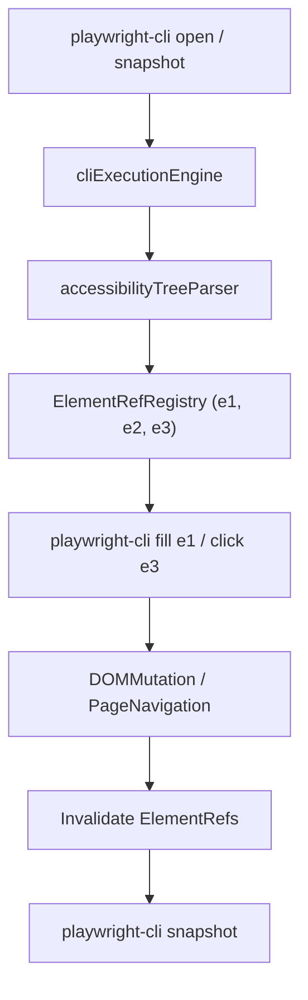
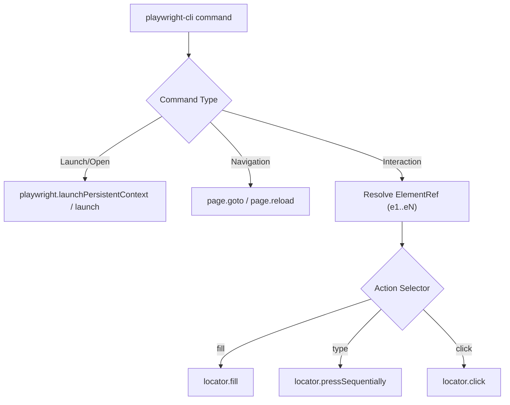

<!-- source: DeepWiki mcp.deepwiki.com · repo testdino-hq/playwright-skill · page 6.1 Core Commands and Element Refs · fetched 2026-10-27 -->

# Core Commands and Element Refs

<details>
<summary>Relevant source files</summary>

The following files were used as context for generating this wiki page:

- [playwright-cli/core-commands.md](playwright-cli/core-commands.md)
- [playwright-cli/request-mocking.md](playwright-cli/request-mocking.md)

</details>


The purpose of this page is to detail the core command-line interface capabilities of `playwright-cli`, focusing on the snapshot-then-act flow, browser navigation and element interactions (such as click, fill, and evaluation escapes), and advanced request mocking via `route`.

---

## 1. The Snapshot-Then-Act Flow & Element Refs

Every browser automation interaction in the CLI relies on the snapshot workflow. The `snapshot` command inspects the accessibility tree of the current page state and assigns short, alphanumeric element references (`e1`, `e2`, `e3`, etc.) to interactive elements. 

```bash
playwright-cli open https://example.com/login
playwright-cli snapshot
# Output:
# e1 [textbox "Email"]
# e2 [textbox "Password"]
# e3 [button "Sign In"]
```

Because these refs map directly to the accessibility node snapshot, any DOM mutation, navigation, or form submission invalidates existing refs. Agents must re-snapshot after state changes.


*Figure 1: Snapshot-then-act control flow from CLI invocation to element ref binding.*

**Sources:** `[playwright-cli/core-commands.md:17-46]()`

---

## 2. Browser Launch, Navigation, and Element Interactions

The CLI provides commands for launching different browser engines, managing persistent profiles, navigating URLs, and interacting with elements via precise refs or escape hatches.

### Launch and Persistent Profiles
Browsers can be launched using engines like Chromium, Firefox, WebKit, or Edge. By default, contexts are ephemeral, but persistent profiles or custom profile directories can be maintained using flags.

```bash
playwright-cli open https://example.com --browser=chrome --profile=/tmp/my-profile
playwright-cli resize 1920 1080
playwright-cli close
```
`[playwright-cli/core-commands.md:57-105]`, `[playwright-cli/core-commands.md:178-184]()`

### Navigation and Interaction Primitives
Navigation supports `goto`, `go-back`, `go-forward`, and `reload`. Elements accept actions such as `click`, `dblclick`, `hover`, `select`, `check`, `uncheck`, `upload`, and `drag`.

For text entry, a critical distinction exists between `fill` and `type`:
- `fill`: Clears the field and sets the value immediately (standard form inputs).
- `type`: Sends individual character keystrokes, triggering `keydown`/`keypress`/`keyup` events per character (search-as-you-type, custom autocompletes).


*Figure 2: Architecture mapping of CLI commands to underlying Playwright execution methods.*

**Sources:** `[playwright-cli/core-commands.md:107-184]()`

---

## 3. Request Mocking via Route

Network interception is managed via the `route` command suite, allowing agents to stub responses, alter headers, strip authorization tokens, or simulate network failures using glob patterns.

### CLI Route Commands
Basic mocking operates directly via command-line arguments to specify status codes, response bodies, content types, and custom headers:

```bash
# Block images
playwright-cli route "**/*.jpg" --status=404

# Mock API JSON response
playwright-cli route "**/api/users" --body='[{"id":1,"name":"Alice"}]' --content-type=application/json

# Remove authentication headers for negative testing
playwright-cli route "**/*" --remove-header=cookie,authorization

# Inspect and clean routes
playwright-cli route-list
playwright-cli unroute "**/*.jpg"
```
`[playwright-cli/request-mocking.md:6-105]()`

### Advanced Mocking with `run-code`
When complex logic, request body inspection, or response modifications are required, the `run-code` escape hatch exposes the full Playwright `Route` and `Request` APIs.

```bash
playwright-cli run-code "async page => {
  await page.route('**/api/user/profile', async route => {
    const response = await route.fetch();
    const json = await response.json();
    json.isPremium = true;
    await route.fulfill({ response, json });
  });
}"
```
`[playwright-cli/request-mocking.md:107-181]()`

Network abort reasons (such as `connectionrefused`, `timedout`, `internetdisconnected`, etc.) can also be injected via `route.abort()` inside custom code blocks.

```bash
playwright-cli run-code "async page => {
  await page.route('**/api/slow', route => route.abort('timedout'));
}"
```
`[playwright-cli/request-mocking.md:195-219]()`

**Sources:** `[playwright-cli/request-mocking.md:1-221]()`

---

