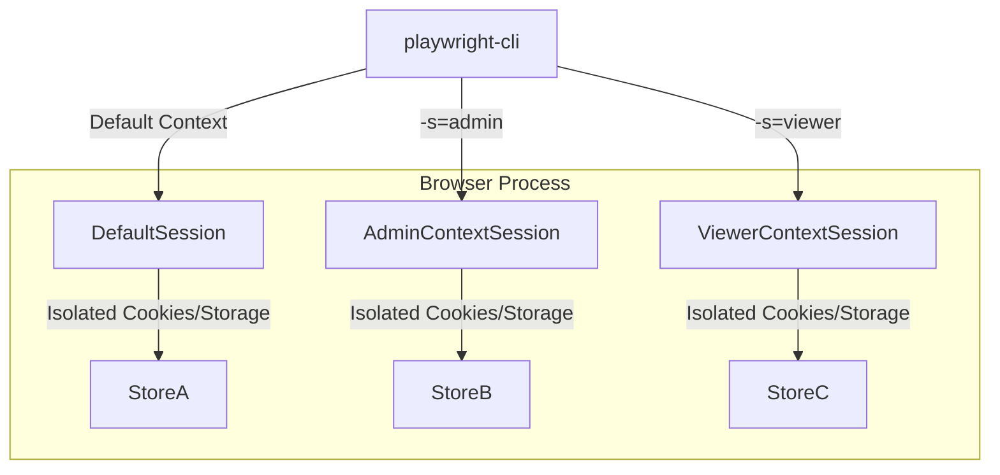
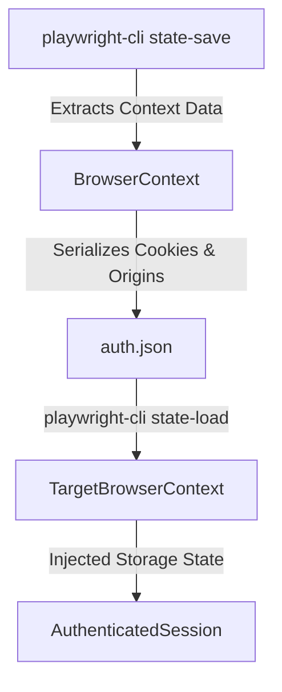

<!-- source: DeepWiki mcp.deepwiki.com · repo testdino-hq/playwright-skill · page 6.2 Sessions, Storage and Auth State · fetched 2026-10-27 -->

# Sessions, Storage and Auth State

<details>
<summary>Relevant source files</summary>

The following files were used as context for generating this wiki page:

- [playwright-cli/session-management.md](playwright-cli/session-management.md)
- [playwright-cli/storage-and-auth.md](playwright-cli/storage-and-auth.md)

</details>


## Purpose and Scope
This page details the technical implementation, commands, and architecture for managing named browser sessions, persistent profiles, state saving/loading, and granular storage operations (cookies, `localStorage`, `sessionStorage`) using `playwright-cli`. These capabilities allow AI agents and developers to isolate concurrent browser environments, persist authentication states across commands, and interact directly with browser storage subsystems.

---

## 1. Named Sessions and Isolation

`playwright-cli` supports running multiple isolated browser instances concurrently via the `-s=<name>` flag [playwright-cli/session-management.md:35-43](). Each named session maintains complete isolation regarding cookies, `localStorage`, `sessionStorage`, IndexedDB, cache, browsing history, and open tabs [playwright-cli/session-management.md:35-43](). When `-s` is omitted, all operations target a shared default session [playwright-cli/session-management.md:63-65]().

### Session Commands and Lifecycle
- `playwright-cli list`: Lists all active sessions and their status [playwright-cli/session-management.md:98-99]().
- `playwright-cli -s=<name> close`: Closes a specific session [playwright-cli/session-management.md:101-102]().
- `playwright-cli close-all`: Terminates all active sessions [playwright-cli/session-management.md:107-108]().
- `playwright-cli kill-all`: Force kills zombie browser daemon processes [playwright-cli/session-management.md:110-111]().
- `playwright-cli -s=<name> delete-data`: Cleans up persistent profile data stored on disk [playwright-cli/session-management.md:113-114]().

Advanced integrations leverage Playwright 1.59+ `browser.bind()` to share browsers launched from programmatic code with external clients, and Playwright 1.60+ `connectOverCDP({ noDefaults })` to attach to active user browsers without overriding download or media behavior [playwright-cli/session-management.md:120-185]().

### Diagram: Session Isolation Architecture

*Sources: [playwright-cli/session-management.md:1-118]()*, *[playwright-cli/session-management.md:120-185]()*

---

## 2. Persistent Profiles and State Management

By default, sessions run entirely in-memory, discarding all state upon termination [playwright-cli/session-management.md:186-188](). Persistent profiles allow state to be preserved across command executions and process restarts [playwright-cli/session-management.md:186-210]().

- **Auto-Generated Profiles**: Utilizing `--persistent` with `open` instructs `playwright-cli` to automatically provision and manage an isolated profile directory on disk [playwright-cli/session-management.md:192-200]().
- **Custom Profiles**: The `--profile=<path>` flag specifies an explicit directory path for browser profile data, enabling multiple sessions to share the same persistent profile state [playwright-cli/session-management.md:202-210]().

Sources: [playwright-cli/session-management.md:186-210]()

---

## 3. State-Save and State-Load Mechanics

The state serialization engine captures the entire browser state—including cookies and `localStorage` across all origins—and writes it to a JSON file [playwright-cli/storage-and-auth.md:32-35](). This mechanism bypasses repeated authentication steps by reloading pre-authenticated contexts [playwright-cli/storage-and-auth.md:32-56]().

### State File Schema
The saved JSON structure encapsulates cookie attributes and origin-scoped storage pairs [playwright-cli/storage-and-auth.md:58-87]()`:

```json
{
  "cookies": [
    {
      "name": "session_id",
      "value": "abc123",
      "domain": "example.com",
      "path": "/",
      "expires": 1735689600,
      "httpOnly": true,
      "secure": true,
      "sameSite": "Lax"
    }
  ],
  "origins": [
    {
      "origin": "https://example.com",
      "localStorage": [
        { "name": "theme", "value": "dark" },
        { "name": "user_id", "value": "12345" }
      ]
    }
  ]
}
```

### Diagram: Storage State Serialization Data Flow

*Sources: [playwright-cli/storage-and-auth.md:32-87]()*, *[playwright-cli/storage-and-auth.md:89-124]()*

---

## 4. Granular Storage Commands

`playwright-cli` exposes direct command-line primitives for inspecting and modifying storage keys without writing bespoke automation scripts [playwright-cli/storage-and-auth.md:6-30]().

### Cookie Operations
- `playwright-cli cookie-list [--domain=<domain>] [--path=<path>]`: Enumerates active cookies with optional domain/path filtering [playwright-cli/storage-and-auth.md:188-202]().
- `playwright-cli cookie-get <name>`: Retrieves a specific cookie value [playwright-cli/storage-and-auth.md:204-209]().
- `playwright-cli cookie-set <name> <value> [options]`: Sets a cookie with flags like `--domain`, `--path`, `--httpOnly`, `--secure`, `--sameSite`, and `--expires` [playwright-cli/storage-and-auth.md:211-227]().
- `playwright-cli cookie-delete <name>`: Deletes a specific cookie [playwright-cli/storage-and-auth.md:229-234]().
- `playwright-cli cookie-clear`: Clears all cookies from the context [playwright-cli/storage-and-auth.md:236-240]().

### Local and Session Storage Operations
- `playwright-cli localstorage-set <key> <value>` / `localstorage-get <key>` / `localstorage-clear` [playwright-cli/storage-and-auth.md:21-24]()
- `playwright-cli sessionstorage-set <key> <value>` / `sessionstorage-get <key>` / `sessionstorage-clear` [playwright-cli/storage-and-auth.md:26-29]()

Sources: [playwright-cli/storage-and-auth.md:6-30]()*, *[playwright-cli/storage-and-auth.md:184-263]()*

---

## 5. Authentication Patterns and OAuth/SSO Handling

Common workflows involve a one-time authentication sequence followed by state capture for reuse across test suites or agent tasks [playwright-cli/storage-and-auth.md:89-112](). 

For complex Single Sign-On (SSO) or OAuth flows involving popup windows and redirects, `run-code` executes custom asynchronous handler functions [playwright-cli/storage-and-auth.md:154-182]() that await popup events, complete identity provider forms, and dump the resultant context storage state via `page.context().storageState({ path: 'oauth-auth.json' })` [playwright-cli/storage-and-auth.md:159-182]().

Sources: [playwright-cli/storage-and-auth.md:89-182]()

---

