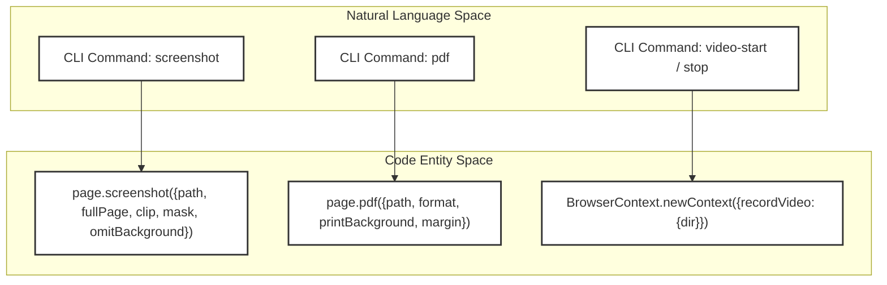
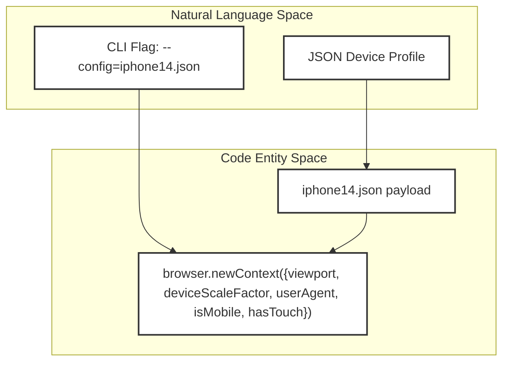

<!-- source: DeepWiki mcp.deepwiki.com · repo testdino-hq/playwright-skill · page 6.3 Media Capture and Device Emulation · fetched 2026-10-27 -->

# Media Capture and Device Emulation

<details>
<summary>Relevant source files</summary>

The following files were used as context for generating this wiki page:

- [playwright-cli/SKILL.md](playwright-cli/SKILL.md)
- [playwright-cli/device-emulation.md](playwright-cli/device-emulation.md)
- [playwright-cli/screenshots-and-media.md](playwright-cli/screenshots-and-media.md)

</details>


## Purpose and Scope
This section covers the technical architecture and command-line execution patterns for capturing visual artifacts (screenshots, PDF documents, video recordings) and emulating target hardware environments (viewport sizes, device profiles, geolocation, and media features) via `playwright-cli`. These capabilities enable agents to perform responsive testing, visual inspection, automated documentation generation, and location-dependent checks without requiring physical devices.

Sources: `playwright-cli/SKILL.md:121-131` [], `playwright-cli/screenshots-and-media.md:1-5` [], `playwright-cli/device-emulation.md:1-5` []

---

## 1. Media Capture Architecture and Commands

The media subsystem integrates directly with Playwright's underlying page and context-level APIs. When invoking CLI commands like `screenshot`, `pdf`, or video recording routines, `playwright-cli` translates terminal arguments into asynchronous operations against the browser engine.

### Core Media Commands
- **Screenshots**: Captures viewport, element, or full-page bitmap data. Supports custom filenames, format options (`jpeg`/`png`), quality parameters, clipping rectangles, background omission (`omitBackground`), and dynamic element masking (`mask`).
- **PDF Export**: Generates document layouts from Chromium-based pages. Supports page formats (A4, Letter), margins, header/footer HTML templates, page ranges, and background printing (`printBackground`). Note that PDF generation is strictly restricted to Chromium instances.
- **Video Recording**: Manages screencast sessions via `video-start` and `video-stop <filename>`, capturing interaction flows into WebM files.


Sources: `playwright-cli/SKILL.md:121-131` [], `playwright-cli/screenshots-and-media.md:6-140` []

### Advanced Screenshot and PDF Customization
Through `run-code` escape hatches, agents can orchestrate complex capture workflows:
- **Masking Dynamic Regions**: Suppressing fluctuating elements (such as timestamps or avatars) by passing an array of locators to the `mask` option.
- **Animation Disabling**: Injecting style overrides via `page.evaluate()` to strip CSS animations and transitions before capturing baseline images.

Sources: `playwright-cli/screenshots-and-media.md:65-130` [], `playwright-cli/screenshots-and-media.md:192-237` []

---

## 2. Viewport Resizing and Responsive Breakpoints

Responsive testing requires altering the visible browser frame dimension. `playwright-cli` exposes the `resize <width> <height>` command alongside programmatic `page.setViewportSize()` bindings to switch layouts dynamically.

### Standard Breakpoints & Viewport Dimensions
Agents test applications across standard device geometries:
- **Desktop**: `1920x1080`, `1440x900`, `1366x768`
- **Tablet**: `1024x768` (iPad landscape), `768x1024` (iPad portrait)
- **Mobile**: `390x844` (iPhone 14), `375x812` (iPhone X), `360x800` (Galaxy S21)

Automated multi-viewport loops iterate through arrays of resolution targets, applying a settling timeout (`page.waitForTimeout()`) before capturing layouts.

Sources: `playwright-cli/screenshots-and-media.md:132-181` [], `playwright-cli/device-emulation.md:28-80` []

---

## 3. Full Device Emulation

Beyond changing pixel dimensions, accurate mobile and tablet emulation requires modifying runtime attributes like the `deviceScaleFactor`, `userAgent`, `isMobile` flag, and touch event support (`hasTouch`).

### Device Configuration Files
`playwright-cli` ingests configuration payloads via `--config=<file.json>` when launching instances (`playwright-cli open <url> --config=<file.json>`).


Sources: `playwright-cli/device-emulation.md:81-125` []

#### Example Profile Structure (`iphone14.json`)
```json
{
  "viewport": { "width": 390, "height": 844 },
  "deviceScaleFactor": 3,
  "userAgent": "Mozilla/5.0 (iPhone; CPU iPhone OS 16_0 like Mac OS X) AppleWebKit/605.1.15...",
  "isMobile": true,
  "hasTouch": true
}
```
Sources: `playwright-cli/device-emulation.md:89-98` []

---

## 4. Environmental Emulation (Geolocation, Timezone, Media)

Environmental properties are controlled via `BrowserContext` methods executed through `run-code` or configuration files.

### Geolocation & Permissions
To test store locators, regional delivery constraints, or maps:
1. Grant permission explicitly via `page.context().grantPermissions(['geolocation'])`.
2. Set GPS coordinates using `page.context().setGeolocation({ latitude, longitude })`.
3. Clear permission state using `page.context().clearPermissions()`.

### Media Emulation
Media queries respecting color schemes (such as `prefers-color-scheme: dark`) are forced via `page.emulateMedia({ colorScheme: 'dark' })`.

Sources: `playwright-cli/device-emulation.md:143-210` []

---

