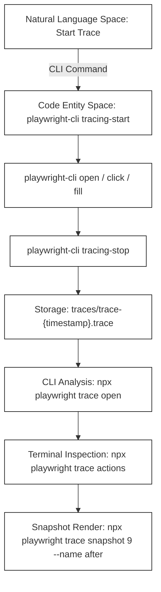
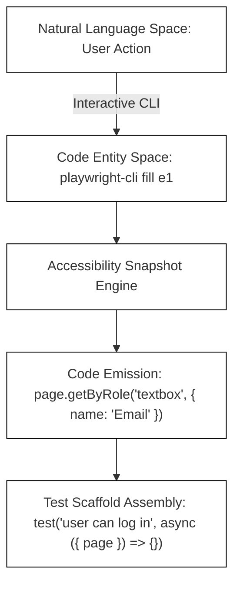

<!-- source: DeepWiki mcp.deepwiki.com · repo testdino-hq/playwright-skill · page 6.4 Tracing, Custom Code and Advanced Workflows · fetched 2026-10-27 -->

# Tracing, Custom Code and Advanced Workflows

<details>
<summary>Relevant source files</summary>

The following files were used as context for generating this wiki page:

- [playwright-cli/advanced-workflows.md](playwright-cli/advanced-workflows.md)
- [playwright-cli/running-custom-code.md](playwright-cli/running-custom-code.md)
- [playwright-cli/test-generation.md](playwright-cli/test-generation.md)
- [playwright-cli/tracing-and-debugging.md](playwright-cli/tracing-and-debugging.md)

</details>


## Purpose and Scope

This page covers the advanced capabilities of the `playwright-cli` pack within the `playwright-skill` repository. It provides technical documentation for recording and analyzing test execution traces, attaching to paused test runs via CLI debugging hooks, escaping to full Playwright API code via the `run-code` command, translating interactive CLI actions into persistent test scripts, and executing complex composed workflows such as OAuth authentication, multi-page scraping, and file operations.

---

## 1. Tracing and Terminal Trace Analysis

Traces capture comprehensive diagnostic information during CLI sessions, including DOM snapshots, action logs, network activity, console messages, and exact timing data `[playwright-cli/tracing-and-debugging.md:37-39]()`. 

When tracing is initiated via `playwright-cli tracing-start`, Playwright initializes a recording context that outputs trace archives, network logs, and resource caches under a local `traces/` directory upon execution of `playwright-cli tracing-stop` `[playwright-cli/tracing-and-debugging.md:9-15](), [playwright-cli/tracing-and-debugging.md:70-89]()`.

In terminal-first or agent-driven environments lacking a graphical interface, the `npx playwright trace` command suite inspects trace archives directly from the command line `[playwright-cli/tracing-and-debugging.md:109-111]()`.

### Diagram: Tracing Execution & Terminal Analysis Architecture



Sources: `[playwright-cli/tracing-and-debugging.md:9-135]()`

---

## 2. Paused Runs and Agent Attachment

Playwright supports an agent-optimized debugging flow via the `--debug=cli` runner flag `[playwright-cli/tracing-and-debugging.md:136-138]()`. When a test run is initiated in debug mode, execution pauses at designated breakpoints or test entry points, emitting a session identifier.

Coding agents or terminal operators can attach directly to this paused instance using `playwright-cli attach`, allowing step-over execution, DOM snapshot inspection, and console error log retrieval without spawning a graphical inspector window `[playwright-cli/tracing-and-debugging.md:136-152]()`.

```bash
# Terminal 1: Launch runner in CLI debug mode
npx playwright test --debug=cli

# Terminal 2: Attach and control execution
playwright-cli attach tw-87b59e
playwright-cli --session=tw-87b59e snapshot
playwright-cli --session=tw-87b59e step-over
```
*(Reference: `[playwright-cli/tracing-and-debugging.md:140-149]()`)*

Sources: `[playwright-cli/tracing-and-debugging.md:136-152]()`

---

## 3. The `run-code` Escape Hatch

When standard command-line flags are insufficient for complex scenarios, the `run-code` command acts as an escape hatch, executing arbitrary asynchronous JavaScript or TypeScript snippets against the active `page` and `page.context()` instances `[playwright-cli/running-custom-code.md:1-16]()`.

This facility grants direct access to the underlying Playwright Node.js API for specialized operations:
- **Geolocation Overrides**: Modifying browser coordinates via `page.context().setGeolocation()` and permissions via `page.context().grantPermissions()` `[playwright-cli/running-custom-code.md:18-56]()`.
- **Media Emulation**: Enforcing dark mode, reduced motion, forced colors, or print layout via `page.emulateMedia()` `[playwright-cli/running-custom-code.md:88-157]()`.
- **Advanced Waiting Strategies**: Polling network states (`networkidle`), DOM readiness (`domcontentloaded`), custom JavaScript predicates (`page.waitForFunction()`), or selector lifecycle states (`detached`, `hidden`, `visible`) `[playwright-cli/running-custom-code.md:175-236]()`.

Sources: `[playwright-cli/running-custom-code.md:1-236]()`

---

## 4. Test Generation Workflows

The `playwright-cli` records user interactions and automatically outputs equivalent Playwright TypeScript or JavaScript statements `[playwright-cli/test-generation.md:1-25]()`.

### Diagram: Test Generation Pipeline



Generated code prioritizes resilient, role-based locator hierarchies over brittle CSS selectors or XPaths, mapping interactions to `getByRole`, `getByLabel`, `getByPlaceholder`, `getByText`, and `getByTestId` `[playwright-cli/test-generation.md:95-107]()`.

Sources: `[playwright-cli/test-generation.md:1-198]()`

---

## 5. Advanced Composed Workflows

Composed workflows coordinate multiple browser automation features into cohesive multi-step automation tasks.

### Popup and New Window Handling
Managing secondary browser contexts or popup windows requires synchronizing event listeners with trigger actions using `Promise.all`:
```javascript
const [popup] = await Promise.all([
  page.waitForEvent('popup'),
  page.click('a[target=_blank]')
]);
await popup.waitForLoadState();
```
*(Reference: `[playwright-cli/advanced-workflows.md:20-54]()`)*

This pattern extends to multi-step OAuth authentication flows operating across popup authentication windows and main page redirects `[playwright-cli/advanced-workflows.md:75-99]()`.

### Data Extraction and Scraping
- **Paginated Extraction**: Iterating through collection views using element evaluation (`evaluateAll`) and conditional pagination button checks `[playwright-cli/advanced-workflows.md:101-133]()`.
- **Infinite Scroll Extraction**: Evaluating scroll heights (`document.body.scrollHeight`) and executing `window.scrollTo` commands until sentinel content exhaustion occurs `[playwright-cli/advanced-workflows.md:135-172]()`.
- **Concurrent Multi-Site Aggregation**: Leveraging named sessions (`playwright-cli -s=site1`) alongside shell job control (`&` and `wait`) to scrape multiple origins in parallel `[playwright-cli/advanced-workflows.md:174-199]()`.

### File Operations
Downloading and uploading files is handled via the `download` event listener interface (`page.waitForEvent('download')`) combined with `download.saveAs()`, as well as standard file input manipulation workflows `[playwright-cli/advanced-workflows.md:201-246]()`.

Sources: `[playwright-cli/advanced-workflows.md:1-246]()`

---

