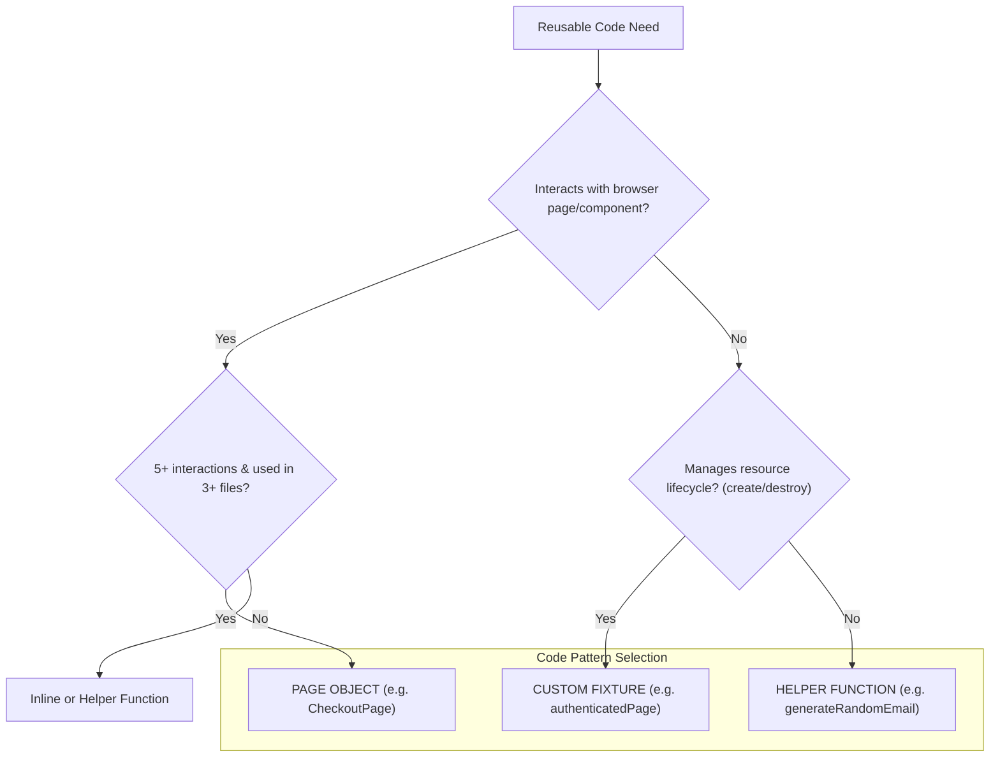

<!-- source: DeepWiki mcp.deepwiki.com · repo testdino-hq/playwright-skill · page 7.1 Page Object Model Patterns · fetched 2026-10-27 -->

# Page Object Model Patterns

<details>
<summary>Relevant source files</summary>

The following files were used as context for generating this wiki page:

- [pom/page-object-model.md](pom/page-object-model.md)
- [pom/pom-vs-fixtures-vs-helpers.md](pom/pom-vs-fixtures-vs-helpers.md)

</details>


## Purpose and Scope
This page covers the structure, implementation patterns, and compositional rules for the Page Object Model (POM) within Playwright test suites. It also details the architectural decision framework for choosing between Page Objects, Custom Fixtures, and Helper Functions.

Sources: `[pom/page-object-model.md:1-6]()`, `[pom/pom-vs-fixtures-vs-helpers.md:1-5]()`

---

## 1. Core Principles of Page Object Model
Page objects encapsulate **actions**, not raw locators. A test should read like a user story (e.g., `await loginPage.login('admin', 'secret')`), never exposing internal element queries directly to the test logic (`await loginPage.usernameInput.fill('admin')`) `[pom/page-object-model.md:5-5]()`.

The key design rules for a robust POM architecture include:
- **Locators**: Defined as `readonly` properties in the constructor or as getters, never exposed raw to tests `[pom/page-object-model.md:11-11]`.
- **Actions**: Public methods performing a user-visible behavior, returning `Promise<void>` or a chained destination page object `[pom/page-object-model.md:12-12]`.
- **Assertions**: **Never** placed inside page objects. Tests own all `expect()` assertions `[pom/page-object-model.md:13-13]`.
- **Navigation**: Methods that trigger navigation return the destination page object rather than `void` `[pom/page-object-model.md:14-14]`.
- **State**: Page objects are stateless. They hold no cached locator text or step-tracking variables `[pom/page-object-model.md:15-15]`.
- **Constructor**: Accepts a Playwright `Page` (or a `Locator` for component objects). It takes nothing else—no URLs or test data `[pom/page-object-model.md:16-16]`.

Sources: `[pom/page-object-model.md:1-18]()`

---

## 2. POM Structure and Component Composition

To map natural language concepts (such as user flows and modular UI regions) to actual codebase entities, page objects and component objects are composed hierarchically. 

### Diagram: Natural Language to Code Entity Mapping (POM Architecture)
```mermaid
graph TD
    UserStory["User Story: Login & Dashboard Search"] --> TestFile["test(\"auth.spec.ts\")"]
    TestFile --> LoginPageCode["LoginPage (login.page.ts)"]
    TestFile --> DashboardPageCode["DashboardPage (dashboard.page.ts)"]
    
    DashboardPageCode --> NavbarComp["NavbarComponent (navbar.component.ts)"]
    DashboardPageCode --> ModalComp["ModalComponent (modal.component.ts)"]

    subgraph "Code Entity Space"
        LoginPageCode
        DashboardPageCode
        NavbarComp
        ModalComp
    end

    subgraph "Natural Language Space"
        UserStory
        TestFile
    end
```
Sources: `[pom/page-object-model.md:21-43]`, `[pom/page-object-model.md:110-189]()`

### Basic POM Implementation
Use a basic POM class when a page has three or more interactions across multiple test files `[pom/page-object-model.md:21-24]`.

```typescript
// tests/pages/login.page.ts
export class LoginPage {
  readonly usernameInput: Locator;
  readonly passwordInput: Locator;
  readonly submitButton: Locator;
  readonly errorMessage: Locator;
  
  constructor(private readonly page: Page) { ... }
  async login(username: string, password: string) { ... }
}
```
Sources: `[pom/page-object-model.md:32-54]()`

### Component Objects
When UI elements like navigators, sidebars, modals, or forms appear across multiple pages, encapsulate them into component objects `[pom/page-object-model.md:110-115]`. Components accept a root `Locator` rather than a `Page`, scoping all queries to that subtree and enabling composition `[pom/page-object-model.md:115-115]`.

Sources: `[pom/page-object-model.md:110-200]()`

---

## 3. Decision Guide: Page Objects vs Fixtures vs Helpers

When structuring reusable test automation code, projects benefit from a hybrid approach, though choosing the right abstraction layer prevents architectural drift `[pom/pom-vs-fixtures-vs-helpers.md:6-15]`.

### Comparison Table

| Aspect | Page Objects | Custom Fixtures | Helper Functions |
|---|---|---|---|
| **Primary Purpose** | Encapsulate UI interactions for a page or component | Provide shared resources with setup/teardown lifecycle | Stateless utility operations |
| **Setup/Teardown** | Manual (`constructor` / methods) | Built-in (`use()` callback with automatic teardown) | None (stateless) |
| **Type Safety** | Full class-based typing | Full typing via `test.extend<T>()` generics | Full typing via function signatures |
| **Composability** | Constructor injection or fixture wiring | Dependent fixtures | Calling other functions |
| **Learning Curve** | Low (plain classes) | Medium (Playwright-specific `test.extend` API) | Lowest (plain functions) |
| **State Management** | Holds page reference and locators | Manages resource lifecycle (create, provide, cleanup) | No state (pure functions) |

Sources: `[pom/pom-vs-fixtures-vs-helpers.md:16-30]()`

### Diagram: Decision Flowchart Mapped to Code Patterns

Sources: `[pom/pom-vs-fixtures-vs-helpers.md:31-68]()`

Sources for this section: `[pom/pom-vs-fixtures-vs-helpers.md:1-69]()`

---

