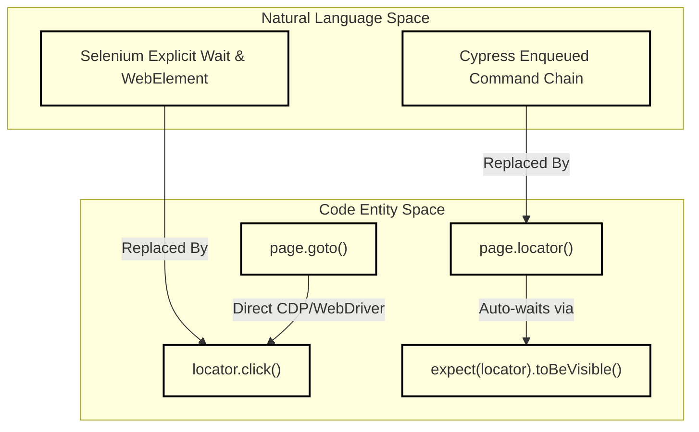
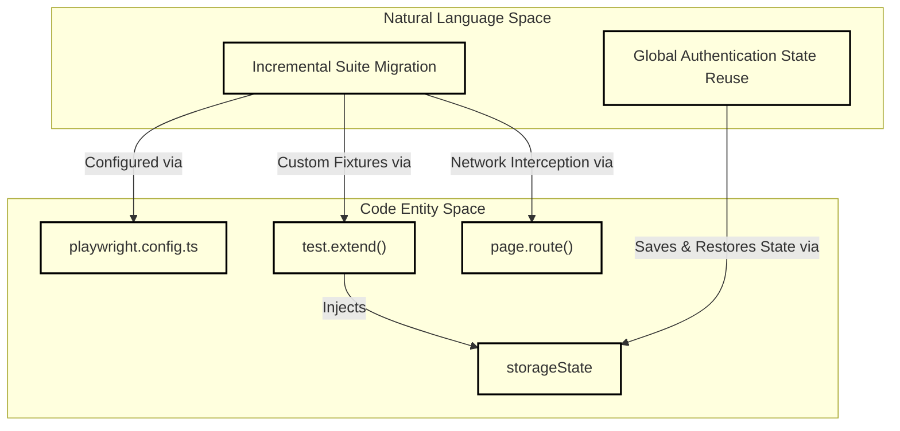

<!-- source: DeepWiki mcp.deepwiki.com · repo testdino-hq/playwright-skill · page 7.2 Migrating from Cypress and Selenium · fetched 2026-10-27 -->

# Migrating from Cypress and Selenium

Relevant source files

The following files were used as context for generating this wiki page:

- [ci/SKILL.md](ci/SKILL.md)
- [migration/SKILL.md](migration/SKILL.md)
- [migration/from-cypress.md](migration/from-cypress.md)
- [migration/from-selenium.md](migration/from-selenium.md)
- [pom/SKILL.md](pom/SKILL.md)

This page covers the migration path for moving existing test suites from Selenium WebDriver and Cypress to Playwright Test, detailing architectural mindset shifts, comprehensive API and command mapping tables, and incremental migration strategies.

Sources: `[migration/SKILL.md:1-18]`, `[migration/from-cypress.md:1-5]`, `[migration/from-selenium.md:1-5]`

---

## Mental-Model Shifts

Translating test suites requires moving past legacy execution paradigms. Both Selenium and Cypress rely on execution models that differ fundamentally from Playwright's Node.js-based, `async`/`await` architecture.

### Selenium to Playwright Shifts
* **No Explicit Waits**: Selenium requires explicit `WebDriverWait` and `ExpectedConditions` declarations. Playwright embeds auto-waiting directly into every action (`click`, `fill`, `check`) and web-first assertion (`expect(locator).toBeVisible()`) `[migration/from-selenium.md:10-18]`.
* **No WebDriver Protocol Overhead**: Selenium transmits W3C HTTP commands per instruction over HTTP round-trips. Playwright maintains a persistent bidirectional connection using CDP (Chromium), DevTools (Firefox), or WebKit native protocols `[migration/from-selenium.md:19-22]`.
* **Lazy Locators**: Selenium's `findElement()` instantly queries the DOM, returning a `WebElement` prone to `StaleElementReferenceException`. Playwright's `page.locator()` is lazy, re-evaluating the DOM on every action or assertion without stale references `[migration/from-selenium.md:38-40]`.

### Cypress to Playwright Shifts
* **Chains vs. `async`/`await`**: Cypress enqueues commands into a pseudo-synchronous serial chain. Playwright uses native JavaScript `async`/`await` control flow, allowing standard conditional statements (`if`/`else`), loops, and `try`/`catch` blocks without custom queue workarounds `[migration/from-cypress.md:9-24]`.
* **In-Browser vs. Node.js Execution**: Cypress executes test code inside the browser origin. Playwright runs in Node.js, controlling browsers externally over protocols, granting direct file system, database, and network access without custom task bridges (`cy.task()`) `[migration/from-cypress.md:38-45]`.
* **Custom Commands vs. Fixtures**: Cypress utilizes global mutable registries (`Cypress.Commands.add()`). Playwright isolates extensions via `test.extend()` dependency injection fixtures with guaranteed teardown and compile-time type safety `[migration/from-cypress.md:51-52]`.

*Sources: `[migration/from-cypress.md:9-52]`, `[migration/from-selenium.md:10-44]`*

---

## API and Command Mapping Tables

### Navigation and Element Location

| Selenium WebDriver | Cypress | Playwright | Notes |
|---|---|---|---|
| `driver.get(url)` | `cy.visit('/path')` | `await page.goto(url)` | Playwright waits for `load` event by default. Use `baseURL` in config `[migration/from-selenium.md:53]`, `[migration/from-cypress.md:58]` |
| `driver.findElement(By.id("x"))` | `cy.get('[data-testid="x"]')` | `page.getByTestId('x')` | Prefer semantic selectors like `getByRole()` or `getByTestId()` over raw CSS/IDs `[migration/from-selenium.md:65]`, `[migration/from-cypress.md:60]` |
| `driver.findElement(By.linkText("x"))` | `cy.contains('text')` | `page.getByRole('link', { name: 'x' })` | Role-based locators are more resilient than link text selectors `[migration/from-selenium.md:69]`, `[migration/from-cypress.md:61]` |
| `driver.findElements(By.css("x"))` | `cy.get('selector')` | `await page.locator('x').all()` | Returns array of locators; use `toHaveCount()` for length assertions `[migration/from-selenium.md:73]` |

Sources: `[migration/from-selenium.md:51-74]`, `[migration/from-cypress.md:56-62]`

### Element Interaction and Assertion

| Selenium WebDriver | Cypress | Playwright | Notes |
|---|---|---|---|
| `element.click()` | `cy.get('sel').click()` | `await locator.click()` | Auto-waits for element to be visible, stable, enabled, and unobscured `[migration/from-selenium.md:79]`, `[migration/from-cypress.md:63]` |
| `element.sendKeys("text")` | `cy.get('sel').type('text')` | `await locator.fill('text')` | `fill()` clears existing text first. Use `pressSequentially()` for character-by-character input `[migration/from-selenium.md:80]`, `[migration/from-cypress.md:64]` |
| `new Select(element)...` | `cy.get('select').select('val')` | `await locator.selectOption('val')` | Accepts value, label, or `{ index }` `[migration/from-selenium.md:84]`, `[migration/from-cypress.md:66]` |
| `element.isDisplayed()` | `cy.get('sel').should('be.visible')` | `await expect(locator).toBeVisible()` | Always use web-first assertion form for auto-retrying `[migration/from-selenium.md:85]`, `[migration/from-cypress.md:69]` |
| `element.getText()` | `cy.get('sel').should('have.text', 'x')` | `await expect(locator).toHaveText('x')` | Accepts string or regex patterns `[migration/from-selenium.md:88]`, `[migration/from-cypress.md:70]` |

Sources: `[migration/from-selenium.md:77-91]`, `[migration/from-cypress.md:63-77]`

### Network Routing, API Requests, and Advanced State

| Cypress | Playwright | Notes |
|---|---|---|
| `cy.intercept('GET', '/api/**', { body })` | `await page.route('/api/**', route => route.fulfill({ body }))` | Set up routes *before* executing the action that triggers the request `[migration/from-cypress.md:78]` |
| `cy.intercept('POST', '/api/save').as('save')` | `const resp = page.waitForResponse('**/api/save')` | Start promise *before* action, `await` after `[migration/from-cypress.md:79]` |
| `cy.wait('@save')` | `await resp` | Returns a `Response` object with `.json()` and `.status()` methods `[migration/from-cypress.md:80]` |
| `cy.request('POST', '/api/users', body)` | `const resp = await request.post('/api/users', { data: body })` | Use the test `request` fixture or standalone `APIRequestContext` `[migration/from-cypress.md:83]` |
| `Cypress.Commands.add('login', fn)` | Custom fixture via `test.extend()` | Replace global command registries with typed fixtures `[migration/from-cypress.md:87]` |

Sources: `[migration/from-cypress.md:78-87]`

---

## Incremental Migration Strategy and Architecture

When converting massive test bases, rewriting everything at once introduces regression risks. An incremental migration strategy allows running Cypress/Selenium tests alongside Playwright tests within the same repository structure, sharing configuration hooks and authentication states.

*Sources: `[migration/from-cypress.md:51-87]`, `[migration/from-selenium.md:10-44]`*

### Migration Steps
1. **Bootstrap Playwright Configuration**: Initialize `playwright.config.ts` alongside existing test frameworks, configuring shared `baseURL` and output directories.
2. **Translate Core Helpers**: Convert global setup commands (`Cypress.Commands.add` or Selenium base classes) into modular Playwright fixtures using `test.extend()`.
3. **Migrate Critical Paths First**: Move high-value smoke tests and flaky suites to Playwright to take advantage of built-in auto-waiting and traces.
4. **Retire Legacy Runners**: Remove driver dependency managers (like `WebDriverManager`) or test runner dependencies (like Mocha/Cypress runners) once functional parity is reached.

Sources: `[migration/SKILL.md:1-18]`, `[migration/from-cypress.md:51-52]`, `[migration/from-selenium.md:23-32]`

---

