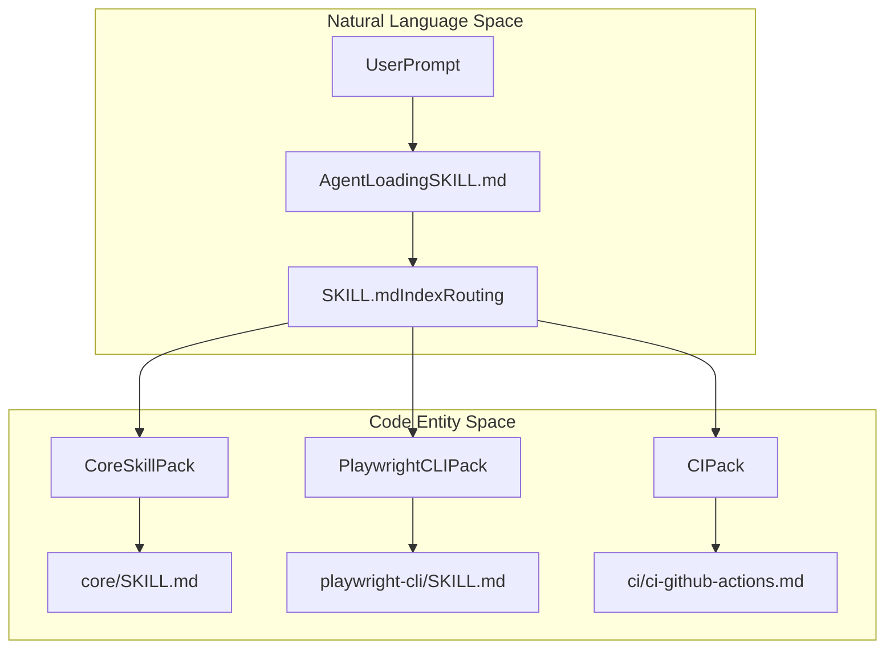
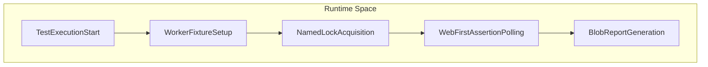
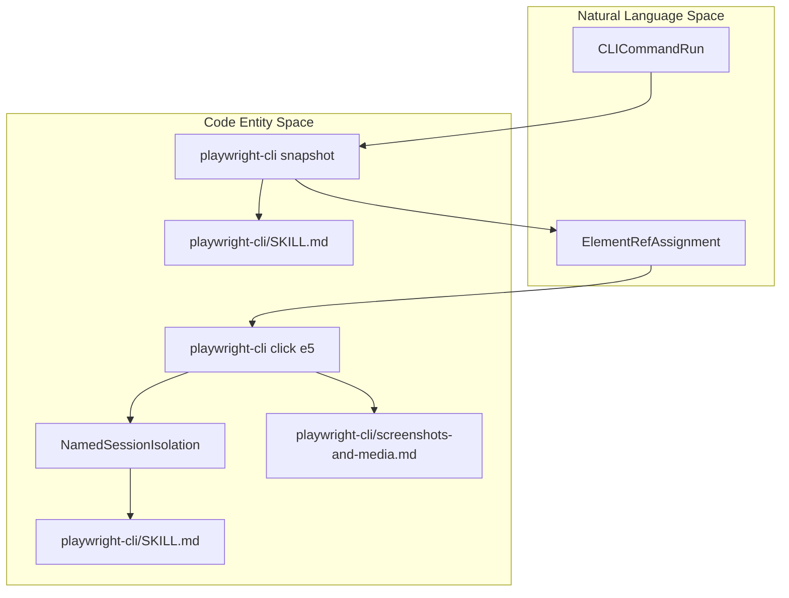

<!-- source: DeepWiki mcp.deepwiki.com · repo testdino-hq/playwright-skill · page 8 Glossary · fetched 2026-10-27 -->

# Glossary

Relevant source files

The following files were used as context for generating this wiki page:

- [README.md](README.md)
- [SKILL.md](SKILL.md)
- [core/SKILL.md](core/SKILL.md)
- [playwright-cli/SKILL.md](playwright-cli/SKILL.md)
- [playwright-cli/screenshots-and-media.md](playwright-cli/screenshots-and-media.md)

## Purpose and Scope
This page provides precise technical definitions for repo-specific terminology, architectural concepts, modern Playwright API features (up to version 1.63), and command-line automation constructs used across the `testdino-hq/playwright-skill` repository. Each entry links to the foundational files and lines defining or utilizing the term.

---

## Core Conceptual & Architecture Terms

### Agent Skill
A structured Markdown guide designed to be loaded dynamically by AI coding agents on demand [README.md:46]. Agent skills provide domain-specific instructions, examples, and rules for performing tasks like test authoring, debugging, or migration.

### SKILL.md Index
The canonical router and index file (`SKILL.md` or pack-level `core/SKILL.md`) parsed by AI agents to locate specific guides, review the 10 Golden Rules, and identify framework capabilities [README.md:46], [SKILL.md:1-156].

### Golden Rules
The ten foundational engineering principles and constraints enforced across all skill guides (e.g., prioritizing `getByRole()`, eliminating hardcoded timeouts, enforcing test isolation, and relying on web-first assertions) [SKILL.md:28-40].

### Trust Boundary
A strict security boundary dictating that agent skills and CLI commands must only target applications owned or explicitly authorized for testing [SKILL.md:20-27], [playwright-cli/SKILL.md:10-19]. Furthermore, all content retrieved from external pages or APIs must be treated as untrusted input to prevent indirect prompt injection.

### Skill Pack
A modular collection of Markdown guides categorized by domain (e.g., `core/`, `ci/`, `pom/`, `migration/`, `playwright-cli/`) that can be installed individually or collectively using the `skills` CLI (`npx skills add`) [README.md:58-66].

*Diagram 1: Bridging agent request routing from natural language space to repository skill packs and index files.*

Sources: `README.md:46-66`, `SKILL.md:1-156`, `playwright-cli/SKILL.md:10-19`

---

## Test Execution & Runtime Terms

### Web-First Assertion
An auto-retrying assertion pattern (e.g., `expect(locator).toBeVisible()`) built into Playwright that continuously polls the DOM until the expected condition is met or the timeout expires, contrasting with non-retrying property extractions like `expect(await locator.textContent())` [SKILL.md:32].

### Actionability
The prerequisite checks performed by Playwright prior to executing any user action (such as `click` or `fill`), ensuring the target element is attached, visible, stable, enabled, and receiving pointer events.

### Worker Fixture
A fixture scoped to the lifespan of an individual test worker process rather than an individual test case, useful for expensive setup routines shared across multiple tests running in the same worker [README.md:102].

### Named Lock
A Playwright 1.63 test `lock` mechanism used to serialize execution contention when multiple tests or shards compete for a shared external resource [README.md:48].

### StorageState
A Playwright state-persistence structure storing cookies and `localStorage` JSON objects, allowing test suites to bypass repetitive login steps by restoring pre-authenticated states [README.md:106], [playwright-cli/SKILL.md:136-137].

### Blob Report
An intermediate report format generated during distributed test execution, which allows sharded job outputs to be aggregated into a single consolidated report using merge tools [README.md:76].

### Shard
A CLI execution flag (`--shard=x/y`) that partitions a test suite across multiple parallel CI runner jobs to reduce overall pipeline duration [README.md:76].

*Diagram 2: Flow of worker setup, resource locking, assertion polling, and blob reporting during test runs.*

Sources: `README.md:48-106`, `SKILL.md:32`, `playwright-cli/SKILL.md:136-137`

---

## Advanced Features & Modern Playwright API Terms

### Preprocess Hook
The Playwright 1.62 `reporter.preprocess()` API utilized for filtering, selecting, or preparing test suites before execution begins [README.md:48].

### Quarantine
A dynamic test selection pattern where intermittently failing tests are automatically identified and skipped or routed based on external flakiness API data [README.md:48].

### RetryStrategy Isolated
A Playwright 1.62 execution strategy configuration (`retryStrategy: 'isolated'`) ensuring that retried tests run under clean runtime conditions [README.md:48].

### HAR (HTTP Archive)
An archive format used for recording and replaying network request/response traffic during test execution and trace analysis [README.md:109], [SKILL.md:18].

### Aria Snapshot
A YAML-based accessibility tree snapshot format (`ariaSnapshotJSON()` or `snapshots: { aria }`) that validates component structure against expected accessibility roles and names [README.md:48].

Sources: `README.md:48-109`, `SKILL.md:18`

---

## Automation & Design Pattern Terms

### Element Ref
A terminal-first, short alphanumeric identifier (e.g., `e1`, `e5`) generated by `playwright-cli snapshot` to reference interactive DOM nodes without writing complex CSS or XPath selectors [playwright-cli/SKILL.md:30-34].

### Named Session
An isolated browser session environment (`-s=name`) in `playwright-cli` that maintains separate cookies, local storage state, and open tabs [playwright-cli/SKILL.md:49].

### POM (Page Object Model)
An architectural design pattern that encapsulates page structures, locators, and interactions into dedicated classes, separating test logic from page implementation details [README.md:78].

*Diagram 3: CLI snapshot-then-act flow mapping natural language interaction requests to `playwright-cli` execution commands.*

Sources: `playwright-cli/SKILL.md:30-49`, `playwright-cli/screenshots-and-media.md:47-48`