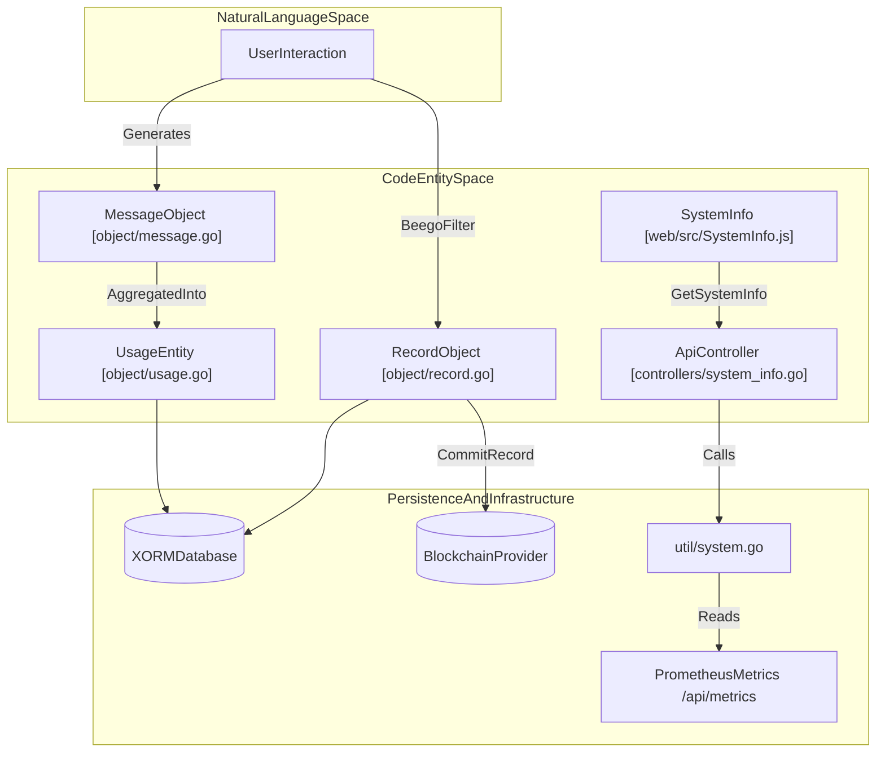

<!-- source: DeepWiki mcp.deepwiki.com · repo the-open-agent/openagent · page 10 Observability & Administration · fetched 2026-10-27 -->

# Observability & Administration

Relevant source files

The following files were used as context for generating this wiki page:

- [build.sh](build.sh)
- [controllers/prometheus.go](controllers/prometheus.go)
- [controllers/record.go](controllers/record.go)
- [controllers/record_chain.go](controllers/record_chain.go)
- [controllers/system_info.go](controllers/system_info.go)
- [controllers/usage.go](controllers/usage.go)
- [object/record.go](object/record.go)
- [object/record_chain.go](object/record_chain.go)
- [object/usage.go](object/usage.go)
- [object/usage_range.go](object/usage_range.go)
- [object/usage_test.go](object/usage_test.go)
- [riscv64.Dockerfile](riscv64.Dockerfile)
- [util/system.go](util/system.go)
- [util/system_test.go](util/system_test.go)
- [web/src/RecordListPage.js](web/src/RecordListPage.js)
- [web/src/SystemInfo.js](web/src/SystemInfo.js)
- [web/src/UsagePage.js](web/src/UsagePage.js)
- [web/src/UsageTable.js](web/src/UsageTable.js)
- [web/src/backend/RecordBackend.js](web/src/backend/RecordBackend.js)
- [web/src/backend/UsageBackend.js](web/src/backend/UsageBackend.js)

OpenAgent provides a comprehensive suite of tools for monitoring system health, tracking AI resource consumption, and maintaining an immutable audit trail of system activities. This subsystem bridges the gap between high-level usage analytics and low-level system metrics, ensuring administrators have full visibility into the platform's operations.

## System Overview

The observability stack is divided into three primary functional areas:
1.  **Usage Analytics**: Focused on the economic and operational metrics of AI interactions (tokens, costs, and user activity).
2.  **Activity Records**: A security-focused audit log that records every API interaction, with optional blockchain integration for non-repudiation.
3.  **System Monitoring**: Real-time performance metrics and health status of the Go/Beego backend.

### Data Flow & Entity Mapping

The following diagram illustrates how user interactions are transformed into observable data points across different storage layers.

**Observability Data Pipeline**

**Sources:** [object/record.go:28-69](), [object/usage.go:27-35](), [web/src/SystemInfo.js:63-73](), [controllers/usage.go:30-53](), [util/system.go:153-185]()

## Usage Analytics & Billing

The usage system tracks the consumption of AI resources across the platform. It aggregates data from the `Message` entity to provide insights into token counts, pricing, and user distribution.

*   **Usage Model**: Defined in `object/usage.go`, the `Usage` struct [object/usage.go:27-35]() tracks `ChatCount`, `MessageCount`, `TokenCount`, and `Price`. 
*   **Granular Tracking**: The system supports range-based queries (Hour, Day, Week, Month) via `GetRangeUsages` [object/usage_range.go:25-51]().
*   **Visualization**: The `UsagePage.js` component uses `echarts-for-react` to render provider distribution charts [web/src/UsagePage.js:176-216]() and activity heatmaps [web/src/UsagePage.js:135-143]().
*   **Billing Integration**: If Casdoor is available, the system retrieves organization and application metadata for billing reports via `GetUsageMetadata` [object/usage.go:193-217]().

For details, see [Usage Analytics & Billing](#10.1).

**Sources:** [object/usage.go:27-48](), [web/src/UsagePage.js:31-47](), [controllers/usage.go:30-53](), [object/usage_range.go:25-51]()

## Activity Records & Audit Logging

Every significant action in OpenAgent is captured as a `Record`. This serves as the primary audit trail for administrative and security purposes.

*   **Record Structure**: Captures `ClientIp`, `UserAgent`, `RequestUri`, `Action`, and geographic info like `Region` or `City` [object/record.go:35-47]().
*   **Blockchain Integration**: Records can be "committed" to a blockchain (e.g., Ethereum, ChainMaker) to create an immutable history [object/record_chain.go:127-177](). This is managed via the `RecordListPage` [web/src/RecordListPage.js:152-168]().
*   **Administrative UI**: The `RecordListPage` allows admins to filter, search, and inspect individual request payloads and blockchain transaction hashes [web/src/RecordListPage.js:206-230]().

For details, see [Activity Records & Audit Logging](#10.2).

**Sources:** [object/record.go:28-69](), [object/record_chain.go:127-177](), [web/src/RecordListPage.js:28-39]()

## System Info & Prometheus Metrics

For real-time operational monitoring, OpenAgent exposes standard metrics and system health indicators.

*   **System Metrics**: The `SystemInfo.js` component provides a live dashboard for CPU usage (per core), Memory, Disk, and Network I/O [web/src/SystemInfo.js:144-203](). Data is gathered by `util/system.go` using `gopsutil` [util/system.go:56-151]().
*   **Prometheus Integration**: The system tracks API throughput and latency, exposing them through `getPrometheusInfo` calls [web/src/SystemInfo.js:99-101]().
*   **Version Tracking**: Backend version information including `CommitId` and `Version` is retrieved from git or build flags [util/system.go:188-253]() and displayed in the UI [web/src/SystemInfo.js:109-118]().

For details, see [System Info & Prometheus Metrics](#10.3).

**Sources:** [web/src/SystemInfo.js:63-118](), [util/system.go:153-185](), [controllers/system_info.go:27-35]()

## Administrative Utilities

The platform provides several utilities for proactive administration:

| Utility | Description | Code Reference |
| :--- | :--- | :--- |
| **Usage Tables** | Per-user breakdown of chats, messages, and costs. | [web/src/UsageTable.js:22-45]() |
| **Record Query** | Verification of blockchain records against local data. | [web/src/RecordListPage.js:170-195]() |
| **Multi-Range Analytics** | Support for Hour, Day, Week, and Month usage buckets. | [object/usage_range.go:35-51]() |
| **Provider Distribution** | Visual breakdown of usage across different AI providers. | [controllers/usage.go:129-145]() |
| **Health Check** | Simple endpoint to verify system availability. | [controllers/system_info.go:79-81]() |

**Sources:** [web/src/UsageTable.js:22-45](), [web/src/RecordListPage.js:170-195](), [object/usage_range.go:35-51](), [controllers/usage.go:129-145](), [controllers/system_info.go:79-81]()

---

