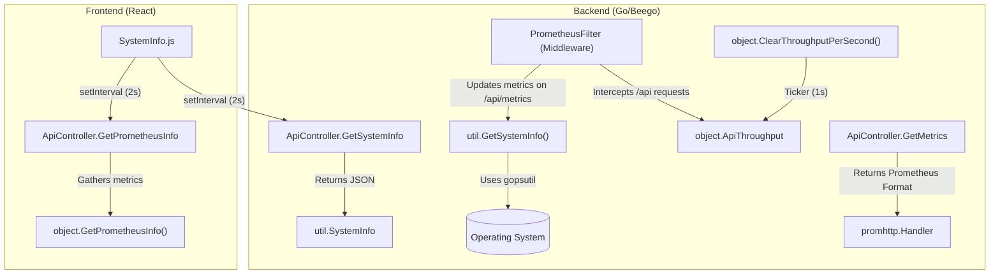

<!-- source: DeepWiki mcp.deepwiki.com · repo the-open-agent/openagent · page 10.3 System Info & Prometheus Metrics · fetched 2026-10-27 -->

# System Info & Prometheus Metrics

<details>
<summary>Relevant source files</summary>

The following files were used as context for generating this wiki page:

- [build.sh](build.sh)
- [controllers/prometheus.go](controllers/prometheus.go)
- [controllers/system_info.go](controllers/system_info.go)
- [riscv64.Dockerfile](riscv64.Dockerfile)
- [util/system.go](util/system.go)
- [util/system_test.go](util/system_test.go)
- [web/src/SystemInfo.js](web/src/SystemInfo.js)

</details>


This section describes the monitoring and observability infrastructure of OpenAgent. It covers real-time system resource tracking (CPU, Memory, Disk, Network), the integration with Prometheus for API performance metrics, and the frontend dashboard used by administrators to visualize system health and versioning.

## System Monitoring Architecture

OpenAgent utilizes a combination of system-level resource polling and middleware-based request tracking to provide a comprehensive view of the application's health.

### Data Flow for Observability

The following diagram illustrates how system metrics are collected from the OS and how API metrics are intercepted via middleware before being exposed through the API.



**Sources:**
- [web/src/SystemInfo.js:84-101]()
- [util/system.go:153-185]()
- [controllers/system_info.go:27-35]()
- [controllers/prometheus.go:48-54]()

## System Information Collection

The `util` package provides the core logic for extracting hardware and process-specific resource usage using the `gopsutil` library.

### Key Metrics Tracked
| Metric | Code Entity | Implementation Detail |
| :--- | :--- | :--- |
| **CPU Usage** | `util.getCpuUsage` | Returns percentage per core using `cpu.Percent` [util/system.go:56-59](). |
| **Memory** | `util.getMemoryUsage` | Tracks process RSS (Resident Set Size) vs System Total Memory [util/system.go:62-82](). |
| **Disk** | `util.getDiskUsage` | Monitors the size of the `./data` directory recursively and reports filesystem total [util/system.go:85-118](). |
| **Network** | `util.getNetworkUsage` | Aggregates bytes sent/received by the OpenAgent process, falling back to I/O counters if net counters are unavailable [util/system.go:121-151](). |
| **Version** | `util.GetVersionInfo` | Extracts Git tags, commit IDs, and offsets via `go-git` [util/system.go:188-253](). |

### Versioning Logic
OpenAgent uses a multi-stage version detection strategy in `controllers/system_info.go`:
1. **Git Metadata**: Attempts to read `.git` repository information [util/system.go:195-200]().
2. **Build Injection**: Falls back to variables injected during `go build` via `-X` flags in `build.sh` [build.sh:15-19]() and [util/system.go:269-282]().
3. **File Fallback**: Reads from a version file if the above fail [controllers/system_info.go:60-68]().

**Sources:**
- [util/system.go:38-47]()
- [util/system.go:49-53]()
- [util/system.go:153-185]()
- [controllers/system_info.go:43-71]()

## Prometheus Integration

OpenAgent implements a Prometheus-compatible monitoring stack. It defines several metrics and exposes them via standard endpoints.

### Metrics Definitions
The system tracks metrics which are exposed through the `/api/metrics` endpoint:
- **Throughput**: Requests per path and method.
- **Latency**: API response times (Histograms).
- **System Stats**: CPU and Memory utilization exported as Gauges.

### Endpoint Implementation
The `controllers/prometheus.go` file handles the metrics exposition:
- `GetMetrics`: Uses the official `promhttp.Handler()` to serve metrics in the Prometheus text format [controllers/prometheus.go:48-54]().
- `GetPrometheusInfo`: An admin-only endpoint that returns a structured `PrometheusInfo` object for frontend visualization [controllers/prometheus.go:28-40]().

**Sources:**
- [controllers/prometheus.go:15-55]()
- [object/prometheus.go:1-50]() (referenced by controllers)

## Frontend: SystemInfo Page

The `SystemInfo` component (`web/src/SystemInfo.js`) provides a real-time dashboard for administrators.

### Implementation Details
- **Polling Strategy**: The component establishes a `setInterval` every 2 seconds to fetch fresh data from `getSystemInfo`, `getPrometheusInfo`, and `getVersionInfo` [web/src/SystemInfo.js:84-101]().
- **Visualization**:
    - **Hardware**: Uses Ant Design `Progress` components to show CPU, Memory, and Disk usage. CPU is displayed as an average across all cores [web/src/SystemInfo.js:167-191]().
    - **API Performance**: Renders `PrometheusInfoTable` to display latency and throughput statistics [web/src/SystemInfo.js:35-35]().
- **Version Tracking**: Displays the current release version and commit ID [web/src/SystemInfo.js:109-117]().

### API Endpoints
| Endpoint | Controller Function | Description |
| :--- | :--- | :--- |
| `/api/get-system-info` | `GetSystemInfo` | Returns CPU, RAM, Disk, and Network stats [controllers/system_info.go:27-35](). |
| `/api/get-version-info` | `GetVersionInfo` | Returns version, commit ID, and offset [controllers/system_info.go:43-71](). |
| `/api/get-prometheus-info` | `GetPrometheusInfo` | Returns throughput and latency data for the UI [controllers/prometheus.go:28-40](). |
| `/api/metrics` | `GetMetrics` | Standard Prometheus scrape endpoint [controllers/prometheus.go:48-54](). |
| `/api/health` | `Health` | Simple 200 OK liveness check [controllers/system_info.go:79-81](). |

**Sources:**
- [web/src/SystemInfo.js:62-101]()
- [controllers/system_info.go:21-82]()
- [util/system.go:188-253]()

## Natural Language to Code Mapping

This diagram maps high-level monitoring concepts to their specific implementation entities in the codebase.

```mermaid
classDiagram
    class "System Monitoring UI" {
        web/src/SystemInfo.js
        web/src/table/PrometheusInfoTable.js
    }
    class "Backend Controllers" {
        controllers/ApiController.GetSystemInfo()
        controllers/ApiController.GetVersionInfo()
        controllers/ApiController.Health()
        controllers/ApiController.GetMetrics()
    }
    class "Hardware Abstraction" {
        util/GetSystemInfo()
        util/getMemoryUsage()
        util/getDiskUsage()
        util/getNetworkUsage()
    }
    class "CLI Versioning" {
        internal/cli.Version
        internal/cli.Commit
        util/GetVersionInfoFromBuild()
    }

    "System Monitoring UI" --> "Backend Controllers" : "Polling (2s)"
    "Backend Controllers" --> "Hardware Abstraction" : "util.GetSystemInfo()"
    "Backend Controllers" --> "CLI Versioning" : "util.GetVersionInfo()"
```

**Sources:**
- [web/src/SystemInfo.js:15-35]()
- [controllers/system_info.go:27-81]()
- [util/system.go:153-185]()
- [util/system.go:269-282]()
- [build.sh:15-15]()

---

