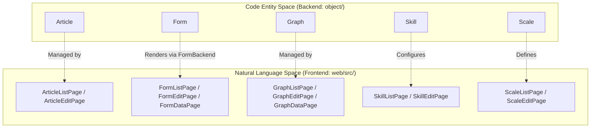
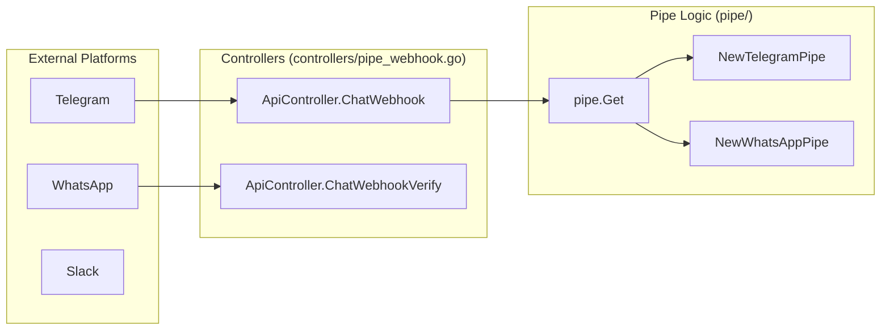

<!-- source: DeepWiki mcp.deepwiki.com · repo the-open-agent/openagent · page 11 Additional Features · fetched 2026-10-27 -->

# Additional Features

Relevant source files

The following files were used as context for generating this wiki page:

- [controllers/pipe.go](controllers/pipe.go)
- [controllers/pipe_webhook.go](controllers/pipe_webhook.go)
- [object/form.go](object/form.go)
- [object/pipe.go](object/pipe.go)
- [pipe/pipe.go](pipe/pipe.go)
- [web/.gitignore](web/.gitignore)
- [web/README.md](web/README.md)
- [web/src/BaseListPage.js](web/src/BaseListPage.js)
- [web/src/FormDataPage.js](web/src/FormDataPage.js)
- [web/src/FormDataTablePage.js](web/src/FormDataTablePage.js)
- [web/src/FormListPage.js](web/src/FormListPage.js)
- [web/src/PipeEditPage.js](web/src/PipeEditPage.js)
- [web/src/PipeListPage.js](web/src/PipeListPage.js)
- [web/src/StoreSelect.js](web/src/StoreSelect.js)

This page provides a high-level overview of supplementary platform features that extend OpenAgent beyond basic chat and AI model management. These features include structured knowledge articles, data collection forms, graph visualizations, and external bot integrations via the "Pipe" system.

## Articles, Forms & Graphs

OpenAgent provides several specialized entities for structured information management and visualization.

*   **Articles**: Represent long-form knowledge content. The system supports structured block-based content, automated text parsing for LaTeX-style headers, and navigation menus.
*   **Forms**: The `Form` system allows for structured data collection and presentation. It supports multiple categories: `Table` for internal data grids, `iFrame` for embedding external tools, and `List Page` for linking to other OpenAgent entity lists like `stores`, `vectors`, or `tasks` [web/src/FormEditPage.js:107-115](). The frontend uses `BaseListPage` as a foundation for entity tables [web/src/BaseListPage.js:34-53]().
*   **Graphs**: Knowledge graphs are used to visualize relationships between entities. The `Graph` entity supports different categories such as "Assets" (for security scanning results) or "Chats" (for conversation relationship mapping).
*   **Skills**: Managed via `SkillEditPage` [web/src/SkillEditPage.js:31-41](), these define specialized agent capabilities (writing, coding, analysis) with specific content and metadata [web/src/SkillEditPage.js:106-151]().
*   **Scales**: Used for structured evaluation or task metrics, managed via `ScaleEditPage` [web/src/ScaleEditPage.js:16-25]().

For technical details on schemas and the BPMN workflow engine integration, see **[Articles, Forms & Graphs](#11.1)**.

### Entity Relationship to UI
The following diagram illustrates how these additional entities are represented in the codebase from the data model to the React management interface.

**Diagram: Knowledge & Data Entity Mapping**

Sources: [web/src/FormEditPage.js:32-42](), [web/src/FormDataPage.js:22-30](), [web/src/SkillEditPage.js:31-41](), [web/src/ScaleEditPage.js:16-25](), [web/src/FormListPage.js:27-30](), [object/form.go:33-46]()

## Bot Integrations & Messaging (Pipes)

OpenAgent supports external connectivity through the **Pipe** system, which abstracts various messaging platforms into a unified interface.

*   **Pipe Interface**: The `Pipe` interface [pipe/pipe.go:34-39]() defines standard methods for `SendMessage`, `ParseWebhookRequest`, and `SetWebhook`.
*   **Supported Platforms**: Supported integrations include Telegram, Discord, WhatsApp, Slack, WeChat, Facebook Messenger, Snapchat, X (Twitter), and Threads [pipe/pipe.go:80-98]().
*   **Webhook Handling**: The `ChatWebhook` controller [controllers/pipe_webhook.go:101-154]() receives updates from external platforms. Verification of webhook ownership is handled by `ChatWebhookVerify` [controllers/pipe_webhook.go:55-95](), which utilizes the `WebhookVerifier` interface [pipe/pipe.go:66-68]().
*   **Configuration**: Pipes are bound to specific `Store` entities [object/pipe.go:36]() and require a `Domain` for webhook registration [controllers/pipe.go:186-191]().

For details on webhook configuration and proxy infrastructure, see **[Bot Integrations & Messaging](#11.2)**.

### Request & Messaging Pipeline
The diagram below shows how external requests from messaging "Pipes" are routed through the system.

**Diagram: Pipe Webhook Flow**

Sources: [controllers/pipe_webhook.go:55-60](), [controllers/pipe_webhook.go:101-105](), [pipe/pipe.go:76-107](), [object/pipe.go:161-172]()

## Image Management & Cloud Resources

The platform manages visual assets and cloud-based image resources used across various modules.

*   **Image Entity**: Tracks image metadata and content within the system.
*   **Cloud Operations**: Integration with Alibaba Cloud via `pkgimage` allows for advanced image operations and resource tracking.
*   **Resource System**: A centralized management layer for tracking file attachments, task-related images, and other binary objects stored in cloud or local storage providers.

For details on the image lifecycle and cloud provider settings, see **[Image Management & Cloud Resources](#11.3)**.

## Feature Summary Table

| Feature Area | Key Backend Entities | Primary UI Components | Purpose |
| :--- | :--- | :--- | :--- |
| **Articles** | `Article`, `Block` | `ArticleEditPage` | Structured knowledge management. |
| **Forms** | `Form`, `FormItem` | `FormEditPage`, `FormDataPage` | Custom data collection and iframes [web/src/FormEditPage.js:131-157](). |
| **Graphs** | `Graph`, `GraphNode` | `GraphDataPage`, `GraphEditPage` | Echarts-based data visualization. |
| **Pipes** | `Pipe` | `PipeListPage`, `PipeEditPage` | External messaging platform integration [web/src/PipeEditPage.js:27-43](). |
| **Skills** | `Skill` | `SkillEditPage` | Agent capability definitions [web/src/SkillEditPage.js:81-151](). |
| **Scales** | `Scale` | `ScaleEditPage` | Evaluation metrics and scoring text [web/src/ScaleEditPage.js:73-125](). |

Sources: [web/src/PipeListPage.js:25-29](), [web/src/FormListPage.js:27-30](), [web/src/SkillEditPage.js:31-41](), [web/src/ScaleEditPage.js:16-25](), [object/pipe.go:27-44](), [object/form.go:33-46]()

---

