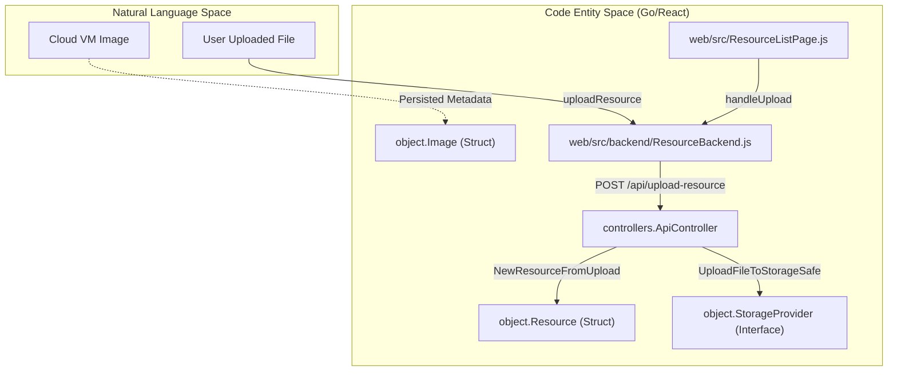
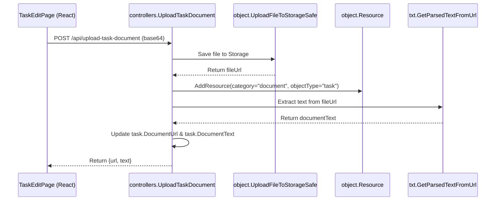

<!-- source: DeepWiki mcp.deepwiki.com · repo the-open-agent/openagent · page 11.3 Image Management & Cloud Resources · fetched 2026-10-27 -->

# Image Management & Cloud Resources

Relevant source files

The following files were used as context for generating this wiki page:

- [controllers/resource.go](controllers/resource.go)
- [controllers/task_upload.go](controllers/task_upload.go)
- [object/adapter.go](object/adapter.go)
- [object/resource.go](object/resource.go)
- [routers/router.go](routers/router.go)
- [web/src/App.js](web/src/App.js)
- [web/src/ManagementPage.js](web/src/ManagementPage.js)
- [web/src/ResourceListPage.js](web/src/ResourceListPage.js)
- [web/src/backend/ResourceBackend.js](web/src/backend/ResourceBackend.js)
- [web/src/component/nav-item-tree/NavItemTree.js](web/src/component/nav-item-tree/NavItemTree.js)

This section covers the management of virtual machine images and the general-purpose Resource system used for tracking all file uploads across the OpenAgent platform.

## Image Entity & Cloud Integration

The `Image` entity represents operating system images, primarily integrated with Alibaba Cloud (Aliyun) ECS. It stores metadata required to provision virtual machines, including architecture, OS type, and boot modes.

### Image Data Model
The `Image` struct (defined in `object/image.go`) includes fields for both cloud-specific identifiers and local database metadata:
- **Cloud Metadata**: `ImageId`, `OSName`, `Architecture`, `Size`, `Status`.
- **Remote Access**: `RemoteProtocol`, `RemotePort`, `RemoteUsername`, `RemotePassword`.

### Alibaba Cloud Image Operations
Cloud integration is handled via the `pkgimage` package.
- **Client Factory**: `NewImageClient` initializes a provider-specific client (currently supporting `Aliyun`).
- **Aliyun Client**: `ImageAliyunClient` uses the Alibaba Cloud SDK to fetch images via `DescribeImages`.
- **Synchronization**: `SyncImagesCloud` fetches images from active cloud providers and synchronizes them with the local database, preserving existing remote access credentials.

### Image Management UI
The frontend provides a standard list and edit interface:
- **ImageListPage**: Displays images in a table. It allows administrators to create a `Machine` directly from an image entry via `createMachine`.
- **ImageEditPage**: Provides forms to modify image metadata such as `Category` (Private, Public, Market, Community) and OS details.

**Sources:** `object/image.go`, `object/image_cloud.go`, `pkgimage/aliyun_image.go`, `web/src/ImageListPage.js`.

## Resource Management System

The `Resource` system is a unified tracker for all files uploaded to the platform, including user avatars, chat attachments, and task documents.

### The Resource Entity
Every uploaded file is recorded as a `Resource` [object/resource.go:26-42]().
- **Category**: Categorizes the file as `avatar`, `chat`, or `document` [object/resource.go:33]().
- **Object Association**: Tracks the parent entity via `ObjectType` (e.g., "task", "message", "store", "chat") and `ObjectId` [object/resource.go:40-41]().
- **Storage Mapping**: `Url` provides the public link, while `StorageName` stores the internal key (path) for the storage provider [object/resource.go:38-39]().

### Resource Flow: Upload & Persistence

The diagram below illustrates the flow from a frontend upload request to the storage provider and database persistence.

**Image & Resource Entity Mapping**

**Sources:** [controllers/resource.go:216-270](), [object/resource.go:173-191](), [web/src/backend/ResourceBackend.js:75-89](), [web/src/ResourceListPage.js:38-55]().

### Key Functions
| Function | File | Description |
| :--- | :--- | :--- |
| `UploadResource` | [controllers/resource.go:216-270]() | Endpoint that handles multipart file uploads and creates resource records. |
| `UploadFileToStorageSafe` | [object/resource.go:196-213]() | Interfaces with the default storage provider to save the raw bytes. |
| `DeleteResourceFile` | [object/resource.go:125-141]() | Deletes the physical file from the storage provider using the `StorageName`. |
| `NewResourceFromUpload` | [object/resource.go:173-191]() | Factory function to initialize a `Resource` struct with generated names and timestamps. |

**Sources:** [controllers/resource.go:216-270](), [object/resource.go:125-213]().

## Task Attachments & Parsing

Resources are often associated with `Task` entities. When a document is uploaded for a task, it undergoes an additional parsing step to enable AI analysis.

### Task Document Pipeline
1. **Upload**: `UploadTaskDocument` [controllers/task_upload.go:38-146]() receives a base64 encoded file (restricted to `.docx` and `.pdf` [controllers/task_upload.go:74-86]()).
2. **Storage**: The file is saved to storage via `UploadFileToStorageSafe` [controllers/task_upload.go:105]().
3. **Recording**: A `Resource` record is created with `ObjectType: "task"` and `ObjectId: taskId` [controllers/task_upload.go:112]().
4. **Parsing**: The system calls `txt.GetParsedTextFromUrl` [controllers/task_upload.go:118]() to extract text.
5. **Association**: The extracted text and file URL are saved directly to the `Task` object [controllers/task_upload.go:126-127]().

**Task Upload Logic Flow**

**Sources:** [controllers/task_upload.go:38-146](), [object/resource.go:112-115]().

## Resource UI (ResourceListPage)
The `ResourceListPage` [web/src/ResourceListPage.js:33]() provides a central administration view for all files. It is accessible via the "Admin -> Resources" menu path [web/src/ManagementPage.js:112](), [web/src/component/nav-item-tree/NavItemTree.js:91]().

### UI Features
- **Filtering**: Supports searching and sorting by `Name`, `User`, `Category`, `FileName`, `FileType`, and `FileFormat` [web/src/ResourceListPage.js:90-146]().
- **Preview**: Dynamically renders previews for `image` (using AntD Image) and `video` (using HTML5 video tags) [web/src/ResourceListPage.js:161-176]().
- **Management**: 
    - **Upload**: `handleUpload` uses `ResourceBackend.uploadResource` to send files to the backend [web/src/ResourceListPage.js:38-55]().
    - **Copy URL**: Allows copying public URLs to the clipboard [web/src/ResourceListPage.js:184-194]().
    - **Deletion**: `deleteResource` triggers both database and storage provider cleanup [web/src/ResourceListPage.js:57-77]().

**Sources:** [web/src/ResourceListPage.js:33-210](), [web/src/ManagementPage.js:112](), [web/src/component/nav-item-tree/NavItemTree.js:91]().

---

