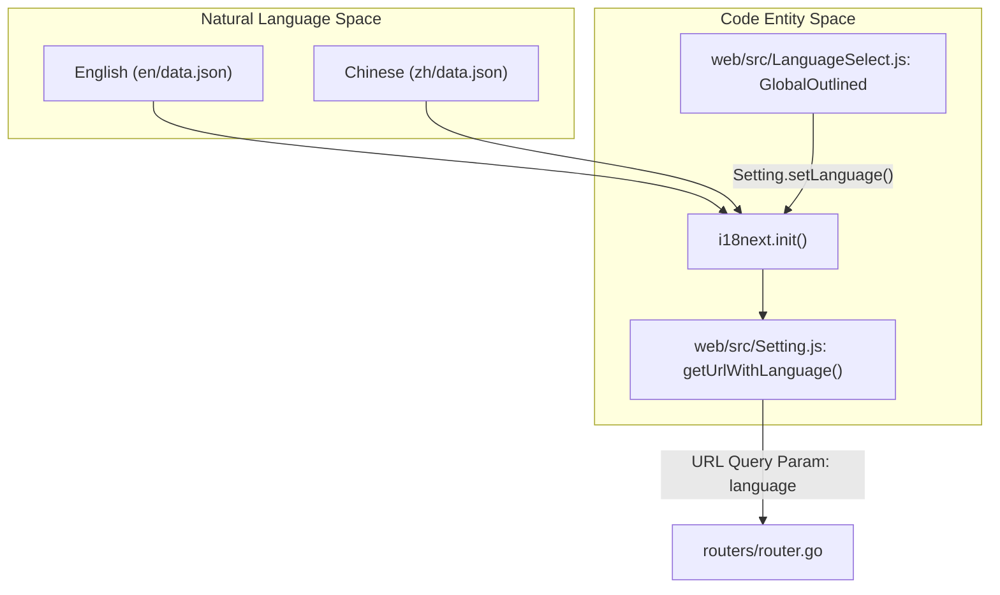
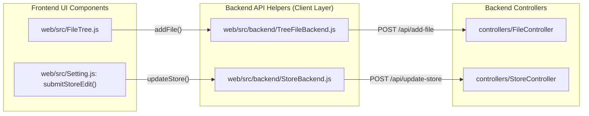

<!-- source: DeepWiki mcp.deepwiki.com · repo the-open-agent/openagent · page 12 Internationalization & Frontend Infrastructure · fetched 2026-10-27 -->

# Internationalization & Frontend Infrastructure

Relevant source files

The following files were used as context for generating this wiki page:

- [web/package.json](web/package.json)
- [web/src/App.less](web/src/App.less)
- [web/src/FileTree.js](web/src/FileTree.js)
- [web/src/LanguageSelect.js](web/src/LanguageSelect.js)
- [web/src/Setting.js](web/src/Setting.js)
- [web/src/index.css](web/src/index.css)
- [web/src/locales/en/data.json](web/src/locales/en/data.json)
- [web/src/locales/zh/data.json](web/src/locales/zh/data.json)
- [web/src/shadcnTheme.js](web/src/shadcnTheme.js)
- [web/yarn.lock](web/yarn.lock)

This section provides an overview of how OpenAgent manages multi-language support and its standardized frontend-to-backend communication layer. The platform is designed to be globally accessible, supporting both English and Chinese natively across the user interface and backend error messaging.

## Overview

The OpenAgent frontend is built on React and Ant Design, utilizing a structured infrastructure to ensure consistency across its various modules (AI Chat, Infrastructure Management, Video Analysis, etc.). The infrastructure is divided into two primary concerns:

1.  **Internationalization (i18n):** A comprehensive system for managing translations using `i18next` on the frontend and a JSON-based localization strategy on the backend.
2.  **Frontend API Client Layer:** A set of modularized backend helper scripts that abstract `fetch` calls, handle streaming responses, and inject metadata like language preferences.

---

## Internationalization (i18n)

OpenAgent uses `i18next` to manage frontend localization. Supported languages currently include English (`en`) and Chinese (`zh`) [web/src/locales/en/data.json:1-10]() [web/src/locales/zh/data.json:1-10](). The system provides a `LanguageSelect` component that allows users to toggle between locales, which updates the `localStorage` and re-renders the application with the selected language [web/src/LanguageSelect.js:51-53]().

### Translation Flow
Translation keys are organized by namespace (e.g., `account`, `chat`, `general`) within JSON files [web/src/locales/zh/data.json:2-103](). The `Setting.js` utility provides a `getUrlWithLanguage` function to ensure that any outbound link to external services (like Casdoor) preserves the user's language context [web/src/Setting.js:62-68]().

**I18n Architecture**

*Sources: [web/src/LanguageSelect.js:51-59](), [web/src/Setting.js:62-68](), [web/src/locales/en/data.json:1-10](), [web/src/locales/zh/data.json:1-10]()*

For a deep dive into translation management, Crowdin integration, and the key generation tooling, see **[Internationalization (i18n)](#12.1)**.

---

## Frontend API Client Layer

OpenAgent follows a pattern where UI components do not perform raw network requests. Instead, logic is abstracted into a `backend` directory where each entity has a dedicated service module [web/src/Setting.js:17-17]().

### Backend Helper Pattern
These helpers handle the boilerplate of API communication, including:
*   **Credential Management:** Integrating with `casdoor-js-sdk` to manage authentication tokens and user profiles [web/src/Setting.js:42-50]().
*   **Centralized Submission:** Functions like `submitStoreEdit` encapsulate the logic for copying objects, stripping UI-only fields (like `fileTree`), and handling success/error notifications via `showMessage` [web/src/Setting.js:214-228]().
*   **Theming & Styles:** The frontend infrastructure includes a Shadcn-style Ant Design theme configuration in `shadcnTheme.js`, providing consistent structural tokens like `borderRadius` and `fontFamily` across the app [web/src/shadcnTheme.js:40-54]().

### UI Infrastructure Components
The system provides several shared components to handle common data patterns:
*   **`FileTree`**: A complex component for managing hierarchical file storage within a Store, integrating `TreeFileBackend` for remote operations [web/src/FileTree.js:21-21]().
*   **`LanguageSelect`**: A dropdown component using Ant Design's `Dropdown` and `GlobalOutlined` icon to switch system locales [web/src/LanguageSelect.js:15-17]().

**API Communication Layer**

*Sources: [web/src/FileTree.js:213-213](), [web/src/Setting.js:217-217](), [web/src/LanguageSelect.js:56-61]()*

For details on the `FetchFilter`, the `BaseListPage` inheritance pattern, and the API helper structure, see **[Frontend API Client Layer](#12.2)**.

---
**Sources:**
*   **I18n Initialization:** [web/src/Setting.js:62-68]()
*   **Backend Helpers:** [web/src/Setting.js:214-232](), [web/src/FileTree.js:21-21]()
*   **UI Components:** [web/src/LanguageSelect.js:15-65](), [web/src/FileTree.js:40-187]()
*   **Theming:** [web/src/shadcnTheme.js:40-138](), [web/src/index.css:156-184]()
*   **Locales:** [web/src/locales/en/data.json:1-100](), [web/src/locales/zh/data.json:1-100]()

---

