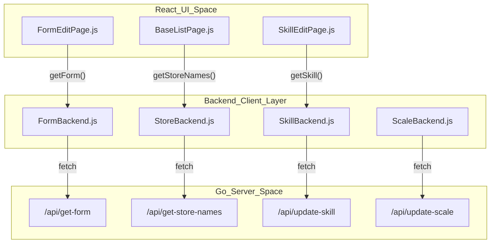
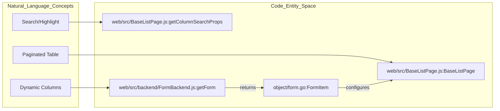

<!-- source: DeepWiki mcp.deepwiki.com · repo the-open-agent/openagent · page 12.2 Frontend API Client Layer · fetched 2026-10-27 -->

# Frontend API Client Layer

Relevant source files

The following files were used as context for generating this wiki page:

- [object/adapter.go](object/adapter.go)
- [object/form.go](object/form.go)
- [routers/router.go](routers/router.go)
- [web/.gitignore](web/.gitignore)
- [web/README.md](web/README.md)
- [web/src/App.js](web/src/App.js)
- [web/src/BaseListPage.js](web/src/BaseListPage.js)
- [web/src/FormDataPage.js](web/src/FormDataPage.js)
- [web/src/FormDataTablePage.js](web/src/FormDataTablePage.js)
- [web/src/FormListPage.js](web/src/FormListPage.js)
- [web/src/ManagementPage.js](web/src/ManagementPage.js)
- [web/src/SettingUtil.js](web/src/SettingUtil.js)
- [web/src/StoreSelect.js](web/src/StoreSelect.js)
- [web/src/ThemeSetting.js](web/src/ThemeSetting.js)
- [web/src/backend/FetchFilter.js](web/src/backend/FetchFilter.js)
- [web/src/component/nav-item-tree/NavItemTree.js](web/src/component/nav-item-tree/NavItemTree.js)

The Frontend API Client Layer in OpenAgent provides a structured abstraction for communication between the React frontend and the Beego backend. This layer centralizes request logic, enforces multi-tenant store isolation at the request level, and provides reusable patterns for administrative list management and shared context selection.

## 1. Backend Helper Modules Pattern

OpenAgent follows a modular pattern where every major system entity has a corresponding `Backend.js` file located in `web/src/backend/`. These modules encapsulate the `fetch` logic, endpoint construction, and response handling.

### Implementation Characteristics
*   **Standardized Headers**: Most requests include `credentials: "include"` to support session-based authentication and an `Accept-Language` header for backend i18n, derived from the current `i18next` state [web/src/ThemeSetting.js:94-99]().
*   **Response Processing**: All standard requests pipe their results through `Setting.handleFetchResponse(res)`, which handles common error codes and parses JSON [web/src/backend/StoreBackend.js:24]().
*   **Deep Copy Protection**: POST requests (add/update/delete) typically perform a deep copy of the object before transmission using `Setting.deepCopy(obj)` to prevent side effects on the local React state during the network round-trip [web/src/backend/StoreBackend.js:58-66]().

### Data Flow: Entity Management
The following diagram illustrates how the frontend components utilize these backend modules to interact with the server.

**API Request Lifecycle**

Sources: [web/src/backend/StoreBackend.js:47-55](), [web/src/App.js:23-29](), [routers/router.go:36-121]()

---

## 2. Request Interception: FetchFilter

OpenAgent implements a global interception layer by overriding the browser's `window.fetch` function. This is managed in `web/src/backend/FetchFilter.js`.

### Key Functions
*   **Global Interception**: The `window.fetch` is replaced with a wrapper that executes a sequence of `requestFilters` before the call and `responseFilters` after the call [web/src/backend/FetchFilter.js:111-124]().
*   **Demo Mode Guard**: A specific filter, `demoModeCallback`, checks if the application is in "Demo Mode" (controlled by `Conf.IsDemoMode`). If a response indicates a denied action via `Setting.isResponseDenied(data)`, it triggers an Ant Design `Modal.info` to inform the user that write operations are disabled [web/src/backend/FetchFilter.js:26-99]().
*   **Permission Checks**: `Setting.isResponseDenied` specifically looks for error messages such as "Unauthorized operation" or "this operation requires admin privilege" [web/src/ThemeSetting.js:255-257]().

Sources: [web/src/backend/FetchFilter.js:105-124](), [web/src/ThemeSetting.js:255-257](), [web/src/App.js:61]()

---

## 3. Administrative Base: BaseListPage

`BaseListPage` is a high-level React component that provides a standardized UI and logic for all administrative tables (e.g., Form List, Store List, Task List).

### Core Features
1.  **Automatic Pagination**: Manages the `pagination` state and integrates with backend pagination parameters (`p`, `pageSize`) [web/src/BaseListPage.js:41-44]().
2.  **Search & Filtering**: Provides `getColumnSearchProps` which injects search inputs and `Highlighter` components into Ant Design table columns to visually mark matches [web/src/BaseListPage.js:134-198]().
3.  **Store Context Integration**: List pages automatically filter their data based on the currently selected `storeName` in the global context, which is updated via the `storeChanged` window event [web/src/BaseListPage.js:55-63]().
4.  **Dynamic Form Configuration**: Fetches custom form configurations via `FormBackend.getForm`. This allows the UI to dynamically adjust column visibility and labels based on the `FormItem` definitions [web/src/BaseListPage.js:104-121]().

**Natural Language to Code Entity: List Page Architecture**

Sources: [web/src/BaseListPage.js:34-53](), [web/src/BaseListPage.js:134-140](), [object/form.go:25-31](), [web/src/FormListPage.js:27-30]()

---

## 4. Context Selection: StoreSelect

The `StoreSelect` component is the primary mechanism for multi-tenancy in the frontend. It allows users (especially admins) to switch the active "Store" context.

### Behavior and Constraints
*   **Initialization**: On mount, it fetches available stores via `StoreBackend.getStoreNames("admin")` [web/src/StoreSelect.js:56-59]().
*   **Homepage Binding**: If a user has a `homepage` field set in their account profile that matches a store name, the component forces the selection of that store and disables the dropdown via the `disabled` prop [web/src/StoreSelect.js:84-98]().
*   **Global Sync**: It listens for `storesChanged` and `storage` events to ensure that if the store is changed in one tab or component, all other components update their state [web/src/StoreSelect.js:32-42]().
*   **Persistence**: Selected store names are persisted in local storage via `Setting.setStore(value)` [web/src/StoreSelect.js:79-82]().

**Store Isolation Data Flow**
| Layer | Mechanism | File Reference |
| :--- | :--- | :--- |
| **Frontend UI** | `StoreSelect` dropdown component | [web/src/StoreSelect.js:21]() |
| **Frontend Persistence** | LocalStorage via `Setting.setStore` | [web/src/StoreSelect.js:81]() |
| **Frontend API** | Query param `?owner=...` or `?id=...` | [web/src/backend/StoreBackend.js:48]() |
| **Backend Object** | `GetPaginationForms(owner, ...)` | [object/form.go:165-174]() |

Sources: [web/src/StoreSelect.js:21-48](), [object/form.go:165-174](), [web/src/ManagementPage.js:60]()

---

