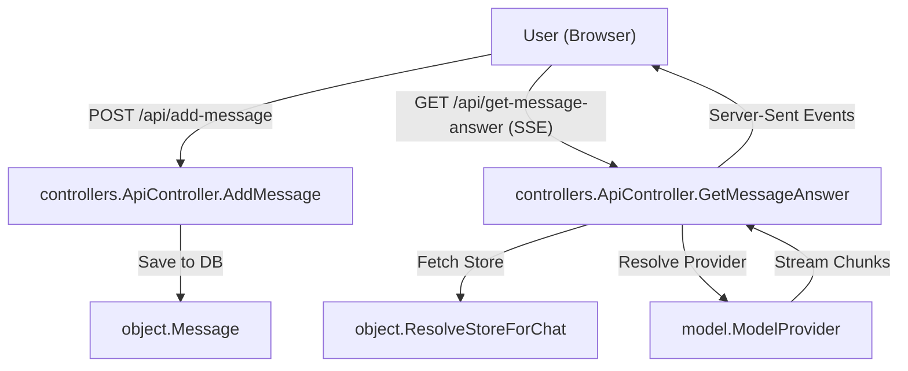
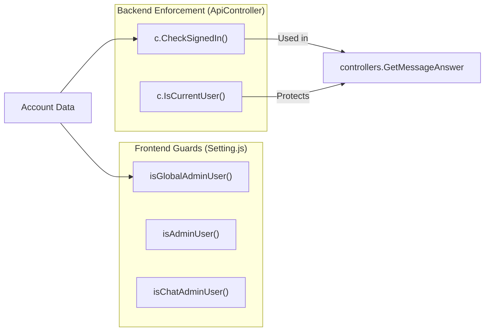

<!-- source: DeepWiki mcp.deepwiki.com · repo the-open-agent/openagent · page 13 Glossary · fetched 2026-10-27 -->

# Glossary

Relevant source files

The following files were used as context for generating this wiki page:

- [conf/app.conf](conf/app.conf)
- [conf/conf.go](conf/conf.go)
- [controllers/message_answer.go](controllers/message_answer.go)
- [controllers/message_util.go](controllers/message_util.go)
- [go.mod](go.mod)
- [go.sum](go.sum)
- [main.go](main.go)
- [model/provider.go](model/provider.go)
- [object/adapter.go](object/adapter.go)
- [object/init.go](object/init.go)
- [object/transaction.go](object/transaction.go)
- [object/util.go](object/util.go)
- [routers/router.go](routers/router.go)
- [routers/static_filter.go](routers/static_filter.go)
- [web/src/App.js](web/src/App.js)
- [web/src/Conf.js](web/src/Conf.js)
- [web/src/ManagementPage.js](web/src/ManagementPage.js)
- [web/src/Setting.js](web/src/Setting.js)
- [web/src/component/nav-item-tree/NavItemTree.js](web/src/component/nav-item-tree/NavItemTree.js)
- [web/src/locales/en/data.json](web/src/locales/en/data.json)
- [web/src/locales/zh/data.json](web/src/locales/zh/data.json)

This page provides definitions for codebase-specific terms, jargon, and domain concepts used throughout the OpenAgent project.

## Core Entities

### Store
The central configuration container for AI behavior. A `Store` defines which model provider to use, the system prompt, available tools, knowledge bases (vector stores), and specific AI capabilities like TTS/STT.
*   **Implementation:** Defined as a struct in `object/store.go`.
*   **Data Flow:** When a chat starts, the system resolves the `Store` to determine the environment for the LLM [controllers/message_answer.go:189-205]().
*   **Initialization:** Default stores are created during database initialization [object/init.go:87-152]().
*   **Key Fields:** `ModelProvider`, `Prompt`, `Tools`, `EmbeddingProvider`, `Welcome` [object/init.go:97-131]().

### Carrier
A structured format used within message text to encapsulate metadata or complex UI elements (like tool calls, thought chains, or file references) inside a standard text stream.
*   **Implementation:** Handled by the `carrier` package in the backend [controllers/message_answer.go:25-25]() and the `MessageCarrier` class in the frontend.
*   **Usage:** Used to parse streaming responses to separate "thinking" from "answering".

### Provider
An abstraction layer for external services. Providers are categorized by their function: `Model` (LLMs), `Embedding`, `Storage`, `TTS`, `STT`, and `Scan`.
*   **Implementation:** Backend logic in `object/provider.go` and `model/provider.go`.
*   **UI:** Managed via `ProviderListPage` and `ProviderEditPage` components [web/src/ManagementPage.js:67-68]().
*   **Discovery:** Global providers are fetched via `GetGlobalProviders` [object/init.go:46-59]().

**Sources:**
* [object/init.go:46-152]()
* [controllers/message_answer.go:189-205]()
* [web/src/ManagementPage.js:67-68]()

---

## Domain Jargon

### RAG (Retrieval-Augmented Generation)
The process of augmenting LLM prompts with relevant document snippets retrieved from a vector database.
*   **Code Entity:** `object.GetNearestKnowledge` is the primary entry point during message generation.
*   **Search Strategies:** Supports `Default` (flat search) and `Hierarchy` (multi-level search).
*   **Configuration:** Linked via the `EmbeddingProvider` in the `Store` [object/init.go:109-109]().

### MCP (Model Context Protocol)
An open protocol that allows AI models to connect to external data sources and tools seamlessly.
*   **Implementation:** The `mcp` package [controllers/message_answer.go:29-29]() and backend client logic.
*   **Usage:** Stores can link to `McpServer` entities to discover and execute remote tools [object/init.go:110-110]().
*   **Routing:** API routes for MCP management include `/api/test-mcp-server` and `/api/sync-mcp-tool` [routers/router.go:95-96]().

### Thought Chain / Reasoning
The intermediate steps an AI takes before providing a final answer. In the UI, this is often rendered as a "Thinking" block [web/src/locales/zh/data.json:79-79]().
*   **Backend:** Logic for handling reasoning processes during streaming [controllers/message_answer.go:211-220]().

**Sources:**
* [object/init.go:109-110]()
* [controllers/message_answer.go:29-29]()
* [routers/router.go:95-96]()
* [web/src/locales/zh/data.json:79-79]()

---

## System Architecture Concepts

### Message Lifecycle
The journey of a user prompt from the UI to the LLM and back as a streamed response.

**Natural Language to Code Mapping:**
1.  **User Input:** Captured in the frontend chat interface.
2.  **API Call:** Sent to `/api/add-message` [routers/router.go:132-132]().
3.  **SSE Stream:** The frontend listens to `/api/get-message-answer` [controllers/message_answer.go:41-42]().
4.  **Inference:** `GetMessageAnswer` calls the `ModelProvider` after resolving the context [controllers/message_answer.go:189-193]().

### Data Flow Diagram: Message Generation
This diagram bridges the conceptual "Chatting" action to the specific backend controllers and object methods.

*Sources: [controllers/message_answer.go:42-64](), [controllers/message_answer.go:139-210](), [routers/router.go:132-132]()*

---

## Technical Abbreviations

| Abbreviation | Full Name | Description | Code Pointer |
| :--- | :--- | :--- | :--- |
| **SSE** | Server-Sent Events | The protocol used for streaming AI responses to the frontend. | [controllers/message_answer.go:58-58]() |
| **TTS** | Text-to-Speech | Converting AI text responses into audible speech. | [object/init.go:111-111]() |
| **STT** | Speech-to-Text | Converting user voice input into text for the prompt. | [object/init.go:112-112]() |
| **RBAC** | Role-Based Access Control | Permission system distinguishing `GlobalAdmin`, `StoreAdmin`, and regular users. | [web/src/Setting.js:115-134]() |
| **ORM** | Object-Relational Mapping | The database abstraction layer used for persistence (XORM). | [object/adapter.go:35-35]() |
| **MCP** | Model Context Protocol | Protocol for tool and resource discovery. | [controllers/message_answer.go:29-29]() |

**Sources:**
* [controllers/message_answer.go:58-58]()
* [object/init.go:111-112]()
* [web/src/Setting.js:115-134]()
* [object/adapter.go:35-35]()

---

## Permission Roles

OpenAgent uses a tiered permission model enforced in both the frontend `Setting.js` and the backend controllers.

*   **Global Admin:** Has full access to all stores, providers, and system settings. Identified by `isAdmin === true` and `name === "admin"` [web/src/Setting.js:115-120]().
*   **Store Admin:** Can manage specific stores and view messages/users within those stores. Identified by `type === "chat-admin"` [web/src/Setting.js:129-134]().
*   **Anonymous User:** Users without a permanent account, often created for public-facing chat widgets. Identified by `type === "anonymous-user"` [web/src/Setting.js:183-188]().

### Authorization Entity Mapping

*Sources: [web/src/Setting.js:115-134](), [controllers/message_answer.go:44-56]()*

---

## Common Code Symbols

*   **`ApiController`**: The base controller for all API endpoints, providing helper methods for session management, response formatting, and permission checks [controllers/message_answer.go:42-42]().
*   **`Adapter`**: The persistence wrapper around XORM for database operations [object/adapter.go:194-199]().
*   **`CasdoorSdk`**: The frontend SDK for interacting with Casdoor for authentication [web/src/Setting.js:42-50]().
*   **`Beego`**: The web framework powering the backend API and routing [routers/router.go:36-41]().
*   **`i18next`**: The frontend internationalization library used for multi-language support [web/src/Setting.js:15-15]().

**Sources:**
* [controllers/message_answer.go:42-42]()
* [object/adapter.go:194-199]()
* [web/src/Setting.js:42-50]()
* [routers/router.go:36-41]()
* [web/src/Setting.js:15-15]()