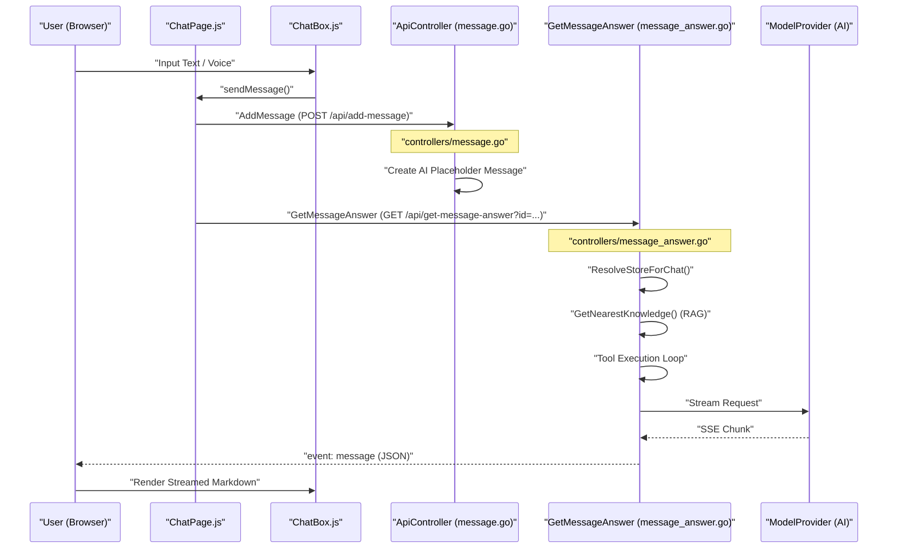
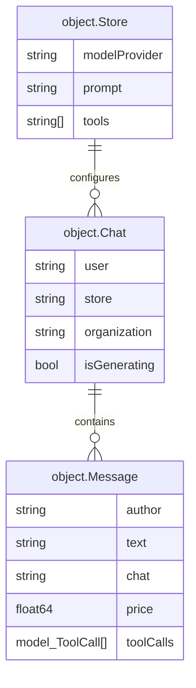

<!-- source: DeepWiki mcp.deepwiki.com · repo the-open-agent/openagent · page 2 Core AI & Chat System · fetched 2026-10-27 -->

# Core AI & Chat System

Relevant source files

The following files were used as context for generating this wiki page:

- [controllers/account.go](controllers/account.go)
- [controllers/chat.go](controllers/chat.go)
- [controllers/message.go](controllers/message.go)
- [controllers/message_answer.go](controllers/message_answer.go)
- [controllers/message_util.go](controllers/message_util.go)
- [controllers/util.go](controllers/util.go)
- [object/chat.go](object/chat.go)
- [object/message.go](object/message.go)
- [web/src/ChatBox.js](web/src/ChatBox.js)
- [web/src/ChatMenu.js](web/src/ChatMenu.js)
- [web/src/ChatPage.js](web/src/ChatPage.js)
- [web/src/backend/ChatBackend.js](web/src/backend/ChatBackend.js)

The **Core AI & Chat System** is the central engine of OpenAgent, responsible for orchestrating the flow between user inputs and AI-generated responses. It bridges the frontend React-based chat interface with a complex backend pipeline that handles Retrieval-Augmented Generation (RAG), tool execution, and real-time streaming via Server-Sent Events (SSE).

### High-Level Architecture

The system is built on a decoupled architecture where the frontend manages the conversation state and the backend manages the AI logic.

*   **Frontend**: Built with React, centered around `ChatPage.js` [web/src/ChatPage.js:36-42]() and `ChatBox.js` [web/src/ChatBox.js:32-53](). It handles message rendering, voice interactions (TTS/STT), and session navigation.
*   **Backend**: A Go/Beego application. The `GetMessageAnswer` controller [controllers/message_answer.go:42-64]() serves as the primary entry point for AI response generation, coordinating between model providers, vector stores, and tools.
*   **Configuration**: The `Store` entity acts as the "brain" configuration, defining which models, prompts, and knowledge bases are active for a specific chat session. It is resolved for each chat in the backend [controllers/message_answer.go:189-205]().

### AI Conversation Lifecycle

The following diagram illustrates the path from a user clicking "Send" to the AI response appearing on the screen.

**Diagram: Chat Message Lifecycle**

**Sources:** [web/src/ChatPage.js:210-230](), [web/src/ChatBox.js:141-169](), [controllers/message_answer.go:42-137](), [controllers/message.go:238-265]()

---

### Core Components

#### [Chat UI & Session Management](#2.1)
The frontend interface provides a multi-pane environment [web/src/ChatPage.js:23]() for interacting with different AI configurations. It manages the `ChatMenu` [web/src/ChatMenu.js:22]() for session history and the `ChatBox` [web/src/ChatBox.js:32]() for the active conversation. It also handles polling for generation status [web/src/ChatPage.js:84-147]().
*   **Key Entities**: `ChatPage`, `ChatBox`, `ChatMenu`.
*   **Details**: See [Chat UI & Session Management](#2.1).

#### [Message Pipeline & AI Response Generation](#2.2)
The backend pipeline handles the heavy lifting of AI orchestration. It manages the conversion of user queries into enriched prompts and determines if external tools (MCP) or built-in tools need to be invoked [controllers/message_answer.go:211-224](). It utilizes a job management system `messageAnswerJobs` to handle streaming and cancellation [controllers/message_answer.go:62-90]().
*   **Key Entities**: `GetMessageAnswer`, `Message`, `ModelProvider`.
*   **Details**: See [Message Pipeline & AI Response Generation](#2.2).

#### [Store Configuration](#2.3)
A `Store` is the foundational unit of AI behavior in OpenAgent. It encapsulates the system prompt, the selected LLM, and the connected knowledge bases. Every chat session is bound to a store that dictates its capabilities, which is resolved via `ResolveStoreForChat` [controllers/message_answer.go:189]().
*   **Key Entities**: `Store`, `VectorStore`, `McpServer`.
*   **Details**: See [Store Configuration](#2.3).

#### [Chat & Message Administration](#2.4)
Administrative views allow system operators to monitor and manage all conversations across the platform. This includes auditing global message history [controllers/message.go:33-106]() and filtering chats by store or user [controllers/chat.go:33-110]().
*   **Key Entities**: `ChatListPage`, `MessageListPage`.
*   **Details**: See [Chat & Message Administration](#2.4).

---

### Code Mapping: Data Entities to System Logic

The following table maps the primary data structures used in the Chat System to their respective implementation files.

| Logic Layer | Code Entity (Go) | Frontend Component (React) | Responsibility |
| :--- | :--- | :--- | :--- |
| **Session** | `object.Chat` [object/chat.go:24-50]() | `ChatMenu.js` [web/src/ChatMenu.js:22]() | Tracks a conversation thread between a user and a Store. |
| **Message** | `object.Message` [object/message.go:40-76]() | `MessageList.js` [web/src/chat/MessageList.js]() | Individual units of communication (User, AI, or System). |
| **Delivery** | `GetMessageAnswer` [controllers/message_answer.go:42]() | `ChatBox.js` [web/src/ChatBox.js:32]() | SSE streaming and real-time UI updates. |
| **Persistence** | `XORM engine` | `ChatBackend.js` [web/src/backend/ChatBackend.js]() | CRUD operations for chats and messages. |

**Diagram: System Entity Relationships**

**Sources:** [object/chat.go:24-50](), [object/message.go:40-76](), [controllers/message.go:116-151](), [controllers/message_answer.go:189-205]()

**Sources:**
- `web/src/ChatPage.js`
- `web/src/ChatBox.js`
- `web/src/ChatMenu.js`
- `controllers/message_answer.go`
- `controllers/message.go`
- `controllers/chat.go`
- `object/chat.go`
- `object/message.go`
- `web/src/backend/ChatBackend.js`

---

