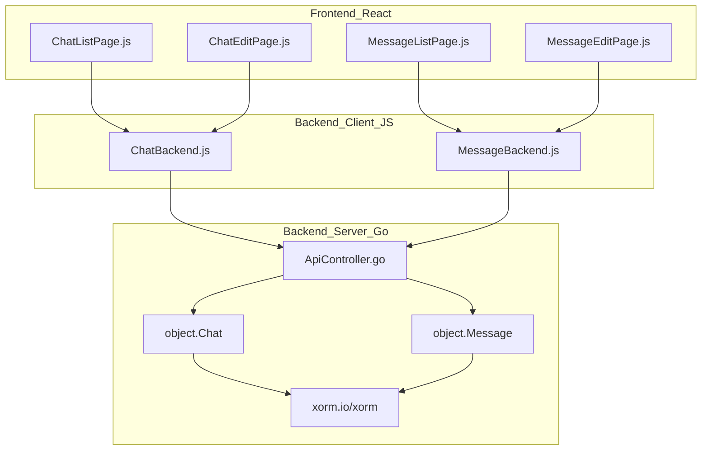
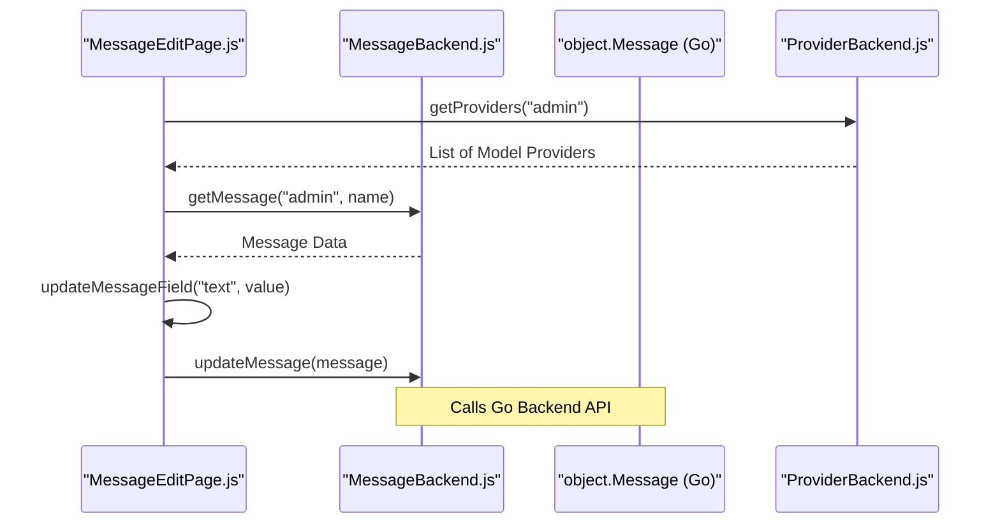

<!-- source: DeepWiki mcp.deepwiki.com · repo the-open-agent/openagent · page 2.4 Chat & Message Administration · fetched 2026-10-27 -->

# Chat & Message Administration

Relevant source files

The following files were used as context for generating this wiki page:

- [web/src/ChatEditPage.js](web/src/ChatEditPage.js)
- [web/src/ChatListPage.js](web/src/ChatListPage.js)
- [web/src/FormEditPage.js](web/src/FormEditPage.js)
- [web/src/MessageEditPage.js](web/src/MessageEditPage.js)
- [web/src/MessageListPage.js](web/src/MessageListPage.js)
- [web/src/RecordEditPage.js](web/src/RecordEditPage.js)
- [web/src/SkillEditPage.js](web/src/SkillEditPage.js)
- [web/src/VectorEditPage.js](web/src/VectorEditPage.js)

This page details the administrative interfaces and backend logic for managing chat sessions and messages within OpenAgent. These tools allow administrators to monitor user interactions, edit specific message contents, audit costs (tokens/price), and analyze system-wide usage trends.

## Administrative Overview

OpenAgent provides two primary administrative list views: the `ChatListPage` for session-level management and the `MessageListPage` for granular message-level control. Both views support filtering by Store, advanced searching, and data export functionality.

### Data Flow: Admin Interface to Persistence

The administration views interact with the backend via dedicated React-based Backend modules, which call the Beego API controllers to perform CRUD operations on the underlying XORM-mapped database.

Title: Admin Data Flow to Persistence

**Sources:** [web/src/ChatListPage.js:21-25](), [web/src/MessageListPage.js:21-22](), [web/src/ChatEditPage.js:18-24](), [web/src/MessageEditPage.js:20-22]()

---

## Chat Session Administration

The `ChatListPage` serves as the primary dashboard for viewing all chat sessions across the platform.

### Key Features
- **Session Browsing:** Displays metadata including `displayName`, `user`, `clientIp`, `messageCount`, and total `price` [web/src/ChatListPage.js:171-188]().
- **Message Preview:** Allows administrators to toggle a "Maximize Messages" view to inspect the content of a specific chat directly within the list using the `getMessages` function [web/src/ChatListPage.js:75-95]().
- **Data Export:** Supports exporting the filtered list of chats to an Excel file (.xlsx) via `downloadChats` and `fetchAllChatsForExport` [web/src/ChatListPage.js:140-214]().

### Chat Lifecycle Management
Administrators can manually create new chats using `addChat()`, which initializes a session with default metadata such as `owner: "admin"`, `category: "Default Category"`, and `needTitle: true` [web/src/ChatListPage.js:97-134](). The `ChatEditPage` allows modifying properties like the `modelProvider` and `store` [web/src/ChatEditPage.js:160-192]().

**Sources:** [web/src/ChatListPage.js:30-138](), [web/src/ChatListPage.js:173-192](), [web/src/ChatEditPage.js:29-192]()

---

## Message Administration

The `MessageListPage` provides a detailed view of every message generated by users or AI providers.

### Message Metadata and Editing
Messages track specific technical details required for auditing:
- **Token Counts:** `tokenCount` (total) and `textTokenCount` are initialized in `newMessage()` [web/src/MessageListPage.js:88-89]().
- **Financials:** `price` and `currency` associated with the LLM call [web/src/MessageListPage.js:90]().
- **Relationships:** `chat` (parent session) and `replyTo` (ID of the message being answered) [web/src/MessageListPage.js:84-85]().

The `MessageEditPage` allows administrators to correct AI responses or system prompts. It provides a `Select` component for the `author` (User, System, AI) and a `TextArea` for the message `text` [web/src/MessageEditPage.js:207-230]().

### Vector and Audit Integration
Administrators can inspect vector embeddings associated with messages via the `VectorTooltip` in the list view [web/src/MessageListPage.js:27](). Detailed audit logs for message operations are stored in the `Record` entity, viewable via `RecordEditPage` [web/src/RecordEditPage.js:27-56]().

Title: Message Administration Logic

**Sources:** [web/src/MessageEditPage.js:45-113](), [web/src/MessageEditPage.js:136-144](), [web/src/MessageListPage.js:114-137]()

---

## Usage Analytics and Extended Forms

Usage statistics are aggregated from the underlying `Chat` and `Message` objects to provide a visual representation of system activity.

### Implementation Details
- **Data Export Strategy:** The `fetchAllMessagesForExport` function in the frontend implements a chunking strategy to fetch large datasets (e.g., 10,000 records per batch) without overloading browser memory [web/src/MessageListPage.js:139-166]().
- **Form Integration:** Admin views can be embedded into custom administrative forms via `FormEditPage`. This allows creating specialized list pages for `records`, `stores`, `vectors`, or `tasks` [web/src/FormEditPage.js:96-119]().
- **Skill Management:** Administrators can also manage AI "Skills" via `SkillEditPage`, defining specific prompts, descriptions, and categories like `writing`, `coding`, or `analysis` [web/src/SkillEditPage.js:28-168]().

**Sources:** [web/src/MessageListPage.js:139-166](), [web/src/FormEditPage.js:96-119](), [web/src/SkillEditPage.js:28-168]()

---

## Administrative Logic and Maintenance

### Vector and Audit Maintenance
OpenAgent provides tools for maintaining the integrity of chat data and its associated vectors:
- **Vector Inspection:** Administrators can use `VectorEditPage` to view or modify the raw `text` and `data` (float array) of embeddings associated with knowledge base segments. The `parseVectorField` function handles the conversion of comma-separated strings back into numeric arrays [web/src/VectorEditPage.js:60-78]().
- **Record Auditing:** Every administrative action is recorded. The `RecordEditPage` displays the `clientIp`, `requestUri`, `method` (GET, POST, etc.), and `action` for security auditing [web/src/RecordEditPage.js:144-190]().
- **Blockchain Verification:** Records can be filtered and verified against blockchain providers if configured [web/src/RecordEditPage.js:57-68]().

**Sources:** [web/src/VectorEditPage.js:26-185](), [web/src/RecordEditPage.js:144-190](), [web/src/RecordEditPage.js:57-68]()

---

