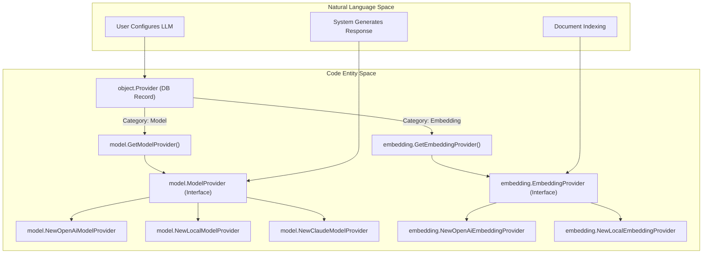
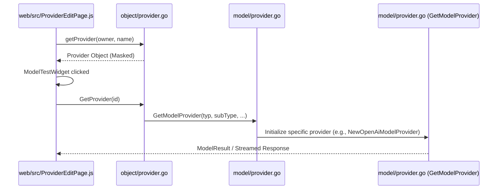

<!-- source: DeepWiki mcp.deepwiki.com · repo the-open-agent/openagent · page 3 AI Model & Embedding Providers · fetched 2026-10-27 -->

# AI Model & Embedding Providers

Relevant source files

The following files were used as context for generating this wiki page:

- [go.mod](go.mod)
- [go.sum](go.sum)
- [model/provider.go](model/provider.go)
- [object/provider.go](object/provider.go)
- [object/transaction.go](object/transaction.go)
- [object/util.go](object/util.go)
- [web/src/ProviderEditPage.js](web/src/ProviderEditPage.js)
- [web/src/ProviderListPage.js](web/src/ProviderListPage.js)

OpenAgent utilizes a robust provider abstraction layer to interface with a wide variety of AI backends. This architecture decouples the core AI logic (like chat sessions and knowledge retrieval) from specific vendor implementations, allowing the system to support Large Language Models (LLMs), Embedding models, Text-to-Speech (TTS), and Speech-to-Text (STT) from providers such as OpenAI, Azure, Claude, and Alibaba Cloud.

## Provider Architecture Overview

The system defines a unified `Provider` data model in the backend that categorizes external services into functional types. This metadata determines how the backend initializes the appropriate driver and how the frontend renders the configuration UI.

### Core Provider Model
The `Provider` struct acts as the central configuration entity, storing credentials, endpoints, and model-specific parameters like temperature and pricing. [object/provider.go:33-83]()

| Field | Description |
| :--- | :--- |
| `Category` | The functional type (e.g., `Model`, `Embedding`, `Storage`, `Text-to-Speech`). [object/provider.go:40]() |
| `Type` | The vendor or backend implementation (e.g., `OpenAI`, `Azure`, `Ollama`). [object/provider.go:41]() |
| `SubType` | The specific model identifier (e.g., `gpt-4o`, `text-embedding-3-small`). [object/provider.go:42]() |
| `ClientSecret` | Secure storage for API keys, which are masked in the UI. [object/provider.go:45]() |

### Code-to-System Mapping
The following diagram illustrates how the abstract `Provider` configuration in the database is transformed into functional code entities at runtime.

**Provider Initialization Pipeline**

**Sources:** [object/provider.go:33-83](), [model/provider.go:117-177](), [go.mod:7-63]()

---

## LLM Provider Integrations

The `ModelProvider` interface defines the contract for text generation and pricing estimation. The system supports a massive array of backends through a factory pattern in `model.GetModelProvider`. [model/provider.go:49-53]()

*   **Capabilities**: Supports streaming responses via `io.Writer`, tool calling (via `ToolSession`), and reasoning/thinking modes for models like DeepSeek, Claude, or Volcano Engine. [model/provider.go:51](), [model/provider.go:159]()
*   **Pricing Engine**: Includes built-in logic to calculate costs based on prompt and response token counts via the `ModelResult` struct. [model/provider.go:32-39](), [object/provider.go:63-65]()
*   **Dry-Run Mode**: Uses the `DryRunPrefix` (`$OpenAgentDryRun$`) to estimate costs and validate balances via Casdoor without making actual AI model API calls. [model/provider.go:30](), [object/transaction.go:59-84]()

For details on specific LLM backends and pricing logic, see [LLM Provider Integrations](#3.1).

**Sources:** [model/provider.go:30-177](), [object/provider.go:63-65](), [object/transaction.go:32-55]()

---

## Embedding & Vector Pipeline

Embedding providers convert text into high-dimensional vectors for semantic search and RAG (Retrieval-Augmented Generation). The system integrates with numerous backends including OpenAI, Gemini, Cohere, and local providers.

*   **Local & Proxy Support**: Supports local deployments via `Ollama` or `Local` (OpenAI-compatible) endpoints. [model/provider.go:120-127]()
*   **Tokenization**: The system uses specialized libraries like `tiktoken-go` for accurate token counting and cost estimation. [go.mod:42]()
*   **Diversity**: Integrates specialized providers like `Baidu Cloud` and `Tencent Cloud` which require specific credential mapping (e.g., Secret ID vs API Key). [web/src/ProviderEditPage.js:87-95]()

For details on the vectorization process and search strategies, see [Embedding & Vector Pipeline](#3.2).

**Sources:** [model/provider.go:117-177](), [web/src/ProviderEditPage.js:85-104](), [go.mod:28-47]()

---

## Provider Management UI

The administration of providers is handled through a dynamic React interface. The `ProviderEditPage` adjusts its fields based on the provider's `Category` and `Type`. [web/src/ProviderEditPage.js:32-44]()

*   **Dynamic Labels**: Labels change contextually (e.g., "Client ID" becomes "Deployment Name" for Azure or "Group ID" for MiniMax). [web/src/ProviderEditPage.js:85-104]()
*   **Validation**: Includes widgets like `ModelTestWidget`, `EmbedTestWidget`, and `TtsTestWidget` to verify credentials and connectivity instantly. [web/src/ProviderEditPage.js:24-26]()
*   **Security**: Implements credential masking in `GetMaskedProvider` to prevent sensitive keys (API keys, sign keys, etc.) from being exposed to non-admin users. [object/provider.go:85-114]()

For details on the UI implementation and property-dependent generation, see [Provider Management UI](#3.3).

**Sources:** [web/src/ProviderEditPage.js:85-159](), [web/src/ProviderListPage.js:133-205](), [object/provider.go:85-125]()

---

## Speech & Audio Processing

OpenAgent provides abstractions for converting between text and audio, primarily used in the chat interface for voice interaction.

*   **TTS & STT**: Standardized interfaces for Text-to-Speech and Speech-to-Text are integrated via the `tts` and `stt` packages. [object/provider.go:26-27]()
*   **Vendor Support**: Supports advanced implementations like `go-cosyvoice` for high-quality audio generation and Alibaba Cloud services. [go.mod:9](), [web/src/ProviderEditPage.js:146]()
*   **Testing**: Includes a `TtsTestWidget` within the provider configuration page for immediate feedback on audio generation. [web/src/ProviderEditPage.js:25]()

For details on audio extraction and browser integration, see [Speech & Audio Processing](#3.4).

**Sources:** [object/provider.go:26-27](), [web/src/ProviderEditPage.js:25](), [go.mod:9]()

---

## Provider Interaction Flow

The following diagram maps the flow from the user interface to the execution of a model query, highlighting the code entities involved.

**Model Query Execution Flow**

**Sources:** [web/src/ProviderEditPage.js:46-65](), [object/provider.go:177-207](), [model/provider.go:117-177]()

---

