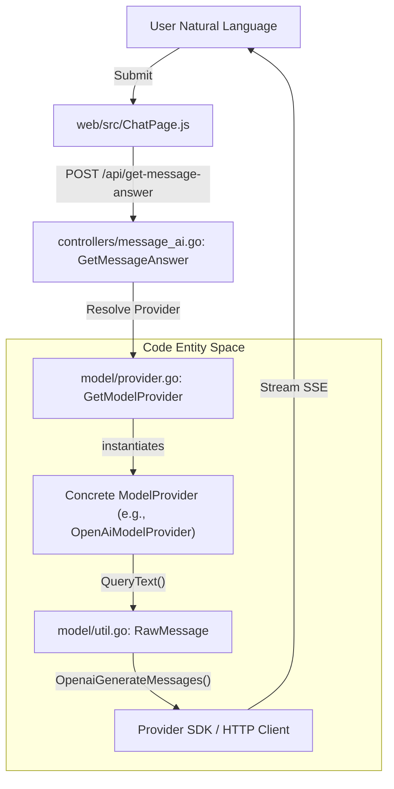
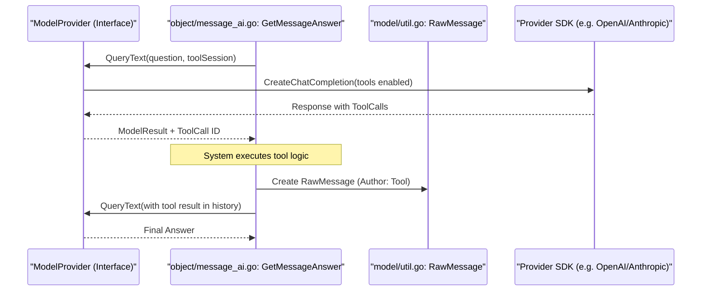

<!-- source: DeepWiki mcp.deepwiki.com · repo the-open-agent/openagent · page 3.1 LLM Provider Integrations · fetched 2026-10-27 -->

# LLM Provider Integrations

<details>
<summary>Relevant source files</summary>

The following files were used as context for generating this wiki page:

- [embedding/alibabacloud.go](embedding/alibabacloud.go)
- [embedding/azure_openai.go](embedding/azure_openai.go)
- [embedding/local.go](embedding/local.go)
- [embedding/openai.go](embedding/openai.go)
- [embedding/provider.go](embedding/provider.go)
- [go.mod](go.mod)
- [go.sum](go.sum)
- [model/alibabacloud.go](model/alibabacloud.go)
- [model/azure_openai.go](model/azure_openai.go)
- [model/baichuan.go](model/baichuan.go)
- [model/baiducloud.go](model/baiducloud.go)
- [model/chatglm.go](model/chatglm.go)
- [model/claude.go](model/claude.go)
- [model/cohere.go](model/cohere.go)
- [model/context_length_util.go](model/context_length_util.go)
- [model/deepseek.go](model/deepseek.go)
- [model/gemini.go](model/gemini.go)
- [model/huggingface.go](model/huggingface.go)
- [model/iflytek.go](model/iflytek.go)
- [model/local.go](model/local.go)
- [model/minimax.go](model/minimax.go)
- [model/moonshot.go](model/moonshot.go)
- [model/openai.go](model/openai.go)
- [model/openai_util.go](model/openai_util.go)
- [model/openrouter.go](model/openrouter.go)
- [model/provider.go](model/provider.go)
- [model/silicon_flow.go](model/silicon_flow.go)
- [model/stepfun.go](model/stepfun.go)
- [model/util.go](model/util.go)
- [model/volcengine.go](model/volcengine.go)
- [model/yi.go](model/yi.go)
- [object/message_ai.go](object/message_ai.go)
- [object/transaction.go](object/transaction.go)
- [object/util.go](object/util.go)

</details>


This page details the Large Language Model (LLM) provider subsystem in OpenAgent. It covers the abstraction layer that allows the system to support a wide variety of AI backends, the factory pattern for provider instantiation, and the specific implementations for major cloud and local providers.

## ModelProvider Abstraction

OpenAgent uses a unified interface, `ModelProvider`, to interact with different LLM backends. This abstraction ensures that the core chat engine remains decoupled from the specific API quirks of individual providers like OpenAI, Claude, or Gemini.

### The ModelProvider Interface
Every LLM integration must implement the following key methods:
*   `QueryText`: The primary method for sending a prompt and receiving a streamed response. It handles history, system prompts, knowledge context, and tool sessions [model/provider.go:51-51]().
*   `GetPricing`: Returns a string describing the pricing structure of the model [model/provider.go:50-50]().
*   `ListModels`: Dynamically fetches available models from the provider's endpoint [model/provider.go:52-52]().

### Data Flow: Natural Language to Code Entities
The following diagram illustrates how a user's natural language request is transformed into provider-specific API calls through the OpenAgent internal entities.

**Diagram: Request Transformation Pipeline**

Sources: [model/provider.go:49-53](), [model/local.go:216-240](), [model/util.go:29-36](), [model/util.go:198-238]()

## Provider Factory and Supported Backends

The `GetModelProvider` function in `model/provider.go` acts as a factory, instantiating the correct provider based on the `typ` and `subType` stored in the database [model/provider.go:117-117]().

### Supported Providers
OpenAgent supports an extensive list of backends, each with a dedicated implementation file:

| Provider | Implementation Class | Key Features |
| :--- | :--- | :--- |
| **OpenAI** | `OpenAiModelProvider` | Native tool calling, pricing in USD [model/openai.go:36-47]() |
| **Azure** | `LocalModelProvider` | Enterprise security, deployment name mapping [model/local.go:224-226]() |
| **Claude** | `ClaudeModelProvider` | Native thinking/reasoning budget support [model/claude.go:30-35]() |
| **Gemini** | `GeminiModelProvider` | Multi-modal support (text/image/video) [model/gemini.go:30-36]() |
| **DeepSeek** | `DeepSeekProvider` | Native DeepSeek API integration [model/provider.go:161-161]() |
| **iFlytek** | `iFlytekModelProvider` | Spark model series with CNY pricing [model/iflytek.go:24-28]() |
| **Local/Custom** | `LocalModelProvider` | OpenAI-compatible APIs (Ollama, vLLM) [model/local.go:32-47]() |
| **Moonshot** | `MoonshotModelProvider` | Kimi series support [model/provider.go:150-151]() |
| **Volcano Engine** | `VolcengineModelProvider` | Doubao models with thinking support [model/provider.go:158-159]() |

Sources: [model/provider.go:117-176](), [model/local.go:51-67](), [model/openai.go:49-63](), [model/claude.go:37-39](), [model/gemini.go:38-47](), [model/iflytek.go:30-37]()

## Pricing Engine and Token Counting

OpenAgent includes a robust pricing engine that calculates costs in real-time. This is critical for multi-tenant environments and usage tracking.

### Token Counting Logic
For OpenAI and compatible models, the system uses the `tiktoken-go` library [model/openai_util.go:18-18]().
*   `GetTokenSize`: Calculates tokens for a single string using model-specific encoding [model/util.go:113-123]().
*   `OpenaiNumTokensFromMessages`: Calculates tokens for an entire chat history, accounting for message metadata, roles, and reply priming [model/openai_util.go:210-215]().

### Price Calculation
Each provider implements logic to determine cost. For example, `CalculateOpenAIModelPrice` uses a switch-case on the `model` string to determine the `inputPricePerThousandTokens` and `outputPricePerThousandTokens` [model/openai.go:65-104](). Costs are refined using `math.Round` to ensure financial accuracy [model/util.go:54-58]().

Sources: [model/util.go:54-69](), [model/openai_util.go:210-215](), [model/openai.go:65-125]()

## Dry-Run Mode

To prevent unnecessary API costs during testing or validation, OpenAgent implements a **Dry-Run Mode**. If a question is prefixed with the constant `DryRunPrefix` (`$OpenAgentDryRun$`), the provider will calculate the expected token usage and check it against the model's context limit without actually calling the remote AI service [model/provider.go:30-30]().

**Implementation Example (Claude):**
```go
if strings.HasPrefix(question, "$OpenAgentDryRun$") {
    modelResult, err := getDefaultModelResult(p.subType, question, "")
    if getContextLength(p.subType) > modelResult.TotalTokenCount {
        return modelResult, nil
    } else {
        return nil, fmt.Errorf(i18n.Translate(lang, "model:exceed max tokens"))
    }
}
```
Sources: [model/claude.go:101-111](), [model/provider.go:30-30]()

## Tool Call Orchestration

OpenAgent allows models to execute tools, including those integrated via the **Model Context Protocol (MCP)**. This is handled by transforming provider-specific tool call structures into a common internal format.

1.  The model returns a `ToolCall` instead of plain text [model/util.go:34-34]().
2.  The system identifies the tool (Built-in or MCP Server).
3.  `mergeAdjacentAssistantToolCalls` is used for providers like Moonshot (Kimi) that require all tool calls from the same turn to live in a single message [model/openai_util.go:126-145]().
4.  The tool result is appended to the history as a `Tool` role message [model/openai_util.go:155-156]().

**Diagram: Tool Execution Loop**

Sources: [model/openai_util.go:126-145](), [model/util.go:29-36](), [model/provider.go:51-51]()

---

