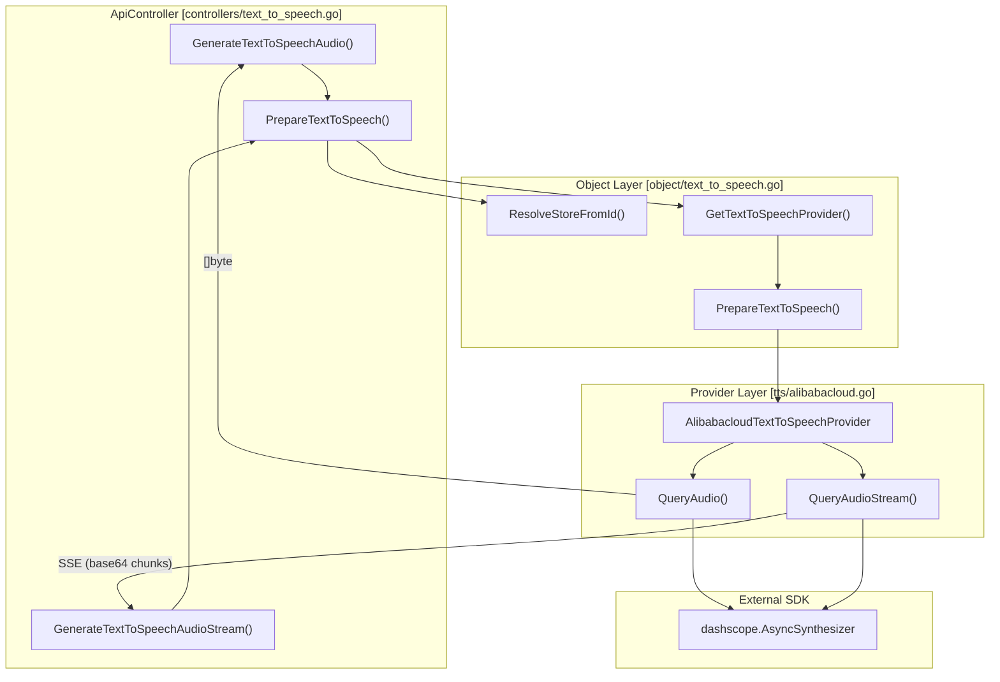
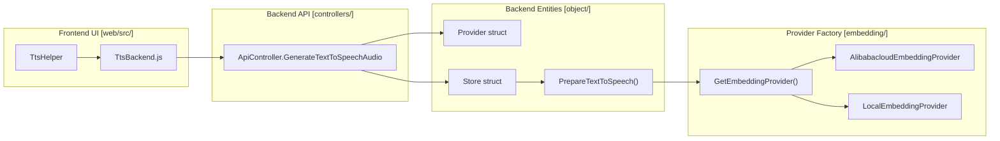

<!-- source: DeepWiki mcp.deepwiki.com · repo the-open-agent/openagent · page 3.4 Speech & Audio Processing · fetched 2026-10-27 -->

# Speech & Audio Processing

Relevant source files

The following files were used as context for generating this wiki page:

- [controllers/text_to_speech.go](controllers/text_to_speech.go)
- [embedding/alibabacloud.go](embedding/alibabacloud.go)
- [embedding/local.go](embedding/local.go)
- [embedding/openai.go](embedding/openai.go)
- [embedding/provider.go](embedding/provider.go)
- [model/alibabacloud.go](model/alibabacloud.go)
- [model/silicon_flow.go](model/silicon_flow.go)
- [model/volcengine.go](model/volcengine.go)
- [object/message_ai.go](object/message_ai.go)
- [object/text_to_speech.go](object/text_to_speech.go)
- [tts/alibabacloud.go](tts/alibabacloud.go)
- [tts/provider.go](tts/provider.go)
- [web/src/TextToSpeech.js](web/src/TextToSpeech.js)
- [web/src/backend/TtsBackend.js](web/src/backend/TtsBackend.js)

OpenAgent provides a robust abstraction layer for handling audio data, encompassing **Text-to-Speech (TTS)** and **Speech-to-Text (STT)** capabilities. The system supports both cloud-based providers (like Alibaba Cloud CosyVoice) and local browser-based synthesis, integrated directly into the chat interface.

## 1. Text-to-Speech (TTS) Architecture

The TTS system follows a provider-based abstraction pattern. The backend handles request preparation, provider resolution, and usage tracking, while the frontend manages audio playback and stream synchronization.

### 1.1 Backend Abstraction & Flow
The core logic resides in `object/text_to_speech.go`, which orchestrates the transition from a text message to an audio provider.

- **Preparation**: `PrepareTextToSpeech` resolves the `Store` configuration via `ResolveStoreFromId` to find the assigned TTS provider and initializes the provider object [object/text_to_speech.go:127-157]().
- **Execution**: Providers implement the `TextToSpeechProvider` interface, offering `QueryAudio` (unary) and `QueryAudioStream` (SSE) methods [tts/provider.go:29-32]().
- **Stats Tracking**: After successful synthesis, `UpdateChatStats` updates the `Chat` object with token usage and cost calculations based on the provider's pricing model [object/text_to_speech.go:159-169]().

### 1.2 Alibaba Cloud Implementation
The `AlibabacloudTextToSpeechProvider` utilizes the **CosyVoice** large model for high-quality speech synthesis.

- **Pricing**: Billed at 0.0007 yuan per 1,000 tokens for `text-embedding-v1/v2` and 0.0005 for `v3` [embedding/alibabacloud.go:40-52](). (Note: specific TTS pricing for CosyVoice is handled within the `tts` package implementation).
- **Streaming Implementation**: The system supports streaming via `GenerateTextToSpeechAudioStream`, which sets response headers for `text/event-stream` and writes audio chunks directly to the response writer [controllers/text_to_speech.go:78-102]().

### TTS Data Flow: Text to Audio
The following diagram bridges the controller logic to the provider implementation.

**Sources:** [controllers/text_to_speech.go:38-102](), [object/text_to_speech.go:127-157](), [embedding/alibabacloud.go:40-52]()

## 2. Browser-Side Voice Integration

The frontend uses `TtsHelper` in `web/src/TextToSpeech.js` to manage the audio lifecycle. It supports three modes: **Browser Built-In**, **Cloud Unary**, and **Cloud Streaming**.

### 2.1 TtsHelper Logic
- **Browser TTS**: Uses the standard `window.speechSynthesis` API when no cloud provider is configured [web/src/TextToSpeech.js:111]().
- **Cloud Streaming**: Connects to the backend via `EventSource` through `generateTextToSpeechAudioStream` [web/src/backend/TtsBackend.js:43-49](). It maintains an `audioQueue` and uses the `AudioContext` to decode and play audio chunks sequentially [web/src/TextToSpeech.js:118-144]().
- **Non-Streaming**: Fetches a complete audio blob from `/api/generate-text-to-speech-audio` and plays it using a standard HTML5 `Audio` object [web/src/TextToSpeech.js:179-213]().

### 2.2 Provider Management & Testing
Administrators configure providers through the management interface.
- **Provider Factory**: `GetEmbeddingProvider` (and similar TTS factories) instantiate specific implementations like `NewAlibabacloudEmbeddingProvider` based on the `typ` string [embedding/provider.go:34-69]().
- **Local/Proxy Support**: For providers like OpenAI, the system can route requests through a proxy via `getProxyClientFromToken` [embedding/openai.go:30-36]().

### Entity Association Diagram
This diagram maps the UI components to the underlying backend data structures and providers.

**Sources:** [web/src/TextToSpeech.js:19-80](), [embedding/provider.go:34-69](), [object/text_to_speech.go:127-157](), [web/src/backend/TtsBackend.js:17-49]()

## 3. Embedding & Vector Processing

While primarily for RAG, the embedding providers share the same infrastructure as speech providers for credential management and pricing.

- **Local Provider**: The `LocalEmbeddingProvider` supports OpenAI-compatible APIs, Azure, and Ollama [embedding/local.go:28-51]().
- **Price Calculation**: Each provider implements `calculatePrice` to determine costs based on token counts and specific model rates (e.g., `text-embedding-3-small` at $0.00002 per 1k tokens) [embedding/local.go:79-99]().
- **Alibaba Cloud Embedding**: Wraps a `LocalEmbeddingProvider` pointing to the DashScope compatible endpoint while applying Alibaba-specific pricing [embedding/alibabacloud.go:69-84]().

**Sources:** [embedding/local.go:79-99](), [embedding/alibabacloud.go:69-84](), [embedding/provider.go:71-89]()

## 4. Supported Providers & Models

| Provider Category | Type | Implementation Class | Key Capabilities |
| :--- | :--- | :--- | :--- |
| **Text-to-Speech** | `Alibaba Cloud` | `AlibabacloudTextToSpeechProvider` | CosyVoice v1, SSE Streaming, Async Synthesis [controllers/text_to_speech.go:78-102]() |
| **Text-to-Speech** | `Browser` | `TtsHelper` (Frontend) | Local synthesis via `window.speechSynthesis` [web/src/TextToSpeech.js:111]() |
| **Embedding** | `OpenAI` | `LocalEmbeddingProvider` | Support for `text-embedding-3-large/small` [embedding/local.go:83-89]() |
| **Embedding** | `Volcengine` | `VolcengineModelProvider` | Doubao-embedding-vision support [model/volcengine.go:97]() |

**Sources:** [embedding/local.go:83-89](), [model/volcengine.go:97](), [web/src/TextToSpeech.js:111](), [controllers/text_to_speech.go:78-102]()

---

