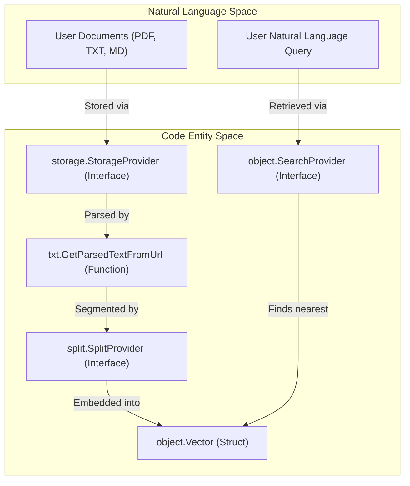
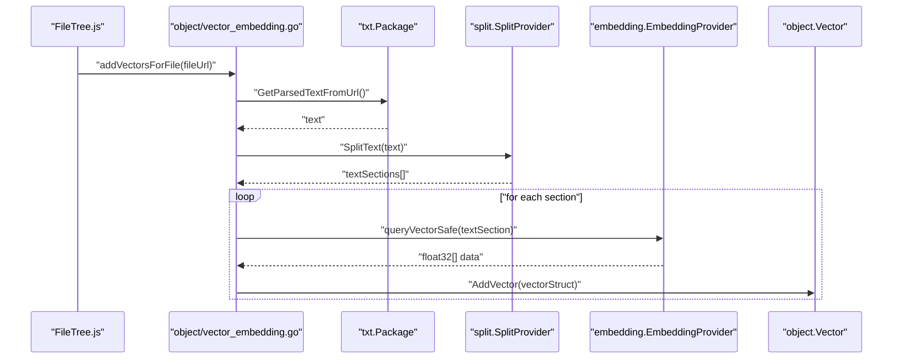

<!-- source: DeepWiki mcp.deepwiki.com · repo the-open-agent/openagent · page 4 Knowledge Base & RAG · fetched 2026-10-27 -->

# Knowledge Base & RAG

Relevant source files

The following files were used as context for generating this wiki page:

- [contest/rag_contest.go](contest/rag_contest.go)
- [contest/rag_contest_test.go](contest/rag_contest_test.go)
- [object/search.go](object/search.go)
- [object/search_default.go](object/search_default.go)
- [object/search_default_util.go](object/search_default_util.go)
- [object/search_hierarchy.go](object/search_hierarchy.go)
- [object/vector.go](object/vector.go)
- [object/vector_embedding.go](object/vector_embedding.go)
- [web/package.json](web/package.json)
- [web/src/App.less](web/src/App.less)
- [web/src/FileTree.js](web/src/FileTree.js)
- [web/src/LanguageSelect.js](web/src/LanguageSelect.js)
- [web/src/index.css](web/src/index.css)
- [web/src/shadcnTheme.js](web/src/shadcnTheme.js)
- [web/yarn.lock](web/yarn.lock)

The Knowledge Base and Retrieval-Augmented Generation (RAG) subsystem enables OpenAgent to provide context-aware responses by grounding AI generations in private or domain-specific documents. This system manages the entire lifecycle of knowledge: from raw file storage and automated parsing to vector indexing and semantic retrieval.

## Overview of the RAG Pipeline

The RAG process in OpenAgent bridges the gap between unstructured data and the LLM's context window. The workflow is orchestrated primarily within the `object` package, specifically in the vector embedding pipeline [object/vector_embedding.go:108-172]().

### Conceptual to Code Mapping

The following diagram illustrates how high-level RAG concepts translate into specific code entities and data structures within the OpenAgent repository.

**Diagram: RAG Logic to Code Entity Mapping**

**Sources:** [object/vector_embedding.go:108-172](), [object/vector.go:24-42](), [object/search.go:21-23]()

---

## File Storage & Management
OpenAgent supports multiple storage backends through the `StorageProvider` interface, allowing files to be hosted locally, on OpenAI's infrastructure, or via Casdoor [object/vector_embedding.go:31]().

The frontend provides a `FileTree` component [web/src/FileTree.js:41-66]() that visualizes the hierarchical structure of a Store's knowledge base. It handles batch deletions [web/src/FileTree.js:94-110](), uploads via `TreeFileBackend.addFile` [web/src/FileTree.js:214](), and permission management through `PermissionBackend` [web/src/FileTree.js:123-136](). The UI supports various file types and even specialized data types like ECG or Impedance [web/src/FileTree.js:180-181]().

For details, see [File Storage & Management](#4.1).

**Sources:** [web/src/FileTree.js:41-110](), [web/src/FileTree.js:180-214](), [object/vector_embedding.go:199-208]()

---

## Document Parsing & Text Splitting
Once files are uploaded, they must be converted into machine-readable text. The system utilizes the `txt` package to extract content from various formats including PDF, DOCX, and Markdown via `txt.GetParsedTextFromUrl` [object/vector_embedding.go:115-118](). 

After parsing, the text is divided into manageable chunks using a `SplitProvider` [object/vector_embedding.go:133-136](). This ensures that the context provided to the LLM is relevant and fits within token limits. Supported strategies include:
*   **Default**: Standard paragraph-based splitting [object/vector_embedding.go:122]().
*   **QA**: Specialized splitting for question-answer pairs, triggered if the file name starts with "QA" and is a `.docx` [object/vector_embedding.go:125-127]().
*   **Markdown**: Structure-aware splitting for `.md` files [object/vector_embedding.go:129-131]().

The system also tracks file status during this process (e.g., `Processing`, `Finished`, `Error`) to provide feedback to the user [object/vector_embedding.go:174-197]().

For details, see [Document Parsing & Text Splitting](#4.2).

**Sources:** [object/vector_embedding.go:108-141](), [object/vector_embedding.go:175-183](), [object/vector_embedding.go:115-118]()

---

## Vector Store & Search
The final stage of the RAG pipeline is the vectorization and indexing of text chunks. Each chunk is transformed into an `object.Vector` and persisted via `AddVector` [object/vector.go:143-155]().

### Vector Data Model
The `Vector` struct stores the embedding data along with metadata such as the source file, index, and token count [object/vector.go:24-42]().

| Field | Type | Description |
| :--- | :--- | :--- |
| `Text` | `string` | The raw text segment [object/vector.go:34]() |
| `Data` | `[]float32` | The numerical embedding vector [object/vector.go:40]() |
| `Dimension` | `int` | Length of the vector [object/vector.go:41]() |
| `TokenCount`| `int` | Tokens consumed by this segment [object/vector.go:35]() |
| `Score` | `float32` | Similarity score calculated during search [object/vector.go:38]() |

### Retrieval Strategies
OpenAgent supports different search strategies via the `SearchProvider` interface [object/search.go:21-23]().
*   **DefaultSearchProvider**: Performs standard cosine similarity lookups using `getNearestVectors` [object/search_default.go:24-64]().
*   **HierarchySearchProvider**: Uses an LLM to enhance the user question based on document titles (specifically for Markdown files) before performing the vector search [object/search_hierarchy.go:34-84]().

**Diagram: Embedding & Storage Pipeline**

For details, see [Vector Store & Search](#4.3).

**Sources:** [object/vector.go:24-42](), [object/vector_embedding.go:53-106](), [object/search.go:25-40](), [object/search_hierarchy.go:34-84](), [object/search_hierarchy.go:86-99]()

---

