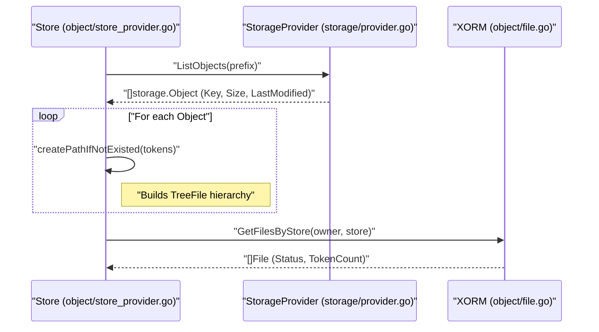
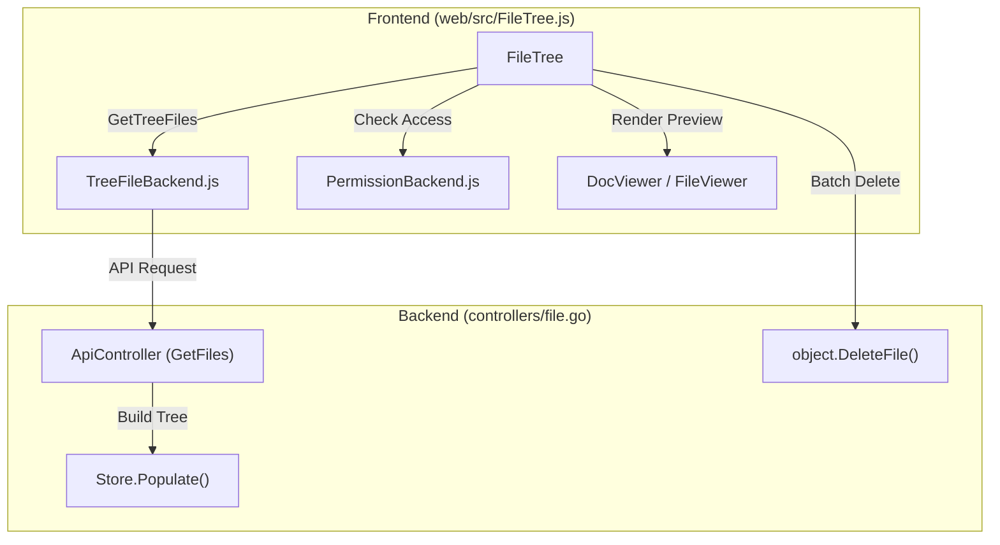

<!-- source: DeepWiki mcp.deepwiki.com · repo the-open-agent/openagent · page 4.1 File Storage & Management · fetched 2026-10-27 -->

# File Storage & Management

Relevant source files

The following files were used as context for generating this wiki page:

- [controllers/file.go](controllers/file.go)
- [controllers/tree_file.go](controllers/tree_file.go)
- [controllers/util_record.go](controllers/util_record.go)
- [object/file.go](object/file.go)
- [object/store_provider.go](object/store_provider.go)
- [object/store_test.go](object/store_test.go)
- [object/tree_file.go](object/tree_file.go)
- [storage/casdoor.go](storage/casdoor.go)
- [storage/local_file_system.go](storage/local_file_system.go)
- [storage/provider.go](storage/provider.go)
- [util/string.go](util/string.go)
- [web/package.json](web/package.json)
- [web/src/App.less](web/src/App.less)
- [web/src/AvatarUpload.js](web/src/AvatarUpload.js)
- [web/src/FileListPage.js](web/src/FileListPage.js)
- [web/src/FileTree.js](web/src/FileTree.js)
- [web/src/LanguageSelect.js](web/src/LanguageSelect.js)
- [web/src/PermissionUtil.js](web/src/PermissionUtil.js)
- [web/src/SiteListPage.js](web/src/SiteListPage.js)
- [web/src/backend/FileBackend.js](web/src/backend/FileBackend.js)
- [web/src/backend/PermissionBackend.js](web/src/backend/PermissionBackend.js)
- [web/src/backend/StorageProviderBackend.js](web/src/backend/StorageProviderBackend.js)
- [web/src/backend/TreeFileBackend.js](web/src/backend/TreeFileBackend.js)
- [web/src/index.css](web/src/index.css)
- [web/src/shadcnTheme.js](web/src/shadcnTheme.js)
- [web/src/table/FileTable.js](web/src/table/FileTable.js)
- [web/yarn.lock](web/yarn.lock)

The File Storage & Management system in OpenAgent provides a unified abstraction for handling physical file assets across multiple storage backends. It bridges the gap between raw storage (OSS, Local FS, OpenAI, Casdoor) and the higher-level Knowledge Base/RAG features by managing file metadata, permissions, and hierarchical visualization.

## StorageProvider Abstraction

OpenAgent utilizes a `StorageProvider` interface to decouple the application logic from specific storage implementations. This allows the system to interact with files regardless of whether they reside on a local disk or a cloud-based provider.

### Supported Implementations
*   **Local File System**: Stores files on the server's local storage using `LocalFileSystemStorageProvider` [storage/local_file_system.go:28-30]().
*   **OpenAI File System**: Integrates with OpenAI's file management API for use with Assistants.
*   **Casdoor**: Leverages Casdoor's resource management capabilities via `CasdoorProvider` [storage/casdoor.go:26-28]().

### Data Flow: Storage to Store
The `Store` entity (the primary container for AI configuration) populates its internal `FileTree` by querying the associated `StorageProvider`. The `Populate` function in `object/store_provider.go` iterates through objects returned by the provider and builds a hierarchical tree structure [object/store_provider.go:81-134](). It uses `createPathIfNotExisted` to recursively build the `TreeFile` nodes [object/store_provider.go:23-71]().

Title: Storage Population Sequence

Sources: [object/store_provider.go:81-134](), [storage/provider.go:1-30](), [object/file.go:74-82]()

## File Entity & Persistence

While `StorageProvider` handles the physical bytes, the `File` struct in the `object` package tracks the database metadata necessary for RAG operations and administration.

| Field | Type | Description |
| :--- | :--- | :--- |
| `Owner` | `string` | The organization owning the file (Primary Key) [object/file.go:40]() |
| `Name` | `string` | Unique identifier, usually `{StoreName}_{ObjectKey}` (Primary Key) [object/file.go:41]() |
| `Store` | `string` | The Store ID this file belongs to [object/file.go:46]() |
| `Status` | `FileStatus` | `Pending`, `Processing`, `Finished`, or `Error` [object/file.go:32-37]() |
| `TokenCount`| `int` | Number of LLM tokens in the document [object/file.go:49]() |
| `Url` | `string` | The public or internal access URL [object/file.go:48]() |

Sources: [object/file.go:39-52](), [object/file.go:170-172]()

## FileTree UI Component

The `FileTree` component in the frontend provides a Windows Explorer-like interface for managing files within a Store. It supports hierarchical navigation, batch operations, and context-aware previews.

### Key Features
*   **Hierarchical Navigation**: Uses the `Tree` component from Ant Design to render the `FileTree` structure [web/src/FileTree.js:17]().
*   **File Previews**: Integrated with `@cyntler/react-doc-viewer` and `react-file-viewer` for PDF, DOCX, and image previews [web/src/FileTree.js:22-23]().
*   **Batch Deletion**: Users can select multiple files and delete them simultaneously via `batchDeleteFiles`, which triggers both database record removal and physical storage deletion [web/src/FileTree.js:93-109]().
*   **Permission Inheritance**: The component fetches permissions from the Casdoor backend to determine if the current user can upload or delete files within a specific domain [web/src/FileTree.js:122-135]().

Title: FileTree Component Architecture

Sources: [web/src/FileTree.js:40-65](), [web/src/FileTree.js:122-135](), [object/store_provider.go:81-134]()

## File Management Administration

The `FileListPage` provides a global administrative view of all files across the system. This view is primarily used by administrators to monitor processing statuses and trigger manual vector refreshes.

### Admin Operations
*   **Global Search**: Filter files by Store, Name, Filename, or Status using `getColumnSearchProps` [web/src/FileListPage.js:153-216]().
*   **Vector Refresh**: The `refreshFileVectors` function allows admins to force a re-indexing of a file into the vector database [web/src/FileListPage.js:119-150]().
*   **File Upload**: Admins can upload files directly to a store via `uploadFile`, which calls the backend `UploadFile` endpoint [web/src/FileListPage.js:59-92]().

### File Deletion Logic
When a file is deleted via `object.DeleteFile`:
1.  The system identifies the `objectKey` by stripping the store prefix from the file name [object/file.go:131-135]().
2.  The physical object is removed from the `StorageProvider` via `DeleteObject` [object/file.go:152-155]().
3.  All associated vectors in the vector store are purged using `DeleteVectorsByFile` [object/file.go:157-160]().
4.  The metadata record is removed from the XORM database using the primary key `(owner, name)` [object/file.go:162-167]().

Sources: [web/src/FileListPage.js:25-57](), [object/file.go:130-168](), [controllers/file.go:222-250]()

---

