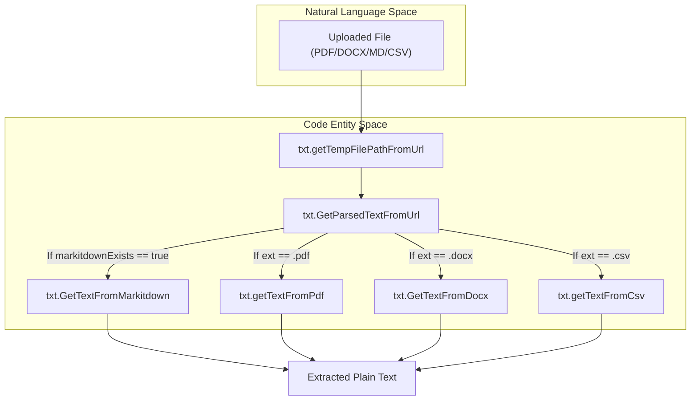
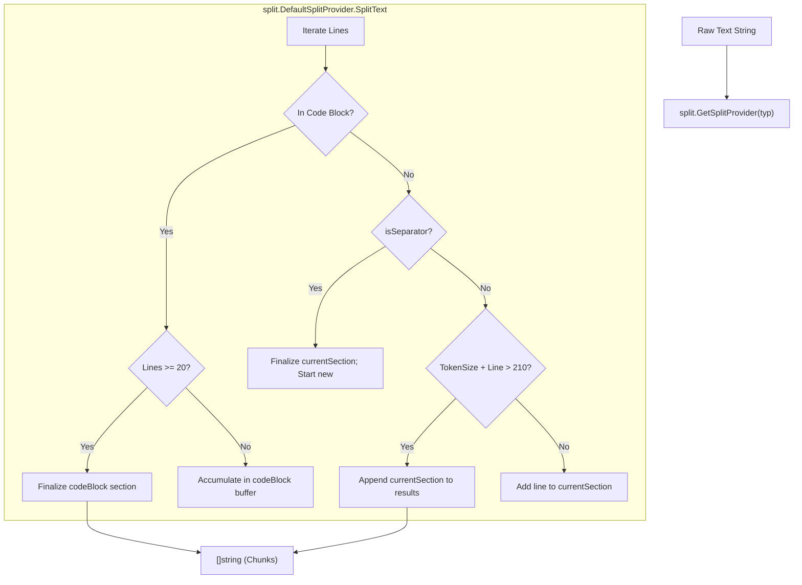

<!-- source: DeepWiki mcp.deepwiki.com · repo the-open-agent/openagent · page 4.2 Document Parsing & Text Splitting · fetched 2026-10-27 -->

# Document Parsing & Text Splitting

<details>
<summary>Relevant source files</summary>

The following files were used as context for generating this wiki page:

- [audio/audio_test.go](audio/audio_test.go)
- [audio/xfyun_client_test.go](audio/xfyun_client_test.go)
- [object/video_import_test.go](object/video_import_test.go)
- [split/basic.go](split/basic.go)
- [split/default.go](split/default.go)
- [split/markdown.go](split/markdown.go)
- [split/markdown_test.go](split/markdown_test.go)
- [split/provider.go](split/provider.go)
- [split/provider_test.go](split/provider_test.go)
- [split/qa.go](split/qa.go)
- [txt/csv.go](txt/csv.go)
- [txt/docx.go](txt/docx.go)
- [txt/markitdown.go](txt/markitdown.go)
- [txt/pdf.go](txt/pdf.go)
- [txt/plain.go](txt/plain.go)
- [txt/txt.go](txt/txt.go)
- [txt/txt_test.go](txt/txt_test.go)
- [txt/util.go](txt/util.go)
- [util/header_test.go](util/header_test.go)

</details>


The Document Parsing and Text Splitting subsystem is responsible for converting heterogeneous file formats (PDF, DOCX, XLSX, etc.) into clean, structured text and subsequently dividing that text into manageable segments for vector embedding and retrieval. This process is critical for the Retrieval-Augmented Generation (RAG) pipeline, ensuring that the AI context window is populated with relevant, high-quality information.

## Document Parsing (`txt` package)

The `txt` package provides a unified interface for extracting text from various file types. It utilizes a combination of native Go libraries and an optional integration with Microsoft's **MarkItDown** for high-fidelity conversion.

### Core Parsing Logic
The system determines the parsing strategy based on the file extension. If the `markitdown` executable is available in the system path, it is prioritized for complex formats like DOCX and PDF [txt/docx.go:26-28](), [txt/markitdown.go:30-38]().

| Format | Parser Function | Primary Library / Method |
| :--- | :--- | :--- |
| **PDF** | `getTextFromPdf` | `github.com/casibase/pdf`, `pdfcpu` [txt/pdf.go:22-24]() |
| **DOCX** | `GetTextFromDocx` | `github.com/carmel/gooxml` [txt/docx.go:21-30]() |
| **XLSX** | `getTextFromXlsx` | `txt/xlsx.go` (internal) [txt/txt.go:57-58]() |
| **PPTX** | `getTextFromPptx` | `txt/pptx.go` (internal) [txt/txt.go:59-60]() |
| **CSV** | `getTextFromCsv` | `encoding/csv` (converted to JSON) [txt/csv.go:26-70]() |
| **Markdown/Plain** | `getTextFromPlain` | Native string handling [txt/txt.go:49-50]() |
| **MarkItDown** | `GetTextFromMarkitdown` | `exec.Command("markitdown")` [txt/markitdown.go:50-62]() |

### MarkItDown Integration
The `markitdown` integration allows OpenAgent to leverage external Python-based tools for superior parsing of office documents. It includes logic to handle character encoding, specifically converting GBK (common in Chinese documents) to UTF-8 using `simplifiedchinese.GBK.NewDecoder()` [txt/markitdown.go:40-48]().

### Data Flow: URL to Text
The following diagram illustrates the lifecycle of a document being converted to text, mapping system logic to code entities.

**Document Extraction Pipeline**

**Sources:** [txt/txt.go:30-69](), [txt/util.go:25-42](), [txt/docx.go:25-56](), [txt/markitdown.go:50-86](), [txt/csv.go:26-70]()

---

## Text Splitting (`split` package)

Once text is extracted, it must be split into "chunks" or "sections." This is handled by the `SplitProvider` interface [split/provider.go:17-19]().

### Split Strategies
OpenAgent supports several splitting strategies via `split.GetSplitProvider(typ)` [split/provider.go:21-40]():

1.  **Default (`DefaultSplitProvider`)**: A sophisticated splitter that respects code blocks (```) and section headers. It uses the `gpt-3.5-turbo` tokenizer to ensure chunks do not exceed a `maxLength` of 210 tokens [split/default.go:39-112]().
2.  **QA (`QaSplitProvider`)**: Designed for FAQ-style documents. It looks for "Q:" and "A:" prefixes to group question-answer pairs into single units [split/qa.go:28-57]().
3.  **Markdown (`MarkdownSplitProvider`)**: A specialized splitter that extracts a document tree based on headers and isolates tables (Standard, Borderless, or HTML) while preserving their context [split/markdown.go:23-29](), [split/markdown.go:140-177]().
4.  **Basic (`BasicSplitProvider`)**: Simple line-based or character-count splitting [split/provider.go:28-29]().

### Default Splitter Implementation Details
The `DefaultSplitProvider` maintains state while iterating through lines:
*   **Code Blocks**: If a code block is detected (via ` ``` `) and contains more than 5 lines, it is treated as a standalone section. If it reaches 20 lines, it is forced into a new section to maintain granularity [split/default.go:63-95]().
*   **Separators**: It identifies "Chapter", "Section", or numeric bullet points (e.g., `^\d+\.\s`) as natural boundaries [split/default.go:133-141]().
*   **Token Sensitivity**: It calls `model.GetTokenSize` with `gpt-3.5-turbo` as the reference model to verify if adding the next line exceeds the token limit before finalizing a chunk [split/default.go:107-123]().

### Markdown Splitter Implementation Details
The `MarkdownSplitProvider` uses a hierarchical approach:
*   **Tree Extraction**: `ExtractMarkdownTree` parses the text into a map where keys represent the heading path (e.g., `# Title > ## Subtitle`) and values contain the associated content [split/markdown.go:29-96]().
*   **Table Isolation**: `ExtractTablesAndRemainder` uses regex to identify and remove Markdown or HTML tables from the text flow so they can be processed as distinct sections [split/markdown.go:98-124]().
*   **Context Preservation**: When splitting content, the provider prepends the heading path (the `contextKey`) to every resulting chunk and table, ensuring the LLM understands the structural location of the information [split/markdown.go:126-138]().

**Text Splitting Logic Flow**

**Sources:** [split/default.go:38-131](), [split/provider.go:21-40](), [split/markdown.go:140-177](), [split/qa.go:28-57]()

---

## Technical Implementation Summary

### Key Functions & Classes
*   `txt.GetParsedTextFromUrl(url, ext, lang)`: The central dispatcher for document parsing. It handles local paths and remote URLs (via temporary file download) [txt/txt.go:30-69]().
*   `split.SplitProvider`: Interface defining the `SplitText(text string) ([]string, error)` contract [split/provider.go:17-19]().
*   `txt.GetTextFromMarkitdown(path, lang)`: Executes the `markitdown` CLI and handles UTF-8 validation/GBK conversion [txt/markitdown.go:50-86]().
*   `split.ExtractMarkdownTree(markdownText)`: Generates a hierarchical map of content keyed by breadcrumb-style heading paths [split/markdown.go:29-96]().
*   `txt.getPageTexts(p pdf.Page)`: Low-level PDF extraction that recovers from panics during content stream parsing [txt/pdf.go:26-42]().

### Dependencies & Tooling
*   **pdfcpu**: Used for optimizing and validating PDF files before extraction [txt/pdf.go:45-47]().
*   **gooxml**: Used for native DOCX parsing by iterating through `docx.Paragraphs()` and `para.Runs()` [txt/docx.go:30-48]().
*   **MarkItDown**: External dependency checked via `exec.LookPath("markitdown")` [txt/markitdown.go:32-34]().
*   **i18n**: Used to provide localized error messages during parsing failures [txt/txt.go:62](), [txt/markitdown.go:52]().

**Sources:** [txt/txt.go:26-69](), [txt/pdf.go:22-95](), [txt/docx.go:25-56](), [txt/markitdown.go:30-86](), [split/default.go:24-161](), [split/markdown.go:15-178]()

---

