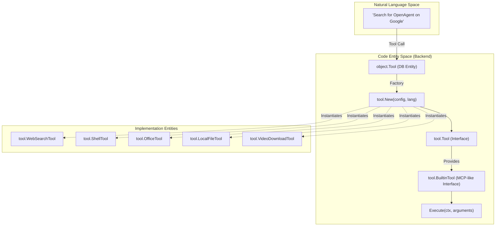
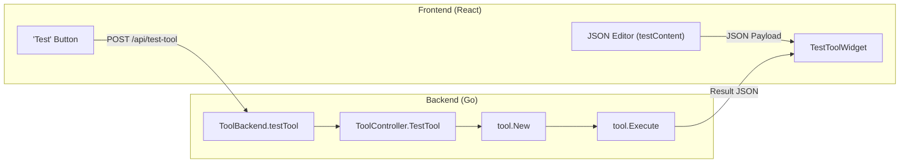

<!-- source: DeepWiki mcp.deepwiki.com · repo the-open-agent/openagent · page 5.1 Built-in Tools · fetched 2026-10-27 -->

# Built-in Tools

Relevant source files

The following files were used as context for generating this wiki page:

- [controllers/skill.go](controllers/skill.go)
- [controllers/snapshot.go](controllers/snapshot.go)
- [object/skill.go](object/skill.go)
- [object/snapshot.go](object/snapshot.go)
- [object/snapshot_tool.go](object/snapshot_tool.go)
- [object/tool.go](object/tool.go)
- [skills/powerpoint/SKILL.md](skills/powerpoint/SKILL.md)
- [skills/powerpoint/references/pptxgenjs.md](skills/powerpoint/references/pptxgenjs.md)
- [tool/browser.go](tool/browser.go)
- [tool/local_file.go](tool/local_file.go)
- [tool/office.go](tool/office.go)
- [tool/office_excel.go](tool/office_excel.go)
- [tool/office_ppt_read.go](tool/office_ppt_read.go)
- [tool/office_ppt_write.go](tool/office_ppt_write.go)
- [tool/office_word.go](tool/office_word.go)
- [tool/shell.go](tool/shell.go)
- [tool/shell_kill_unix.go](tool/shell_kill_unix.go)
- [tool/shell_kill_windows.go](tool/shell_kill_windows.go)
- [tool/skill.go](tool/skill.go)
- [tool/time.go](tool/time.go)
- [tool/tool.go](tool/tool.go)
- [tool/video_download.go](tool/video_download.go)
- [tool/web_fetch.go](tool/web_fetch.go)
- [tool/web_search.go](tool/web_search.go)
- [web/src/ProviderSetting.js](web/src/ProviderSetting.js)
- [web/src/SkillListPage.js](web/src/SkillListPage.js)
- [web/src/ToolEditPage.js](web/src/ToolEditPage.js)
- [web/src/backend/SkillBackend.js](web/src/backend/SkillBackend.js)
- [web/src/common/TestToolWidget.js](web/src/common/TestToolWidget.js)

OpenAgent provides a comprehensive suite of built-in tools that allow AI agents to interact with the physical and digital world. These tools range from web browsing and search to local file system operations, shell execution, and Windows desktop automation.

The tool system is built on a provider-based architecture where each tool implements a standard interface, allowing the LLM to discover capabilities via JSON schemas and execute them through a unified request-flow.

## Tool Architecture & Registration

Tools are initialized during the system startup sequence. The `New` factory function in `tool/tool.go` is the central entry point for instantiating tool implementations based on the `Config` struct [tool/tool.go:39-65]().

### Data Flow: Natural Language to Code Entity

The following diagram illustrates how a user's natural language request is translated into a specific tool execution within the codebase.

**Tool Execution Mapping**

Sources: [tool/tool.go:24-26](), [tool/tool.go:39-65](), [tool/shell.go:48-52]()

## Tool Implementations

### Web Search & Fetch
The platform supports multiple search engines and direct web content extraction.

| Tool Type | SubTypes | Implementation | Description |
| :--- | :--- | :--- | :--- |
| `web_search` | DuckDuckGo, Google, Bing, Baidu | `tool.WebSearchTool` | Returns snippets, URLs, and titles. |
| `web_fetch` | Default | `tool.WebFetchTool` | Fetches HTML and extracts cleaned plain text. |
| `web_browser` | Default | `tool.BrowserTool` | Headless Chrome (chromedp) for JS-heavy sites. |

*   **Web Search**: Supports API-based search (Google/Baidu) and HTML parsing-based search (DuckDuckGo/Bing).
*   **Web Fetch**: Extracts text while stripping `script`, `style`, `nav`, `footer`, and `header` tags to minimize token usage [tool/web_fetch.go:187-190](). It handles timeouts (default 30s) and max response sizes (5MB) [tool/web_fetch.go:31-34]().
*   **Browser**: Provides navigation and interaction via `chromedp`. It supports waiting for specific CSS selectors and taking screenshots.

Sources: [tool/web_fetch.go:38-41](), [tool/web_fetch.go:68-70](), [tool/web_fetch.go:187-197]()

### Office & Local Files
These tools allow the agent to interact with the server's local environment and document formats.

*   **Office Tool**: Handles `.docx`, `.xlsx`, and `.pptx`. It can be configured for specific operations (e.g., "Word Read", "Excel Write") or "All" [tool/office.go:49-57](). Relative paths are resolved against the user's `Documents` folder to prevent files from landing in the server's working directory [tool/office.go:32-44]().
*   **PowerPoint Generation**: The `pptx_write` tool uses a specialized Node.js worker and `PptxGenJS`. Agents provide a JavaScript build script that adds slides to a `pptx` instance [tool/office_ppt_write.go:63-70]().
*   **Shell Tool**: Executes commands via `exec.CommandContext`. It supports long-running background sessions with a `session_id`, allowing for `poll`, `write`, `submit`, and `send_keys` actions [tool/shell.go:101-113](). It can allocate a PTY for interactive CLI programs [tool/shell.go:136-139]().
*   **Local File**: Provides filesystem operations including directory scanning, absolute path verification, and OCR-assisted PDF reading [tool/local_file.go:54-63]().

Sources: [tool/office.go:79-85](), [tool/office_ppt_write.go:32-39](), [tool/shell.go:48-52](), [tool/local_file.go:49-52]()

### Multimedia & Automation
*   **Video Download**: Uses `yt-dlp` to download videos, retrieve info, or extract audio.
*   **Windows UIA**: Provides GUI automation for Windows using the User Interface Automation (UIA) framework [tool/tool.go:56-57]().
*   **Time Tool**: Offers utilities for current time, timezone conversion, and timestamp mapping [tool/tool.go:42-43]().

Sources: [tool/tool.go:41-62](), [tool/local_file.go:59-60]()

## Tool Management UI

The frontend provides specialized components for configuring and validating tools.

### ToolEditPage
The `ToolEditPage` allows administrators to define tool parameters, including credentials (API keys), endpoints, and proxy settings. It dynamically adjusts input fields based on the selected `type` and `subType` [web/src/ToolEditPage.js:142-165]().

### TestToolWidget
The `TestToolWidget` is an interactive testing environment embedded within the edit page [web/src/common/TestToolWidget.js:51-52]().

**Tool Testing Data Flow**

Sources: [web/src/common/TestToolWidget.js:143-159](), [web/src/ToolEditPage.js:21-25]()

Key features of the testing widget:
1.  **Automatic Formatting**: Attempts to format JSON input for the `testContent` field [web/src/common/TestToolWidget.js:26-32]().
2.  **Default Templates**: Provides boilerplate JSON for specific tool types to help users get started [web/src/common/TestToolWidget.js:43-49]().
3.  **Result Persistence**: Saves the successful test output into the `resultSummary` field of the tool object and updates the backend [web/src/common/TestToolWidget.js:173-176]().

Sources: [web/src/ToolEditPage.js:25-35](), [web/src/common/TestToolWidget.js:106-116]()

---

