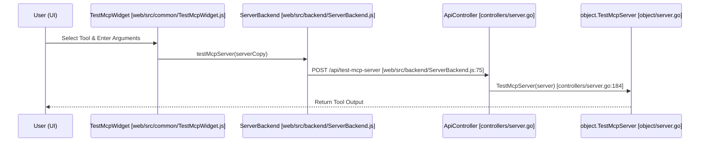

<!-- source: DeepWiki mcp.deepwiki.com · repo the-open-agent/openagent · page 5.2 MCP Server Management · fetched 2026-10-27 -->

# MCP Server Management

<details>
<summary>Relevant source files</summary>

The following files were used as context for generating this wiki page:

- [controllers/message_writer.go](controllers/message_writer.go)
- [controllers/server.go](controllers/server.go)
- [mcp/scan.go](mcp/scan.go)
- [mcp/tools.go](mcp/tools.go)
- [model/mcp.go](model/mcp.go)
- [object/server.go](object/server.go)
- [web/src/ScaleEditPage.js](web/src/ScaleEditPage.js)
- [web/src/ServerEditPage.js](web/src/ServerEditPage.js)
- [web/src/ServerListPage.js](web/src/ServerListPage.js)
- [web/src/ServerStorePage.js](web/src/ServerStorePage.js)
- [web/src/backend/ServerBackend.js](web/src/backend/ServerBackend.js)
- [web/src/chat/ToolCallSection.js](web/src/chat/ToolCallSection.js)
- [web/src/chat/toolCallStream.js](web/src/chat/toolCallStream.js)

</details>


The Model Context Protocol (MCP) integration in OpenAgent allows the system to connect to external tool providers over standard protocols. This enables AI agents to discover and execute tools hosted on remote servers, extending their capabilities beyond built-in functions.

## Overview and Architecture

OpenAgent implements an MCP client that communicates with MCP servers via HTTP-based transport. The system manages these connections through the `Server` entity, which stores connection metadata, authentication tokens, and a cache of discovered tools.

### Data Flow: Tool Discovery and Execution

The following diagram illustrates the lifecycle of an MCP server integration, from registration in the UI to tool execution by the backend.

**MCP Tool Lifecycle Diagram**
```mermaid
graph TD
    subgraph "Frontend (React)"
        "ServerEditPage [web/src/ServerEditPage.js]" -- "syncMcpTool()" --> "ServerBackend [web/src/backend/ServerBackend.js]"
        "TestMcpWidget [web/src/common/TestMcpWidget.js]" -- "testMcpServer()" --> "ServerBackend [web/src/backend/ServerBackend.js]"
        "ServerStorePage [web/src/ServerStorePage.js]" -- "addServer()" --> "ServerBackend [web/src/backend/ServerBackend.js]"
    end

    subgraph "Backend (Go/Beego)"
        "ServerBackend [web/src/backend/ServerBackend.js]" -- "HTTP POST /api/sync-mcp-tool" --> "ApiController.SyncMcpTool [controllers/server.go]"
        "ApiController.SyncMcpTool [controllers/server.go]" -- "calls" --> "object.SyncMcpTool [object/server.go]"
        "object.SyncMcpTool [object/server.go]" -- "fetches tools" --> "mcp.GetToolsFromURL [mcp/tools.go]"
        "mcp.GetToolsFromURL [mcp/tools.go]" -- "JSON-RPC over HTTP" --> "Remote_MCP_Server"
    end

    subgraph "Persistence"
        "object.SyncMcpTool [object/server.go]" -- "Updates Tools JSON" --> "XORM_Adapter [object/server.go]"
    end
```
Sources: [web/src/ServerEditPage.js:88-106](), [controllers/server.go:202-218](), [object/server.go:139-174](), [mcp/tools.go:30-61](), [web/src/ServerStorePage.js:86-100]()

---

## MCP Server Entity

The `Server` struct defines the configuration for an MCP connection.

| Field | Type | Description |
| :--- | :--- | :--- |
| `Owner` | `string` | The owner of the server (usually "admin") [object/server.go:41](). |
| `Name` | `string` | Unique identifier for the server [object/server.go:42](). |
| `Url` | `string` | The HTTP endpoint of the MCP server [object/server.go:47](). |
| `Token` | `string` | Bearer token for authentication (masked in JSON responses) [object/server.go:48](). |
| `Tools` | `[]*McpTool` | Cached list of tools retrieved from the server [object/server.go:49](). |
| `TestContent` | `string` | JSON string used to store temporary test parameters [object/server.go:50](). |

Sources: [object/server.go:40-52]()

### Tool Schema
Each tool discovered via MCP is stored as an `McpTool` object.
- **Name**: The identifier of the tool [object/server.go:34]().
- **IsAllowed**: A boolean flag allowing administrators to enable/disable specific tools from a server [object/server.go:36]().
- **InputSchema**: A JSON string representing the JSON Schema for the tool's arguments [object/server.go:37]().

---

## Tool Discovery and Intranet Scanning

### `GetToolsFromURL`
The core logic for fetching tools resides in the `mcp` package. The function `GetToolsFromURL` establishes a `StreamableHTTPClientTransport` to the remote server.
1.  **Authentication**: If a token is provided, it is added as a `Authorization: Bearer <token>` header [mcp/tools.go:34-39]().
2.  **Discovery**: The client calls `ListTools` with a 30-second timeout [mcp/tools.go:53-56]().

### Intranet Scanning
OpenAgent can probe local networks for active MCP endpoints.
- **Discovery Flow**: Users initiate a scan via the `ScanServerModal` in `ServerListPage` [web/src/ServerListPage.js:70-102]().
- **Backend Trigger**: Calls `ServerBackend.syncIntranetServers` which routes to the backend scanning logic [web/src/backend/ServerBackend.js:107-116]().

Sources: [mcp/tools.go:30-61](), [web/src/ServerListPage.js:79-102]()

---

## Management UI

### ServerListPage and ServerStorePage
- **ServerListPage**: Provides a tabular view of configured servers and triggers the intranet scanner [web/src/ServerListPage.js:26-153]().
- **ServerStorePage**: Connects to a public registry (e.g., `mcp.casdoor.org`) to allow users to discover and add curated MCP servers with a single click via `getOnlineServers` [web/src/ServerStorePage.js:43-57]().

### ServerEditPage
The `ServerEditPage` handles detailed configuration and tool management.
- **Tool Synchronization**: The `syncMcpTool` function refreshes the cached tool list from the remote URL [web/src/ServerEditPage.js:88-106]().
- **Tool Permissioning**: Administrators can toggle the `isAllowed` status of individual tools before they are exposed to agents [object/server.go:191-207]().

Sources: [web/src/ServerListPage.js:26-153](), [web/src/ServerStorePage.js:26-143](), [web/src/ServerEditPage.js:25-106]()

---

## Tool Execution and Streaming

When an LLM invokes an MCP tool, the system manages the request/response lifecycle and streams progress to the UI.

### Backend Execution Loop
The `QueryTextWithTools` function in `model/mcp.go` orchestrates the tool-calling loop:
1.  **Normalization**: Converts LLM tool calls into a standard format via `normalizeToolCalls` [model/mcp.go:139-160]().
2.  **Execution**: Calls `callMcpTool` which routes the request to the specific MCP server [model/mcp.go:205]().
3.  **Feedback**: Tool results are appended to the message history and fed back to the LLM for the next round [model/mcp.go:214-216]().

### Frontend Streaming
Progress is streamed to the user via Server-Sent Events (SSE).
- **`RefinedWriter`**: Intercepts `tool-delta` and `tool-start` events to provide real-time UI updates without polluting the final message history [controllers/message_writer.go:58-92]().
- **`ToolCallCard`**: A React component that renders the tool execution state (Executing, Done, or Error) and displays arguments/results [web/src/chat/ToolCallSection.js:70-187]().
- **`applyToolDelta`**: Merges incoming tool argument fragments during streaming to provide a smooth preview [web/src/chat/tool_call_stream.js:35-62]().

Sources: [model/mcp.go:162-225](), [controllers/message_writer.go:58-92](), [web/src/chat/ToolCallSection.js:70-187](), [web/src/chat/tool_call_stream.js:35-62]()

---

## Testing Tools with `TestMcpWidget`

The `TestMcpWidget` allows developers to verify tool execution within the `ServerEditPage`.

**Tool Testing Flow**


Sources: [controllers/server.go:176-191](), [web/src/backend/ServerBackend.js:73-83]()

---

## Tool Set Construction

When an agent needs to use tools, the system calls `BuildMcpToolSet` on the `Server` object.

1.  **Connection**: Opens a new MCP client connection to the server URL [object/server.go:229]().
2.  **Filtering**: Only tools marked as `IsAllowed` are included in the resulting `ToolSet` [object/server.go:251-256]().
3.  **Namespacing**: Tool names are prefixed with the server name (e.g., `serverName__toolName`) to prevent collisions [object/server.go:258]().

Sources: [object/server.go:224-266]()

---

