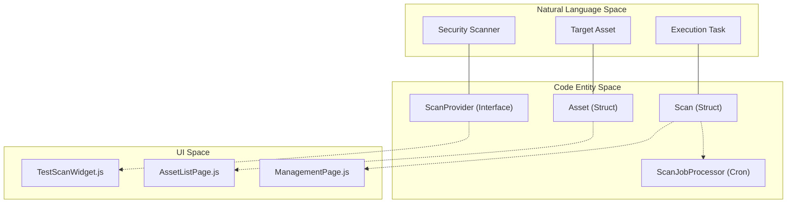
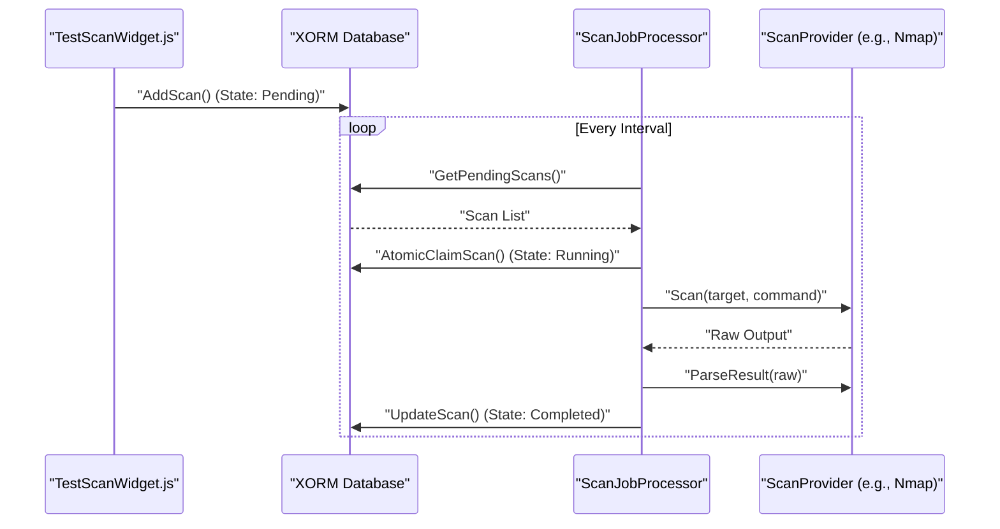

<!-- source: DeepWiki mcp.deepwiki.com · repo the-open-agent/openagent · page 6 Security Scanning · fetched 2026-10-27 -->

# Security Scanning

Relevant source files

The following files were used as context for generating this wiki page:

- [object/adapter.go](object/adapter.go)
- [routers/router.go](routers/router.go)
- [web/src/App.js](web/src/App.js)
- [web/src/ManagementPage.js](web/src/ManagementPage.js)
- [web/src/component/nav-item-tree/NavItemTree.js](web/src/component/nav-item-tree/NavItemTree.js)

The security scanning subsystem in OpenAgent provides a robust framework for vulnerability assessment, network mapping, and asset inventory management. It integrates industry-standard security tools with a distributed execution engine capable of scanning both external targets and internal infrastructure.

## System Overview

The scanning architecture is built upon three primary pillars: **Scan Providers**, **Assets**, and **Scan Jobs**.

*   **Scan Providers**: Abstractions for security tools like Nmap, Nuclei, and ZAP.
*   **Assets**: Logical representations of infrastructure (Virtual Machines, VPCs, etc.) that serve as scan targets.
*   **Scan Jobs**: State-managed execution instances that track the progress and results of a specific scan operation.

### Component Relationship

The following diagram illustrates how high-level scanning concepts map to specific backend entities and frontend components.

**Scanning System Mapping**

Sources: `scan/provider.go`, `object/asset.go`, `object/scan.go`, `object/scan_job.go`, `web/src/ManagementPage.js:90-91`()

---

## Scan Job Processing

Scan execution is managed by a background processor initialized in `object/scan_job.go`. This processor runs a cron job to identify and execute pending scans.

### Job Lifecycle
1.  **Pending**: A scan is created via the UI or API.
2.  **Claiming**: The `processPendingScans` function attempts to claim the job. To ensure distributed safety, `AtomicClaimScan` is used to transition the state from "Pending" to "Running".
3.  **Execution**: The system determines if the current host is the correct runner (especially for "Asset" mode scans like OS Patching) and invokes the relevant `ScanProvider`.
4.  **Completion/Failure**: Results are persisted in the `RawResult` and `Result` fields of the `Scan` object.

**Scan Execution Flow**

Sources: `object/scan_job.go`, `routers/router.go:121-125`()

---

## Scan Engine & Providers

The system uses a factory pattern to instantiate various security tools through the `ScanProvider` interface.

Supported tools include:
*   **Nmap**: Network discovery and port scanning.
*   **Nuclei**: Template-based vulnerability scanning.
*   **ZAP**: Web application security testing.
*   **OS Patch**: Auditing and installing Windows updates via PowerShell.
*   **Subfinder & httpx**: Domain and HTTP service discovery.

For details on configuration and tool-specific logic, see **[Scan Engine & Providers](#6.1)**.

Sources: `scan/provider.go`, `scan/os_patch.go`

---

## Asset & Cloud Inventory

Assets represent the infrastructure being protected. The system supports manual entry and automated discovery of cloud resources, specifically from Alibaba Cloud ECS.

### Key Features
*   **Graph Visualization**: Assets are transformed into a relational graph showing connections between VPCs, VSwitches, and Virtual Machines.
*   **Relationship Mapping**: The system automatically links assets based on properties like IP addresses and Region/Zone IDs.
*   **Contextual Scanning**: Users can view all scan history directly from an asset's detail view.

For details on asset data models and cloud integration, see **[Asset & Cloud Inventory](#6.2)**.

Sources: `web/src/ManagementPage.js:112-113`(), `web/src/component/nav-item-tree/NavItemTree.js:62-67`()

---

## Security UI Components

The scanning subsystem provides specialized React components for managing and visualizing security data, integrated into the `ManagementPage` sidebar under the "Multimedia" and "Knowledge Base" sections.

| Component | Description |
| :--- | :--- |
| `TaskListPage` | Admin view for browsing and managing scan tasks and security reports. |
| `TaskEditPage` | Configuration interface for defining scan parameters and AI analysis scales. |
| `ScanResultRenderer` | Dynamic dispatcher that chooses the correct visualizer for scan results. |
| `ResourceListPage` | General view for tracking uploaded security artifacts and scan attachments. |

Sources: `web/src/ManagementPage.js:90-93`(), `web/src/ManagementPage.js:103`(), `web/src/component/nav-item-tree/NavItemTree.js:91`()

---

