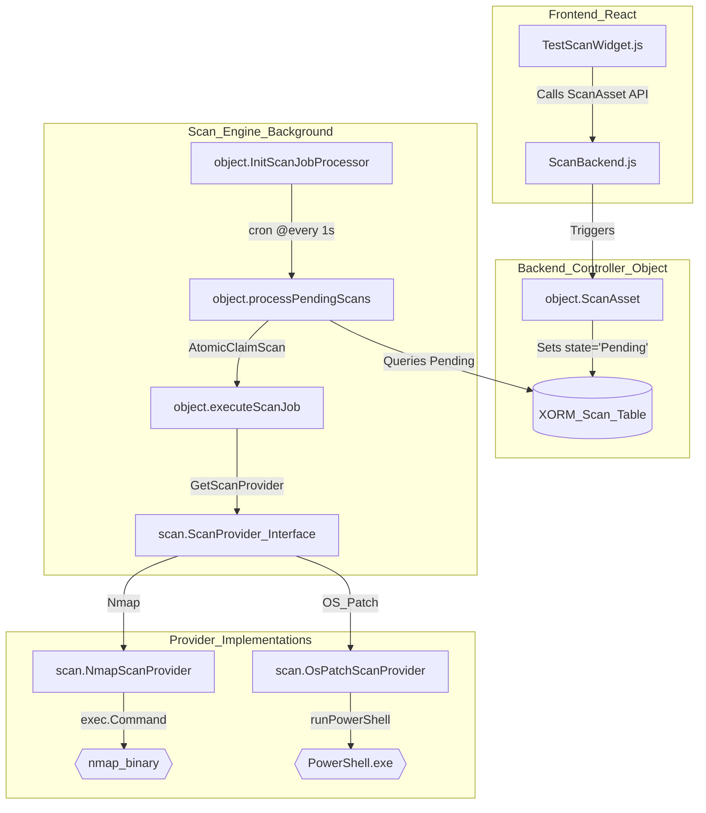
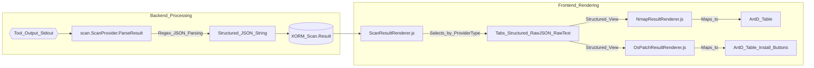

<!-- source: DeepWiki mcp.deepwiki.com · repo the-open-agent/openagent · page 6.1 Scan Engine & Providers · fetched 2026-10-27 -->

# Scan Engine & Providers

Relevant source files

The following files were used as context for generating this wiki page:

- [conf/app.conf](conf/app.conf)
- [conf/conf.go](conf/conf.go)
- [main.go](main.go)
- [object/adapter.go](object/adapter.go)
- [object/init.go](object/init.go)
- [routers/router.go](routers/router.go)
- [routers/static_filter.go](routers/static_filter.go)
- [web/src/App.js](web/src/App.js)
- [web/src/Conf.js](web/src/Conf.js)
- [web/src/ManagementPage.js](web/src/ManagementPage.js)
- [web/src/component/nav-item-tree/NavItemTree.js](web/src/component/nav-item-tree/NavItemTree.js)

The Scan Engine in OpenAgent is a distributed task processing system designed to perform security audits, network mapping, and vulnerability assessments. It abstracts third-party security tools behind a unified `ScanProvider` interface, facilitating consistent job management, execution, and result visualization across heterogeneous environments.

## ScanProvider Interface

The core of the scanning subsystem is the `ScanProvider` interface. Every integrated tool must implement these methods to handle execution and data normalization.

| Method | Description |
| :--- | :--- |
| `Scan(target string, command string)` | Executes the underlying tool with specific arguments against a target. |
| `ParseResult(rawResult string)` | Converts the tool's stdout (Raw Text) into a structured JSON format. |
| `GetResultSummary(result string)` | Generates a high-level string summary of the findings. |

The factory function `GetScanProvider` in `scan/provider.go` instantiates the appropriate provider based on the type string (e.g., "Nmap", "Nuclei", "ZAP").

Sources: `[scan/provider.go:37-41]()`, `[scan/provider.go:43-68]()`

## Supported Scan Tools

OpenAgent supports several industry-standard tools and custom auditing providers:

### 1. Nmap (Network Mapping)
- **Implementation**: `NmapScanProvider` in `scan/nmap.go`.
- **Functionality**: Performs port scanning and service discovery.
- **Data Flow**: Captures Nmap text output and uses regex patterns (e.g., `ipPattern`, `portPattern`) to build a structured `NmapScanResult` containing host IPs, latencies, and port states.
- **Default Command**: `-sn %s` (Ping scan).

Sources: `[scan/nmap.go:54-56]()`, `[scan/nmap.go:163-212]()`, `[web/src/common/TestScanWidget.js:27-27]()`

### 2. OS Patch (Windows Auditing)
- **Implementation**: `OsPatchScanProvider` in `scan/os_patch.go`.
- **Functionality**: Uses PowerShell and the `PSWindowsUpdate` module to list available, installed, or hidden patches on Windows systems.
- **Unique Capability**: Supports active remediation via the `InstallPatch` method, which can be triggered directly from the UI.
- **Command Types**: `available`, `installed`, `all`, or `install:<patchId>`.

Sources: `[scan/os_patch.go:57-64]()`, `[scan/os_patch.go:69-94]()`, `[web/src/renderers/OsPatchResultRenderer.js:115-130]()`

### 3. Nuclei (Vulnerability Scanning)
- **Implementation**: `NucleiScanProvider`.
- **Functionality**: Template-based vulnerability scanner.
- **Default Command**: `-u %s -jsonl`.

Sources: `[scan/provider.go:51-52]()`, `[web/src/common/TestScanWidget.js:29-29]()`

### 4. Other Providers
- **ZAP**: Web application security testing (`-cmd -quickurl %s`).
- **Subfinder**: Subdomain discovery (`-d %s -json`).
- **httpx**: HTTP probing and finger-printing (`-u %s -json`).

Sources: `[web/src/common/TestScanWidget.js:30-32]()`, `[scan/provider.go:53-58]()`

## Scan Job Processing

Scan jobs follow an asynchronous lifecycle managed by a cron-based processor. This allows OpenAgent instances running on different machines to "claim" jobs relevant to their local environment.

### Execution Workflow

1.  **Job Creation**: A `Scan` object is created with a `state` of `Created`.
2.  **Pending State**: When the user clicks "Scan", the state is updated to `Pending` via `ScanAsset`.
3.  **Job Polling**: `InitScanJobProcessor` runs a cron job every second that calls `processPendingScans`.
4.  **Atomic Claiming**: Instances attempt to claim the job using `AtomicClaimScan`. This ensures only one runner processes the scan.
5.  **Execution**: The runner calls `executeScanJob`, which invokes the provider's `Scan` and `ParseResult` methods.
6.  **Completion**: The `Scan` object is updated with `RawResult`, `Result` (JSON), and `ResultSummary`.

### Distributed Logic & Target Matching
For `Asset` mode scans, the system ensures that only the instance whose `hostname` matches the asset's `displayName` picks up the job. This is critical for OS Patching where the scan must run locally on the target machine.

Sources: `[object/scan_job.go:29-38]()`, `[object/scan_job.go:41-71]()`, `[object/scan_asset.go:162-174]()`, `[object/scan_job.go:124-143]()`

### Job State Transitions

| State | Description |
| :--- | :--- |
| `Created` | Scan defined but not yet queued. |
| `Pending` | Waiting for a runner to claim the job. |
| `Running` | Currently being executed by a specific `Runner`. |
| `Completed` | Finished successfully with results populated. |
| `Failed` | Terminated with an error message in `ErrorText`. |

Sources: `[object/scan.go:35-35]()`, `[object/scan_job.go:198-209]()`

## Natural Language to Code Entity Space

The following diagrams illustrate how user-facing concepts and UI components map to backend Go entities and logic.

### Scan Execution Logic
This diagram shows the path from a UI interaction to the execution of a binary tool on the system.

Sources: `[web/src/common/TestScanWidget.js:35-52]()`, `[object/scan_asset.go:41-82]()`, `[object/scan_job.go:29-71]()`, `[scan/nmap.go:126-133]()`, `[scan/os_patch.go:167-172]()`

### Result Rendering Pipeline
This diagram illustrates how raw tool output is transformed and displayed in the UI.

Sources: `[scan/nmap.go:147-160]()`, `[web/src/common/ScanResultRenderer.js:88-106]()`, `[web/src/renderers/OsPatchResultRenderer.js:143-225]()`

## Result Rendering

The `ScanResultRenderer` component provides a multi-tab interface for inspecting results:

1.  **Structured View**: Uses specific renderers (e.g., `NmapResultRenderer`, `OsPatchResultRenderer`) to display data in interactive Ant Design tables.
2.  **Raw JSON**: Displays the parsed JSON in a code editor (`Editor.js`) with syntax highlighting.
3.  **Raw Text**: Displays the original stdout from the tool.

### OS Patch Specific Rendering
The `OsPatchResultRenderer` includes a "Action" column. If a patch status is `Available` or `Downloaded`, it renders an **Install** button. Clicking this calls `PatchBackend.installPatch`, which triggers an asynchronous installation job on the target machine.

Sources: `[web/src/common/ScanResultRenderer.js:88-127]()`, `[web/src/renderers/OsPatchResultRenderer.js:201-224]()`, `[web/src/renderers/OsPatchResultRenderer.js:115-130]()`

---

