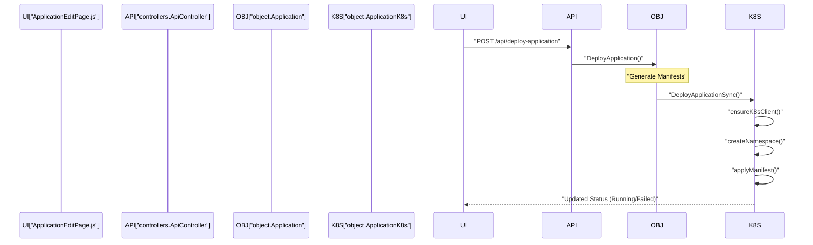

<!-- source: DeepWiki mcp.deepwiki.com · repo the-open-agent/openagent · page 7 Infrastructure Management · fetched 2026-10-27 -->

# Infrastructure Management

<details>
<summary>Relevant source files</summary>

The following files were used as context for generating this wiki page:

- [object/adapter.go](object/adapter.go)
- [routers/router.go](routers/router.go)
- [web/src/App.js](web/src/App.js)
- [web/src/ManagementPage.js](web/src/ManagementPage.js)
- [web/src/component/nav-item-tree/NavItemTree.js](web/src/component/nav-item-tree/NavItemTree.js)

</details>


Infrastructure Management in OpenAgent provides a comprehensive suite for managing multi-cloud compute resources and Kubernetes-based application lifecycles. The system abstracts physical and virtual assets into manageable entities: **Machines**, **Containers**, and **Applications**. These features are integrated into the central management console via the `ManagementPage` component [web/src/ManagementPage.js:145-201]().

### Infrastructure Overview

The platform bridges high-level user intent with low-level cloud provider APIs and Kubernetes orchestration. It supports a wide array of cloud providers (Alibaba Cloud, AWS, Azure, GCP) and virtualization platforms (KVM, VMware) through a unified interface. Access to these resources is routed through the central API namespace defined in the backend router [routers/router.go:36-41]().

#### System Mapping: Natural Language to Code Entities

The following diagram maps infrastructure concepts to their corresponding backend and frontend implementations within the OpenAgent architecture.

Infrastructure Entity Mapping
```mermaid
graph TD
    subgraph "NaturalLanguageSpace"
        ["Virtual Machine"]
        ["Docker Container"]
        ["K8s Application"]
        ["App Template"]
    end

    subgraph "CodeEntitySpace_Backend"
        BE_MACH["object.Machine"]
        BE_CONT["object.Container"]
        BE_APP["object.Application"]
        BE_TPL["object.Template"]
    end

    subgraph "CodeEntitySpace_Frontend"
        FE_MACH_LIST["MachineListPage.js"]
        FE_CONT_LIST["ContainerListPage.js"]
        FE_APP_LIST["ApplicationListPage.js"]
        FE_TPL_LIST["TemplateListPage.js"]
    end

    ["Virtual Machine"] --> BE_MACH
    ["Docker Container"] --> BE_CONT
    ["K8s Application"] --> BE_APP
    ["App Template"] --> BE_TPL

    BE_MACH --- FE_MACH_LIST
    BE_CONT --- FE_CONT_LIST
    BE_APP --- FE_APP_LIST
    BE_TPL --- FE_TPL_LIST
```
Sources: [web/src/ManagementPage.js:62-105](), [routers/router.go:90-125]()

---

### Machine & Container Management

The platform allows for the lifecycle management of compute nodes. **Machines** represent virtual or physical servers across multiple cloud regions, while **Containers** represent isolated execution environments. These resources are managed through dedicated list and edit pages in the React frontend [web/src/ManagementPage.js:63-105]().

- **Multi-Cloud Support**: Management of instances across Alibaba, AWS, Azure, GCP, and local hypervisors like KVM.
- **State Management**: Tracking of machine states (Active, Inactive) and network details like Public/Private IPs.
- **Remote Access**: Integration of remote desktop and terminal capabilities via the `OsDesktop` and Guacamole infrastructure.

For details, see [Machine & Container Management](#7.1).

Sources: [web/src/ManagementPage.js:145-201](), [routers/router.go:119-130]()

---

### Kubernetes Application Deployment

The **Application** subsystem provides a GitOps-like workflow for deploying services to Kubernetes clusters. It uses a **Template** system to define the base architecture and **Parameters** to customize specific deployments.

- **Manifest Generation**: The system handles the merging of base manifests with user-provided parameters.
- **Synchronous Deployment**: The backend handles the creation of namespaces and resource application.
- **Status Tracking**: Applications transition through states such as `Pending`, `Running`, `Failed`, or `Not Deployed`.

#### Application Deployment Flow

This diagram illustrates the transition from a Template definition to a running Kubernetes resource via the internal deployment pipeline.

Application Deployment Logic

Sources: [routers/router.go:36-41](), [web/src/ManagementPage.js:145-201]()

For details, see [Kubernetes Application Deployment](#7.2).

---

### Workbench & Infrastructure Catalog

Infrastructure components are organized into a searchable catalog within the `ManagementPage` sidebar. The system provides specialized views for different infrastructure layers, categorized under sections like "Basic", "Connectors", and "Knowledge Base" [web/src/ManagementPage.js:108-118]().

| Component | Primary UI Entity | Responsibility |
| :--- | :--- | :--- |
| **Machine List** | `MachineListPage` | Grid view for multi-cloud VM inventory. |
| **Container List** | `ContainerListPage` | Management of Docker-style containers and runtimes. |
| **Application List** | `ApplicationListPage` | Deployment dashboard for Kubernetes services. |
| **Template Editor** | `TemplateEditPage` | YAML manifest and Kustomize option definition. |
| **Site Config** | `SiteListPage` | Global infrastructure and branding settings [web/src/ManagementPage.js:104-105](). |

The navigation structure is programmatically defined to ensure consistent access to these infrastructure tools across the application [web/src/component/nav-item-tree/NavItemTree.js:23-97]().

Sources: [web/src/ManagementPage.js:62-118](), [web/src/App.js:107-158](), [web/src/component/nav-item-tree/NavItemTree.js:23-97]()

---

