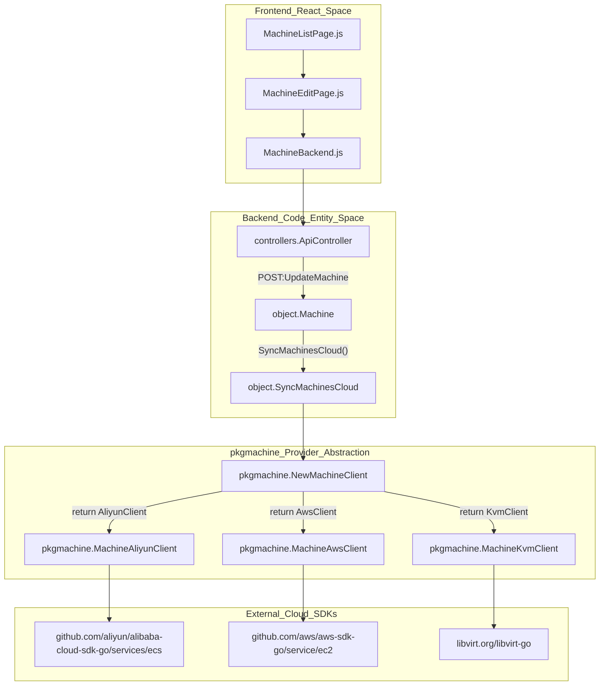
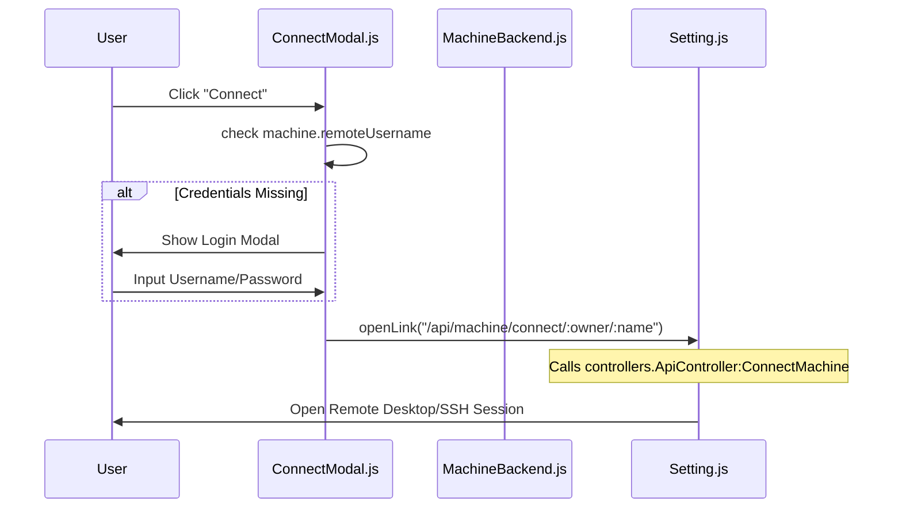
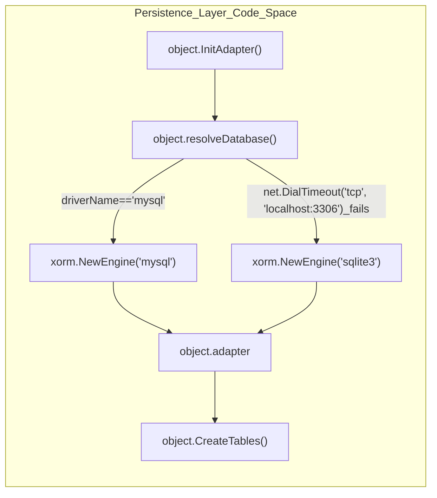

<!-- source: DeepWiki mcp.deepwiki.com · repo the-open-agent/openagent · page 7.1 Machine & Container Management · fetched 2026-10-27 -->

# Machine & Container Management

Relevant source files

The following files were used as context for generating this wiki page:

- [object/adapter.go](object/adapter.go)
- [routers/router.go](routers/router.go)
- [web/src/App.js](web/src/App.js)
- [web/src/ManagementPage.js](web/src/ManagementPage.js)
- [web/src/component/nav-item-tree/NavItemTree.js](web/src/component/nav-item-tree/NavItemTree.js)

The Machine and Container Management subsystem provides a unified interface for managing heterogeneous compute resources across multiple cloud providers (Alibaba Cloud, AWS, Azure, GCP) and virtualization platforms (KVM, VMware). It allows users to inventory, create, and remotely connect to virtual machines and containers through a standardized data model and a provider-based abstraction layer.

## Compute Resource Architecture

The system uses a provider pattern to abstract cloud-specific APIs into a common interface. This enables multi-cloud operations such as synchronization and state management without leaking provider-specific implementation details into the business logic.

### Machine Data Flow

The following diagram illustrates the flow from the frontend management UI through the backend object layer to the specific cloud provider implementations.

**Sources:** [web/src/ManagementPage.js:67-76](), [routers/router.go:90-98](), [object/adapter.go:138-152]()

## Machine Management

The `Machine` entity represents a virtual or physical compute instance. It tracks metadata such as IP addresses, regions, and hardware specifications.

### Machine Data Model
The backend `Machine` struct is persisted via XORM and includes fields for both cloud metadata and remote access credentials.

| Field | Type | Description |
| :--- | :--- | :--- |
| `Owner` | `string` | The organization that owns the machine |
| `Name` | `string` | Unique identifier for the machine |
| `Provider` | `string` | The name of the cloud provider instance |
| `PublicIp` | `string` | Publicly accessible IP address |
| `State` | `string` | Current instance state (e.g., Running, Stopped) |
| `RemoteProtocol` | `string` | Protocol for remote access (RDP, SSH, VNC) |

### Provider Abstraction (`pkgmachine`)
The `pkgmachine` package defines the `MachineClientInterface`, which must be implemented by every supported cloud or virtualization driver.

*   **Key Functions:**
    *   `NewMachineClient`: A factory function that returns the appropriate client implementation based on `providerType`.
    *   `GetMachines`: Fetches a list of instances from the remote provider.
    *   `UpdateMachineState`: Controls instance power states (e.g., `StartInstance`, `StopInstance`).

### Cloud Synchronization
The system supports synchronizing the local database with the actual state of cloud resources via `SyncMachinesCloud`. This function fetches machines from all active cloud providers and updates the local XORM database while preserving sensitive fields like `RemotePassword`.

## Container Management

Container management focuses on lifecycle operations for containerized workloads, primarily interacting with provider-managed container services.

### Container UI Components
*   **ContainerListPage**: Displays a table of containers including `Image`, `Status`, and `Ports`.
*   **ContainerEditPage**: Allows editing container configuration such as `Command`, `SizeRw`, and `ImageId`.

### Data Interaction
The frontend interacts with the backend via `ContainerBackend.js`. When a new container is initialized, it defaults to a `Stopped` state and uses a standard naming convention `container_{randomName}`.

**Sources:** [web/src/ManagementPage.js:108-118](), [web/src/App.js:107-158]()

## Remote Connectivity

OpenAgent provides built-in support for connecting to managed machines and nodes using protocols like RDP, SSH, and VNC.

### Connection Logic
The `ConnectModal` component handles the orchestration of remote access. It checks for existing credentials (`remoteUsername`, `remotePassword`) and, if present, opens a secure tunnel to the resource.

**Sources:** [web/src/ManagementPage.js:55-60](), [routers/router.go:35-41]()

## Implementation Details

### Database Persistence
The system uses XORM for persistence. The `object.InitAdapter` function configures the database connection based on the `driverName` and `dataSourceName` provided in `app.conf`. It includes a fallback mechanism for SQLite if MySQL is unavailable [object/adapter.go:79-106]().

**Sources:** [object/adapter.go:79-106](), [object/adapter.go:138-152](), [object/adapter.go:182-191]()

### Navigation and Routing
The management interface is organized into logical groups in the `ManagementPage` sidebar [web/src/ManagementPage.js:108-118](). Machine and container related paths are mapped to the `/connectors` parent key in the navigation tree [web/src/component/nav-item-tree/NavItemTree.js:49-58]().

| Path | Menu Parent Key | Icon |
| :--- | :--- | :--- |
| `/providers` | `/connectors` | `ApiOutlined` |
| `/servers` | `/connectors` | `ApartmentOutlined` |
| `/tools` | `/connectors` | `ToolOutlined` |

**Sources:** [web/src/ManagementPage.js:108-118](), [web/src/component/nav-item-tree/NavItemTree.js:49-58]()

### Security & Masking
Sensitive information is handled carefully. The `maskDSN` function strips credentials from connection strings [object/adapter.go:58-63](). For machine access, the backend ensures that if a masked password (`***`) is received during an update, the existing password in the database is preserved.

**Sources:** [object/adapter.go:58-63](), [routers/router.go:43-47]()

---

