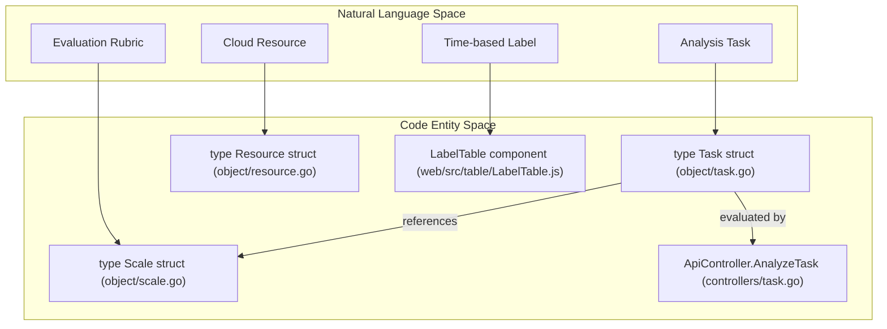
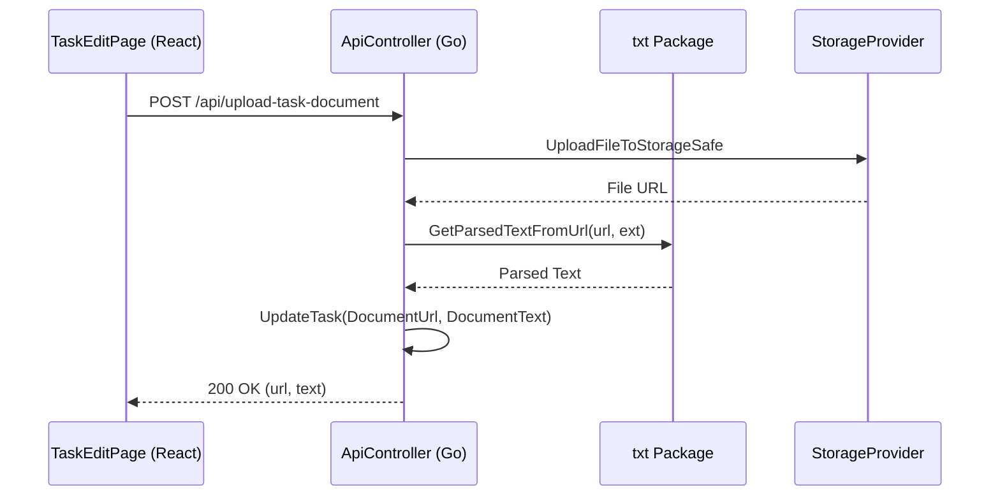

<!-- source: DeepWiki mcp.deepwiki.com · repo the-open-agent/openagent · page 8.1 Video Lifecycle & Annotation · fetched 2026-10-27 -->

# Video Lifecycle & Annotation

Relevant source files

The following files were used as context for generating this wiki page:

- [controllers/resource.go](controllers/resource.go)
- [controllers/scale.go](controllers/scale.go)
- [controllers/task.go](controllers/task.go)
- [controllers/task_upload.go](controllers/task_upload.go)
- [object/resource.go](object/resource.go)
- [object/task.go](object/task.go)
- [web/src/ResourceListPage.js](web/src/ResourceListPage.js)
- [web/src/TaskEditPage.js](web/src/TaskEditPage.js)
- [web/src/TaskListPage.js](web/src/TaskListPage.js)
- [web/src/WordCloudChart.js](web/src/WordCloudChart.js)
- [web/src/backend/ResourceBackend.js](web/src/backend/ResourceBackend.js)
- [web/src/backend/TaskBackend.js](web/src/backend/TaskBackend.js)
- [web/src/table/LabelTable.js](web/src/table/LabelTable.js)
- [web/src/table/RemarkTable.js](web/src/table/RemarkTable.js)

This section covers the lifecycle of multimedia and document-based tasks within OpenAgent, from initial upload and cloud ingestion to multi-stage review and AI-assisted annotation. The system integrates cloud services for storage, document parsing, and a React-based frontend for interactive labeling, time-based annotation, and data visualization.

## Video & Task Data Model

The system handles multimedia through two primary entities: `Video` (for video-specific workflows) and `Task` (for general AI-assisted analysis of documents and media).

### The Task Entity
The `Task` struct represents a unit of work where a document or media asset is analyzed against a specific rubric (`Scale`).

| Field | Type | Description |
| :--- | :--- | :--- |
| `Provider` | `string` | The AI Model provider used for analysis [object/task.go:59](). |
| `Scale` | `string` | The ID of the rubric used for evaluation [object/task.go:69](). |
| `DocumentUrl` | `string` | URL to the uploaded file (PDF/Docx) [object/task.go:77](). |
| `Result` | `string` | JSON string containing the structured AI analysis [object/task.go:75](). |
| `Score` | `float64` | The numerical score derived from the analysis [object/task.go:64](). |
| `Labels` | `[]string` | Tags or categories associated with the task content [object/task.go:72](). |

### Entity Mapping
The following diagram associates the logical workflow concepts with their specific code entities.

**Task & Video Entity Mapping**

Sources: [object/task.go:53-79](), [controllers/task.go:256-270](), [object/resource.go:25-45](), [web/src/table/LabelTable.js:26-34]()

## Upload & Resource Management

OpenAgent uses a centralized `Resource` system to manage files uploaded to cloud storage (Alibaba Cloud OSS or Local).

1.  **Unified Upload**: The `UploadResource` controller handles multipart file uploads, detects MIME types, and persists the file to storage via `UploadFileToStorageSafe` [controllers/resource.go:216-244]().
2.  **Task Document Pipeline**: For tasks, the `UploadTaskDocument` endpoint specifically handles `.docx` and `.pdf` files [controllers/task_upload.go:73-86](). 
3.  **Text Extraction**: Once uploaded, the system calls `txt.GetParsedTextFromUrl` to convert the document into searchable text for the AI [controllers/task_upload.go:118-123]().
4.  **Resource Records**: Every upload is tracked in the `Resource` table, linking the file to a specific `ObjectType` (e.g., "task") and `ObjectId` [object/resource.go:172-191]().

**Resource Data Flow**

Sources: [controllers/task_upload.go:38-146](), [web/src/backend/TaskBackend.js:83-96](), [controllers/resource.go:216-244](), [object/resource.go:196-213]()

## AI Analysis & Annotation Workflow

The analysis workflow leverages LLMs to evaluate content based on user-defined labels and scales.

### 1. Task Analysis
In `TaskEditPage`, the `analyzeTask` function triggers a backend process that sends the document text and the `Scale` (rubric) to the selected `ModelProvider` [web/src/TaskEditPage.js:118-156]().
*   **Progress Tracking**: The frontend simulates progress using `ANALYZE_PROGRESS_TICK_MS` (500ms) to provide user feedback during long-running LLM calls [web/src/TaskEditPage.js:19-21]().
*   **Structured Results**: The backend returns a `TaskResult` containing categories, scores, and suggestions [object/task.go:38-51](), which is then visualized in the `TaskAnalysisReport` [web/src/TaskEditPage.js:31]().

### 2. Manual Annotation (Labeling)
The `LabelTable` component provides a time-based annotation interface for video content:
*   **Time-stamped Rows**: Users can add rows with `startTime`, `endTime`, and `text` comments [web/src/table/LabelTable.js:87-94]().
*   **Video Integration**: Clicking a row number triggers `player.seek(record.startTime)` to synchronize the video playback with the annotation [web/src/table/LabelTable.js:161-167]().
*   **Export**: Annotations can be downloaded as Excel files using the `xlsx` library [web/src/table/LabelTable.js:111-130]().

### 3. Word Cloud & Visualization
For multimedia or text-heavy tasks, the system generates visual summaries:
*   **WordCloudChart**: Uses `echarts-wordcloud` to render a frequency map of terms found in the analysis or transcript [web/src/WordCloudChart.js:46-78]().
*   **Radar/Bar Charts**: The `TaskAnalysisReport` renders the `TaskResult` categories into radar and bar charts to visualize strengths and weaknesses [web/src/TaskEditPage.js:31]().

Sources: [web/src/TaskEditPage.js:118-156](), [object/task.go:24-51](), [web/src/WordCloudChart.js:29-82](), [web/src/table/LabelTable.js:153-220]()

## Review & Permission Workflow

OpenAgent implements a multi-stage review process enforced by role-based access control (RBAC) and the `RemarkTable`.

### Multi-Stage Review
The `RemarkTable` is used to collect evaluations from different reviewers (e.g., `video-reviewer1-user`, `video-reviewer2-user`).
*   **Score Categories**: Reviewers select from "Excellent", "Good", "Pass", or "Fail" [web/src/table/RemarkTable.js:168-176]().
*   **Anonymity**: The `filterRemark1Value` function masks comments and user IDs if the current user does not have the appropriate review permissions [web/src/table/RemarkTable.js:97-107]().

### Role Access Levels
| Role | Access Level | Workflow Stage |
| :--- | :--- | :--- |
| `Normal User` | Can only view/edit their own tasks [controllers/task.go:124-130](). | Creation / Draft |
| `Admin` | Can view and analyze all tasks globally [controllers/task.go:63-66](). | Management / Final Review |
| `Reviewer` | Specialized roles for multi-stage evaluation [web/src/table/RemarkTable.js:109-111](). | Peer Review |

### Data Protection
The system uses "masking" logic to ensure sensitive provider credentials or internal metadata are not leaked in list views:
*   `GetMaskedTasks` iterates through task lists and applies visibility rules before returning data to the frontend [object/task.go:93-102]().
*   Controllers like `GetTasks` and `GetGlobalTasks` invoke this masking by default [controllers/task.go:44-82]().

Sources: [controllers/task.go:63-73](), [object/task.go:81-102](), [web/src/table/RemarkTable.js:122-205](), [controllers/resource.go:49-52]()

---

