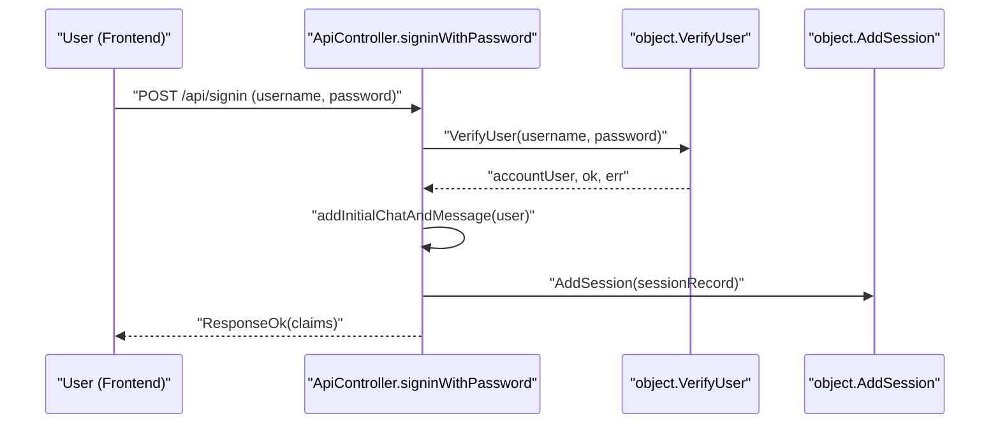
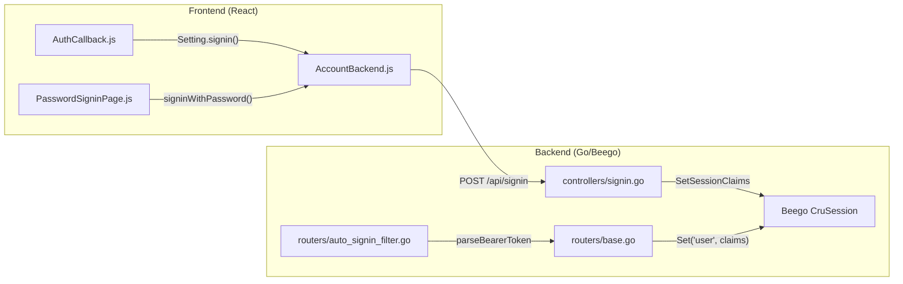

<!-- source: DeepWiki mcp.deepwiki.com · repo the-open-agent/openagent · page 9.1 Authentication & Session Management · fetched 2026-10-27 -->

# Authentication & Session Management

Relevant source files

The following files were used as context for generating this wiki page:

- [controllers/casdoor_user.go](controllers/casdoor_user.go)
- [controllers/permission.go](controllers/permission.go)
- [controllers/signin.go](controllers/signin.go)
- [controllers/storage_provider.go](controllers/storage_provider.go)
- [object/store_share.go](object/store_share.go)
- [object/user.go](object/user.go)
- [routers/auto_signin_filter.go](routers/auto_signin_filter.go)
- [routers/base.go](routers/base.go)
- [web/craco.config.js](web/craco.config.js)
- [web/mv.js](web/mv.js)
- [web/public/index.html](web/public/index.html)
- [web/public/manifest.json](web/public/manifest.json)
- [web/src/AccountPage.js](web/src/AccountPage.js)
- [web/src/AuthCallback.js](web/src/AuthCallback.js)
- [web/src/PasswordSigninPage.js](web/src/PasswordSigninPage.js)
- [web/src/StoreShareModal.js](web/src/StoreShareModal.js)
- [web/src/backend/AccountBackend.js](web/src/backend/AccountBackend.js)
- [web/src/backend/OrganizationUserBackend.js](web/src/backend/OrganizationUserBackend.js)

OpenAgent leverages **Casdoor** as its central Single Sign-On (SSO) provider to manage user identities, authentication flows, and session persistence. The system supports OAuth2/OIDC flows, password-based authentication, and a specialized anonymous user mode for guest access.

## Casdoor SSO Integration

The backend initializes its connection to Casdoor during startup. This configuration enables the application to communicate with the Casdoor API for token exchange, user profile retrieval, and certificate validation.

### Initialization Sequence
The system checks if Casdoor is available via configuration checks [controllers/signin.go:49](). If Casdoor is unavailable, certain APIs (like Permission and Storage Provider management) return empty or default results to maintain basic functionality [controllers/permission.go:32-35](), [controllers/storage_provider.go:46-49]().

| Function | File | Description |
| :--- | :--- | :--- |
| `GetSigninOptions` | [controllers/signin.go:45-53]() | Checks if Casdoor is available and if sign-in is enabled. |
| `IsCasdoorAvailable` | [conf/util.go (referenced)]() | Utility to check Casdoor connectivity status. |

**Sources:** [controllers/signin.go:39-53](), [controllers/permission.go:31-44](), [controllers/storage_provider.go:43-58]()

## Sign-in & Sign-out Flow

OpenAgent supports two primary sign-in methods: **OAuth code** (standard SSO) and **Password** (direct credential check).

### Password Authentication
The `signinWithPassword` function handles direct credential validation. It verifies the username and password against the database via `object.VerifyUser` [controllers/signin.go:174](). Upon success, it establishes a session and records the user ID [controllers/signin.go:195-208]().

Title: Authentication Data Flow (Password)

**Sources:** [controllers/signin.go:151-211](), [web/src/backend/AccountBackend.js:60-70]()

### Session Management
When a user signs in, a session record is created to track active `SessionId` values associated with a specific user [controllers/signin.go:199-208]().
*   **Sign-in:** The session ID is captured from `c.Ctx.Input.CruSession.SessionID()` and stored via `object.AddSession` [controllers/signin.go:199-208]().
*   **Sign-out:** The frontend triggers `signout()` which calls the `/api/signout` endpoint to clear server-side state [web/src/backend/AccountBackend.js:72-80]().

## Auto-Signin Filter

The `AutoSigninFilter` acts as a middleware in the request pipeline to automatically authenticate requests using Bearer tokens or Client Credentials.

*   **Token Extraction:** It looks for `accessToken` in query parameters or the `Authorization: Bearer` header [routers/auto_signin_filter.go:38-45]().
*   **Basic Auth:** It also supports `Authorization: Basic` using a Client ID and Client Secret [routers/auto_signin_filter.go:59-67]().
*   **Session Injection:** If a valid `userId` is resolved from the token or credentials, the filter calls `setSessionUser` to populate the Beego session [routers/auto_signin_filter.go:53-66]().

**Sources:** [routers/auto_signin_filter.go:23-68](), [routers/base.go:88-107]()

## Backend Request Processing

The `routers/base.go` file provides core utilities for session retrieval and error handling.

### Key Functions
1.  **GetSessionUser:** Retrieves the `auth.User` object from the current session [routers/base.go:37-45]().
2.  **getUsername:** A polymorphic helper that first tries to get the user from the session; if empty, it attempts to authenticate via Client ID/Secret [routers/base.go:47-55]().
3.  **setSessionUser:** Manually injects a user into the Beego `CruSession` and ensures the session is released to the response writer [routers/base.go:88-107]().

**Sources:** [routers/base.go:37-107]()

## Session Configuration

OpenAgent uses the Beego session framework. The `ApiController` and filters interact with `c.Ctx.Input.CruSession` to manage state.

| Feature | Implementation | Description |
| :--- | :--- | :--- |
| **Session ID** | `CruSession.SessionID()` | Unique identifier for the current browser session [controllers/signin.go:199](). |
| **Data Storage** | `CruSession.Set("user", claims)` | Stores the JWT claims and user profile in the session store [routers/base.go:100](). |
| **Token Auth** | `getMd5HexDigest` | Generates a digest for internal access token validation [routers/base.go:156-160](). |

## Frontend Auth Components

### AuthCallback
The `AuthCallback.js` component is the landing page for Casdoor's redirect. It extracts the OAuth code and calls `Setting.signin()` to finalize the login [web/src/AuthCallback.js:45-58](). It also includes an error modal to display debugging information if sign-in fails [web/src/AuthCallback.js:148-161]().

### Account Management
Users can update their profile (DisplayName, Avatar) and change passwords via the `UpdateAccount` API [controllers/signin.go:100-149](). The backend sanitizes the request body to prevent logging sensitive password data [controllers/signin.go:113-116](). The frontend implementation in `AccountPage.js` uses `AccountBackend.updateAccount` to persist these changes [web/src/AccountPage.js:34-44]().

Title: Frontend-Backend Auth Entity Interaction

**Sources:** [web/src/AuthCallback.js:44-58](), [controllers/signin.go:151-211](), [routers/auto_signin_filter.go:23-68](), [web/src/backend/AccountBackend.js:17-80](), [web/src/PasswordSigninPage.js:57-69]()

---

