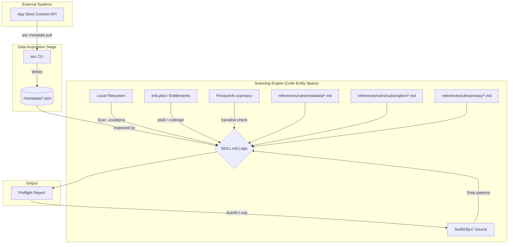
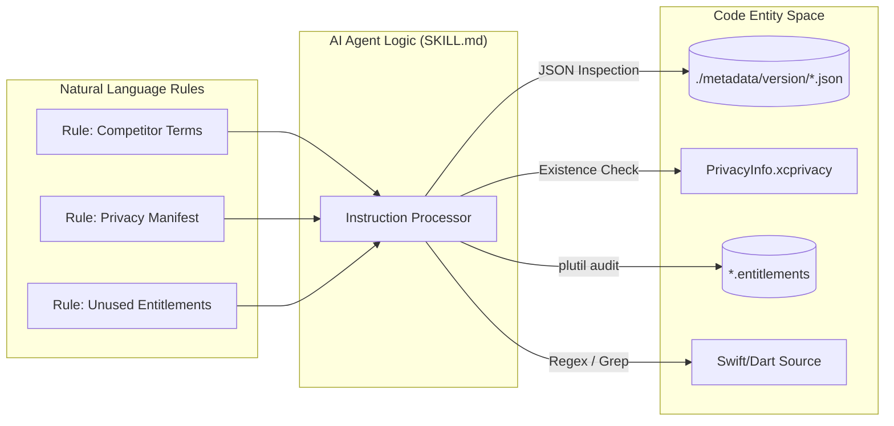

<!-- source: DeepWiki mcp.deepwiki.com · repo truongduy2611/app-store-preflight-skills · page 1.2 How the Preflight Pipeline Works · fetched 2026-10-27 -->

# How the Preflight Pipeline Works

Relevant source files

The following files were used as context for generating this wiki page:

- [README.md](README.md)
- [SKILL.md](SKILL.md)

The App Store Preflight pipeline is a structured, five-stage process designed to move from a raw Xcode project and App Store metadata to a validated, compliant submission state. This pipeline is driven by the `SKILL.md` instruction set, which directs the AI agent to orchestrate external CLI tools, filesystem scans, and rule-based validation.

## Pipeline Overview

The pipeline transitions from identifying the high-level application context to granular code-level inspection, ending with an automated remediation loop.

### 1. Context Identification
The agent first determines the scope of the scan by identifying the app type. This determines which specialized checklists are merged with the universal baseline.

*   **Logic**: Every scan starts with `references/guidelines/by-app-type/all_apps.md` [SKILL.md:25-29]().
*   **Specialization**: Based on project analysis (e.g., presence of `StoreKit`, AI frameworks, or macOS targets), the agent loads supplemental checklists like `ai_apps.md` or `subscription_iap.md` [SKILL.md:30-38]().

### 2. Data Acquisition
The pipeline relies on the `asc` CLI to bridge the gap between the local environment and App Store Connect.

*   **Command**: `asc metadata pull --app "<APP_ID>" --version "<VERSION>" --dir ./metadata` [SKILL.md:48-49]().
*   **Output**: The agent expects a canonical JSON layout where app information is stored in `./metadata/app-info/*.json` and localized version data in `./metadata/version/<VERSION>/*.json` [SKILL.md:51-52]().
*   **Authentication**: The agent verifies credentials using `asc auth doctor` or environment variables like `ASC_KEY_ID` and `ASC_ISSUER_ID` [SKILL.md:109-109]().

### 3. Scanning Engine
The core of the pipeline involves mapping files in the "Code Entity Space" to "Rejection Rules" defined in `references/rules/`.

*   **Execution**: The agent iterates through five rule domains: Metadata, Subscription, Privacy, Design, and Entitlements [SKILL.md:65-71]().
*   **Detection Patterns**: Rules provide specific "How to Detect" instructions, such as using `grep` for competitor terms or `plutil` for entitlement audits [README.md:102-102](), [SKILL.md:63-64]().

### 4. Reporting
Findings are aggregated into a standardized Preflight Report.

*   **Triage**: Issues are categorized into **❌ Rejections** (immediate blockers), **⚠️ Warnings** (risky patterns), and **✅ Passed** (validated domains) [SKILL.md:80-90]().
*   **Mapping**: Each finding must cite the specific Apple Guideline number (e.g., 2.3.1 for competitor terms) and the affected file path [SKILL.md:81-83]().

### 5. Remediation Lifecycle (Autofix & Validate)
The pipeline is a closed loop. If an issue is fixable, the agent applies the change and immediately re-triggers the specific scan stage to verify the fix.

*   **Autofixable**: Text-based metadata (competitor terms), missing URL templates (ToS/PP), and character limit adjustments [SKILL.md:96-99]().
*   **Manual**: UI-based issues (Sign in with Apple button prominence) or asset-based issues (App Preview frames) [SKILL.md:103-104]().

---

## Technical Data Flow

The following diagram illustrates how the pipeline moves data from Apple's servers and the local filesystem through the AI Scanning Engine.

**Preflight Data Flow: From Source to Report**

**Sources:** [README.md:40-46](), [SKILL.md:23-104](), [SKILL.md:107-112]()

---

## Implementation Detail: AI Agent Orchestration

The `SKILL.md` file acts as the "Brain" of the pipeline. It does not contain executable code itself but defines the operational sequence the AI agent must follow to interact with the codebase.

| Stage | Key Code Entities / Tools | File/Path References |
| :--- | :--- | :--- |
| **Context** | `all_apps.md`, `ai_apps.md` | `references/guidelines/by-app-type/` [SKILL.md:25-38]() |
| **Acquisition** | `asc metadata pull`, `jq` | `./metadata/` [SKILL.md:48-52]() |
| **Scanning** | `grep`, `plutil`, `codesign` | `references/rules/` [README.md:102-102](), [SKILL.md:65-71]() |
| **Validation** | `asc auth doctor` | `ASC_KEY_ID`, `ASC_PRIVATE_KEY` [SKILL.md:109-109]() |

### Natural Language to Code Entity Mapping

This diagram shows how natural language rules defined in Markdown files are translated into technical checks against specific project entities.

**Rule-to-Entity Mapping**

**Sources:** [README.md:54-89](), [SKILL.md:61-72](), [SKILL.md:107-112]()

## The Remediation Loop

A unique aspect of this pipeline is the **Autofix + Validate** stage [SKILL.md:94-101](). Unlike static analysis tools that only report errors, the Preflight Pipeline attempts to close the ticket.

1.  **Detection**: A rule (e.g., `references/rules/metadata/competitor_terms.md`) flags a violation in a localized description JSON.
2.  **Proposed Fix**: The agent generates a version of the text with terms like "Android" or "Google Play" removed [SKILL.md:97-97]().
3.  **Application**: The agent modifies the local JSON file in `./metadata/version/`.
4.  **Verification**: The agent re-runs the `competitor_terms` scan specifically against the modified file.
5.  **Completion**: The finding is moved from **❌ Rejections** to **✅ Passed** in the final report, with a note about the applied fix.

**Sources:** [SKILL.md:94-104](), [README.md:46-46]()

---

