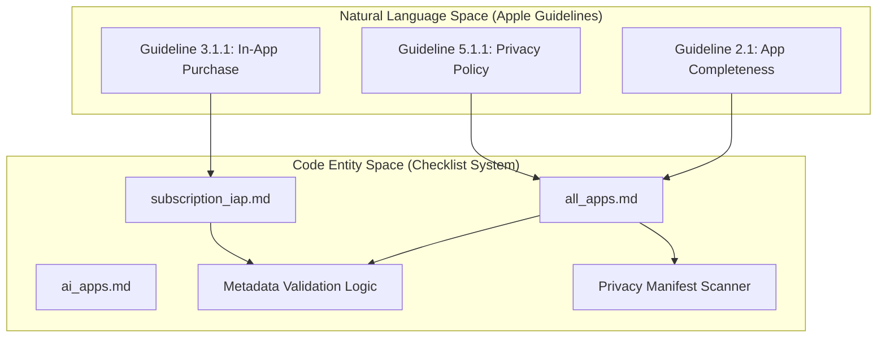
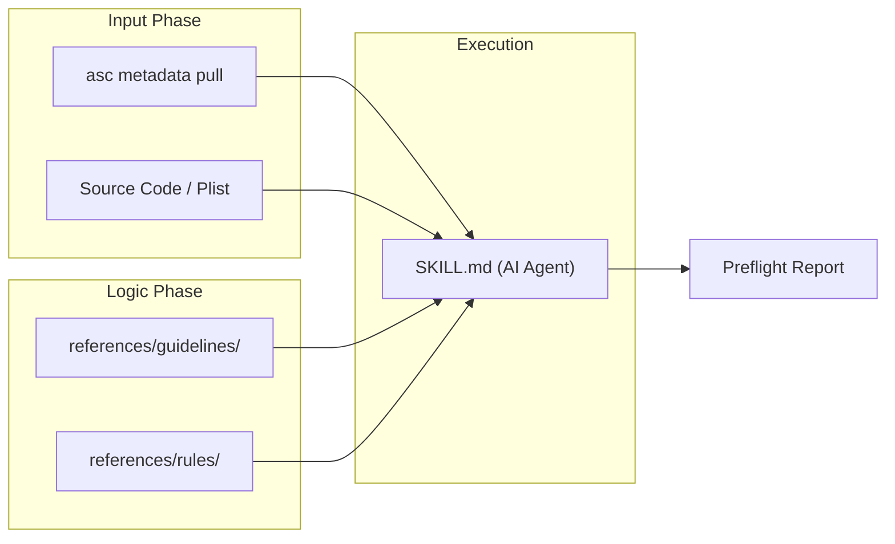

<!-- source: DeepWiki mcp.deepwiki.com · repo truongduy2611/app-store-preflight-skills · page 2 Guideline Index & App-Type Checklists · fetched 2026-10-27 -->

# Guideline Index & App-Type Checklists

Relevant source files

The following files were used as context for generating this wiki page:

- [references/guidelines/README.md](references/guidelines/README.md)
- [references/guidelines/by-app-type/all_apps.md](references/guidelines/by-app-type/all_apps.md)

This page provides a high-level overview of the `references/guidelines/` directory, which serves as the foundational knowledge base for the App Store Preflight Skills system. It details the master index of Apple's App Store Review Guidelines and the modular checklist system used to evaluate apps based on their specific functionality.

## Guideline Reference System

The system maintains a structured index of the official Apple App Store Review Guidelines to ensure that every automated check and manual verification step is mapped to a specific regulatory requirement.

### Master Guideline Index
The `references/guidelines/README.md` file acts as the central repository, categorizing guidelines into five primary domains:
1.  **Safety**: Objectionable content, user-generated content, and physical harm.
2.  **Performance**: App completeness, metadata accuracy, and software requirements.
3.  **Business**: Payments (IAP), subscriptions, and external purchase links.
4.  **Design**: Copycats, minimum functionality, and "Sign in with Apple" requirements.
5.  **Legal**: Privacy, data collection, and intellectual property.

### App-Type Checklist Model
Rather than applying every rule to every app, the system uses a **Base + Delta** loading model. Every scan begins with the **Universal Checklist** and then dynamically appends **App-Type Specific Checklists** based on the app's identified features (e.g., if the app uses Generative AI or Subscriptions).

| Component | File Path | Role |
| :--- | :--- | :--- |
| **Universal Base** | `references/guidelines/by-app-type/all_apps.md` | Mandatory checks for every submission. |
| **Specialized Deltas** | `references/guidelines/by-app-type/*.md` | Conditional checks (e.g., `ai_apps.md`, `subscription_iap.md`). |

**Sources:**
- [references/guidelines/README.md:1-120]()
- [references/guidelines/by-app-type/all_apps.md:1-51]()

---

## Guideline Mapping Architecture

The following diagram illustrates how natural language Apple Guidelines are mapped to the codebase's internal checklist logic.

### Natural Language to Code Entity Mapping
"The Mapping of Apple Guidelines to Checklist Entities"

**Sources:**
- [references/guidelines/README.md:40-40]()
- [references/guidelines/README.md:87-87]()
- [references/guidelines/by-app-type/all_apps.md:7-12]()

---

## Checklist Categories

### 2.1 Universal Checklist (all_apps.md)
The Universal Checklist contains the "Pre-Submission Essentials." These are the non-negotiable requirements that apply to every iOS, macOS, watchOS, or tvOS binary. It covers:
*   **Completeness**: Ensuring demo accounts are provided and backends are live [references/guidelines/by-app-type/all_apps.md:7-10]().
*   **Metadata Constraints**: Enforcing the 30-character name limit and preventing trademark stuffing [references/guidelines/by-app-type/all_apps.md:16-18]().
*   **Privacy Essentials**: Validating `PrivacyInfo.xcprivacy` and in-app privacy policy links [references/guidelines/by-app-type/all_apps.md:28-33]().

For details, see [Universal Checklist (all_apps.md)](#2.1).

### 2.2 App-Type Specific Checklists
The system includes specialized checklists for nine distinct app categories. These are activated when the `Context Identification` stage of the pipeline detects specific frameworks or metadata keywords.

*   **AI & Generative AI**: Focuses on content moderation, China-specific AI regulations, and prohibited branding [references/guidelines/by-app-type/ai_apps.md]().
*   **Subscriptions & IAP**: Validates pricing transparency, restore buttons, and EULA/ToS links [references/guidelines/by-app-type/subscription_iap.md]().

For details, see [App-Type Specific Checklists](#2.2).

---

## Pipeline Integration Logic

This diagram shows how the `references/guidelines/` directory feeds into the automated scanning engine.

### Guideline-Driven Execution Flow
"How Guidelines Drive the Scanning Engine"

**Sources:**
- [references/guidelines/README.md:5-5]()
- [references/guidelines/by-app-type/all_apps.md:3-3]()

---

## Summary Table: Guideline Domains

| Domain | Key Guidelines | Primary Checklist |
| :--- | :--- | :--- |
| **Safety** | 1.1, 1.2 (UGC) | `all_apps.md` |
| **Performance** | 2.1 (Completeness), 2.3 (Metadata) | `all_apps.md` |
| **Business** | 3.1.1 (IAP), 3.1.2 (Subs) | `subscription_iap.md` |
| **Design** | 4.2 (Min Functionality), 4.8 (SIWA) | `all_apps.md` |
| **Legal** | 5.1.1 (Privacy), 5.2.5 (Trademarks) | `all_apps.md` |

**Sources:**
- [references/guidelines/README.md:9-130]()
- [references/guidelines/by-app-type/all_apps.md:5-51]()

---

