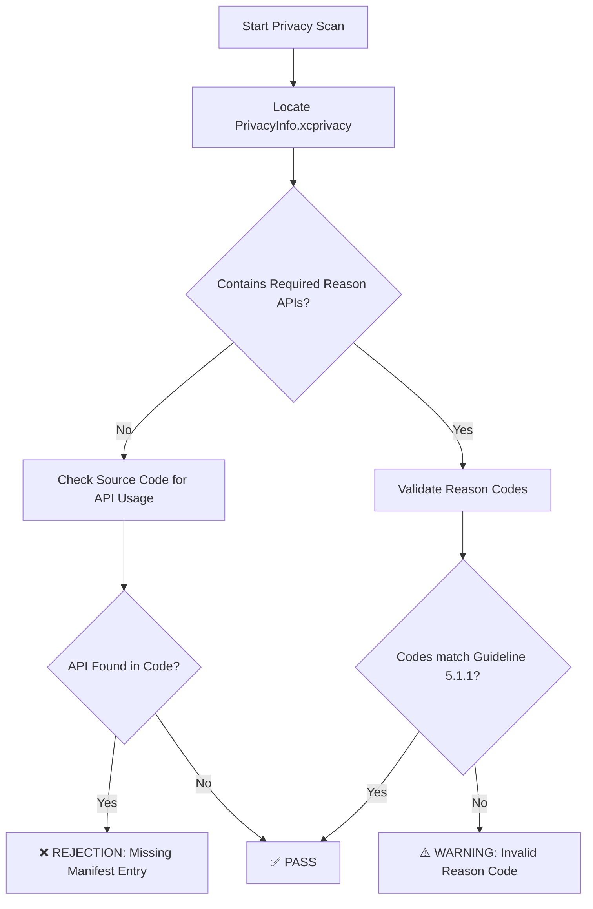

<!-- source: DeepWiki mcp.deepwiki.com · repo truongduy2611/app-store-preflight-skills · page 2.1 Universal Checklist (all_apps.md) · fetched 2026-10-27 -->

# Universal Checklist (all_apps.md)

<details>
<summary>Relevant source files</summary>

The following files were used as context for generating this wiki page:

- [references/guidelines/README.md](references/guidelines/README.md)
- [references/guidelines/by-app-type/all_apps.md](references/guidelines/by-app-type/all_apps.md)

</details>


The Universal Checklist serves as the foundational compliance layer for the App Store Preflight Skills system. It defines the baseline requirements that every application must satisfy to pass an App Store review, regardless of its specific category (e.g., AI, Games, or Subscriptions). This checklist is implemented as a set of verification points that map directly to Apple's App Store Review Guidelines.

## Pre-Submission Essentials (Guideline 2.1)

The most frequent cause of immediate rejection is "App Completeness." The system validates that the app is a final production build rather than a beta or placeholder.

| Requirement | Code/Guideline Reference | Implementation Logic |
|:---|:---|:---|
| **App Completeness** | [references/guidelines/by-app-type/all_apps.md:7-7]() | Verifies the binary is not a demo/beta (Guideline 2.1). |
| **Metadata Accuracy** | [references/guidelines/by-app-type/all_apps.md:8-8]() | Checks for placeholder text like "Lorem Ipsum" or "TBD". |
| **Demo Accounts** | [references/guidelines/by-app-type/all_apps.md:9-9]() | Ensures `review_notes` include credentials if login is required. |
| **Backend Availability**| [references/guidelines/by-app-type/all_apps.md:10-10]() | Validates that API endpoints used by the app are reachable. |

**Sources:** [references/guidelines/by-app-type/all_apps.md:5-13](), [references/guidelines/README.md:40-40]()

## Metadata Constraints

Metadata validation focuses on text lengths, prohibited terms, and visual asset compliance. The `asc` CLI is used to pull the current metadata state for analysis.

### Textual Constraints (Guideline 2.3.7 & 2.3.10)
The system scans app titles and descriptions for:
*   **Length:** Ensuring the App Name is $\le 30$ characters [references/guidelines/by-app-type/all_apps.md:16-16]().
*   **Competitor Mentions:** Flagging terms like "Android" or "Google Play" [references/guidelines/by-app-type/all_apps.md:18-18]().
*   **Trademark Misuse:** Identifying unauthorized use of Apple product names or icons [references/guidelines/by-app-type/all_apps.md:24-24]().

### Visual Assets (Guideline 2.3.3 & 2.3.4)
*   **Screenshots:** Must show the app in actual use, not just marketing splash screens [references/guidelines/by-app-type/all_apps.md:19-19]().
*   **App Previews:** Video captures must be "screen captures only" and are prohibited from using device frames (e.g., an iPhone bezel around the video) [references/guidelines/by-app-type/all_apps.md:20-20]().

**Sources:** [references/guidelines/by-app-type/all_apps.md:14-25](), [references/guidelines/README.md:49-52]()

## Privacy & Data Compliance

This section bridges the gap between legal requirements (Privacy Policy) and technical implementation (`PrivacyInfo.xcprivacy`).

### Data Flow: Privacy Manifest Validation
The scanner inspects the project's `PrivacyInfo.xcprivacy` file to ensure compliance with the "Required Reason API" policy.

**Privacy Manifest Verification Logic**

**Sources:** [references/guidelines/by-app-type/all_apps.md:33-33](), [references/guidelines/README.md:133-138]()

### Account Management (Guideline 5.1.1(v))
If the app supports account creation, the system checks for an "Account Deletion" mechanism within the UI or metadata links, as required by Apple's data privacy mandates [references/guidelines/by-app-type/all_apps.md:31-31]().

## Authentication & Design (Guideline 4.0)

The checklist enforces the "Sign in with Apple" (SIWA) parity rule. If an app implements third-party social logins (Google, Facebook, etc.), it must also offer SIWA.

### Code-to-Guideline Mapping: Authentication
The following diagram illustrates how the system maps natural language requirements to specific code entities found in an iOS project.

**Authentication Requirement Mapping**
```mermaid
classDiagram
    class "Guideline 4.8" {
        +Requirement: Social Login Parity
        +Rule: Must offer Sign in with Apple
    }
    class "Code Entities" {
        +ASAuthorizationAppleIDProvider
        +ASAuthorizationAppleIDButton
        +AuthenticationServices.framework
    }
    class "Scanner Logic" {
        +grep_social_sdks()
        +verify_siwa_implementation()
    }
    "Guideline 4.8" --> "Scanner Logic" : "Triggers"
    "Scanner Logic" --> "Code Entities" : "Inspects"
```
**Sources:** [references/guidelines/by-app-type/all_apps.md:39-40](), [references/guidelines/README.md:126-126]()

## Business & IAP Baseline

Regardless of the business model, the universal checklist enforces two critical rules:
1.  **Digital Content:** All digital unlocks (features, levels, ad-removal) must use the In-App Purchase (IAP) system [references/guidelines/by-app-type/all_apps.md:47-47]().
2.  **Review Manipulation:** The app cannot force or incentivize users to rate or review the app in exchange for functionality [references/guidelines/by-app-type/all_apps.md:48-48]().

**Sources:** [references/guidelines/by-app-type/all_apps.md:45-51](), [references/guidelines/README.md:87-87](), [references/guidelines/README.md:103-103]()

---

