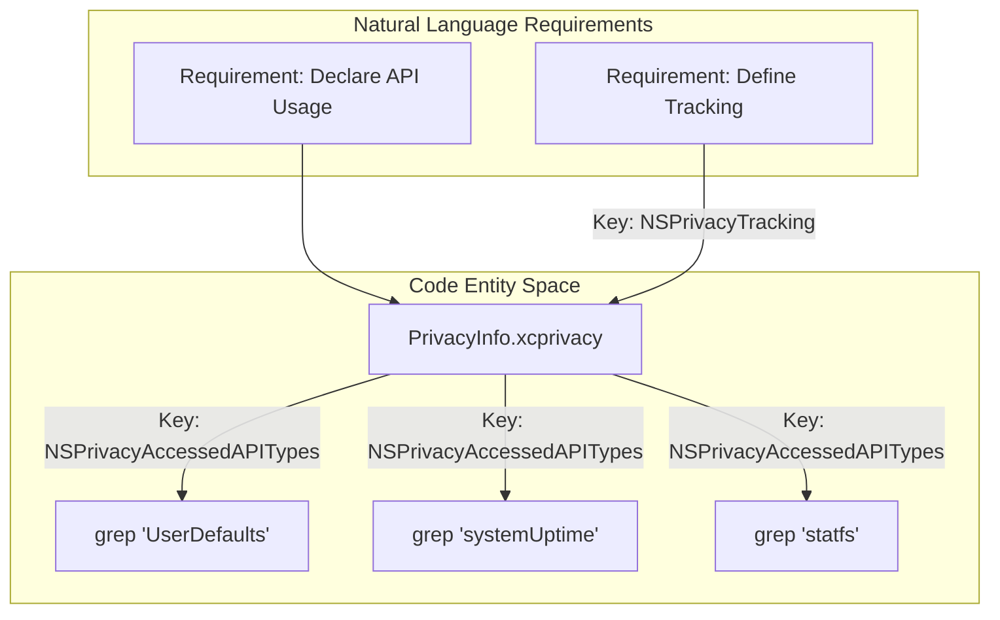
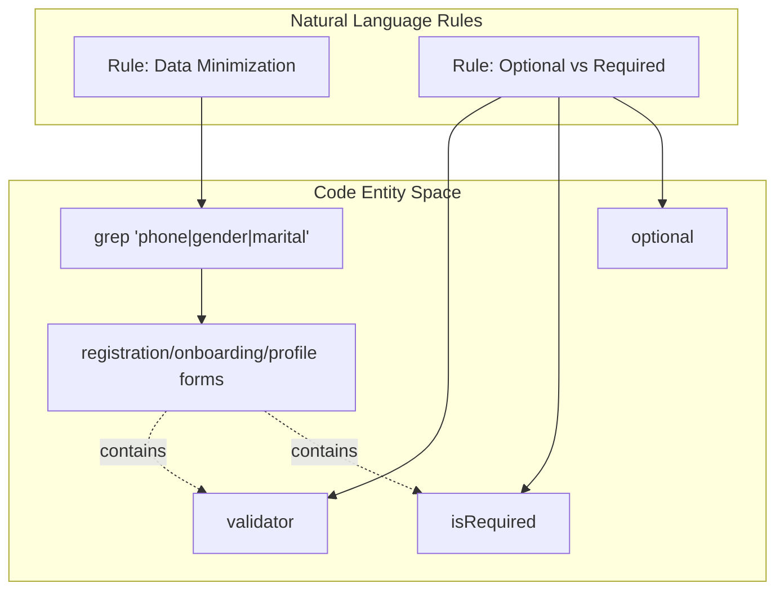

<!-- source: DeepWiki mcp.deepwiki.com · repo truongduy2611/app-store-preflight-skills · page 3.3 Privacy Rules · fetched 2026-10-27 -->

# Privacy Rules

Relevant source files

The following files were used as context for generating this wiki page:

- [references/rules/privacy/privacy_manifest.md](references/rules/privacy/privacy_manifest.md)
- [references/rules/privacy/unnecessary_data.md](references/rules/privacy/unnecessary_data.md)

The Privacy Rules domain focuses on compliance with Apple's stringent data protection requirements, specifically the **Spring 2024 Privacy Manifest mandate** and the long-standing **Data Minimization** principle. Failure to adhere to these rules results in immediate app rejection under Guideline 5.1.1.

## Privacy Manifest (PrivacyInfo.xcprivacy)

Starting in Spring 2024, Apple requires all apps and third-party SDKs to include a `PrivacyInfo.xcprivacy` manifest if they utilize "Required Reason APIs" [references/rules/privacy/privacy_manifest.md:7-8](). These APIs are identified by Apple as potentially being used for fingerprinting, and their usage must be declared with a valid reason code.

### Required Reason API Categories
The system scans for the following four major categories of APIs that necessitate a manifest entry:

| Category | Targeted Symbols | Example Reason Code |
| :--- | :--- | :--- |
| **File Timestamp** | `NSFileCreationDate`, `NSFileModificationDate`, `stat()` | `DDA9.1` (Display to user) |
| **User Defaults** | `UserDefaults`, `NSUserDefaults` | `CA92.1` (App-specific data) |
| **System Boot Time** | `systemUptime`, `mach_absolute_time()` | `35F9.1` (Measure time) |
| **Disk Space** | `volumeAvailableCapacityKey`, `statfs()` | `E174.1` (Check for writes) |

Sources: [references/rules/privacy/privacy_manifest.md:9-16]()

### Detection Logic: Natural Language to Code Entity
The following diagram illustrates how the scanning engine maps high-level Privacy Manifest requirements to specific code entities and search patterns.

**Privacy Manifest Detection Flow**

Sources: [references/rules/privacy/privacy_manifest.md:18-22](), [references/rules/privacy/privacy_manifest.md:32-45]()

### Implementation Details
The scanner performs a two-step verification:
1.  **Existence Check**: Searches for `PrivacyInfo.xcprivacy` using `find . -name "PrivacyInfo.xcprivacy"` [references/rules/privacy/privacy_manifest.md:27-30]().
2.  **API Audit**: Executes targeted `grep` commands across `.swift` and `.m` files to identify undeclared usage of restricted APIs [references/rules/privacy/privacy_manifest.md:33-45]().

### Manifest Structure
A valid manifest must be a Property List (`plist`) containing specific keys:
*   `NSPrivacyTracking`: Boolean indicating data usage for tracking [references/rules/privacy/privacy_manifest.md:19]().
*   `NSPrivacyAccessedAPITypes`: An array of dictionaries, each containing an `NSPrivacyAccessedAPIType` (the category) and `NSPrivacyAccessedAPITypeReasons` (the codes) [references/rules/privacy/privacy_manifest.md:64-74]().

Sources: [references/rules/privacy/privacy_manifest.md:56-77]()

---

## Unnecessary Data Collection

Under Guideline 5.1.1, apps must only require personal information that is **directly relevant** to the app's core functionality [references/rules/privacy/unnecessary_data.md:2-7](). If data is useful but not essential, it must be marked as **optional**.

### Data Minimization Logic
The relevance of a data field is determined by the app's context. The scanner flags fields that typically violate this principle:

| Data Field | Contextual Justification | Potential Violation |
| :--- | :--- | :--- |
| **Phone Number** | Core calling/SMS features | Note-taking or Calculator apps |
| **Gender** | Medical, fitness (calories), or dating | Shopping or Utility apps |
| **Date of Birth** | Legal age-gating requirements | Basic productivity tools |
| **Home Address** | Physical shipping or location services | Digital-only content apps |

Sources: [references/rules/privacy/unnecessary_data.md:9-21]()

### Form Validation Audit
The system bridges the gap between UI forms and code-level validation logic to identify "Required" fields that should be "Optional".

**Form Validation Mapping**

Sources: [references/rules/privacy/unnecessary_data.md:24-31]()

### Remediation Workflow
1.  **Identify**: Locate registration or profile forms using `grep` patterns for common personal data terms (e.g., `birthdate`, `address`, `signup`) [references/rules/privacy/unnecessary_data.md:25-27]().
2.  **Evaluate**: Check for validation keywords like `validator`, `isRequired`, or `required` associated with these fields [references/rules/privacy/unnecessary_data.md:29-30]().
3.  **Fix**: Convert non-essential fields to optional by removing validation logic and adding "Skip" or "Not now" UI elements [references/rules/privacy/unnecessary_data.md:41-42]().

Sources: [references/rules/privacy/unnecessary_data.md:40-44]()

---

