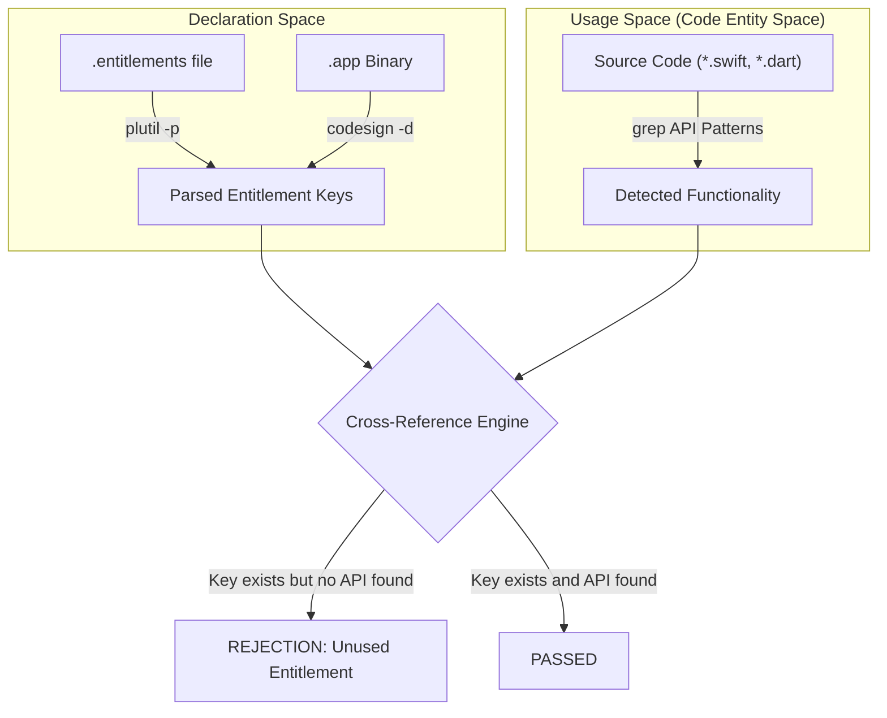
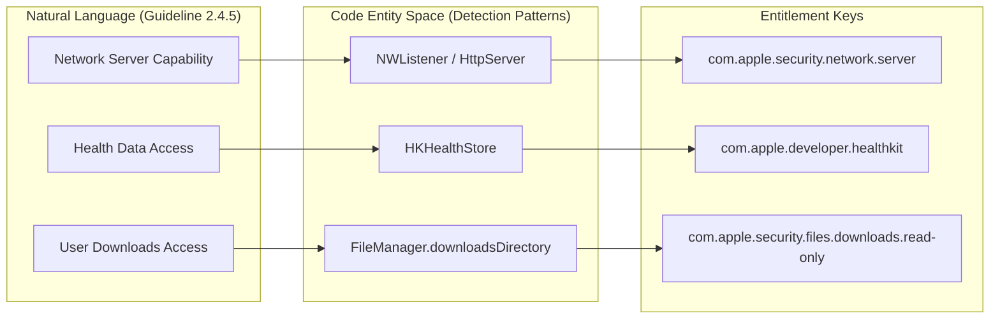

<!-- source: DeepWiki mcp.deepwiki.com · repo truongduy2611/app-store-preflight-skills · page 3.5 Entitlements Rules · fetched 2026-10-27 -->

# Entitlements Rules

Relevant source files

The following files were used as context for generating this wiki page:

- [references/rules/entitlements/unused_entitlements.md](references/rules/entitlements/unused_entitlements.md)

The **Entitlements Rules** define the technical requirements for the Principle of Least Privilege as applied to iOS and macOS applications. This rule set is primarily governed by **App Store Review Guideline 2.4.5(i)**, which dictates that apps must only request the minimum set of permissions necessary for their functionality [references/rules/entitlements/unused_entitlements.md:2-2](). Failure to justify or remove unused entitlements results in a rejection categorized as an "Information Request," effectively blocking the review process until resolved [references/rules/entitlements/unused_entitlements.md:3-3]().

## Audit Methodology

The preflight system audits entitlements by cross-referencing declared keys in `.entitlements` files against actual API calls within the source code. This process identifies "orphaned" entitlements that increase the app's attack surface and trigger Apple's automated scanners.

### Entitlement Discovery and Parsing
The system identifies entitlements through two primary methods:
1.  **Static File Analysis**: Searching the project directory for `.entitlements` XML files [references/rules/entitlements/unused_entitlements.md:27-31]().
2.  **Binary Inspection**: Using `codesign` to extract the entitlements embedded in a compiled `.app` bundle [references/rules/entitlements/unused_entitlements.md:55-59]().

### Data Flow: Entitlement Verification
The following diagram illustrates the flow from detecting a declared entitlement to verifying its usage in the codebase.

**Entitlement Validation Pipeline**

Sources: [references/rules/entitlements/unused_entitlements.md:33-59]()

## Common Entitlement Mapping

The preflight system uses specific grep patterns to map high-scrutiny entitlements to their corresponding code entities.

| Entitlement Key | Category | Code Entities / API Patterns |
| :--- | :--- | :--- |
| `com.apple.security.network.server` | macOS Network | `NWListener`, `GCDWebServer`, `Vapor`, `startServer` |
| `com.apple.security.files.downloads.*` | macOS Filesystem | `Downloads`, `downloadsDirectory`, `FileManager` |
| `com.apple.developer.healthkit` | iOS Health | `HKHealthStore`, `HealthKit`, `health_kit` |
| `aps-environment` | iOS Push | Push Notification capabilities in Xcode |
| `com.apple.developer.applesignin` | iOS Auth | Sign in with Apple implementation |

Sources: [references/rules/entitlements/unused_entitlements.md:9-23](), [references/rules/entitlements/unused_entitlements.md:44-53]()

## Detection and Remediation

### Code-to-Entitlement Association
This diagram bridges the natural language requirements of the App Store Guidelines to the specific code symbols searched during an audit.

**Natural Language to Code Entity Mapping**

Sources: [references/rules/entitlements/unused_entitlements.md:44-53](), [references/rules/entitlements/unused_entitlements.md:9-13]()

### Resolution Workflow
If the preflight scan identifies an unused entitlement, the following remediation steps are required:

1.  **Xcode Configuration**: Open the **Signing & Capabilities** tab for the target and remove the unused capability [references/rules/entitlements/unused_entitlements.md:63-63]().
2.  **Manual XML Cleanup**: Directly edit the `.entitlements` file to remove keys that do not have matching functionality [references/rules/entitlements/unused_entitlements.md:62-62]().
3.  **Justification**: If the entitlement is necessary but the automated scan failed to find the usage (e.g., dynamic usage or third-party binary usage), prepare a written justification for the App Store Connect "App Review Information" section [references/rules/entitlements/unused_entitlements.md:64-64]().
4.  **Submission Reset**: If a rejection has already occurred, the developer must "Developer Reject" the current build, increment the build number, and resubmit a clean binary [references/rules/entitlements/unused_entitlements.md:65-65]().

Sources: [references/rules/entitlements/unused_entitlements.md:61-66]()

---

