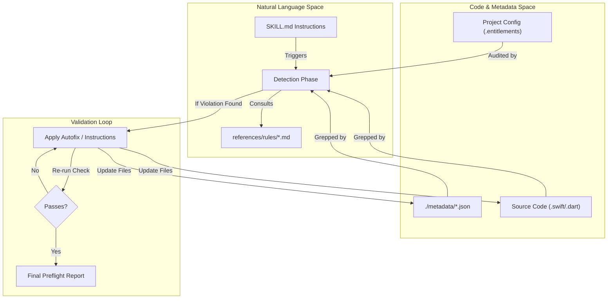
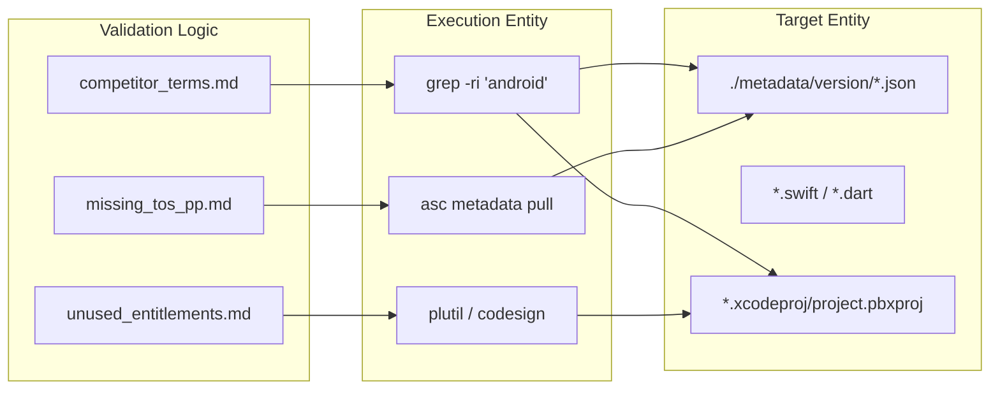

<!-- source: DeepWiki mcp.deepwiki.com · repo truongduy2611/app-store-preflight-skills · page 4 Autofix & Validation System · fetched 2026-10-27 -->

# Autofix & Validation System

Relevant source files

The following files were used as context for generating this wiki page:

- [README.md](README.md)
- [SKILL.md](SKILL.md)
- [references/rules/metadata/competitor_terms.md](references/rules/metadata/competitor_terms.md)
- [references/rules/subscription/missing_tos_pp.md](references/rules/subscription/missing_tos_pp.md)

The Autofix & Validation System implements a closed-loop remediation lifecycle within the AI agent. This system ensures that once a potential App Store rejection is identified, the agent doesn't just report it but actively assists in resolving it and verifying the fix against the same rules that triggered the initial finding.

## Remediation Lifecycle

The remediation process follows a structured five-stage pipeline as defined in the core skill instructions [SKILL.md:42-46](). This lifecycle transitions findings from "Identified Violation" to "Validated Resolution."

### 1. Detection and Categorization
The agent scans the project using the rules defined in `references/rules/` [SKILL.md:61-72](). Findings are categorized by severity (REJECTION or WARNING) and domain (Metadata, Subscription, Privacy, Design, or Entitlements) [README.md:98-99]().

### 2. Resolution Strategy
For every finding, the agent consults the "Resolution" section of the specific rule file to determine the appropriate fix [README.md:103](). 
- **Autofixable:** Issues involving text manipulation, configuration files, or missing boilerplate.
- **Manual-Only:** Issues involving UI/UX redesign, screenshot assets, or complex architectural changes.

### 3. Application of Fixes
The agent applies automated fixes where possible. For example, in the case of **Competitor Terms**, the agent suggests replacement text that removes banned brands like "Android" or "Google Play" [references/rules/metadata/competitor_terms.md:39-45]().

### 4. Re-Validation (The "Closed Loop")
Crucially, after applying a fix, the agent is instructed to **re-run the affected checks** [SKILL.md:101-102](). A violation is only marked as resolved in the final report if the re-scan passes the original detection logic.

### 5. Final Reporting
The agent produces a final Preflight Report. For details on the severity tiers and report structure, see [Reporting Format](#4.1).

## Autofix vs. Manual Intervention

The system distinguishes between issues it can resolve autonomously and those requiring developer action.

| Capability | Supported Rule Examples | Logic / Tools Used |
|:---|:---|:---|
| **Autofix** | Competitor terms [SKILL.md:97](), Metadata character limits [SKILL.md:98](), Missing ToS/PP URLs [SKILL.md:99]() | Text replacement, `sed`, `jq` |
| **Manual** | App Preview device frames [README.md:61](), Sign in with Apple button design [README.md:82](), Minimum functionality/WebViews [README.md:83]() | Human-in-the-loop (Instructions provided) |

### Remediation Flow Diagram
The following diagram illustrates how the AI agent (`SKILL.md`) interacts with the project files and the `asc` CLI to move from detection to validation.

**Sources:** [SKILL.md:42-46](), [SKILL.md:94-103](), [README.md:40-48]()

## Validation Tools & Integration

The validation system relies heavily on external CLI tools to ensure the project state matches Apple's expectations.

- **`asc` CLI:** Used to pull the latest metadata for inspection and to perform dry-run pushes to validate metadata integrity [SKILL.md:48-49](), [references/rules/metadata/competitor_terms.md:45](). For details on CLI usage and authentication, see [asc CLI Integration](#4.2).
- **`grep` & `jq`:** Used within rule definitions to create deterministic detection patterns [references/rules/metadata/competitor_terms.md:25-27](), [references/rules/subscription/missing_tos_pp.md:25-38]().

### System Entity Mapping
This diagram maps the conceptual "Checks" to the actual files and commands executed during the Autofix/Validation cycle.

**Sources:** [references/rules/metadata/competitor_terms.md:19-37](), [references/rules/subscription/missing_tos_pp.md:19-38](), [README.md:89]()

## Child Pages
- [Reporting Format](#4.1) — Detailed breakdown of the Preflight Report output.
- [asc CLI Integration](#4.2) — Reference for metadata synchronization and authentication.

---

