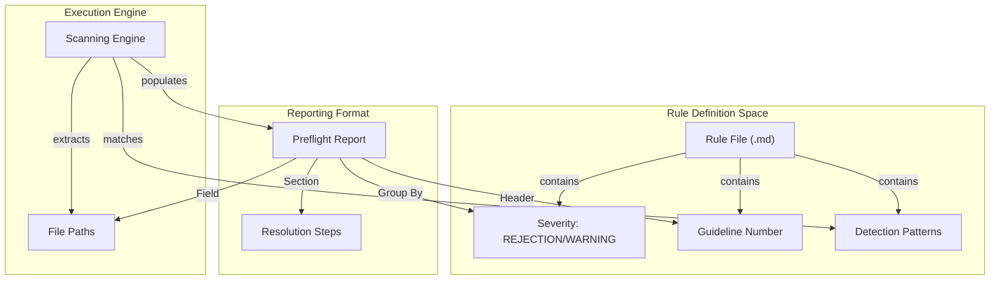
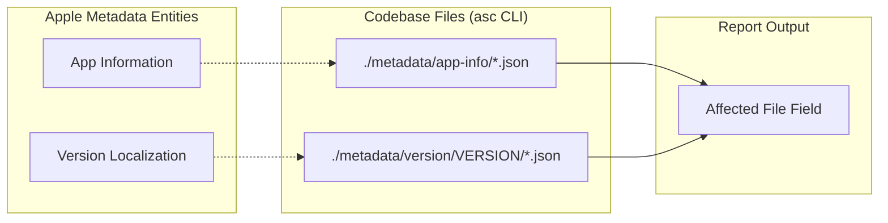

<!-- source: DeepWiki mcp.deepwiki.com · repo truongduy2611/app-store-preflight-skills · page 4.1 Reporting Format · fetched 2026-10-27 -->

# Reporting Format

Relevant source files

The following files were used as context for generating this wiki page:

- [README.md](README.md)
- [SKILL.md](SKILL.md)

The **Preflight Report** is the final output of the scanning engine, designed to provide developers with an actionable, prioritized list of compliance issues before App Store submission [SKILL.md:73-75](). It standardizes findings from various rule domains—Metadata, Subscriptions, Privacy, Design, and Entitlements—into a unified structure that maps directly to Apple's Review Guidelines [SKILL.md:61-72]().

## Purpose and Scope

The reporting format ensures that the AI agent communicates findings consistently, whether it is identifying a hard rejection (e.g., competitor terms in metadata) or a warning (e.g., potential design improvements) [README.md:40-45](). By categorizing results by severity and providing specific "Affected Files" and "Resolution Steps," the report bridges the gap between a detected violation and a validated fix [SKILL.md:94-103]().

## Report Structure

The report follows a strict hierarchical template defined in the core skill instructions [SKILL.md:77-90]().

### 1. Severity Tiers
Findings are grouped into three distinct tiers to help developers prioritize remediation efforts [SKILL.md:92]().

| Tier | Icon | Description |
| :--- | :--- | :--- |
| **Rejections** | ❌ | High-probability App Store rejections. These violate specific Apple Guidelines (e.g., Guideline 2.3.1 for competitor terms) [README.md:58-62](). |
| **Warnings** | ⚠️ | Potential issues that might trigger a manual review flag or are "gray areas" in enforcement [SKILL.md:85-87](). |
| **Passed** | ✅ | Categories where no violations were detected during the scan [SKILL.md:88-90](). |

### 2. Finding Components
Each finding within the Rejections or Warnings sections must include:
*   **Guideline Mapping**: The specific Apple Guideline number (e.g., `[GUIDELINE 5.1.1]`) [SKILL.md:81-86]().
*   **Description**: A concise summary of the violation [SKILL.md:81]().
*   **Affected Files**: The specific path to the source code, metadata JSON, or configuration file where the issue was found [SKILL.md:82]().
*   **Resolution Steps**: Actionable instructions or suggested code/text changes to resolve the issue [SKILL.md:83]().

### 3. Data Flow: From Detection to Report
The following diagram illustrates how the `Scanning Engine` processes rule definitions to generate the `Preflight Report`.

**Figure 1: Report Generation Logic**

Sources: [README.md:91-105](), [SKILL.md:61-90]()

## Implementation Detail: Mapping to Code Entities

The report relies on the canonical JSON layout produced by the `asc` CLI to identify "Affected Files" in the metadata domain [SKILL.md:51-53](). When a rule like `competitor_terms.md` is triggered, the report points to the specific localized version file [README.md:58]().

**Figure 2: Metadata Entity Mapping in Reports**

Sources: [SKILL.md:42-59](), [README.md:11-14]()

## Resolution Steps and Autofix

The `Resolution Steps` field in the report serves as the prompt for the `Autofix` stage [SKILL.md:94-95](). 

*   **Manual Resolution**: For issues like `minimum_functionality` (Guideline 4.2), the report provides instructions for UI redesign [SKILL.md:103](), [README.md:83]().
*   **Automated Resolution**: For metadata issues (e.g., character limits or competitor terms), the report includes the specific replacement string [SKILL.md:96-99]().

### Validation Lifecycle
Once a resolution is applied (either manually or via autofix), the system mandates a re-scan of the specific "Affected File" to update the report status from ❌ to ✅ [SKILL.md:101-102]().

| Field | Requirement | Source of Truth |
| :--- | :--- | :--- |
| **Guideline** | Mandatory | `references/rules/<category>/<rule>.md` [README.md:97]() |
| **File Path** | Mandatory | Detected by `grep` or `jq` during scan [SKILL.md:21](), [README.md:102]() |
| **Fix** | Mandatory | `## Resolution` section of the rule file [README.md:103]() |

Sources: [SKILL.md:94-104](), [README.md:91-105]()

---

