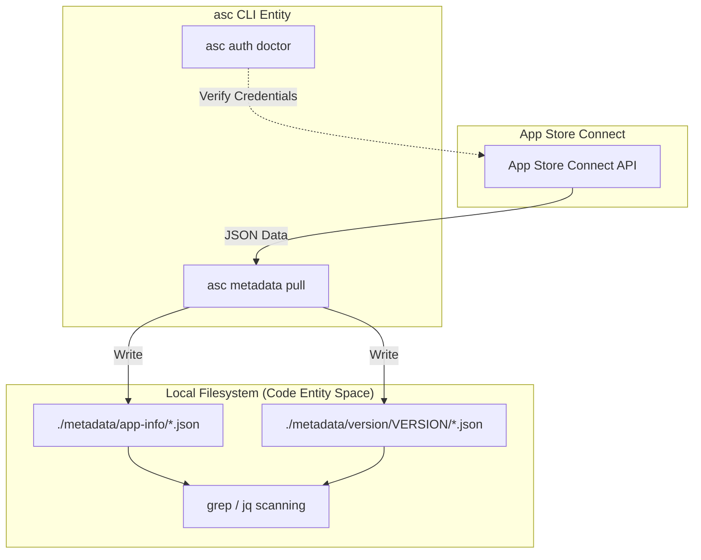
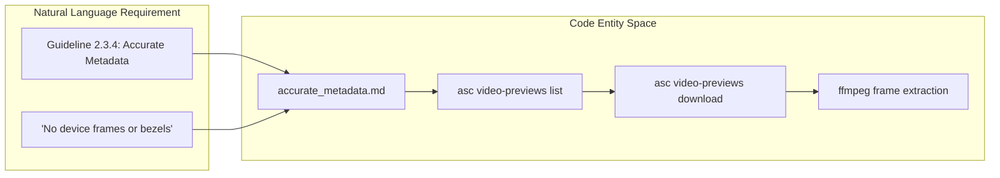

<!-- source: DeepWiki mcp.deepwiki.com · repo truongduy2611/app-store-preflight-skills · page 4.2 asc CLI Integration · fetched 2026-10-27 -->

# asc CLI Integration

<details>
<summary>Relevant source files</summary>

The following files were used as context for generating this wiki page:

- [SKILL.md](SKILL.md)
- [references/rules/metadata/accurate_metadata.md](references/rules/metadata/accurate_metadata.md)
- [references/rules/metadata/competitor_terms.md](references/rules/metadata/competitor_terms.md)

</details>


The App Store Preflight Skill leverages the `asc` CLI (App Store Connect CLI) as its primary interface for data acquisition from Apple's backend. This integration allows the skill to perform automated inspections of live or pending metadata, download assets for validation, and verify authentication states before running preflight checks.

## Authentication and Environment

The `asc` CLI requires valid App Store Connect API credentials. These can be provided through interactive login or via environment variables for CI/CD and automated agent workflows.

### Authentication Variables
The following environment variables are used to authenticate the CLI without manual intervention:
- `ASC_KEY_ID`: Your App Store Connect API Key ID. [SKILL.md:109-109]()
- `ASC_ISSUER_ID`: Your App Store Connect Issuer ID. [SKILL.md:109-109]()
- `ASC_PRIVATE_KEY`: The content of your `.p8` private key file. [SKILL.md:109-109]()
- `ASC_PRIVATE_KEY_PATH`: Path to the `.p8` file (alternative to `ASC_PRIVATE_KEY`). [SKILL.md:109-109]()

### Verification Commands
| Command | Purpose |
|---------|---------|
| `asc auth login` | Interactive login to store credentials locally. [SKILL.md:109-109]() |
| `asc auth doctor` | Diagnoses authentication issues and verifies which credentials the CLI is currently using. [SKILL.md:109-109]() |

**Sources:** [SKILL.md:109-109]()

---

## Metadata Acquisition Flow

The skill relies on a "Pull-Inspect-Validate" pattern. Metadata is first pulled into a canonical local directory structure before being scanned by the rejection rules.

### Pulling Metadata
To initialize a scan of existing App Store metadata, the skill uses:
```bash
asc metadata pull --app "<APP_ID>" --version "<VERSION>" --dir ./metadata
```
[SKILL.md:48-48]()

### Canonical JSON Layout
The `asc metadata pull` command populates the `./metadata` directory with a standardized structure that the scanning engine expects:
- **App Information**: General app-level settings (e.g., category, bundle ID) are stored in `./metadata/app-info/*.json`. [SKILL.md:51-51]()
- **Version Localizations**: Version-specific metadata (e.g., description, keywords, what's new) for each locale is stored in `./metadata/version/<VERSION>/*.json`. [SKILL.md:52-52]()

### Metadata Inspection Patterns (jq/grep)
Once the JSON is pulled, the skill uses `grep` or `jq` to detect violations:
- **Competitor Terms**: Searching for "Android" or "Google Play" across all pulled JSON files. [references/rules/metadata/competitor_terms.md:25-27]()
- **Character Limits**: Validating field lengths against Apple's constraints. [SKILL.md:98-98]()

### Metadata Flow Diagram
This diagram illustrates how the `asc` CLI acts as the bridge between the App Store Connect API and the local filesystem used by the preflight rules.

**Data Flow: API to Local Rules**

**Sources:** [SKILL.md:48-55](), [references/rules/metadata/competitor_terms.md:25-27]()

---

## Video Preview Integration

The `asc` CLI is specifically used to audit App Preview videos, which are subject to strict "capture-only" rules under Guideline 2.3.4.

### Listing and Downloading Previews
The skill uses specific subcommands to identify and retrieve video assets for frame-by-frame analysis:
1. **List Previews**: `asc video-previews list --version-localization "<ID>"` [references/rules/metadata/accurate_metadata.md:28-28]()
2. **Download Previews**: `asc video-previews download --version-localization "<ID>" --output-dir ./previews` [references/rules/metadata/accurate_metadata.md:31-31]()

### Visual Inspection Pipeline
After downloading via `asc`, the skill may trigger an automated frame extraction using `ffmpeg` to detect prohibited device frames or bezels. [references/rules/metadata/accurate_metadata.md:37-41]()

### Preview Validation Diagram
This diagram maps the natural language requirement ("No device frames in videos") to the specific CLI commands and code entities that perform the check.

**System Mapping: Video Compliance**

**Sources:** [references/rules/metadata/accurate_metadata.md:2-3](), [references/rules/metadata/accurate_metadata.md:28-31](), [references/rules/metadata/accurate_metadata.md:37-41]()

---

## Validation and Dry Runs

Before finalizing remediation, the `asc` CLI provides a mechanism to verify that metadata changes are valid without actually committing them to the App Store.

### Dry-Run Verification
When the skill suggests an "Autofix" (e.g., removing competitor terms), it recommends verifying the fix using the `--dry-run` flag:
```bash
asc metadata push --app "<APP_ID>" --version "<VERSION>" --dir ./metadata --dry-run
```
[references/rules/metadata/competitor_terms.md:45-45]()

This ensures that the proposed changes adhere to the schema and constraints of the App Store Connect API before the user performs a manual or automated push. [SKILL.md:101-101]()

**Sources:** [SKILL.md:101-101](), [references/rules/metadata/competitor_terms.md:45-45]()

---

