# Page: Overview

# Overview

<details>
<summary>Relevant source files</summary>

The following files were used as context for generating this wiki page:

- [LICENSE](LICENSE)
- [README.md](README.md)
- [SKILL.md](SKILL.md)

</details>


The **App Store Preflight Skills** system is an AI agent skill designed to automate the audit of iOS and macOS projects against Apple's App Store Review Guidelines. By scanning source code, project configurations, and App Store metadata, the system identifies common patterns that lead to rejections before a developer submits their build for review [README.md:3-7]().

The system exists to reduce the friction of the App Store submission process, providing a "pre-flight" check that mirrors the scrutiny of Apple's review team. It integrates directly with the `asc` CLI to pull live metadata and uses a structured library of rejection rules and app-type checklists to generate actionable compliance reports [README.md:9-13]().

### System Architecture: From Natural Language to Code Entities

The following diagram illustrates how the high-level "Preflight" concepts map to specific files and directories within the codebase.

**Codebase Entity Mapping**
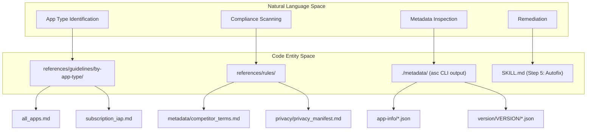
Sources: [README.md:21-38](), [README.md:52-89](), [SKILL.md:23-38](), [SKILL.md:51-52]()

---

## Core Components

### 1. Guideline Index & Checklists
The system categorizes Apple's 100+ guidelines into digestible checklists based on the app's functionality. Every scan starts with a universal baseline (`all_apps.md`) and layers on specialized checks for categories like AI, Subscriptions, or Games [README.md:21-36]().

For details, see [Guideline Index & App-Type Checklists](#2).

### 2. Rejection Rules Reference
The core logic of the system is contained within `references/rules/`. These are categorized into five domains:
*   **Metadata**: Checks for competitor terms, trademark misuse, and storefront-specific bans [README.md:54-62]().
*   **Subscription**: Validates pricing transparency and legal links [README.md:64-69]().
*   **Privacy**: Audits `PrivacyInfo.xcprivacy` and data collection practices [README.md:71-76]().
*   **Design**: Identifies "minimum functionality" issues and Sign in with Apple requirements [README.md:78-83]().
*   **Entitlements**: Audits `.entitlements` files for unused or unjustified permissions [README.md:85-89]().

For details, see [Rejection Rules Reference](#3).

### 3. Preflight Pipeline
The AI agent follows a five-step execution model defined in `SKILL.md`. This pipeline ensures that the context is correctly identified before scanning begins and provides a closed-loop system for fixing identified issues [SKILL.md:13-104]().

**The Preflight Execution Pipeline**
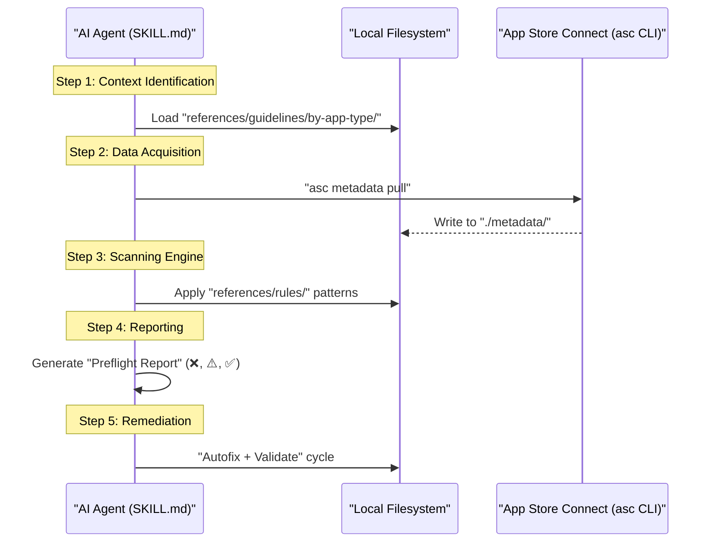
Sources: [SKILL.md:23-104](), [README.md:40-46]()

For details, see [How the Preflight Pipeline Works](#1.2).

---

## Getting Started

To use the system, developers must install the skill via `npx` and ensure the `asc` CLI is configured for authentication. The skill relies on the canonical JSON layout provided by `asc metadata pull` to perform its audits [README.md:15-19](), [SKILL.md:17-21]().

For a step-by-step installation and configuration guide, see [Getting Started](#1.1).

---

## Navigation Summary

| Page | Purpose |
| :--- | :--- |
| [Getting Started](#1.1) | Installation, `asc` CLI setup, and authentication. |
| [How the Preflight Pipeline Works](#1.2) | Deep dive into the 5-stage agent execution logic. |
| [Guideline Index & App-Type Checklists](#2) | Overview of app-type checklists and the guideline library. |
| [Rejection Rules Reference](#3) | Technical details on the specific patterns detected by the system. |
| [Autofix & Validation System](#4) | How the system applies and verifies automated remediations. |
| [Glossary](#5) | Key terms and code entity definitions. |

Sources: [README.md:1-114](), [SKILL.md:1-128]()

---

# Page: Getting Started

# Getting Started

<details>
<summary>Relevant source files</summary>

The following files were used as context for generating this wiki page:

- [README.md](README.md)
- [SKILL.md](SKILL.md)

</details>


This page provides a technical guide for installing and configuring the **App Store Preflight Skills** system. It details the setup of external dependencies, authentication with App Store Connect, and the execution of the initial scanning pipeline.

## 1. Installation and Prerequisites

The system is designed as an AI agent skill that interacts with the local filesystem and the App Store Connect API.

### 1.1 Core Dependencies
The skill relies on two primary external tools for data acquisition and JSON processing:
*   **asc CLI**: The [App-Store-Connect-CLI](https://github.com/rudrankriyam/App-Store-Connect-CLI) is used to pull canonical metadata from Apple's servers [SKILL.md:19-20]().
*   **jq**: A lightweight command-line JSON processor used within rule detection patterns to parse metadata and project configurations [SKILL.md:21-22]().

### 1.2 Skill Installation
Install the skill using `npx` to add it to your local AI agent environment:
```bash
npx skills add truongduy2611/app-store-preflight-skills
```
[README.md:17-19]()

### 1.3 System Component Overview
The following diagram maps the high-level conceptual steps to the specific directories and tools used in the codebase.

**Natural Language to Code Entity Mapping: Installation & Setup**
```mermaid
graph TD
    subgraph "External Tools"
        ASC_CLI["asc CLI (Homebrew)"]
        JQ_TOOL["jq (JSON Processor)"]
    end

    subgraph "Skill Logic (Code Entities)"
        SKILL_MD["SKILL.md (Agent Instructions)"]
        RULES_DIR["references/rules/ (Detection Logic)"]
        GUIDE_DIR["references/guidelines/ (App Checklists)"]
    end

    subgraph "Data Storage"
        METADATA_DIR["./metadata/ (Canonical JSON)"]
    end

    ASC_CLI -->| "asc metadata pull" | METADATA_DIR
    SKILL_MD -->| "Loads Rules" | RULES_DIR
    SKILL_MD -->| "Selects Type" | GUIDE_DIR
    METADATA_DIR -->| "Parsed by" | JQ_TOOL
    JQ_TOOL -->| "Used in" | RULES_DIR
```
**Sources:** [SKILL.md:17-22](), [README.md:52-54](), [README.md:23-27]()

---

## 2. Authentication (asc auth)

Before running a preflight scan, you must authenticate with App Store Connect to allow the `asc` CLI to fetch your app's current metadata.

### 2.1 Authentication Methods
The skill supports the standard `asc` authentication flow. You can authenticate interactively or via environment variables for CI/CD environments:
*   **Interactive**: Run `asc auth login` [SKILL.md:109-110]().
*   **Environment Variables**: Set `ASC_KEY_ID`, `ASC_ISSUER_ID`, and `ASC_PRIVATE_KEY` (or `ASC_PRIVATE_KEY_PATH`) [SKILL.md:110-111]().

### 2.2 Validation
To verify the authentication state, use the `doctor` command:
```bash
asc auth doctor
```
[SKILL.md:111-112]()

**Sources:** [SKILL.md:109-112]()

---

## 3. Running the First Preflight Scan

The preflight process follows a structured 5-step pipeline defined in the agent instructions.

### Step 1: Context Identification
The agent first identifies the app type to load the correct compliance checklists from `references/guidelines/by-app-type/`. It always loads `all_apps.md` as a baseline [SKILL.md:25-29]().

### Step 2: Data Acquisition (Metadata Pull)
The agent executes the `asc metadata pull` command to synchronize the local environment with the App Store Connect state.
```bash
asc metadata pull --app "<APP_ID>" --version "<VERSION>" --dir ./metadata
```
[SKILL.md:48-49]()

This populates the following structure:
*   `./metadata/app-info/*.json`: General app information [SKILL.md:51-52]().
*   `./metadata/version/<VERSION>/*.json`: Version-specific localizations (descriptions, keywords) [SKILL.md:52-53]().

### Step 3: Scanning Engine
The agent iterates through categories (Metadata, Subscription, Privacy, Design, Entitlements) and applies the detection logic found in `references/rules/` [SKILL.md:63-72]().

**Data Flow: Metadata Acquisition and Scanning**
```mermaid
graph LR
    subgraph "App Store Connect"
        API["App Store API"]
    end

    subgraph "Local Workspace"
        CMD_PULL["asc-metadata-pull"]
        JSON_STORE["./metadata/version/*.json"]
        SCAN_ENGINE["SKILL.md: Step 3 (Scanning)"]
        
        subgraph "Rule Definitions"
            R_META["references/rules/metadata/*.md"]
            R_PRIV["references/rules/privacy/*.md"]
        end
    end

    API -->| "JSON Data" | CMD_PULL
    CMD_PULL --> JSON_STORE
    JSON_STORE --> SCAN_ENGINE
    R_META --> SCAN_ENGINE
    R_PRIV --> SCAN_ENGINE
    SCAN_ENGINE -->| "Generates" | REPORT["Preflight Report"]
```
**Sources:** [SKILL.md:42-61](), [README.md:40-45]()

### Step 4: Reporting
The scan results are compiled into a `Preflight Report` categorized by severity:
1.  **❌ Rejections**: Critical violations of Apple Review Guidelines [SKILL.md:80-83]().
2.  **⚠️ Warnings**: Potential issues or best-practice violations [SKILL.md:85-86]().
3.  **✅ Passed**: Categories that met all criteria [SKILL.md:88-89]().

### Step 5: Autofix & Validation
For specific rules (e.g., Competitor Terms or character limits), the agent can suggest or apply fixes [SKILL.md:96-99](). After a fix is applied, the agent must **re-run the affected check** to confirm resolution [SKILL.md:101-102]().

**Sources:** [SKILL.md:23-104](), [README.md:40-48]()

---

# Page: How the Preflight Pipeline Works

# How the Preflight Pipeline Works

<details>
<summary>Relevant source files</summary>

The following files were used as context for generating this wiki page:

- [README.md](README.md)
- [SKILL.md](SKILL.md)

</details>


The App Store Preflight pipeline is a structured, five-stage process designed to move from a raw Xcode project and App Store metadata to a validated, compliant submission state. This pipeline is driven by the `SKILL.md` instruction set, which directs the AI agent to orchestrate external CLI tools, filesystem scans, and rule-based validation.

## Pipeline Overview

The pipeline transitions from identifying the high-level application context to granular code-level inspection, ending with an automated remediation loop.

### 1. Context Identification
The agent first determines the scope of the scan by identifying the app type. This determines which specialized checklists are merged with the universal baseline.

*   **Logic**: Every scan starts with `references/guidelines/by-app-type/all_apps.md` [SKILL.md:25-29]().
*   **Specialization**: Based on project analysis (e.g., presence of `StoreKit`, AI frameworks, or macOS targets), the agent loads supplemental checklists like `ai_apps.md` or `subscription_iap.md` [SKILL.md:30-38]().

### 2. Data Acquisition
The pipeline relies on the `asc` CLI to bridge the gap between the local environment and App Store Connect.

*   **Command**: `asc metadata pull --app "<APP_ID>" --version "<VERSION>" --dir ./metadata` [SKILL.md:48-49]().
*   **Output**: The agent expects a canonical JSON layout where app information is stored in `./metadata/app-info/*.json` and localized version data in `./metadata/version/<VERSION>/*.json` [SKILL.md:51-52]().
*   **Authentication**: The agent verifies credentials using `asc auth doctor` or environment variables like `ASC_KEY_ID` and `ASC_ISSUER_ID` [SKILL.md:109-109]().

### 3. Scanning Engine
The core of the pipeline involves mapping files in the "Code Entity Space" to "Rejection Rules" defined in `references/rules/`.

*   **Execution**: The agent iterates through five rule domains: Metadata, Subscription, Privacy, Design, and Entitlements [SKILL.md:65-71]().
*   **Detection Patterns**: Rules provide specific "How to Detect" instructions, such as using `grep` for competitor terms or `plutil` for entitlement audits [README.md:102-102](), [SKILL.md:63-64]().

### 4. Reporting
Findings are aggregated into a standardized Preflight Report.

*   **Triage**: Issues are categorized into **❌ Rejections** (immediate blockers), **⚠️ Warnings** (risky patterns), and **✅ Passed** (validated domains) [SKILL.md:80-90]().
*   **Mapping**: Each finding must cite the specific Apple Guideline number (e.g., 2.3.1 for competitor terms) and the affected file path [SKILL.md:81-83]().

### 5. Remediation Lifecycle (Autofix & Validate)
The pipeline is a closed loop. If an issue is fixable, the agent applies the change and immediately re-triggers the specific scan stage to verify the fix.

*   **Autofixable**: Text-based metadata (competitor terms), missing URL templates (ToS/PP), and character limit adjustments [SKILL.md:96-99]().
*   **Manual**: UI-based issues (Sign in with Apple button prominence) or asset-based issues (App Preview frames) [SKILL.md:103-104]().

---

## Technical Data Flow

The following diagram illustrates how the pipeline moves data from Apple's servers and the local filesystem through the AI Scanning Engine.

**Preflight Data Flow: From Source to Report**

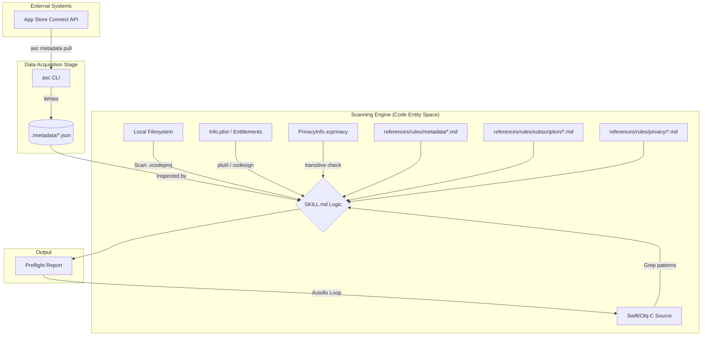
**Sources:** [README.md:40-46](), [SKILL.md:23-104](), [SKILL.md:107-112]()

---

## Implementation Detail: AI Agent Orchestration

The `SKILL.md` file acts as the "Brain" of the pipeline. It does not contain executable code itself but defines the operational sequence the AI agent must follow to interact with the codebase.

| Stage | Key Code Entities / Tools | File/Path References |
| :--- | :--- | :--- |
| **Context** | `all_apps.md`, `ai_apps.md` | `references/guidelines/by-app-type/` [SKILL.md:25-38]() |
| **Acquisition** | `asc metadata pull`, `jq` | `./metadata/` [SKILL.md:48-52]() |
| **Scanning** | `grep`, `plutil`, `codesign` | `references/rules/` [README.md:102-102](), [SKILL.md:65-71]() |
| **Validation** | `asc auth doctor` | `ASC_KEY_ID`, `ASC_PRIVATE_KEY` [SKILL.md:109-109]() |

### Natural Language to Code Entity Mapping

This diagram shows how natural language rules defined in Markdown files are translated into technical checks against specific project entities.

**Rule-to-Entity Mapping**

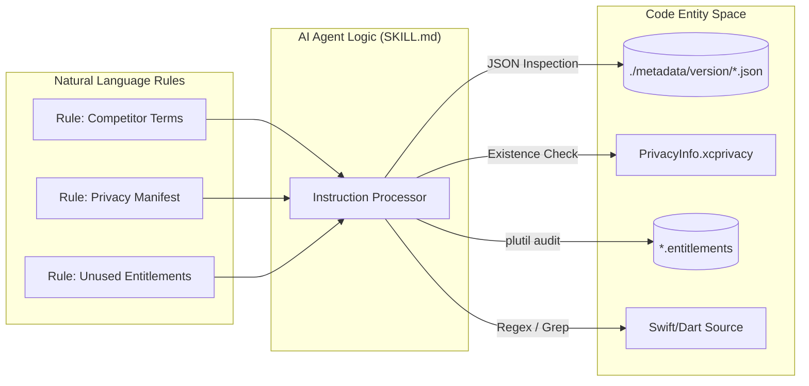
**Sources:** [README.md:54-89](), [SKILL.md:61-72](), [SKILL.md:107-112]()

## The Remediation Loop

A unique aspect of this pipeline is the **Autofix + Validate** stage [SKILL.md:94-101](). Unlike static analysis tools that only report errors, the Preflight Pipeline attempts to close the ticket.

1.  **Detection**: A rule (e.g., `references/rules/metadata/competitor_terms.md`) flags a violation in a localized description JSON.
2.  **Proposed Fix**: The agent generates a version of the text with terms like "Android" or "Google Play" removed [SKILL.md:97-97]().
3.  **Application**: The agent modifies the local JSON file in `./metadata/version/`.
4.  **Verification**: The agent re-runs the `competitor_terms` scan specifically against the modified file.
5.  **Completion**: The finding is moved from **❌ Rejections** to **✅ Passed** in the final report, with a note about the applied fix.

**Sources:** [SKILL.md:94-104](), [README.md:46-46]()

---

# Page: Guideline Index & App-Type Checklists

# Guideline Index & App-Type Checklists

<details>
<summary>Relevant source files</summary>

The following files were used as context for generating this wiki page:

- [references/guidelines/README.md](references/guidelines/README.md)
- [references/guidelines/by-app-type/all_apps.md](references/guidelines/by-app-type/all_apps.md)

</details>


This page provides a high-level overview of the `references/guidelines/` directory, which serves as the foundational knowledge base for the App Store Preflight Skills system. It details the master index of Apple's App Store Review Guidelines and the modular checklist system used to evaluate apps based on their specific functionality.

## Guideline Reference System

The system maintains a structured index of the official Apple App Store Review Guidelines to ensure that every automated check and manual verification step is mapped to a specific regulatory requirement.

### Master Guideline Index
The `references/guidelines/README.md` file acts as the central repository, categorizing guidelines into five primary domains:
1.  **Safety**: Objectionable content, user-generated content, and physical harm.
2.  **Performance**: App completeness, metadata accuracy, and software requirements.
3.  **Business**: Payments (IAP), subscriptions, and external purchase links.
4.  **Design**: Copycats, minimum functionality, and "Sign in with Apple" requirements.
5.  **Legal**: Privacy, data collection, and intellectual property.

### App-Type Checklist Model
Rather than applying every rule to every app, the system uses a **Base + Delta** loading model. Every scan begins with the **Universal Checklist** and then dynamically appends **App-Type Specific Checklists** based on the app's identified features (e.g., if the app uses Generative AI or Subscriptions).

| Component | File Path | Role |
| :--- | :--- | :--- |
| **Universal Base** | `references/guidelines/by-app-type/all_apps.md` | Mandatory checks for every submission. |
| **Specialized Deltas** | `references/guidelines/by-app-type/*.md` | Conditional checks (e.g., `ai_apps.md`, `subscription_iap.md`). |

**Sources:**
- [references/guidelines/README.md:1-120]()
- [references/guidelines/by-app-type/all_apps.md:1-51]()

---

## Guideline Mapping Architecture

The following diagram illustrates how natural language Apple Guidelines are mapped to the codebase's internal checklist logic.

### Natural Language to Code Entity Mapping
"The Mapping of Apple Guidelines to Checklist Entities"

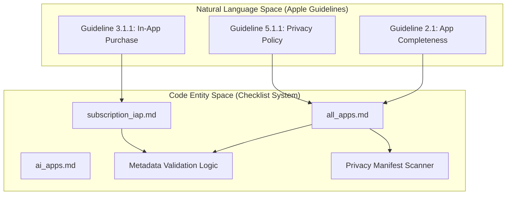

**Sources:**
- [references/guidelines/README.md:40-40]()
- [references/guidelines/README.md:87-87]()
- [references/guidelines/by-app-type/all_apps.md:7-12]()

---

## Checklist Categories

### 2.1 Universal Checklist (all_apps.md)
The Universal Checklist contains the "Pre-Submission Essentials." These are the non-negotiable requirements that apply to every iOS, macOS, watchOS, or tvOS binary. It covers:
*   **Completeness**: Ensuring demo accounts are provided and backends are live [references/guidelines/by-app-type/all_apps.md:7-10]().
*   **Metadata Constraints**: Enforcing the 30-character name limit and preventing trademark stuffing [references/guidelines/by-app-type/all_apps.md:16-18]().
*   **Privacy Essentials**: Validating `PrivacyInfo.xcprivacy` and in-app privacy policy links [references/guidelines/by-app-type/all_apps.md:28-33]().

For details, see [Universal Checklist (all_apps.md)](#2.1).

### 2.2 App-Type Specific Checklists
The system includes specialized checklists for nine distinct app categories. These are activated when the `Context Identification` stage of the pipeline detects specific frameworks or metadata keywords.

*   **AI & Generative AI**: Focuses on content moderation, China-specific AI regulations, and prohibited branding [references/guidelines/by-app-type/ai_apps.md]().
*   **Subscriptions & IAP**: Validates pricing transparency, restore buttons, and EULA/ToS links [references/guidelines/by-app-type/subscription_iap.md]().

For details, see [App-Type Specific Checklists](#2.2).

---

## Pipeline Integration Logic

This diagram shows how the `references/guidelines/` directory feeds into the automated scanning engine.

### Guideline-Driven Execution Flow
"How Guidelines Drive the Scanning Engine"

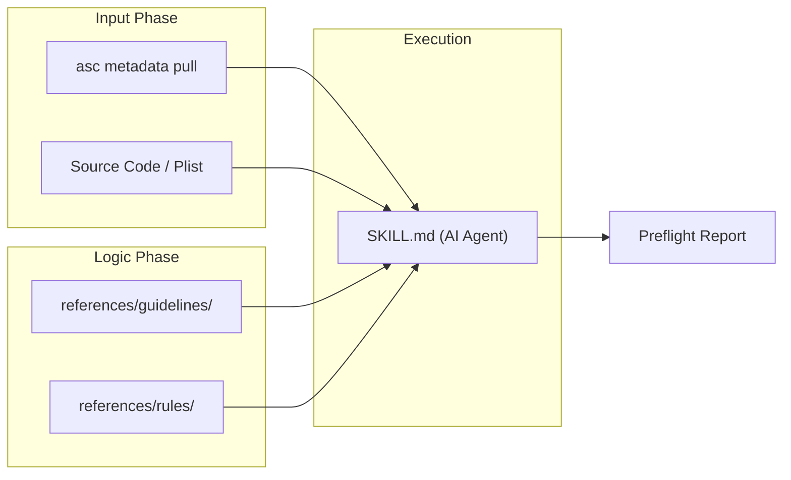

**Sources:**
- [references/guidelines/README.md:5-5]()
- [references/guidelines/by-app-type/all_apps.md:3-3]()

---

## Summary Table: Guideline Domains

| Domain | Key Guidelines | Primary Checklist |
| :--- | :--- | :--- |
| **Safety** | 1.1, 1.2 (UGC) | `all_apps.md` |
| **Performance** | 2.1 (Completeness), 2.3 (Metadata) | `all_apps.md` |
| **Business** | 3.1.1 (IAP), 3.1.2 (Subs) | `subscription_iap.md` |
| **Design** | 4.2 (Min Functionality), 4.8 (SIWA) | `all_apps.md` |
| **Legal** | 5.1.1 (Privacy), 5.2.5 (Trademarks) | `all_apps.md` |

**Sources:**
- [references/guidelines/README.md:9-130]()
- [references/guidelines/by-app-type/all_apps.md:5-51]()

---

# Page: Universal Checklist (all_apps.md)

# Universal Checklist (all_apps.md)

<details>
<summary>Relevant source files</summary>

The following files were used as context for generating this wiki page:

- [references/guidelines/README.md](references/guidelines/README.md)
- [references/guidelines/by-app-type/all_apps.md](references/guidelines/by-app-type/all_apps.md)

</details>


The Universal Checklist serves as the foundational compliance layer for the App Store Preflight Skills system. It defines the baseline requirements that every application must satisfy to pass an App Store review, regardless of its specific category (e.g., AI, Games, or Subscriptions). This checklist is implemented as a set of verification points that map directly to Apple's App Store Review Guidelines.

## Pre-Submission Essentials (Guideline 2.1)

The most frequent cause of immediate rejection is "App Completeness." The system validates that the app is a final production build rather than a beta or placeholder.

| Requirement | Code/Guideline Reference | Implementation Logic |
|:---|:---|:---|
| **App Completeness** | [references/guidelines/by-app-type/all_apps.md:7-7]() | Verifies the binary is not a demo/beta (Guideline 2.1). |
| **Metadata Accuracy** | [references/guidelines/by-app-type/all_apps.md:8-8]() | Checks for placeholder text like "Lorem Ipsum" or "TBD". |
| **Demo Accounts** | [references/guidelines/by-app-type/all_apps.md:9-9]() | Ensures `review_notes` include credentials if login is required. |
| **Backend Availability**| [references/guidelines/by-app-type/all_apps.md:10-10]() | Validates that API endpoints used by the app are reachable. |

**Sources:** [references/guidelines/by-app-type/all_apps.md:5-13](), [references/guidelines/README.md:40-40]()

## Metadata Constraints

Metadata validation focuses on text lengths, prohibited terms, and visual asset compliance. The `asc` CLI is used to pull the current metadata state for analysis.

### Textual Constraints (Guideline 2.3.7 & 2.3.10)
The system scans app titles and descriptions for:
*   **Length:** Ensuring the App Name is $\le 30$ characters [references/guidelines/by-app-type/all_apps.md:16-16]().
*   **Competitor Mentions:** Flagging terms like "Android" or "Google Play" [references/guidelines/by-app-type/all_apps.md:18-18]().
*   **Trademark Misuse:** Identifying unauthorized use of Apple product names or icons [references/guidelines/by-app-type/all_apps.md:24-24]().

### Visual Assets (Guideline 2.3.3 & 2.3.4)
*   **Screenshots:** Must show the app in actual use, not just marketing splash screens [references/guidelines/by-app-type/all_apps.md:19-19]().
*   **App Previews:** Video captures must be "screen captures only" and are prohibited from using device frames (e.g., an iPhone bezel around the video) [references/guidelines/by-app-type/all_apps.md:20-20]().

**Sources:** [references/guidelines/by-app-type/all_apps.md:14-25](), [references/guidelines/README.md:49-52]()

## Privacy & Data Compliance

This section bridges the gap between legal requirements (Privacy Policy) and technical implementation (`PrivacyInfo.xcprivacy`).

### Data Flow: Privacy Manifest Validation
The scanner inspects the project's `PrivacyInfo.xcprivacy` file to ensure compliance with the "Required Reason API" policy.

**Privacy Manifest Verification Logic**
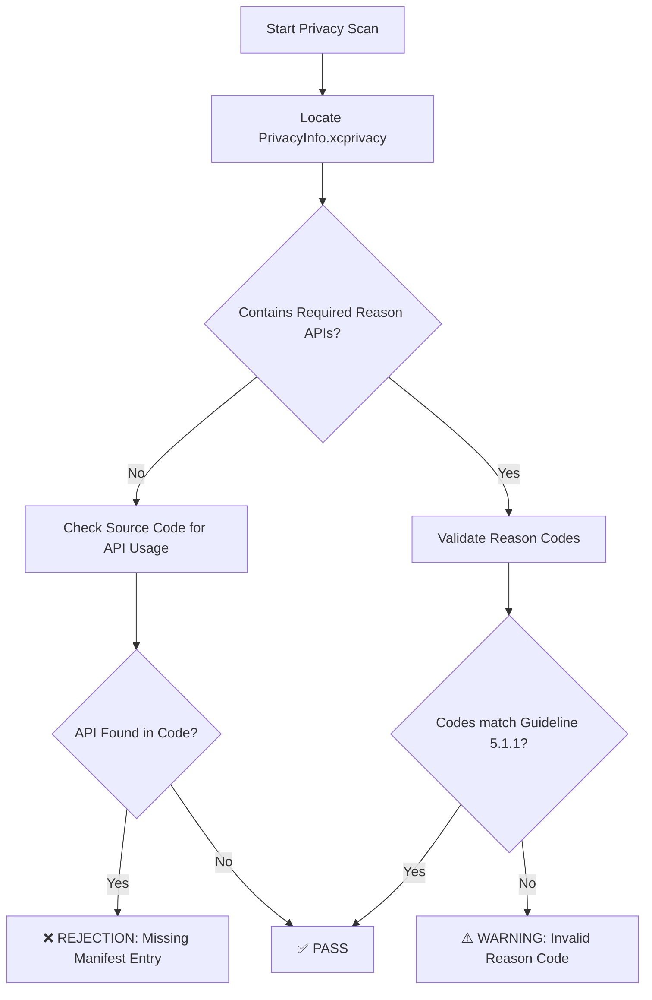
**Sources:** [references/guidelines/by-app-type/all_apps.md:33-33](), [references/guidelines/README.md:133-138]()

### Account Management (Guideline 5.1.1(v))
If the app supports account creation, the system checks for an "Account Deletion" mechanism within the UI or metadata links, as required by Apple's data privacy mandates [references/guidelines/by-app-type/all_apps.md:31-31]().

## Authentication & Design (Guideline 4.0)

The checklist enforces the "Sign in with Apple" (SIWA) parity rule. If an app implements third-party social logins (Google, Facebook, etc.), it must also offer SIWA.

### Code-to-Guideline Mapping: Authentication
The following diagram illustrates how the system maps natural language requirements to specific code entities found in an iOS project.

**Authentication Requirement Mapping**
```mermaid
classDiagram
    class "Guideline 4.8" {
        +Requirement: Social Login Parity
        +Rule: Must offer Sign in with Apple
    }
    class "Code Entities" {
        +ASAuthorizationAppleIDProvider
        +ASAuthorizationAppleIDButton
        +AuthenticationServices.framework
    }
    class "Scanner Logic" {
        +grep_social_sdks()
        +verify_siwa_implementation()
    }
    "Guideline 4.8" --> "Scanner Logic" : "Triggers"
    "Scanner Logic" --> "Code Entities" : "Inspects"
```
**Sources:** [references/guidelines/by-app-type/all_apps.md:39-40](), [references/guidelines/README.md:126-126]()

## Business & IAP Baseline

Regardless of the business model, the universal checklist enforces two critical rules:
1.  **Digital Content:** All digital unlocks (features, levels, ad-removal) must use the In-App Purchase (IAP) system [references/guidelines/by-app-type/all_apps.md:47-47]().
2.  **Review Manipulation:** The app cannot force or incentivize users to rate or review the app in exchange for functionality [references/guidelines/by-app-type/all_apps.md:48-48]().

**Sources:** [references/guidelines/by-app-type/all_apps.md:45-51](), [references/guidelines/README.md:87-87](), [references/guidelines/README.md:103-103]()

---

# Page: App-Type Specific Checklists

# App-Type Specific Checklists

<details>
<summary>Relevant source files</summary>

The following files were used as context for generating this wiki page:

- [references/guidelines/by-app-type/ai_apps.md](references/guidelines/by-app-type/ai_apps.md)
- [references/guidelines/by-app-type/crypto_finance.md](references/guidelines/by-app-type/crypto_finance.md)
- [references/guidelines/by-app-type/games.md](references/guidelines/by-app-type/games.md)
- [references/guidelines/by-app-type/health_fitness.md](references/guidelines/by-app-type/health_fitness.md)
- [references/guidelines/by-app-type/kids.md](references/guidelines/by-app-type/kids.md)
- [references/guidelines/by-app-type/macos.md](references/guidelines/by-app-type/macos.md)
- [references/guidelines/by-app-type/social_ugc.md](references/guidelines/by-app-type/social_ugc.md)
- [references/guidelines/by-app-type/subscription_iap.md](references/guidelines/by-app-type/subscription_iap.md)
- [references/guidelines/by-app-type/vpn.md](references/guidelines/by-app-type/vpn.md)

</details>


The App Store Preflight Skills system employs a "base + delta" loading model for compliance verification. While the **Universal Checklist (all_apps.md)** covers the baseline requirements for every submission, the system identifies the specific nature of an application to activate one or more of the nine specialized checklists found in `references/guidelines/by-app-type/`.

This approach ensures that a high-utility utility app isn't burdened with "Loot Box" disclosure requirements, while a Generative AI app is strictly audited for China storefront compliance and medical disclaimers.

### The Loading Model

The AI agent determines which checklists to apply by analyzing the app's metadata, entitlements, and source code during the **Context Identification** stage. Multiple checklists can be active simultaneously (e.g., a Game that also uses Generative AI).

| Category | Primary Target | Key File |
| :--- | :--- | :--- |
| **AI & Generative AI** | Apps using LLMs, Diffusers, or Deep Synthesis | [ai_apps.md:1-38]() |
| **Subscriptions & IAP** | Apps with auto-renewable subs or digital goods | [subscription_iap.md:1-35]() |
| **Social & UGC** | Messaging, Communities, and Content Platforms | [social_ugc.md:1-33]() |
| **Games** | Casual, Hardcore, and Gambling titles | [games.md:1-32]() |
| **Health & Medical** | HealthKit integration and diagnostic tools | [health_fitness.md:1-32]() |
| **Crypto & Finance** | Wallets, Exchanges, and Loan providers | [crypto_finance.md:1-32]() |
| **Kids Category** | Apps specifically targeting children under 13 | [kids.md:1-28]() |
| **macOS Specific** | Desktop apps (Sandboxing & Entitlements) | [macos.md:1-39]() |
| **VPN & Networking** | VPN providers and Network managers | [vpn.md:1-19]() |

**Sources:**
- `references/guidelines/by-app-type/`

---

### AI & Generative AI Apps
This checklist focuses on the rapidly evolving regulatory landscape for AI, particularly regarding the **China DST (Deep Synthesis Technology)** regulations. It enforces strict metadata bans on terms like "ChatGPT" or "OpenAI" for the China storefront [ai_apps.md:7-8]() and ensures that AI-generated health advice includes mandatory medical disclaimers [ai_apps.md:10-10]().

For details, see **[AI & Generative AI Apps (#2.2.1)]**.

**Sources:**
- [references/guidelines/by-app-type/ai_apps.md:1-38]()

---

### Subscriptions & In-App Purchases
This is the most frequently triggered delta checklist. It validates the visual hierarchy of paywalls—ensuring the billed amount is more prominent than "calculated" monthly costs [subscription_iap.md:10-10](). It also verifies the presence of mandatory legal links (EULA/Privacy Policy) both in the metadata and on the purchase screen [subscription_iap.md:11-13]().

For details, see **[Subscriptions & In-App Purchases (#2.2.2)]**.

**Sources:**
- [references/guidelines/by-app-type/subscription_iap.md:1-35]()

---

### Specialized Industry Checklists

#### Games
Focuses on **Guideline 3.1.1** requirements for loot box odds disclosure [games.md:8-8]() and ensuring that in-game currency does not expire [games.md:9-9](). It also checks for "lasting entertainment value" to prevent store spamming [games.md:28-29]().

#### Health, Fitness & Medical
Strictly enforces **Guideline 1.4.1**, preventing apps from claiming sensor-only diagnostics (e.g., measuring blood pressure via camera) without clinical proof [health_fitness.md:7-9](). It also audits **HealthKit** usage to ensure data is never used for advertising [health_fitness.md:11-11]().

#### Crypto, Finance & Trading
Ensures that any app handling cryptocurrency or financial trading is submitted by a **Legal Entity** rather than an individual developer [crypto_finance.md:7-15](). It specifically prohibits on-device crypto mining [crypto_finance.md:8-8]().

**Sources:**
- [references/guidelines/by-app-type/games.md:1-32]()
- [references/guidelines/by-app-type/health_fitness.md:1-32]()
- [references/guidelines/by-app-type/crypto_finance.md:1-32]()

---

### Platform & Audience Checklists

#### macOS Specific
Unlike iOS apps, macOS apps are audited for **Sandboxing compliance** [macos.md:7-7]() and appropriate use of entitlements. The system flags "Temporary Exception" entitlements which often trigger manual Apple review [macos.md:38-38]().

#### Kids Category
Enforces the "Parental Gate" requirement for all external links or IAP opportunities [kids.md:7-8](). It also restricts third-party analytics and advertising to services with verified kids-specific policies [kids.md:9-10]().

**Sources:**
- [references/guidelines/by-app-type/macos.md:1-39]()
- [references/guidelines/by-app-type/kids.md:1-28]()

---

### System Logic: Checklist Activation

The following diagram illustrates how the system maps technical indicators to the specialized checklists.

**Context-to-Checklist Mapping**
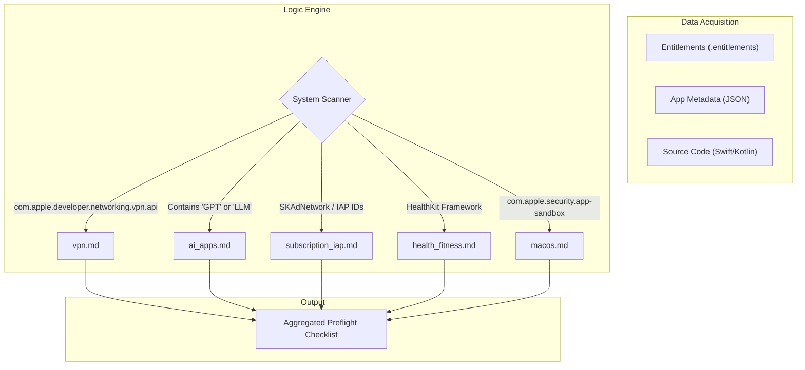

**Sources:**
- [references/guidelines/by-app-type/vpn.md:7-7]()
- [references/guidelines/by-app-type/ai_apps.md:25-32]()
- [references/guidelines/by-app-type/subscription_iap.md:1-3]()
- [references/guidelines/by-app-type/health_fitness.md:26-31]()
- [references/guidelines/by-app-type/macos.md:7-9]()

---

# Page: AI & Generative AI Apps

# AI & Generative AI Apps

<details>
<summary>Relevant source files</summary>

The following files were used as context for generating this wiki page:

- [references/guidelines/by-app-type/ai_apps.md](references/guidelines/by-app-type/ai_apps.md)
- [references/rules/metadata/china_storefront.md](references/rules/metadata/china_storefront.md)

</details>


This page provides a technical deep dive into the compliance requirements for applications utilizing Artificial Intelligence (AI), Generative AI, and Deep Synthesis Technology (DST). The preflight system evaluates these apps against a specialized checklist that extends the universal baseline to address specific Apple guidelines regarding content moderation, medical disclaimers, data privacy, and regional legal restrictions—most notably the Chinese Ministry of Industry and Information Technology (MIIT) regulations.

## Overview of AI Compliance Pipeline

When an app is identified as containing AI features, the preflight engine activates the `ai_apps.md` checklist. This process involves scanning both the codebase for API integrations (e.g., OpenAI, Anthropic) and the app metadata for restricted terminology.

### Data Flow for AI Preflight
The following diagram illustrates how the system transitions from raw metadata and source code to a compliance report.

**AI Compliance Data Flow**
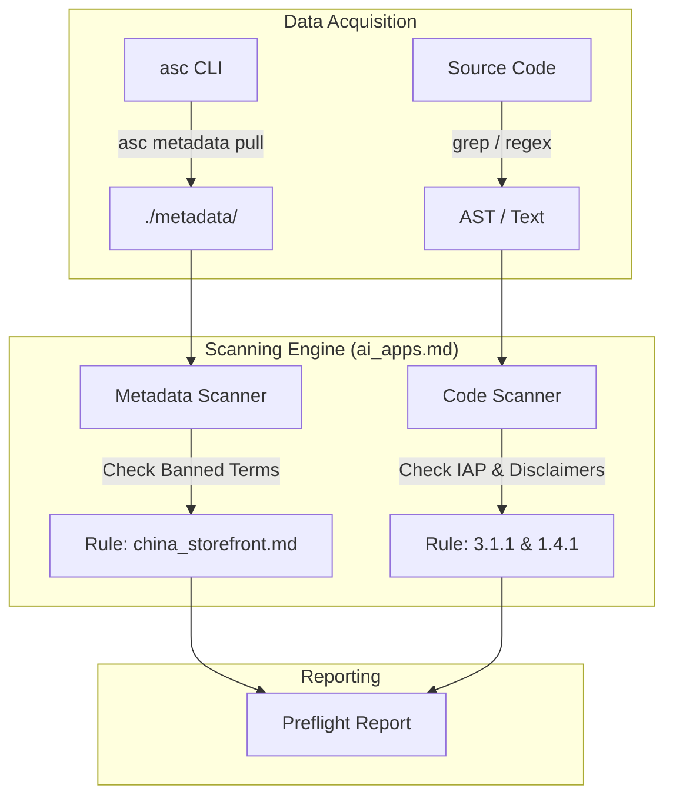
Sources: [references/guidelines/by-app-type/ai_apps.md:1-38](), [references/rules/metadata/china_storefront.md:30-38]()

---

## China DST & MIIT Compliance

The most frequent cause for rejection of AI apps is non-compliance with the *Administrative Provisions on Deep Synthesis of Internet-based Information Services*. If an app is distributed on the **China mainland storefront**, it must not reference unlicensed AI services in its metadata or provide access to them in-app without a permit.

### Banned AI Brand Terms
The system scans all locales in `./metadata/app-info/` and `./metadata/version/` for the following restricted terms:

| Category | Banned Terms (Case-Insensitive) |
| :--- | :--- |
| **OpenAI** | `ChatGPT`, `GPT-4`, `GPT-4o`, `GPT`, `OpenAI`, `DALL-E` |
| **Google** | `Gemini`, `Bard` |
| **Anthropic** | `Claude`, `Anthropic` |
| **Microsoft** | `Copilot` (when used in AI context) |
| **Other** | `Midjourney`, `Stable Diffusion` (cloud API) |

### Detection Implementation
The preflight tool utilizes `grep` patterns to identify these terms across all localized metadata files, as Apple may flag any locale if the app is available in the China storefront.

```bash
# Example detection logic used by the scanner
grep -ri "chatgpt\|openai\|gpt-4\|gemini\|claude\|anthropic\|midjourney\|dall-e" \
  ./metadata/app-info/ ./metadata/version/<VERSION>/
```

Sources: [references/rules/metadata/china_storefront.md:9-17](), [references/rules/metadata/china_storefront.md:40-45](), [references/guidelines/by-app-type/ai_apps.md:23-32]()

---

## Technical Requirements & Guidelines

Beyond regional restrictions, AI apps must adhere to safety and monetization standards defined in the `ai_apps.md` checklist.

### Content Moderation (Guideline 1.2)
If the AI generates user-facing content (text, images, or audio), the app must implement robust filtering. The preflight check looks for:
*   Presence of reporting mechanisms for offensive content.
*   In-app moderation logic or calls to safety-tuned APIs.

### Health Disclaimers (Guideline 1.4.1)
AI apps providing health or medical advice must include explicit disclaimers stating that the AI is not a substitute for professional medical diagnosis. The system checks for "medical disclaimer" strings in the app description and UI source files.

### Data Minimization & Consent (Guideline 5.1.1)
*   **Guideline 2.5.14**: The app must obtain explicit consent before processing user recordings or inputs for AI training or inference.
*   **Guideline 5.1.1(iii)**: Data minimization is enforced; apps should not transmit more user data to an AI service than is strictly necessary for the requested function.

### Monetization (Guideline 3.1.1)
AI features, such as "credits" or "tokens" for generation, must be unlocked via **In-App Purchases (IAP)**. The use of external payment methods for these digital goods is a high-severity rejection risk.

Sources: [references/guidelines/by-app-type/ai_apps.md:9-21]()

---

## Mapping Code Entities to Compliance Rules

The following diagram bridges the gap between the logical compliance requirements and the specific files and CLI tools used to enforce them.

**Entity Mapping: Requirements to Implementation**
```mermaid
classDiagram
    class "App Store Connect" {
        <<Service>>
        +PricingAndAvailability
        +MetadataLocales
    }
    class "asc_CLI" {
        <<Tool>>
        +metadata_pull()
    }
    class "china_storefront_md" {
        <<Rule>>
        +check_banned_terms()
        +verify_storefront()
    }
    class "ai_apps_md" {
        <<Checklist>>
        +guideline_1_4_1_Health
        +guideline_3_1_1_IAP
        +guideline_5_DST
    }

    "App Store Connect" ..> "asc_CLI" : Data Source
    "asc_CLI" --> "china_storefront_md" : populates ./metadata/
    "china_storefront_md" --|> "ai_apps_md" : Implements China DST
```

Sources: [references/rules/metadata/china_storefront.md:30-38](), [references/guidelines/by-app-type/ai_apps.md:1-21]()

## Remediation Strategies

If the preflight scan identifies a violation, the following resolution paths are recommended:

1.  **Generic Terminology**: Replace banned brand names with generic terms like "AI-powered," "Smart Assistant," or "Generative Image Tool" in all metadata fields.
2.  **Regional Suppression**: Implement logic to deactivate AI functionality specifically for the China storefront build and update the "App Review Notes" (Guideline 2.3.1) to reflect this.
3.  **Storefront Exclusion**: If the AI functionality is core to the app and cannot be suppressed, deselect "China mainland" in the App Store Connect "Pricing and Availability" section.
4.  **Medical Disclaimers**: Ensure a clear disclaimer is visible in the `App Description` and on the initial screen where AI medical advice is presented.

Sources: [references/rules/metadata/china_storefront.md:50-63](), [references/guidelines/by-app-type/ai_apps.md:34-38]()

---

# Page: Subscriptions & In-App Purchases

# Subscriptions & In-App Purchases

<details>
<summary>Relevant source files</summary>

The following files were used as context for generating this wiki page:

- [references/guidelines/by-app-type/subscription_iap.md](references/guidelines/by-app-type/subscription_iap.md)
- [references/rules/subscription/misleading_pricing.md](references/rules/subscription/misleading_pricing.md)
- [references/rules/subscription/missing_tos_pp.md](references/rules/subscription/missing_tos_pp.md)

</details>


This page provides a technical deep dive into the `subscription_iap.md` checklist and its associated enforcement rules. It covers the requirements for digital content delivery, pricing transparency, and the mandatory legal links required for App Store compliance.

## Purpose and Scope

The Subscriptions & In-App Purchase (IAP) module ensures that apps offering digital goods or services comply with Apple's strict Business and Payment guidelines (Section 3.1). The system focuses on preventing "bait-and-switch" pricing, ensuring technical persistence of purchases, and verifying that all required metadata and legal links are present both in-code and in App Store Connect.

## System Data Flow: IAP Validation

The following diagram illustrates how the preflight skill validates subscription and IAP compliance by cross-referencing source code, metadata files, and App Store Connect configurations.

### IAP Compliance Data Flow
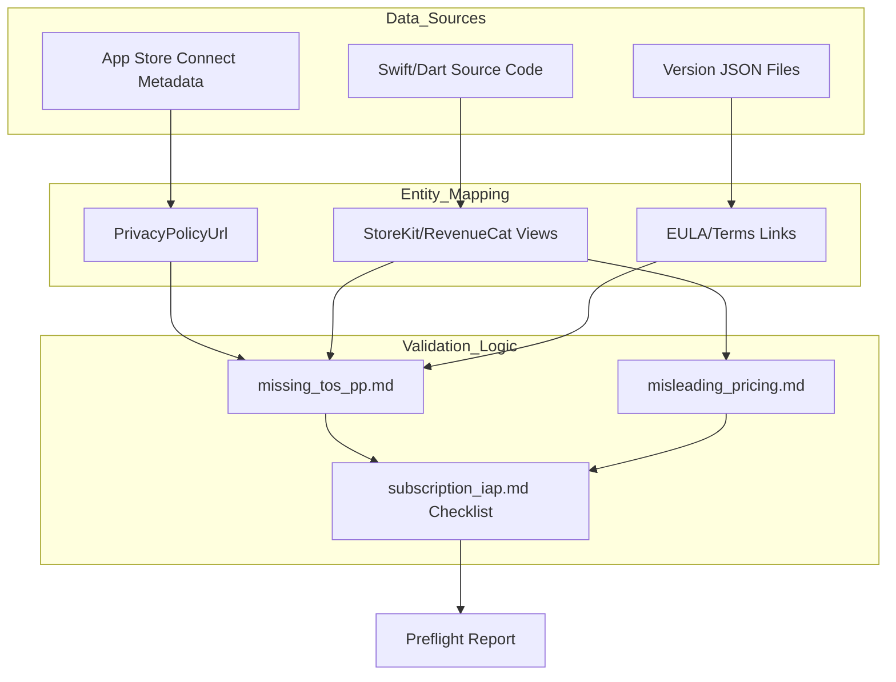
**Sources:** [references/guidelines/by-app-type/subscription_iap.md:1-35](), [references/rules/subscription/missing_tos_pp.md:1-58](), [references/rules/subscription/misleading_pricing.md:1-64]()

---

## Core Requirements & Implementation

### 1. Pricing Transparency & Visual Hierarchy
Guideline 3.1.2 requires that the **actual billed amount** be the most prominent element on any subscription screen. The system flags "misleading pricing" where calculated monthly costs (e.g., "$2.50/mo") overshadow the annual charge (e.g., "$29.99/year").

**Technical Checks:**
- **Font Size/Weight:** The billed amount must use the largest and boldest font [references/rules/subscription/misleading_pricing.md:39-45]().
- **Color Contrast:** Calculated prices must use subordinate (lower contrast) colors [references/rules/subscription/misleading_pricing.md:41-43]().
- **Detection Logic:** The scanner searches for patterns like `perMonth`, `per_month`, or `divided` in UI code to identify where price manipulation might be occurring [references/rules/subscription/misleading_pricing.md:28-29]().

### 2. Legal Links (ToS/PP)
Every subscription paywall must provide functional, tappable links to the Privacy Policy and Terms of Use (EULA).

**Code-to-Metadata Mapping:**
| Requirement | Code Entity / Metadata Key | Source File |
| :--- | :--- | :--- |
| **Privacy Policy URL** | `privacyPolicyUrl` | [references/rules/subscription/missing_tos_pp.md:37]() |
| **EULA/ToS Link** | `terms`, `eula`, `TermsOfService` | [references/rules/subscription/missing_tos_pp.md:28]() |
| **Subscription Title** | Paywall UI Text | [references/guidelines/by-app-type/subscription_iap.md:30]() |
| **Billed Amount** | `StoreKit` / `RevenueCat` price | [references/rules/subscription/misleading_pricing.md:25]() |

**Sources:** [references/rules/subscription/missing_tos_pp.md:6-18](), [references/guidelines/by-app-type/subscription_iap.md:28-35]()

---

## Technical Detection & Rule Mapping

The system bridges natural language guidelines to code entities using `grep` patterns and metadata field validation.

### Code Entity Space Mapping
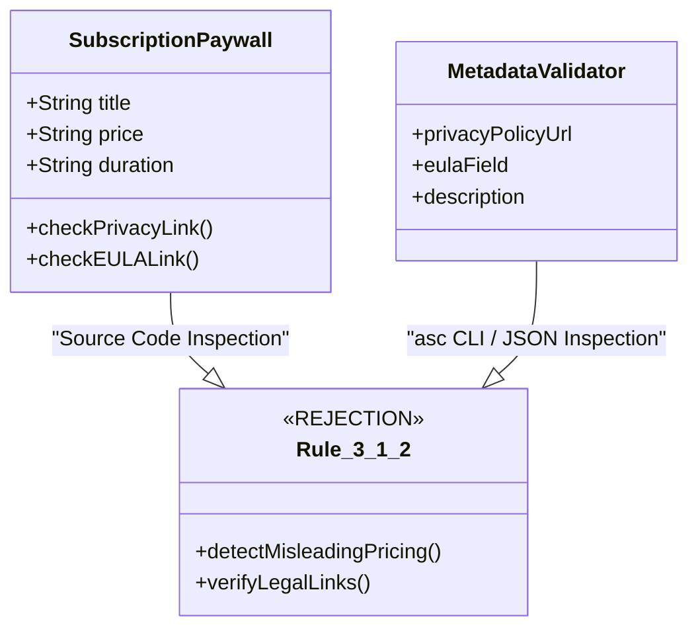
**Sources:** [references/rules/subscription/missing_tos_pp.md:19-38](), [references/rules/subscription/misleading_pricing.md:20-30]()

### Key Functions and Search Patterns
The preflight engine utilizes specific search patterns to identify compliance issues in `Swift` and `Dart` files:

- **UI Discovery:** Searches for `paywall`, `subscribe`, or `purchase` to locate the entry point of the IAP flow [references/rules/subscription/missing_tos_pp.md:25]().
- **Link Validation:** Checks for the presence of `PrivacyPolicy` or `TermsOfService` strings within those UI files [references/rules/subscription/missing_tos_pp.md:28]().
- **Metadata Verification:** Uses `jq` or `grep` on local metadata caches (e.g., `./metadata/app-info/*.json`) to ensure the `privacyPolicyUrl` is populated [references/rules/subscription/missing_tos_pp.md:37]().

---

## Critical Compliance Checklist

The `subscription_iap.md` checklist identifies high-risk areas that result in immediate rejection:

| Guideline | Requirement | Technical Context |
| :--- | :--- | :--- |
| **3.1.1** | Digital Content Unlocks | Must use Apple IAP; no external license keys or crypto [references/guidelines/by-app-type/subscription_iap.md:7](). |
| **3.1.1** | Restore Purchases | Mandatory for all non-consumable and subscription IAPs [references/guidelines/by-app-type/subscription_iap.md:16](). |
| **3.1.1** | Loot Box Odds | Must disclose randomized item odds before purchase [references/guidelines/by-app-type/subscription_iap.md:14](). |
| **3.1.2(b)** | State Management | Ensure seamless upgrade/downgrade without duplicate charges [references/guidelines/by-app-type/subscription_iap.md:21](). |
| **5.1.1(i)** | Privacy Manifest | Privacy Policy URL must be set in App Store Connect metadata [references/guidelines/by-app-type/subscription_iap.md:13](). |

**Sources:** [references/guidelines/by-app-type/subscription_iap.md:5-17](), [references/guidelines/by-app-type/subscription_iap.md:19-26]()

## Resolution Workflow

When a violation is detected (e.g., Missing ToS/PP), the following steps are required:
1. **In-App:** Add tappable `Terms of Use` and `Privacy Policy` links to the `StoreKit` or `RevenueCat` view [references/rules/subscription/missing_tos_pp.md:45]().
2. **Metadata:** Update the `Privacy Policy URL` field in App Store Connect using `asc metadata` or the web portal [references/rules/subscription/missing_tos_pp.md:47]().
3. **Description:** Ensure the app description in all locales references the EULA (Standard Apple or Custom) [references/rules/subscription/missing_tos_pp.md:46-48]().

**Sources:** [references/rules/subscription/missing_tos_pp.md:44-49](), [references/rules/subscription/misleading_pricing.md:46-50]()

---

# Page: Rejection Rules Reference

# Rejection Rules Reference

<details>
<summary>Relevant source files</summary>

The following files were used as context for generating this wiki page:

- [README.md](README.md)
- [SKILL.md](SKILL.md)

</details>


The `references/rules/` directory contains the core logic of the App Store Preflight system. While the guidelines in `references/guidelines/` provide the "what" of Apple's requirements, these rules define the "how"—the specific patterns, file paths, and code entities that trigger a potential rejection.

Each rule is a structured Markdown file designed to be interpretable by both human developers and the AI scanning engine. Rules are categorized into five distinct domains to align with the standard App Store Review process.

### Rule Structure and Severity

All rules follow a standardized format to ensure consistency across the scanning pipeline [README.md:91-105](). Every rule file includes:

*   **Guideline**: The specific Apple App Store Review Guideline number (e.g., 2.3.1).
*   **Severity**: Either `REJECTION` (immediate blocker) or `WARNING` (potential issue requiring manual review).
*   **Category**: The domain the rule belongs to (Metadata, Subscription, Privacy, Design, or Entitlements).
*   **Detection Logic**: Specific instructions on how to identify the violation in source code or metadata.
*   **Resolution**: Actionable steps to fix the violation.

### Rule Domains

The system organizes rejection logic into five functional domains. The scanning engine iterates through these directories to evaluate the project state [SKILL.md:61-72]().

#### 1. Metadata Rules
These rules focus on the information submitted via App Store Connect, such as descriptions, keywords, and app previews. They primarily target violations of Guideline 2.3 (Accurate Metadata) and Guideline 5.2.5 (Apple Trademarks).
*   **Key Checks**: Competitor brand mentions, Apple trademark misuse, and storefront-specific bans (e.g., AI terms in China).
*   **For details, see [Metadata Rules](#3.1)**.

#### 2. Subscription Rules
Focuses on Guideline 3.1.2 regarding auto-renewable subscriptions. These rules inspect both the metadata (ToS/PP links) and the visual hierarchy of in-app paywalls.
*   **Key Checks**: Misleading pricing displays and missing legal links in both the app and App Store description.
*   **For details, see [Subscription Rules](#3.2)**.

#### 3. Privacy Rules
Addresses Guideline 5.1.1 regarding data collection and transparency. This includes the technical requirements for the `PrivacyInfo.xcprivacy` manifest introduced by Apple in 2024.
*   **Key Checks**: Missing privacy manifests and "data greed" (requesting irrelevant personal information).
*   **For details, see [Privacy Rules](#3.3)**.

#### 4. Design Rules
Covers Guideline 4.0 (Design) and 4.2 (Minimum Functionality). These rules verify that the app provides a unique, high-quality experience and correctly implements system features like "Sign in with Apple."
*   **Key Checks**: WebView wrappers, low-utility apps, and post-authentication data collection for Apple ID users.
*   **For details, see [Design Rules](#3.4)**.

#### 5. Entitlements Rules
Enforces the principle of least privilege under Guideline 2.4.5(i). It audits the `.entitlements` file against actual API usage in the source code.
*   **Key Checks**: Unused or over-privileged entitlements, specifically temporary exception entitlements on macOS.
*   **For details, see [Entitlements Rules](#3.5)**.

### Technical Mapping: From Rules to Code

The following diagrams illustrate how the abstract "Rejection Rules" relate to the physical files and the execution flow of the Preflight Skill.

**Rule File Architecture**
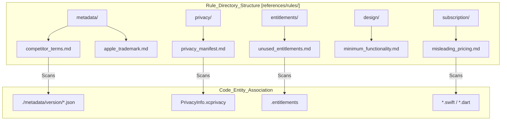

**Detection and Severity Logic**
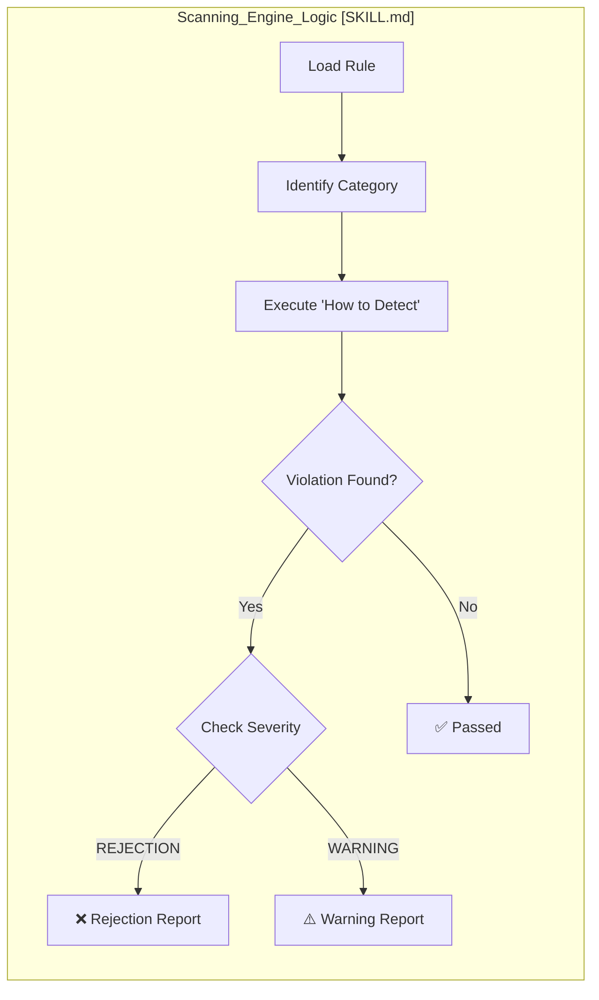

**Sources:**
* [README.md:50-90]()
* [README.md:91-105]()
* [SKILL.md:61-72]()
* [SKILL.md:113-128]()

---

# Page: Metadata Rules

# Metadata Rules

<details>
<summary>Relevant source files</summary>

The following files were used as context for generating this wiki page:

- [references/rules/metadata/accurate_metadata.md](references/rules/metadata/accurate_metadata.md)
- [references/rules/metadata/apple_trademark.md](references/rules/metadata/apple_trademark.md)
- [references/rules/metadata/china_storefront.md](references/rules/metadata/china_storefront.md)
- [references/rules/metadata/competitor_terms.md](references/rules/metadata/competitor_terms.md)
- [references/rules/metadata/subscription_metadata.md](references/rules/metadata/subscription_metadata.md)

</details>


The **Metadata Rules** engine enforces compliance with Apple's App Store Review Guidelines regarding the textual and visual information provided in an app's store listing. These rules prevent common rejection triggers such as referencing competitors, misusing Apple trademarks, or failing to disclose subscription terms. The system utilizes the `asc` CLI to pull canonical metadata from App Store Connect for automated analysis.

## Metadata Scanning Architecture

The metadata scanning process follows a "Pull-Analyze-Report" flow. It transitions from the **Natural Language Space** (Apple Guidelines) to the **Code Entity Space** by mapping specific guideline numbers to `grep` patterns and `asc` CLI commands.

### Data Flow: Metadata Acquisition to Rule Enforcement

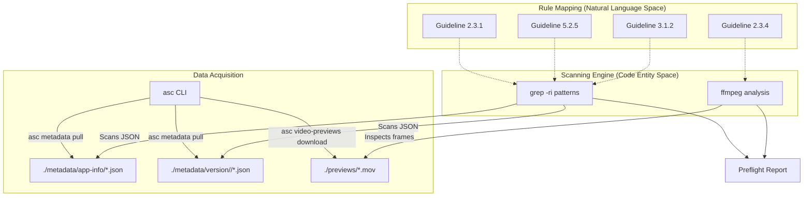

**Sources:**
- [references/rules/metadata/competitor_terms.md:19-27]()
- [references/rules/metadata/apple_trademark.md:45-57]()
- [references/rules/metadata/accurate_metadata.md:25-41]()
- [references/rules/metadata/subscription_metadata.md:27-36]()

---

## 1. Competitor Platform Terms (Guideline 2.3.1)

This rule prevents the mention of competing mobile platforms (e.g., Android, Google Play) within any metadata field. Apple considers these references "not appropriate for the App Store."

### Detection Logic
The system searches all localized metadata files in `./metadata/app-info/` and `./metadata/version/<VERSION>/` using the following pattern:
`grep -ri "android\|google play\|samsung\|huawei\|apk\|amazon appstore\|windows store\|microsoft store"` [references/rules/metadata/competitor_terms.md:25-27]().

### Resolution Workflow
1. **Identify**: Locate the specific file and locale flagged by the `grep` command.
2. **Sanitize**: Replace "Android" with "multiple platforms" or "your previous device" [references/rules/metadata/competitor_terms.md:41-44]().
3. **Verify**: Run `asc metadata push --dry-run` to ensure changes are valid before submission [references/rules/metadata/competitor_terms.md:45]().

**Sources:**
- [references/rules/metadata/competitor_terms.md:1-54]()

---

## 2. Apple Trademark Misuse (Guideline 5.2.5)

Ensures the app does not imply an official Apple association or use Apple's intellectual property (logos, device silhouettes) in icons or screenshots.

### Flagged Entities
| Category | Prohibited Items |
| :--- | :--- |
| **App Icon** | Device silhouettes (iPhone/iPad), Apple logo variations [references/rules/metadata/apple_trademark.md:11-14](). |
| **App Name** | "iPhone Cleaner", "iCloud Backup", "Siri Helper" [references/rules/metadata/apple_trademark.md:16-18](). |
| **Screenshots** | 3D renders of Apple products, competitor devices shown next to Apple devices [references/rules/metadata/apple_trademark.md:25-31](). |

### Detection Implementation
The engine scans `Assets.xcassets/AppIcon.appiconset/Contents.json` for visual asset references and performs a case-insensitive search across metadata for terms like `vision pro`, `imessage`, and `airdrop` [references/rules/metadata/apple_trademark.md:41-57]().

**Sources:**
- [references/rules/metadata/apple_trademark.md:1-94]()

---

## 3. Accurate App Previews (Guideline 2.3.4)

App preview videos must be pure screen captures. Unlike static screenshots, videos are prohibited from using device frames or "lifestyle" shots.

### Technical Detection (ffmpeg)
To automate the detection of device frames (bezels) or non-app content, the system extracts the first frame of downloaded previews:
```bash
ffmpeg -i "$preview" -vframes 1 -q:v 2 "${preview%.*}_frame.jpg"
```
[references/rules/metadata/accurate_metadata.md:34-41]()

### Resolution
Developers must re-record using the Xcode Simulator or QuickTime screen recording to ensure no external framing is present [references/rules/metadata/accurate_metadata.md:45-48]().

**Sources:**
- [references/rules/metadata/accurate_metadata.md:1-63]()

---

## 4. Subscription Metadata Disclosures (Guideline 3.1.2)

For apps with auto-renewable subscriptions, specific legal links and pricing details must be present in both the binary and the App Store Connect metadata fields.

### Required Metadata Fields
1. **Privacy Policy URL**: Must be set in the `privacyPolicyUrl` field in the app info JSON [references/rules/metadata/subscription_metadata.md:17-18]().
2. **Terms of Use (EULA)**: Must be either a custom EULA or a functional link in the App Description [references/rules/metadata/subscription_metadata.md:19-21]().

### Verification Script
```bash
# Check for EULA/ToS keywords in localized descriptions
grep -i "terms of use\|terms of service\|eula" ./metadata/version/<VERSION>/*.json
```
[references/rules/metadata/subscription_metadata.md:30-32]()

**Sources:**
- [references/rules/metadata/subscription_metadata.md:1-82]()

---

## 5. China Storefront AI Restrictions (Guideline 5 - Legal)

Apps distributed in China are subject to strict Deep Synthesis Technology (DST) regulations. Metadata cannot mention specific AI brands that lack MIIT licensing.

### Banned Terms for China Storefront
The system flags the following terms if the China mainland storefront is active:
`ChatGPT`, `OpenAI`, `GPT-4`, `Gemini`, `Claude`, `Anthropic`, `Midjourney`, `DALL-E` [references/rules/metadata/china_storefront.md:10-14]().

### Remediation Strategies
| Strategy | Action |
| :--- | :--- |
| **Remove References** | Replace brand names with "AI-powered" across **all** locales [references/rules/metadata/china_storefront.md:52-54](). |
| **Exclude Storefront** | Deselect "China mainland" in Pricing and Availability [references/rules/metadata/china_storefront.md:58-60](). |
| **Functionality** | Suppress AI features for China-specific builds and update Review Notes [references/rules/metadata/china_storefront.md:55-56](). |

**Sources:**
- [references/rules/metadata/china_storefront.md:1-75]()

---

# Page: Subscription Rules

# Subscription Rules

<details>
<summary>Relevant source files</summary>

The following files were used as context for generating this wiki page:

- [references/rules/subscription/misleading_pricing.md](references/rules/subscription/misleading_pricing.md)
- [references/rules/subscription/missing_tos_pp.md](references/rules/subscription/missing_tos_pp.md)

</details>


This section covers the enforcement of Guideline 3.1.2 regarding auto-renewable subscriptions. The focus is on ensuring transparency in pricing hierarchy and the presence of mandatory legal links both within the app's source code and the App Store Connect metadata.

## Overview

Subscription rules are categorized under the `subscription` domain and carry a **REJECTION** severity. These rules ensure that users are not misled by visual pricing tricks and that they have immediate access to legal terms before committing to a purchase.

The system validates compliance through two primary vectors:
1.  **Source Code Analysis**: Scanning Swift and Dart files for UI patterns, StoreKit implementations, and third-party SDKs like RevenueCat or Superwall.
2.  **Metadata Analysis**: Inspecting JSON files pulled via the `asc` CLI to verify localized descriptions and App Store Connect field values.

---

## 3.2.1 Misleading Pricing Display

Apple requires that the **actual billed amount** (the total amount charged to the user's payment method) be the most prominent element in the visual hierarchy. A common rejection reason is highlighting a "calculated" price (e.g., "$2.50/month") to make an annual plan ($29.99/year) appear cheaper.

### Visual Hierarchy Requirements
The billed amount must be superior to calculated pricing in the following attributes:
*   **Font Size**: Must be the largest among pricing elements [references/rules/subscription/misleading_pricing.md:9-9]().
*   **Font Weight**: Must be bolder than derived prices [references/rules/subscription/misleading_pricing.md:10-10]().
*   **Color Contrast**: Must have the highest contrast against the background [references/rules/subscription/misleading_pricing.md:11-11]().
*   **Position**: Must be placed prominently, not buried or overshadowed by free trial text [references/rules/subscription/misleading_pricing.md:12-18]().

### Detection Logic
The system identifies potential violations by searching for UI code that handles pricing breakdowns.

**Code Entity Mapping: Pricing Detection**
```mermaid
graph TD
    "Search_Patterns"["Grep Patterns"] --> "Swift_Files"["*.swift"]
    "Search_Patterns" --> "Dart_Files"["*.dart"]
    
    subgraph "Logic Detection"
        "Search_Patterns" -- "Find Paywalls" --> "UI_Context"["'paywall', 'subscribe', 'pricing'"]
        "Search_Patterns" -- "Find Derived Pricing" --> "Calculation_Logic"["'perMonth', 'monthly_price', 'divided'"]
    end

    "UI_Context" --> "Manual_Review"["Visual Inspection Checklist"]
    "Calculation_Logic" --> "Manual_Review"
```
Sources: [references/rules/subscription/misleading_pricing.md:23-29]()

### Resolution Workflow
1.  Locate the paywall view (e.g., `SubscriptionView.swift` or `PaywallWidget.dart`).
2.  Adjust the `Text` or `Label` styles so the total price (e.g., `$29.99`) uses a larger font size than the breakdown (e.g., `$2.49/mo`).
3.  Ensure free trial durations do not use more prominent styling than the post-trial price [references/rules/subscription/misleading_pricing.md:47-50]().

---

## 3.2.2 Missing ToS and Privacy Policy

Every subscription purchase flow must provide functional links to the Terms of Use (EULA) and Privacy Policy. These links must exist both in the app UI and in the App Store metadata.

### Mandatory Elements
The following must be present on the subscription screen:
1.  **Subscription Title** [references/rules/subscription/missing_tos_pp.md:9-9]()
2.  **Length/Duration** (e.g., 1 Month) [references/rules/subscription/missing_tos_pp.md:10-10]()
3.  **Billed Price** [references/rules/subscription/missing_tos_pp.md:11-11]()
4.  **Privacy Policy Link** [references/rules/subscription/missing_tos_pp.md:12-12]()
5.  **Terms of Use (EULA) Link** [references/rules/subscription/missing_tos_pp.md:13-13]()

### Data Flow: Metadata Verification
The scanning engine checks localized metadata JSON files retrieved from App Store Connect.

**System Entity Mapping: Metadata Validation**
```mermaid
graph LR
    subgraph "App Store Connect Data"
        "ASC_API"["App Store Connect API"] --> "ASC_CLI"["asc metadata pull"]
    end

    subgraph "Local Metadata Files"
        "ASC_CLI" --> "Ver_JSON"["./metadata/version/*.json"]
        "ASC_CLI" --> "App_JSON"["./metadata/app-info/*.json"]
    end

    subgraph "Rule Engine Validation"
        "Ver_JSON" -- "Grep: 'terms', 'privacy'" --> "Desc_Check"["Description Field Check"]
        "App_JSON" -- "Grep: 'privacyPolicyUrl'" --> "URL_Field_Check"["Privacy Policy URL Check"]
    end
```
Sources: [references/rules/subscription/missing_tos_pp.md:32-38]()

### Implementation Check
The system runs the following patterns to detect missing links in the UI code:

| Target | File Types | Grep Pattern |
| :--- | :--- | :--- |
| **UI Components** | `.swift`, `.dart` | `subscribe\|paywall\|StoreKit\|RevenueCat` |
| **Link Strings** | `.swift`, `.dart` | `terms\|privacy\|eula\|PrivacyPolicy` |

Sources: [references/rules/subscription/missing_tos_pp.md:23-29]()

### Resolution Steps
1.  **In-App**: Add `Button` or `Link` components to the paywall view [references/rules/subscription/missing_tos_pp.md:45-45]().
2.  **App Store Connect**:
    *   Populate the `Privacy Policy URL` field [references/rules/subscription/missing_tos_pp.md:47-47]().
    *   If using the standard Apple EULA, include a link to it in the app description [references/rules/subscription/missing_tos_pp.md:57-57]().
    *   If using a custom EULA, upload it to the dedicated EULA field in App Store Connect [references/rules/subscription/missing_tos_pp.md:48-48]().

---

# Page: Privacy Rules

# Privacy Rules

<details>
<summary>Relevant source files</summary>

The following files were used as context for generating this wiki page:

- [references/rules/privacy/privacy_manifest.md](references/rules/privacy/privacy_manifest.md)
- [references/rules/privacy/unnecessary_data.md](references/rules/privacy/unnecessary_data.md)

</details>


The Privacy Rules domain focuses on compliance with Apple's stringent data protection requirements, specifically the **Spring 2024 Privacy Manifest mandate** and the long-standing **Data Minimization** principle. Failure to adhere to these rules results in immediate app rejection under Guideline 5.1.1.

## Privacy Manifest (PrivacyInfo.xcprivacy)

Starting in Spring 2024, Apple requires all apps and third-party SDKs to include a `PrivacyInfo.xcprivacy` manifest if they utilize "Required Reason APIs" [references/rules/privacy/privacy_manifest.md:7-8](). These APIs are identified by Apple as potentially being used for fingerprinting, and their usage must be declared with a valid reason code.

### Required Reason API Categories
The system scans for the following four major categories of APIs that necessitate a manifest entry:

| Category | Targeted Symbols | Example Reason Code |
| :--- | :--- | :--- |
| **File Timestamp** | `NSFileCreationDate`, `NSFileModificationDate`, `stat()` | `DDA9.1` (Display to user) |
| **User Defaults** | `UserDefaults`, `NSUserDefaults` | `CA92.1` (App-specific data) |
| **System Boot Time** | `systemUptime`, `mach_absolute_time()` | `35F9.1` (Measure time) |
| **Disk Space** | `volumeAvailableCapacityKey`, `statfs()` | `E174.1` (Check for writes) |

Sources: [references/rules/privacy/privacy_manifest.md:9-16]()

### Detection Logic: Natural Language to Code Entity
The following diagram illustrates how the scanning engine maps high-level Privacy Manifest requirements to specific code entities and search patterns.

**Privacy Manifest Detection Flow**
```mermaid
graph TD
    subgraph "Natural Language Requirements"
        R1["Requirement: Declare API Usage"]
        R2["Requirement: Define Tracking"]
    end

    subgraph "Code Entity Space"
        P1["PrivacyInfo.xcprivacy"]
        G1["grep 'UserDefaults'"]
        G2["grep 'systemUptime'"]
        G3["grep 'statfs'"]
    end

    R1 --> P1
    P1 -->|"Key: NSPrivacyAccessedAPITypes"| G1
    P1 -->|"Key: NSPrivacyAccessedAPITypes"| G2
    P1 -->|"Key: NSPrivacyAccessedAPITypes"| G3
    R2 -->|"Key: NSPrivacyTracking"| P1
```
Sources: [references/rules/privacy/privacy_manifest.md:18-22](), [references/rules/privacy/privacy_manifest.md:32-45]()

### Implementation Details
The scanner performs a two-step verification:
1.  **Existence Check**: Searches for `PrivacyInfo.xcprivacy` using `find . -name "PrivacyInfo.xcprivacy"` [references/rules/privacy/privacy_manifest.md:27-30]().
2.  **API Audit**: Executes targeted `grep` commands across `.swift` and `.m` files to identify undeclared usage of restricted APIs [references/rules/privacy/privacy_manifest.md:33-45]().

### Manifest Structure
A valid manifest must be a Property List (`plist`) containing specific keys:
*   `NSPrivacyTracking`: Boolean indicating data usage for tracking [references/rules/privacy/privacy_manifest.md:19]().
*   `NSPrivacyAccessedAPITypes`: An array of dictionaries, each containing an `NSPrivacyAccessedAPIType` (the category) and `NSPrivacyAccessedAPITypeReasons` (the codes) [references/rules/privacy/privacy_manifest.md:64-74]().

Sources: [references/rules/privacy/privacy_manifest.md:56-77]()

---

## Unnecessary Data Collection

Under Guideline 5.1.1, apps must only require personal information that is **directly relevant** to the app's core functionality [references/rules/privacy/unnecessary_data.md:2-7](). If data is useful but not essential, it must be marked as **optional**.

### Data Minimization Logic
The relevance of a data field is determined by the app's context. The scanner flags fields that typically violate this principle:

| Data Field | Contextual Justification | Potential Violation |
| :--- | :--- | :--- |
| **Phone Number** | Core calling/SMS features | Note-taking or Calculator apps |
| **Gender** | Medical, fitness (calories), or dating | Shopping or Utility apps |
| **Date of Birth** | Legal age-gating requirements | Basic productivity tools |
| **Home Address** | Physical shipping or location services | Digital-only content apps |

Sources: [references/rules/privacy/unnecessary_data.md:9-21]()

### Form Validation Audit
The system bridges the gap between UI forms and code-level validation logic to identify "Required" fields that should be "Optional".

**Form Validation Mapping**
```mermaid
graph TD
    subgraph "Natural Language Rules"
        F1["Rule: Data Minimization"]
        F2["Rule: Optional vs Required"]
    end

    subgraph "Code Entity Space"
        S1["registration/onboarding/profile forms"]
        V1["validator"]
        V2["isRequired"]
        V3["optional"]
        G4["grep 'phone|gender|marital'"]
    end

    F1 --> G4
    G4 --> S1
    F2 --> V1
    F2 --> V2
    F2 --> V3
    S1 -.->|"contains"| V1
    S1 -.->|"contains"| V2
```
Sources: [references/rules/privacy/unnecessary_data.md:24-31]()

### Remediation Workflow
1.  **Identify**: Locate registration or profile forms using `grep` patterns for common personal data terms (e.g., `birthdate`, `address`, `signup`) [references/rules/privacy/unnecessary_data.md:25-27]().
2.  **Evaluate**: Check for validation keywords like `validator`, `isRequired`, or `required` associated with these fields [references/rules/privacy/unnecessary_data.md:29-30]().
3.  **Fix**: Convert non-essential fields to optional by removing validation logic and adding "Skip" or "Not now" UI elements [references/rules/privacy/unnecessary_data.md:41-42]().

Sources: [references/rules/privacy/unnecessary_data.md:40-44]()

---

# Page: Design Rules

# Design Rules

<details>
<summary>Relevant source files</summary>

The following files were used as context for generating this wiki page:

- [references/rules/design/minimum_functionality.md](references/rules/design/minimum_functionality.md)
- [references/rules/design/sign_in_with_apple.md](references/rules/design/sign_in_with_apple.md)

</details>


The **Design Rules** section covers the technical and experiential requirements mandated by Apple's Human Interface Guidelines and App Store Review Guidelines (specifically Guideline 4.0 and 4.2). These checks focus on ensuring the app provides a native-quality experience that justifies its existence as a standalone application rather than a web-based service, and that integrated Apple services like **Sign in with Apple** are implemented according to strict UX standards.

## 3.4.1 Minimum Functionality (Guideline 4.2)

Apple requires that apps provide "valuable utility or entertainment" beyond what a standard mobile website offers. Apps that serve as simple shells for websites or lack sufficient interactive depth are frequently rejected under Guideline 4.2.

### Implementation and Detection

The preflight system uses a combination of static analysis and metadata inspection to identify "thin" apps. The detection logic focuses on four primary signals: WebView dominance, screen count, model layer complexity, and data persistence.

#### Data Flow: Minimum Functionality Assessment
The following diagram illustrates how the system evaluates an app's "app-like" qualities by scanning the codebase for specific architectural patterns.

**Title: Minimum Functionality Detection Logic**
```mermaid
graph TD
    subgraph "Natural Language Space"
        A["Guideline 4.2 Requirement"] -- "defines" --> B["'App-like' Experience"]
        B -- "implies" --> C["Native UI Components"]
        B -- "implies" --> D["Local Data Management"]
        B -- "implies" --> E["Sufficient Content"]
    end

    subgraph "Code Entity Space"
        C -- "Check for" --> F["WKWebView / SFSafariViewController"]
        D -- "Check for" --> G["CoreData / SwiftData / Realm"]
        E -- "Count" --> H["UIViewController / View classes"]
        
        F -- "grep" --> I["references/rules/design/minimum_functionality.md"]
        G -- "grep" --> I
        H -- "wc -l" --> I
    end

    I -- "Logic" --> J{"Is App a Wrapper?"}
    J -- "Yes (> 1 WebView, < 3 Screens)" --> K["REJECTION: Minimal Functionality"]
    J -- "No (Local Persistence + Native UI)" --> L["PASS"]
```
**Sources:** [references/rules/design/minimum_functionality.md:30-52](), [references/rules/design/minimum_functionality.md:8-17]()

### Technical Signals
The system identifies design-rule violations through the following shell-based heuristics:

| Metric | Threshold / Signal | Code Reference |
| :--- | :--- | :--- |
| **WebView Usage** | Presence of `WKWebView`, `UIWebView`, or `SFSafariViewController` | [references/rules/design/minimum_functionality.md:32-34]() |
| **Screen Count** | `< 3` unique `UIViewController` or SwiftUI `View` definitions | [references/rules/design/minimum_functionality.md:36-37](), [references/rules/design/minimum_functionality.md:48-48]() |
| **Model Layer** | Absence of dedicated `Models` or `Model` directories | [references/rules/design/minimum_functionality.md:39-40]() |
| **Persistence** | Usage of `CoreData`, `SwiftData`, `UserDefaults`, `Realm`, or `KeychainSwift` | [references/rules/design/minimum_functionality.md:42-43]() |
| **Metadata** | App descriptions `< 50` words in length | [references/rules/design/minimum_functionality.md:54-61]() |

**Sources:** [references/rules/design/minimum_functionality.md:30-61]()

---

## 3.4.2 Sign in with Apple (SIWA) Implementation

If an app provides third-party social login providers (e.g., Google, Facebook), it must also offer **Sign in with Apple** as an equivalent option. Furthermore, the implementation must adhere to Apple's UX requirements regarding data collection and visual prominence.

### Key Requirements
1.  **Data Parsimony**: If the user shares their name or email via the `ASAuthorizationAppleIDProvider`, the app must not prompt for this information again via native text fields [references/rules/design/sign_in_with_apple.md:9-10]().
2.  **Visual Parity**: The SIWA button must be as prominent as other social login buttons and should use the system-provided `ASAuthorizationAppleIDButton` [references/rules/design/sign_in_with_apple.md:11-12]().
3.  **Relay Email Handling**: Apps must successfully process and validate email addresses ending in `@privaterelay.appleid.com` [references/rules/design/sign_in_with_apple.md:13-13]().

### Technical Architecture
The system scans for the `AuthenticationServices` framework usage and looks for common anti-patterns where developers request profile information that has already been provided by the credential.

**Title: SIWA Compliance Data Flow**
```mermaid
sequenceDiagram
    participant U as "User"
    participant A as "ASAuthorizationAppleIDProvider"
    participant C as "ASAuthorizationAppleIDCredential"
    participant S as "App Source Code"

    U->>A: "Taps SIWA Button"
    A->>C: "Provides fullName & email"
    C->>S: "Passes Data to App"
    
    rect "Compliance Check"
        S-->>S: "Check: Is askForName or emailTextField called?"
        Note over S: "If YES -> Violation (Guideline 4.0)"
    end

    S-->>S: "Check: Is @privaterelay.appleid.com allowed?"
    Note over S: "If NO -> Rejection"
```
**Sources:** [references/rules/design/sign_in_with_apple.md:17-30](), [references/rules/design/sign_in_with_apple.md:40-43]()

### Detection Logic
The skill executes the following checks to identify SIWA UX violations:

*   **Credential Handling**: It searches for `ASAuthorizationAppleIDProvider` and `appleIDCredential` to locate the implementation, then cross-references those files for forbidden UI elements like `nameTextField` or `profileSetup` functions [references/rules/design/sign_in_with_apple.md:18-24]().
*   **Relay Validation**: It greps for email validation logic (e.g., `isValidEmail`) to ensure that `privaterelay.appleid.com` is not accidentally blocked by overly restrictive regex patterns [references/rules/design/sign_in_with_apple.md:26-30]().

**Sources:** [references/rules/design/sign_in_with_apple.md:15-30]()

## Remediation Workflow

### Minimum Functionality
1.  **Native Integration**: Replace web-based navigation with native UI components.
2.  **Offline Support**: Implement local caching using `SwiftData` or `UserDefaults` to ensure the app works without a network connection [references/rules/design/minimum_functionality.md:65-76]().
3.  **Reviewer Context**: Use the `asc metadata pull` command to audit the app description and ensure it clearly articulates native features that Safari cannot provide [references/rules/design/minimum_functionality.md:78-82]().

### Sign in with Apple
1.  **Use Credentials**: Cache `fullName` and `email` directly from the `ASAuthorizationAppleIDCredential` on the first successful login [references/rules/design/sign_in_with_apple.md:40-41]().
2.  **Standard Components**: Use `ASAuthorizationAppleIDButton` in Swift or the `sign_in_with_apple` package in Flutter to ensure visual compliance [references/rules/design/sign_in_with_apple.md:43-43]().

**Sources:** [references/rules/design/minimum_functionality.md:63-82](), [references/rules/design/sign_in_with_apple.md:39-44]()

---

# Page: Entitlements Rules

# Entitlements Rules

<details>
<summary>Relevant source files</summary>

The following files were used as context for generating this wiki page:

- [references/rules/entitlements/unused_entitlements.md](references/rules/entitlements/unused_entitlements.md)

</details>


The **Entitlements Rules** define the technical requirements for the Principle of Least Privilege as applied to iOS and macOS applications. This rule set is primarily governed by **App Store Review Guideline 2.4.5(i)**, which dictates that apps must only request the minimum set of permissions necessary for their functionality [references/rules/entitlements/unused_entitlements.md:2-2](). Failure to justify or remove unused entitlements results in a rejection categorized as an "Information Request," effectively blocking the review process until resolved [references/rules/entitlements/unused_entitlements.md:3-3]().

## Audit Methodology

The preflight system audits entitlements by cross-referencing declared keys in `.entitlements` files against actual API calls within the source code. This process identifies "orphaned" entitlements that increase the app's attack surface and trigger Apple's automated scanners.

### Entitlement Discovery and Parsing
The system identifies entitlements through two primary methods:
1.  **Static File Analysis**: Searching the project directory for `.entitlements` XML files [references/rules/entitlements/unused_entitlements.md:27-31]().
2.  **Binary Inspection**: Using `codesign` to extract the entitlements embedded in a compiled `.app` bundle [references/rules/entitlements/unused_entitlements.md:55-59]().

### Data Flow: Entitlement Verification
The following diagram illustrates the flow from detecting a declared entitlement to verifying its usage in the codebase.

**Entitlement Validation Pipeline**
```mermaid
graph TD
    subgraph "Declaration Space"
        A[".entitlements file"] -->|plutil -p| B["Parsed Entitlement Keys"]
        C[".app Binary"] -->|codesign -d| B
    end

    subgraph "Usage Space (Code Entity Space)"
        D["Source Code (*.swift, *.dart)"] -->|grep API Patterns| E["Detected Functionality"]
    end

    B --> F{"Cross-Reference Engine"}
    E --> F
    
    F -->|Key exists but no API found| G["REJECTION: Unused Entitlement"]
    F -->|Key exists and API found| H["PASSED"]
```
Sources: [references/rules/entitlements/unused_entitlements.md:33-59]()

## Common Entitlement Mapping

The preflight system uses specific grep patterns to map high-scrutiny entitlements to their corresponding code entities.

| Entitlement Key | Category | Code Entities / API Patterns |
| :--- | :--- | :--- |
| `com.apple.security.network.server` | macOS Network | `NWListener`, `GCDWebServer`, `Vapor`, `startServer` |
| `com.apple.security.files.downloads.*` | macOS Filesystem | `Downloads`, `downloadsDirectory`, `FileManager` |
| `com.apple.developer.healthkit` | iOS Health | `HKHealthStore`, `HealthKit`, `health_kit` |
| `aps-environment` | iOS Push | Push Notification capabilities in Xcode |
| `com.apple.developer.applesignin` | iOS Auth | Sign in with Apple implementation |

Sources: [references/rules/entitlements/unused_entitlements.md:9-23](), [references/rules/entitlements/unused_entitlements.md:44-53]()

## Detection and Remediation

### Code-to-Entitlement Association
This diagram bridges the natural language requirements of the App Store Guidelines to the specific code symbols searched during an audit.

**Natural Language to Code Entity Mapping**
```mermaid
graph LR
    subgraph "Natural Language (Guideline 2.4.5)"
        N1["Network Server Capability"]
        N2["Health Data Access"]
        N3["User Downloads Access"]
    end

    subgraph "Code Entity Space (Detection Patterns)"
        C1["NWListener / HttpServer"]
        C2["HKHealthStore"]
        C3["FileManager.downloadsDirectory"]
    end

    subgraph "Entitlement Keys"
        E1["com.apple.security.network.server"]
        E2["com.apple.developer.healthkit"]
        E3["com.apple.security.files.downloads.read-only"]
    end

    N1 --> C1 --> E1
    N2 --> C2 --> E2
    N3 --> C3 --> E3
```
Sources: [references/rules/entitlements/unused_entitlements.md:44-53](), [references/rules/entitlements/unused_entitlements.md:9-13]()

### Resolution Workflow
If the preflight scan identifies an unused entitlement, the following remediation steps are required:

1.  **Xcode Configuration**: Open the **Signing & Capabilities** tab for the target and remove the unused capability [references/rules/entitlements/unused_entitlements.md:63-63]().
2.  **Manual XML Cleanup**: Directly edit the `.entitlements` file to remove keys that do not have matching functionality [references/rules/entitlements/unused_entitlements.md:62-62]().
3.  **Justification**: If the entitlement is necessary but the automated scan failed to find the usage (e.g., dynamic usage or third-party binary usage), prepare a written justification for the App Store Connect "App Review Information" section [references/rules/entitlements/unused_entitlements.md:64-64]().
4.  **Submission Reset**: If a rejection has already occurred, the developer must "Developer Reject" the current build, increment the build number, and resubmit a clean binary [references/rules/entitlements/unused_entitlements.md:65-65]().

Sources: [references/rules/entitlements/unused_entitlements.md:61-66]()

---

# Page: Autofix & Validation System

# Autofix & Validation System

<details>
<summary>Relevant source files</summary>

The following files were used as context for generating this wiki page:

- [README.md](README.md)
- [SKILL.md](SKILL.md)
- [references/rules/metadata/competitor_terms.md](references/rules/metadata/competitor_terms.md)
- [references/rules/subscription/missing_tos_pp.md](references/rules/subscription/missing_tos_pp.md)

</details>


The Autofix & Validation System implements a closed-loop remediation lifecycle within the AI agent. This system ensures that once a potential App Store rejection is identified, the agent doesn't just report it but actively assists in resolving it and verifying the fix against the same rules that triggered the initial finding.

## Remediation Lifecycle

The remediation process follows a structured five-stage pipeline as defined in the core skill instructions [SKILL.md:42-46](). This lifecycle transitions findings from "Identified Violation" to "Validated Resolution."

### 1. Detection and Categorization
The agent scans the project using the rules defined in `references/rules/` [SKILL.md:61-72](). Findings are categorized by severity (REJECTION or WARNING) and domain (Metadata, Subscription, Privacy, Design, or Entitlements) [README.md:98-99]().

### 2. Resolution Strategy
For every finding, the agent consults the "Resolution" section of the specific rule file to determine the appropriate fix [README.md:103](). 
- **Autofixable:** Issues involving text manipulation, configuration files, or missing boilerplate.
- **Manual-Only:** Issues involving UI/UX redesign, screenshot assets, or complex architectural changes.

### 3. Application of Fixes
The agent applies automated fixes where possible. For example, in the case of **Competitor Terms**, the agent suggests replacement text that removes banned brands like "Android" or "Google Play" [references/rules/metadata/competitor_terms.md:39-45]().

### 4. Re-Validation (The "Closed Loop")
Crucially, after applying a fix, the agent is instructed to **re-run the affected checks** [SKILL.md:101-102](). A violation is only marked as resolved in the final report if the re-scan passes the original detection logic.

### 5. Final Reporting
The agent produces a final Preflight Report. For details on the severity tiers and report structure, see [Reporting Format](#4.1).

## Autofix vs. Manual Intervention

The system distinguishes between issues it can resolve autonomously and those requiring developer action.

| Capability | Supported Rule Examples | Logic / Tools Used |
|:---|:---|:---|
| **Autofix** | Competitor terms [SKILL.md:97](), Metadata character limits [SKILL.md:98](), Missing ToS/PP URLs [SKILL.md:99]() | Text replacement, `sed`, `jq` |
| **Manual** | App Preview device frames [README.md:61](), Sign in with Apple button design [README.md:82](), Minimum functionality/WebViews [README.md:83]() | Human-in-the-loop (Instructions provided) |

### Remediation Flow Diagram
The following diagram illustrates how the AI agent (`SKILL.md`) interacts with the project files and the `asc` CLI to move from detection to validation.

```mermaid
graph TD
    subgraph "Natural Language Space"
        A["SKILL.md Instructions"] -- "Triggers" --> B["Detection Phase"]
        B -- "Consults" --> C["references/rules/*.md"]
    end

    subgraph "Code & Metadata Space"
        D["./metadata/*.json"] -- "Grepped by" --> B
        E["Source Code (.swift/.dart)"] -- "Grepped by" --> B
        F["Project Config (.entitlements)"] -- "Audited by" --> B
    end

    B -- "If Violation Found" --> G["Apply Autofix / Instructions"]
    G -- "Update Files" --> D
    G -- "Update Files" --> E
    
    subgraph "Validation Loop"
        G -- "Re-run Check" --> H{"Passes?"}
        H -- "No" --> G
        H -- "Yes" --> I["Final Preflight Report"]
    end
```
**Sources:** [SKILL.md:42-46](), [SKILL.md:94-103](), [README.md:40-48]()

## Validation Tools & Integration

The validation system relies heavily on external CLI tools to ensure the project state matches Apple's expectations.

- **`asc` CLI:** Used to pull the latest metadata for inspection and to perform dry-run pushes to validate metadata integrity [SKILL.md:48-49](), [references/rules/metadata/competitor_terms.md:45](). For details on CLI usage and authentication, see [asc CLI Integration](#4.2).
- **`grep` & `jq`:** Used within rule definitions to create deterministic detection patterns [references/rules/metadata/competitor_terms.md:25-27](), [references/rules/subscription/missing_tos_pp.md:25-38]().

### System Entity Mapping
This diagram maps the conceptual "Checks" to the actual files and commands executed during the Autofix/Validation cycle.

```mermaid
graph LR
    subgraph "Validation Logic"
        R1["competitor_terms.md"]
        R2["missing_tos_pp.md"]
        R3["unused_entitlements.md"]
    end

    subgraph "Execution Entity"
        C1["grep -ri 'android'"]
        C2["asc metadata pull"]
        C3["plutil / codesign"]
    end

    subgraph "Target Entity"
        T1["./metadata/version/*.json"]
        T2["*.swift / *.dart"]
        T3["*.xcodeproj/project.pbxproj"]
    end

    R1 --> C1
    R2 --> C2
    R3 --> C3

    C1 --> T1
    C1 --> T3
    C2 --> T1
    C3 --> T3
```
**Sources:** [references/rules/metadata/competitor_terms.md:19-37](), [references/rules/subscription/missing_tos_pp.md:19-38](), [README.md:89]()

## Child Pages
- [Reporting Format](#4.1) — Detailed breakdown of the Preflight Report output.
- [asc CLI Integration](#4.2) — Reference for metadata synchronization and authentication.

---

# Page: Reporting Format

# Reporting Format

<details>
<summary>Relevant source files</summary>

The following files were used as context for generating this wiki page:

- [README.md](README.md)
- [SKILL.md](SKILL.md)

</details>


The **Preflight Report** is the final output of the scanning engine, designed to provide developers with an actionable, prioritized list of compliance issues before App Store submission [SKILL.md:73-75](). It standardizes findings from various rule domains—Metadata, Subscriptions, Privacy, Design, and Entitlements—into a unified structure that maps directly to Apple's Review Guidelines [SKILL.md:61-72]().

## Purpose and Scope

The reporting format ensures that the AI agent communicates findings consistently, whether it is identifying a hard rejection (e.g., competitor terms in metadata) or a warning (e.g., potential design improvements) [README.md:40-45](). By categorizing results by severity and providing specific "Affected Files" and "Resolution Steps," the report bridges the gap between a detected violation and a validated fix [SKILL.md:94-103]().

## Report Structure

The report follows a strict hierarchical template defined in the core skill instructions [SKILL.md:77-90]().

### 1. Severity Tiers
Findings are grouped into three distinct tiers to help developers prioritize remediation efforts [SKILL.md:92]().

| Tier | Icon | Description |
| :--- | :--- | :--- |
| **Rejections** | ❌ | High-probability App Store rejections. These violate specific Apple Guidelines (e.g., Guideline 2.3.1 for competitor terms) [README.md:58-62](). |
| **Warnings** | ⚠️ | Potential issues that might trigger a manual review flag or are "gray areas" in enforcement [SKILL.md:85-87](). |
| **Passed** | ✅ | Categories where no violations were detected during the scan [SKILL.md:88-90](). |

### 2. Finding Components
Each finding within the Rejections or Warnings sections must include:
*   **Guideline Mapping**: The specific Apple Guideline number (e.g., `[GUIDELINE 5.1.1]`) [SKILL.md:81-86]().
*   **Description**: A concise summary of the violation [SKILL.md:81]().
*   **Affected Files**: The specific path to the source code, metadata JSON, or configuration file where the issue was found [SKILL.md:82]().
*   **Resolution Steps**: Actionable instructions or suggested code/text changes to resolve the issue [SKILL.md:83]().

### 3. Data Flow: From Detection to Report
The following diagram illustrates how the `Scanning Engine` processes rule definitions to generate the `Preflight Report`.

**Figure 1: Report Generation Logic**
```mermaid
graph TD
    subgraph "Rule Definition Space"
        R["Rule File (.md)"] -- "contains" --> S["Severity: REJECTION/WARNING"]
        R -- "contains" --> G["Guideline Number"]
        R -- "contains" --> DET["Detection Patterns"]
    end

    subgraph "Execution Engine"
        SCAN["Scanning Engine"] -- "matches" --> DET
        SCAN -- "extracts" --> PATH["File Paths"]
    end

    subgraph "Reporting Format"
        REP["Preflight Report"]
        REP -- "Group By" --> S
        REP -- "Header" --> G
        REP -- "Field" --> PATH
        REP -- "Section" --> RES["Resolution Steps"]
    end

    SCAN -- "populates" --> REP
```
Sources: [README.md:91-105](), [SKILL.md:61-90]()

## Implementation Detail: Mapping to Code Entities

The report relies on the canonical JSON layout produced by the `asc` CLI to identify "Affected Files" in the metadata domain [SKILL.md:51-53](). When a rule like `competitor_terms.md` is triggered, the report points to the specific localized version file [README.md:58]().

**Figure 2: Metadata Entity Mapping in Reports**
```mermaid
graph LR
    subgraph "Apple Metadata Entities"
        APP_INFO["App Information"]
        VER_LOC["Version Localization"]
    end

    subgraph "Codebase Files (asc CLI)"
        JSON_INFO["./metadata/app-info/*.json"]
        JSON_VER["./metadata/version/VERSION/*.json"]
    end

    subgraph "Report Output"
        AFF_FILE["Affected File Field"]
    end

    APP_INFO -.-> JSON_INFO
    VER_LOC -.-> JSON_VER
    JSON_INFO --> AFF_FILE
    JSON_VER --> AFF_FILE
```
Sources: [SKILL.md:42-59](), [README.md:11-14]()

## Resolution Steps and Autofix

The `Resolution Steps` field in the report serves as the prompt for the `Autofix` stage [SKILL.md:94-95](). 

*   **Manual Resolution**: For issues like `minimum_functionality` (Guideline 4.2), the report provides instructions for UI redesign [SKILL.md:103](), [README.md:83]().
*   **Automated Resolution**: For metadata issues (e.g., character limits or competitor terms), the report includes the specific replacement string [SKILL.md:96-99]().

### Validation Lifecycle
Once a resolution is applied (either manually or via autofix), the system mandates a re-scan of the specific "Affected File" to update the report status from ❌ to ✅ [SKILL.md:101-102]().

| Field | Requirement | Source of Truth |
| :--- | :--- | :--- |
| **Guideline** | Mandatory | `references/rules/<category>/<rule>.md` [README.md:97]() |
| **File Path** | Mandatory | Detected by `grep` or `jq` during scan [SKILL.md:21](), [README.md:102]() |
| **Fix** | Mandatory | `## Resolution` section of the rule file [README.md:103]() |

Sources: [SKILL.md:94-104](), [README.md:91-105]()

---

# Page: asc CLI Integration

# asc CLI Integration

<details>
<summary>Relevant source files</summary>

The following files were used as context for generating this wiki page:

- [SKILL.md](SKILL.md)
- [references/rules/metadata/accurate_metadata.md](references/rules/metadata/accurate_metadata.md)
- [references/rules/metadata/competitor_terms.md](references/rules/metadata/competitor_terms.md)

</details>


The App Store Preflight Skill leverages the `asc` CLI (App Store Connect CLI) as its primary interface for data acquisition from Apple's backend. This integration allows the skill to perform automated inspections of live or pending metadata, download assets for validation, and verify authentication states before running preflight checks.

## Authentication and Environment

The `asc` CLI requires valid App Store Connect API credentials. These can be provided through interactive login or via environment variables for CI/CD and automated agent workflows.

### Authentication Variables
The following environment variables are used to authenticate the CLI without manual intervention:
- `ASC_KEY_ID`: Your App Store Connect API Key ID. [SKILL.md:109-109]()
- `ASC_ISSUER_ID`: Your App Store Connect Issuer ID. [SKILL.md:109-109]()
- `ASC_PRIVATE_KEY`: The content of your `.p8` private key file. [SKILL.md:109-109]()
- `ASC_PRIVATE_KEY_PATH`: Path to the `.p8` file (alternative to `ASC_PRIVATE_KEY`). [SKILL.md:109-109]()

### Verification Commands
| Command | Purpose |
|---------|---------|
| `asc auth login` | Interactive login to store credentials locally. [SKILL.md:109-109]() |
| `asc auth doctor` | Diagnoses authentication issues and verifies which credentials the CLI is currently using. [SKILL.md:109-109]() |

**Sources:** [SKILL.md:109-109]()

---

## Metadata Acquisition Flow

The skill relies on a "Pull-Inspect-Validate" pattern. Metadata is first pulled into a canonical local directory structure before being scanned by the rejection rules.

### Pulling Metadata
To initialize a scan of existing App Store metadata, the skill uses:
```bash
asc metadata pull --app "<APP_ID>" --version "<VERSION>" --dir ./metadata
```
[SKILL.md:48-48]()

### Canonical JSON Layout
The `asc metadata pull` command populates the `./metadata` directory with a standardized structure that the scanning engine expects:
- **App Information**: General app-level settings (e.g., category, bundle ID) are stored in `./metadata/app-info/*.json`. [SKILL.md:51-51]()
- **Version Localizations**: Version-specific metadata (e.g., description, keywords, what's new) for each locale is stored in `./metadata/version/<VERSION>/*.json`. [SKILL.md:52-52]()

### Metadata Inspection Patterns (jq/grep)
Once the JSON is pulled, the skill uses `grep` or `jq` to detect violations:
- **Competitor Terms**: Searching for "Android" or "Google Play" across all pulled JSON files. [references/rules/metadata/competitor_terms.md:25-27]()
- **Character Limits**: Validating field lengths against Apple's constraints. [SKILL.md:98-98]()

### Metadata Flow Diagram
This diagram illustrates how the `asc` CLI acts as the bridge between the App Store Connect API and the local filesystem used by the preflight rules.

**Data Flow: API to Local Rules**
```mermaid
graph TD
    subgraph "App Store Connect"
        API["App Store Connect API"]
    end

    subgraph "asc CLI Entity"
        ASC_PULL["asc metadata pull"]
        ASC_AUTH["asc auth doctor"]
    end

    subgraph "Local Filesystem (Code Entity Space)"
        DIR_INFO["./metadata/app-info/*.json"]
        DIR_VER["./metadata/version/VERSION/*.json"]
        RULE_SCAN["grep / jq scanning"]
    end

    API -->|"JSON Data"| ASC_PULL
    ASC_PULL -->|"Write"| DIR_INFO
    ASC_PULL -->|"Write"| DIR_VER
    DIR_INFO --> RULE_SCAN
    DIR_VER --> RULE_SCAN
    ASC_AUTH -.->|"Verify Credentials"| API
```
**Sources:** [SKILL.md:48-55](), [references/rules/metadata/competitor_terms.md:25-27]()

---

## Video Preview Integration

The `asc` CLI is specifically used to audit App Preview videos, which are subject to strict "capture-only" rules under Guideline 2.3.4.

### Listing and Downloading Previews
The skill uses specific subcommands to identify and retrieve video assets for frame-by-frame analysis:
1. **List Previews**: `asc video-previews list --version-localization "<ID>"` [references/rules/metadata/accurate_metadata.md:28-28]()
2. **Download Previews**: `asc video-previews download --version-localization "<ID>" --output-dir ./previews` [references/rules/metadata/accurate_metadata.md:31-31]()

### Visual Inspection Pipeline
After downloading via `asc`, the skill may trigger an automated frame extraction using `ffmpeg` to detect prohibited device frames or bezels. [references/rules/metadata/accurate_metadata.md:37-41]()

### Preview Validation Diagram
This diagram maps the natural language requirement ("No device frames in videos") to the specific CLI commands and code entities that perform the check.

**System Mapping: Video Compliance**
```mermaid
graph LR
    subgraph "Natural Language Requirement"
        REQ["Guideline 2.3.4: Accurate Metadata"]
        RULE_TEXT["'No device frames or bezels'"]
    end

    subgraph "Code Entity Space"
        CMD_LIST["asc video-previews list"]
        CMD_DL["asc video-previews download"]
        FFMPEG["ffmpeg frame extraction"]
        RULE_MD["accurate_metadata.md"]
    end

    REQ --> RULE_MD
    RULE_TEXT --> RULE_MD
    RULE_MD --> CMD_LIST
    CMD_LIST --> CMD_DL
    CMD_DL --> FFMPEG
```
**Sources:** [references/rules/metadata/accurate_metadata.md:2-3](), [references/rules/metadata/accurate_metadata.md:28-31](), [references/rules/metadata/accurate_metadata.md:37-41]()

---

## Validation and Dry Runs

Before finalizing remediation, the `asc` CLI provides a mechanism to verify that metadata changes are valid without actually committing them to the App Store.

### Dry-Run Verification
When the skill suggests an "Autofix" (e.g., removing competitor terms), it recommends verifying the fix using the `--dry-run` flag:
```bash
asc metadata push --app "<APP_ID>" --version "<VERSION>" --dir ./metadata --dry-run
```
[references/rules/metadata/competitor_terms.md:45-45]()

This ensures that the proposed changes adhere to the schema and constraints of the App Store Connect API before the user performs a manual or automated push. [SKILL.md:101-101]()

**Sources:** [SKILL.md:101-101](), [references/rules/metadata/competitor_terms.md:45-45]()

---

# Page: Glossary

# Glossary

<details>
<summary>Relevant source files</summary>

The following files were used as context for generating this wiki page:

- [README.md](README.md)
- [SKILL.md](SKILL.md)
- [references/guidelines/README.md](references/guidelines/README.md)
- [references/rules/design/sign_in_with_apple.md](references/rules/design/sign_in_with_apple.md)
- [references/rules/entitlements/unused_entitlements.md](references/rules/entitlements/unused_entitlements.md)
- [references/rules/metadata/china_storefront.md](references/rules/metadata/china_storefront.md)
- [references/rules/privacy/privacy_manifest.md](references/rules/privacy/privacy_manifest.md)
- [references/rules/subscription/misleading_pricing.md](references/rules/subscription/misleading_pricing.md)

</details>


This page provides technical definitions for codebase-specific terms, Apple Review Guideline references, CLI tools, and domain concepts used within the App Store Preflight Skills. It serves as a bridge between the natural language requirements of the App Store and the automated detection logic implemented in the skill.

## Core Concepts & Pipeline

The preflight process follows a structured pipeline to identify potential rejections before they occur.

| Term | Definition | Code Reference |
|:---|:---|:---|
| **Preflight Report** | The final output generated by the AI agent summarizing findings categorized by severity (Rejection, Warning, Passed). | [SKILL.md:73-92]() |
| **App-Type Checklist** | A specialized markdown file containing a subset of guidelines and rules relevant to a specific category of app (e.g., AI, Games, Kids). | [SKILL.md:23-40]() |
| **Rejection Rule** | A technical specification file in `references/rules/` that defines what to check, how to detect it via grep/code analysis, and how to resolve it. | [README.md:52-90]() |
| **Autofix** | Automated remediation logic where the agent suggests or applies text replacements (e.g., removing competitor names) or generates missing assets. | [SKILL.md:94-103]() |

### Data Flow: From Metadata to Report
The following diagram illustrates how the system transitions from raw App Store data to a structured compliance report.

**Preflight Data Logic Flow**
```mermaid
graph TD
    subgraph "Data Acquisition"
        A["asc CLI"] -- "asc metadata pull" --> B["./metadata/app-info/*.json"]
        A -- "asc metadata pull" --> C["./metadata/version/*.json"]
    end

    subgraph "Scanning Engine"
        D["SKILL.md"] -- "Load Rules" --> E["references/rules/"]
        B & C --> F["Grep / JQ Analysis"]
        E --> F
    end

    subgraph "Output Generation"
        F --> G["Preflight Report"]
        G --> H["❌ Rejections"]
        G --> I["⚠️ Warnings"]
        G --> J["✅ Passed"]
    end

    subgraph "Remediation"
        H -- "Trigger" --> K["Autofix Logic"]
        K -- "Re-verify" --> F
    end
```
**Sources:** [SKILL.md:42-72](), [README.md:40-48](), [references/rules/metadata/china_storefront.md:30-45]()

---

## Technical Tooling

The skill relies on external CLI tools to interface with the Apple ecosystem and parse project files.

### `asc` (App Store Connect CLI)
The primary tool used to fetch canonical metadata from App Store Connect.
*   **`asc auth login`**: Establishes session using API keys (`ASC_KEY_ID`, `ASC_ISSUER_ID`). [SKILL.md:109-109]()
*   **`asc metadata pull`**: Downloads app information and version-specific localizations into a standard JSON structure. [SKILL.md:42-52]()
*   **`asc auth doctor`**: Diagnostic command to verify environment variable configuration. [SKILL.md:109-109]()

### File Formats
*   **`.xcprivacy`**: The Privacy Manifest file required by Apple as of Spring 2024. It must declare "Required Reason APIs". [references/rules/privacy/privacy_manifest.md:1-4]()
*   **`.entitlements`**: XML property list defining the specific capabilities and security permissions an app requests from the OS. [references/rules/entitlements/unused_entitlements.md:6-24]()
*   **`all_apps.md`**: The universal baseline checklist applied to every scan regardless of app type. [README.md:25-27]()

**Code Entity Mapping: Detection Logic**
```mermaid
graph LR
    subgraph "Natural Language Guideline"
        G231["Guideline 2.3.1: Accurate Metadata"]
        G511["Guideline 5.1.1: Privacy"]
        G312["Guideline 3.1.2: Subscriptions"]
    end

    subgraph "Code Implementation (Detection)"
        G231 --> R_Comp["references/rules/metadata/competitor_terms.md"]
        G511 --> R_Priv["references/rules/privacy/privacy_manifest.md"]
        G312 --> R_Price["references/rules/subscription/misleading_pricing.md"]
        
        R_Comp -.-> Grep1["grep -ri 'android\|google play'"]
        R_Priv -.-> Find1["find . -name 'PrivacyInfo.xcprivacy'"]
        R_Price -.-> Grep2["grep -rn 'perMonth\|per_month'"]
    end
```
**Sources:** [README.md:54-76](), [references/rules/privacy/privacy_manifest.md:26-46](), [references/rules/subscription/misleading_pricing.md:22-29]()

---

## Domain Terms & Guideline References

Definitions for specific Apple-centric concepts encountered during the preflight scan.

### Metadata Compliance
*   **China Storefront (DST/MIIT)**: Refers to Chinese regulations on Deep Synthesis Technology. Apps in the China storefront are scanned for banned AI terms like `ChatGPT` or `OpenAI`. [references/rules/metadata/china_storefront.md:6-17]()
*   **Competitor Terms**: Mentioning rival platforms (Android, Google Play) in metadata is a violation of Guideline 2.3.10. [references/guidelines/README.md:52-52]()
*   **Device Frames**: Using physical hardware imagery (e.g., an iPhone bezel) inside App Preview videos or screenshots, which violates Guideline 2.3.4. [README.md:61-61]()

### Privacy & Security
*   **Required Reason APIs**: A set of Apple APIs (e.g., `UserDefaults`, `systemUptime`) that require a declared justification in the Privacy Manifest. [references/rules/privacy/privacy_manifest.md:9-17]()
*   **Temporary Exception Entitlements**: Entitlements starting with `com.apple.security.temporary-exception.*` that allow macOS apps to bypass sandbox restrictions; these require manual justification to Apple. [SKILL.md:111-111]()
*   **Privacy Relay Email**: Apple's `*@privaterelay.appleid.com` addresses. Apps must not reject these as "invalid" emails. [references/rules/design/sign_in_with_apple.md:13-13]()

### Business & Subscriptions
*   **Billed Amount**: The total price a user is charged by Apple. This must be the most prominent element on a paywall. [references/rules/subscription/misleading_pricing.md:6-13]()
*   **Calculated Pricing**: Derived costs (e.g., "Price per week") shown for annual plans. These must be subordinate to the Billed Amount. [references/rules/subscription/misleading_pricing.md:7-13]()
*   **Sign in with Apple (SIWA)**: A required authentication method if other 3rd-party social logins are provided. Common rejections involve asking for a name/email after the user has already provided it via the SIWA framework. [references/rules/design/sign_in_with_apple.md:6-14]()

**Sources:** [SKILL.md:107-112](), [references/rules/metadata/china_storefront.md:1-27](), [references/rules/privacy/privacy_manifest.md:1-23](), [references/rules/subscription/misleading_pricing.md:1-19]()