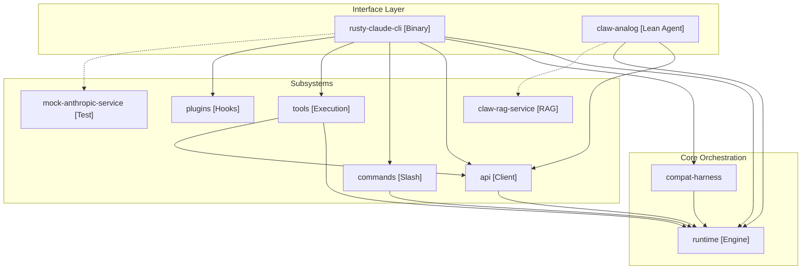
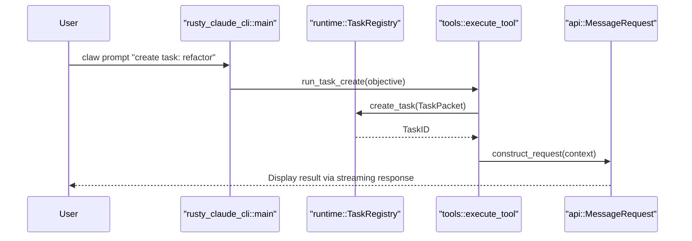

<!-- source: DeepWiki mcp.deepwiki.com · repo ultraworkers/claw-code · page 1.2 Repository Structure · fetched 2026-10-27 -->

# Repository Structure

Relevant source files

The following files were used as context for generating this wiki page:

- [AGENTS.md](AGENTS.md)
- [PARITY.md](PARITY.md)
- [README.md](README.md)
- [USAGE.md](USAGE.md)
- [docs/g007-plugin-mcp-verification-map.md](docs/g007-plugin-mcp-verification-map.md)
- [docs/g011-acp-json-rpc-status-contract.md](docs/g011-acp-json-rpc-status-contract.md)
- [docs/local-openai-compatible-providers.md](docs/local-openai-compatible-providers.md)
- [docs/navigation-file-context.md](docs/navigation-file-context.md)
- [rust/AGENTS.md](rust/AGENTS.md)
- [rust/Cargo.toml](rust/Cargo.toml)
- [rust/MOCK_PARITY_HARNESS.md](rust/MOCK_PARITY_HARNESS.md)
- [rust/README.md](rust/README.md)
- [rust/crates/api/AGENTS.md](rust/crates/api/AGENTS.md)
- [rust/crates/commands/AGENTS.md](rust/crates/commands/AGENTS.md)
- [rust/crates/mock-anthropic-service/src/lib.rs](rust/crates/mock-anthropic-service/src/lib.rs)
- [rust/crates/plugins/AGENTS.md](rust/crates/plugins/AGENTS.md)
- [rust/crates/runtime/AGENTS.md](rust/crates/runtime/AGENTS.md)
- [rust/crates/rusty-claude-cli/AGENTS.md](rust/crates/rusty-claude-cli/AGENTS.md)
- [rust/crates/rusty-claude-cli/tests/mock_parity_harness.rs](rust/crates/rusty-claude-cli/tests/mock_parity_harness.rs)
- [rust/crates/tools/AGENTS.md](rust/crates/tools/AGENTS.md)
- [rust/mock_parity_scenarios.json](rust/mock_parity_scenarios.json)
- [rust/scripts/run_mock_parity_diff.py](rust/scripts/run_mock_parity_diff.py)
- [src/AGENTS.md](src/AGENTS.md)

This page provides a detailed map of the `claw-code` repository layout. The project follows a dual-track architecture: a **Python porting workspace** used for clean-room verification and parity tracking against the original system, and a **Rust production implementation** designed for performance and memory safety.

## Top-Level Directory Layout

The repository is organized into primary top-level directories that separate implementation concerns from assets and testing.

| Directory | Purpose |
| :--- | :--- |
| `rust/` | The production-grade Rust workspace, containing the canonical `claw` CLI binary and its supporting crates. [README.md:106-106](), [rust/README.md:1-3]() |
| `src/` | The Python porting workspace used for clean-room architectural replication and reference logic. [README.md:111-111](), [src/AGENTS.md:5-8]() |
| `tests/` | Integration tests and verification suites for the Python porting workspace. [README.md:111-111](), [AGENTS.md:15-15]() |
| `assets/` | Static resources, including the `claw-hero.jpeg` branding asset. [README.md:93-93]() |
| `docs/` | Detailed technical documentation covering ACP/Zed contracts, navigation, and local provider setup. [README.md:100-102]() |

**Sources:** [README.md:104-112](), [rust/README.md:1-3](), [AGENTS.md:10-20](), [src/AGENTS.md:1-8]()

---

## Rust Workspace (Production)

The Rust implementation is managed as a Cargo workspace located in the `rust/` directory. It uses a `resolver = "2"` configuration and enforces `unsafe_code = "forbid"` across all members. [rust/Cargo.toml:1-15]()

### Crate Graph and Data Flow

The following diagram illustrates how the Rust crates interact. Data flows from the `rusty-claude-cli` (User Input) through the `runtime` (Orchestration) to external `api` providers or local `tools`.

**Rust Crate Dependency Map**

**Sources:** [rust/Cargo.toml:1-2](), [AGENTS.md:23-33](), [PARITY.md:42-52]()

### Key Rust Crates

*   **`rusty-claude-cli`**: The entrypoint binary (`claw`). Wires together api, runtime, tools, and commands using a hand-rolled argument parser. [rust/crates/rusty-claude-cli/AGENTS.md:5-9](), [rust/crates/rusty-claude-cli/tests/mock_parity_harness.rs:17-30]()
*   **`runtime`**: The central engine. It implements the `TaskRegistry` for task lifecycle, `PermissionEnforcer` for security gating, and `LspClient` for language server integration. [PARITY.md:47-52](), [PARITY.md:94-96](), [AGENTS.md:43-45]()
*   **`api`**: A provider-agnostic client supporting Anthropic and OpenAI-compatible endpoints. It manages auth via `ANTHROPIC_API_KEY`, `ANTHROPIC_AUTH_TOKEN`, or `OPENAI_API_KEY`. [rust/README.md:29-41](), [docs/local-openai-compatible-providers.md:16-22]()
*   **`tools`**: Handles execution of built-in tools (bash, file_ops, etc.). It wires the `TaskRegistry` into tool dispatch for operations like `TaskCreate` and `TaskUpdate`. [PARITY.md:102-105](), [AGENTS.md:48-48]()
*   **`claw-analog`**: A lightweight agent harness built on the `api` crate for CI-friendly automation. [AGENTS.md:31-31]()
*   **`mock-anthropic-service`**: A deterministic test server that implements a subset of the Anthropic `/v1/messages` API to facilitate reproducible harness runs. [rust/crates/mock-anthropic-service/src/lib.rs:26-31](), [rust/crates/mock-anthropic-service/src/lib.rs:142-164]()

---

## Python Porting Workspace (`src/`)

The Python tree exists solely to mirror and track parity against the original TypeScript source code. It is a scaffold for verification, not a production target. [src/AGENTS.md:3-8]()

### Python Module Tree

The Python workspace mirrors the original subsystem surface using placeholder packages that load JSON metadata snapshots.

| Component | File/Directory | Role |
| :--- | :--- | :--- |
| **CLI Entry** | `src/main.py` | Argparse-based shim for `manifest`, `parity-audit`, and `turn-loop`. [src/AGENTS.md:13-13]() |
| **Reference Data** | `src/reference_data/` | Tracked JSON snapshots of tools, commands, and 29 subsystems. [src/AGENTS.md:18-21]() |
| **Audit Engine** | `src/parity_audit.py` | Maps original `.ts` files to the Python `.py` implementations. [src/AGENTS.md:16-16]() |
| **Logic Shims** | `src/permissions.py` | Ported logic for permission handling and path scoping. [src/AGENTS.md:39-39]() |

**Sources:** [src/AGENTS.md:1-45]()

---

## Clean-Room Methodology and Parity Tracking

Parity is verified through a rigorous automated harness that ensures the Rust implementation matches the behavioral expectations of the original design.

### Parity Audit System

*   **Mock Parity Harness**: A reproducible CLI harness located in `rust/crates/rusty-claude-cli/tests/mock_parity_harness.rs` that runs 12 scripted scenarios against the `MockAnthropicService`. [rust/README.md:75-82](), [rust/crates/rusty-claude-cli/tests/mock_parity_harness.rs:30-151]()
*   **Scenario Coverage**: The harness validates critical paths such as `bash_stdout_roundtrip`, `grep_chunk_assembly`, and `auto_compact_triggered`. [rust/MOCK_PARITY_HARNESS.md:11-26](), [rust/crates/rusty-claude-cli/tests/mock_parity_harness.rs:31-151]()
*   **9-Lane Checkpoint**: Progress is measured across nine functional "lanes," including Bash validation, Task wiring, and MCP lifecycle. [PARITY.md:42-53]()

**Sources:** [rust/README.md:48-82](), [PARITY.md:1-110](), [rust/MOCK_PARITY_HARNESS.md:1-27]()

---

## Data Flow: Input to Execution

This diagram bridges the Natural Language Space (User Input) to the Code Entity Space (Implementation).

**System Input Flow**

**Sources:** [rust/README.md:139-152](), [PARITY.md:94-105](), [rust/crates/mock-anthropic-service/src/lib.rs:146-150]()

## Workspace Health and Initialization

| Command | Code Entity | Purpose |
| :--- | :--- | :--- |
| `claw init` | `rusty_claude_cli::run_init` | Idempotent setup of `.claw/settings.json`, `.claw.json`, and `CLAUDE.md`. [USAGE.md:57-65](), [rust/crates/rusty-claude-cli/AGENTS.md:26-26]() |
| `claw doctor` | `rusty_claude_cli::check_*_health` | Preflight diagnostic for API keys, provider connectivity, and MCP validation. [USAGE.md:14-17](), [rust/crates/rusty-claude-cli/AGENTS.md:22-22]() |
| `claw status` | `rusty_claude_cli::StatusContext` | Reports loaded project memory files (`CLAUDE.md`, `CLAW.md`) and MCP validation. [rust/README.md:157-159](), [rust/crates/rusty-claude-cli/AGENTS.md:24-24]() |
| `claw state` | `.claw/worker-state.json` | Inspects active worker ID, session reference, and current permission mode. [USAGE.md:116-125]() |

**Sources:** [USAGE.md:57-75](), [USAGE.md:116-140](), [rust/README.md:153-160](), [rust/crates/rusty-claude-cli/AGENTS.md:22-26]()

---

