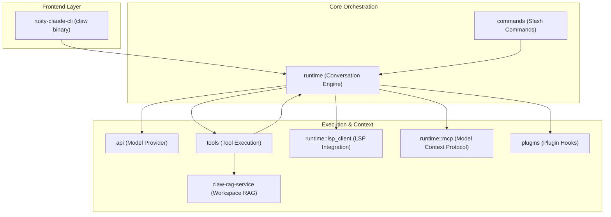
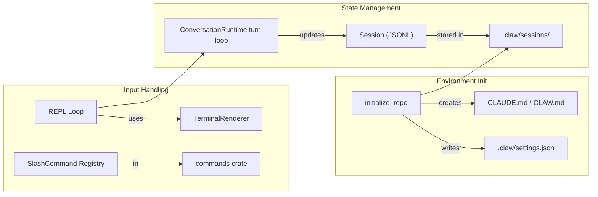

<!-- source: DeepWiki mcp.deepwiki.com · repo ultraworkers/claw-code · page 2 Rust Implementation · fetched 2026-10-27 -->

# Rust Implementation

Relevant source files

The following files were used as context for generating this wiki page:

- [README.md](README.md)
- [USAGE.md](USAGE.md)
- [docs/g011-acp-json-rpc-status-contract.md](docs/g011-acp-json-rpc-status-contract.md)
- [docs/local-openai-compatible-providers.md](docs/local-openai-compatible-providers.md)
- [docs/navigation-file-context.md](docs/navigation-file-context.md)
- [rust/Cargo.toml](rust/Cargo.toml)
- [rust/README.md](rust/README.md)

The Claw Code production environment is a workspace of interconnected Rust crates designed for high-performance, local-first agentic workflows. While the repository contains a Python porting workspace for verification, the **Rust workspace** under `rust/crates/` is the primary product surface [rust/README.md:1-5](), [rust/README.md:106]().

The architecture follows a modular design where the `runtime` acts as the central orchestrator, the `api` handles model communication, and specialized crates like `tools`, `commands`, and `plugins` provide the agent with environmental capabilities.

### Crate Collaboration Map

The following diagram illustrates how the core crates in the Rust workspace interact to process a user request.

**System Entity Interaction**

**Sources:** [rust/crates/rusty-claude-cli/src/main.rs:37-71](), [rust/README.md:84-110](), [rust/Cargo.toml:1-3]()

---

### Core Subsystems

#### [CLI and REPL (claw-cli)](#2.1)
The `rusty-claude-cli` crate is the main entry point for users, producing the `claw` binary [rust/README.md:96](). It provides an interactive REPL with `rustyline` support and a one-shot prompt mode [rust/README.md:84-85](). It manages the input lifecycle and handles terminal rendering via `TerminalRenderer` [rust/crates/rusty-claude-cli/src/main.rs:55](). It also includes the `init` logic for setting up new projects with `CLAUDE.md`, `CLAW.md`, and `.claw/settings.json` [rust/crates/rusty-claude-cli/src/main.rs:53](), [USAGE.md:56-74]().
*   **Key Entities:** `CliApp`, `TerminalRenderer`, `initialize_repo`.
*   **For details, see [CLI and REPL (claw-cli)](#2.1).**

#### [Runtime and Conversation Engine](#2.2)
The `runtime` crate is the "brain" of the system. It manages `ConversationRuntime`, which handles the turn loop, session persistence, and the construction of the system prompt by discovering `CLAUDE.md`, `CLAW.md`, and `AGENTS.md` [rust/crates/rusty-claude-cli/src/main.rs:56-65](), [rust/README.md:157](). It also enforces `PermissionMode` gating for tool usage [rust/crates/rusty-claude-cli/src/main.rs:117-162]().
*   **Key Entities:** `ConversationRuntime`, `Session`, `PermissionMode`.
*   **For details, see [Runtime and Conversation Engine](#2.2).**

#### [API Client and Provider Abstraction](#2.3)
The `api` crate abstracts multiple LLM providers behind a unified interface, supporting Anthropic and OpenAI-compatible endpoints [rust/README.md:87-88](). It handles SSE (Server-Sent Events) stream normalization and authentication via `AuthSource` (API key, OAuth, or bearer) [rust/crates/rusty-claude-cli/src/main.rs:37-43](), [docs/local-openai-compatible-providers.md:14-30]().
*   **Key Entities:** `ProviderClient`, `AuthSource`, `MessageStream`.
*   **For details, see [API Client and Provider Abstraction](#2.3).**

#### [Tool Execution Engine](#2.4)
The `tools` crate contains the implementations for the agent's capabilities, including shell execution, file system operations, and notebook editing [rust/README.md:90-94](). It uses a `GlobalToolRegistry` to dispatch requests based on the model's tool-call outputs [rust/crates/rusty-claude-cli/src/main.rs:68-71]().
*   **Key Entities:** `GlobalToolRegistry`, `execute_tool`, `Skill` system.
*   **For details, see [Tool Execution Engine](#2.4).**

#### [MCP Integration](#2.5)
The Model Context Protocol (MCP) support allows Claw to connect to external tool servers. It manages the lifecycle of MCP server processes and routes tool calls through JSON-RPC [rust/README.md:98](), [rust/README.md:158]().
*   **Key Entities:** `McpServerManager`, `McpConfigCollection`, `McpServer`.
*   **For details, see [MCP Integration](#2.5).**

#### [Plugin System](#2.6)
The `plugins` crate allows extending the agent with lifecycle hooks [rust/README.md:106](). It manages a registry of installed plugins and provides surfaces for installation and update flows [rust/crates/rusty-claude-cli/src/main.rs:54]().
*   **Key Entities:** `PluginManager`, `PluginRegistry`, `PluginHooks`.
*   **For details, see [Plugin System](#2.6).**

#### [Worker Boot and Lane System](#2.7)
The `runtime` crate implements a state machine for worker booting and "lane" management. This includes `WorkerStatus` transitions (e.g., `spawning`, `trust_required`, `ready_for_prompt`) to ensure reliable agent startup and auto-recovery from misdeliveries [rust/README.md:157]().
*   **Key Entities:** `WorkerStatus`, `LaneEvent`, `TrustResolver`.
*   **For details, see [Worker Boot and Lane System](#2.7).**

#### [LSP Integration](#2.8)
The LSP client, integrated into the `runtime` crate, provides workspace awareness by communicating with Language Servers. It enriches the conversation context with diagnostics and symbol definitions [rust/crates/rusty-claude-cli/src/main.rs:59-65]().
*   **Key Entities:** `LspManager`, `LspAction`.
*   **For details, see [LSP Integration](#2.8).**

#### [Compat Harness](#2.9)
The `compat-harness` is a specialized utility used during development to ensure parity with the original TypeScript specifications by extracting command and tool registries via static analysis [rust/README.md:145-146]().
*   **Key Entities:** `BootstrapPlan`, `DumpManifests`.
*   **For details, see [Compat Harness](#2.9).**

#### [claw-analog: Lightweight Agent Harness](#2.13)
The workspace includes specialized crates for CI-friendly agent runs (`claw-analog`) and a workspace-wide RAG service (`claw-rag-service`) for vector-based search across repository files [rust/Cargo.toml:2]().
*   **For details, see [claw-analog: Lightweight Agent Harness](#2.13) and [claw-rag-service: Workspace RAG and Embedding Service](#2.14).**

---

### Code Entity Mapping

The following diagram maps high-level system behaviors to specific code identifiers and files within the Rust workspace.

**Behavior to Entity Mapping**

**Sources:** [rust/crates/rusty-claude-cli/src/main.rs:53-65](), [rust/crates/commands/src/lib.rs:60-230](), [USAGE.md:56-74](), [rust/README.md:157]()

### Crate Dependency Summary

| Crate | Purpose | Primary Responsibilities |
| :--- | :--- | :--- |
| `rusty-claude-cli` | User interface and binary | REPL, one-shot prompt, `claw` entrypoint [rust/crates/rusty-claude-cli/src/main.rs:1-16]() |
| `runtime` | Logic, turns, and state | `ConversationRuntime`, MCP, LSP, session persistence [rust/crates/rusty-claude-cli/src/main.rs:56-65]() |
| `api` | LLM Provider integration | Provider clients, SSE streaming, auth [rust/crates/rusty-claude-cli/src/main.rs:37-43]() |
| `tools` | Agent capabilities | Built-in tools (bash, edit), skill resolution [rust/crates/rusty-claude-cli/src/main.rs:68-71]() |
| `commands` | Slash command registry | Command definitions, help text generation [rust/crates/commands/src/lib.rs:1-52]() |
| `plugins` | Extensibility | Plugin metadata, install/enable flows [rust/crates/rusty-claude-cli/src/main.rs:54]() |
| `claw-analog` | Lean agent harness | CI-friendly execution, NDJSON output [rust/Cargo.toml:2]() |
| `claw-rag-service` | RAG and Embeddings | Workspace ingestion, SQLite-vec search [rust/Cargo.toml:2]() |

**Sources:** [rust/Cargo.toml:1-12](), [rust/README.md:84-110](), [rust/crates/rusty-claude-cli/src/main.rs:37-71]()

---

