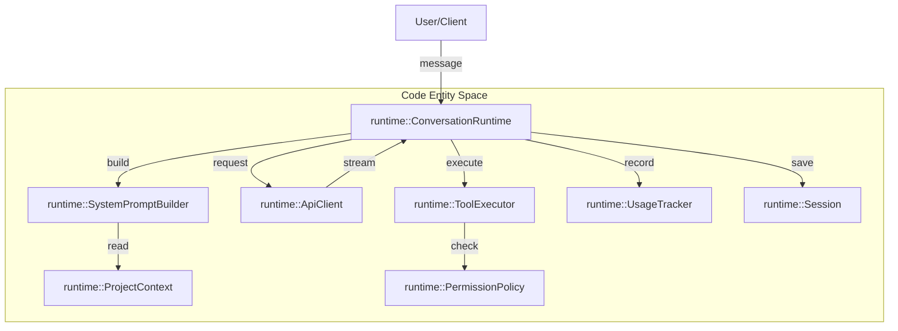
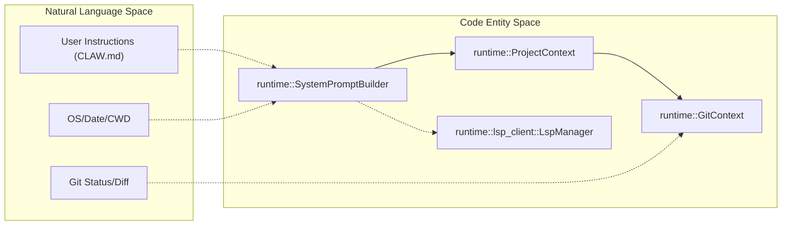

<!-- source: DeepWiki mcp.deepwiki.com · repo ultraworkers/claw-code · page 2.2 Runtime and Conversation Engine · fetched 2026-10-27 -->

# Runtime and Conversation Engine

Relevant source files

The following files were used as context for generating this wiki page:

- [rust/crates/compat-harness/src/lib.rs](rust/crates/compat-harness/src/lib.rs)
- [rust/crates/runtime/src/compact.rs](rust/crates/runtime/src/compact.rs)
- [rust/crates/runtime/src/config.rs](rust/crates/runtime/src/config.rs)
- [rust/crates/runtime/src/config_validate.rs](rust/crates/runtime/src/config_validate.rs)
- [rust/crates/runtime/src/conversation.rs](rust/crates/runtime/src/conversation.rs)
- [rust/crates/runtime/src/file_ops.rs](rust/crates/runtime/src/file_ops.rs)
- [rust/crates/runtime/src/hooks.rs](rust/crates/runtime/src/hooks.rs)
- [rust/crates/runtime/src/lib.rs](rust/crates/runtime/src/lib.rs)
- [rust/crates/runtime/src/oauth.rs](rust/crates/runtime/src/oauth.rs)
- [rust/crates/runtime/src/prompt.rs](rust/crates/runtime/src/prompt.rs)
- [rust/crates/runtime/src/session.rs](rust/crates/runtime/src/session.rs)
- [rust/crates/runtime/src/usage.rs](rust/crates/runtime/src/usage.rs)
- [rust/crates/rusty-claude-cli/src/render.rs](rust/crates/rusty-claude-cli/src/render.rs)
- [rust/crates/rusty-claude-cli/src/setup_wizard.rs](rust/crates/rusty-claude-cli/src/setup_wizard.rs)

The `runtime` crate serves as the central orchestration layer for the CLAW codebase. It defines the `ConversationRuntime` which manages the lifecycle of an AI interaction, including turn loops, tool execution, session persistence, and the assembly of complex system prompts [rust/crates/runtime/src/lib.rs:1-5](). It acts as the bridge between the low-level API clients and the high-level CLI or Server interfaces.

## Core Architecture

The runtime is designed around a "turn-based" loop where user input is processed, context is gathered, and the assistant's response is managed. This process involves several specialized components:

*   **Conversation Engine**: Coordinates the `ApiClient` requests and manages the `AssistantEvent` stream, which includes text deltas, tool usage, and token usage telemetry [rust/crates/runtime/src/conversation.rs:28-44](), [rust/crates/runtime/src/conversation.rs:57-59]().
*   **Session Management**: Tracks the history of `ConversationMessage` objects and handles their serialization and state [rust/crates/runtime/src/session.rs:15-16](), [rust/crates/runtime/src/lib.rs:40-42]().
*   **Permission Gating**: Enforces `PermissionPolicy` and interacts with a `PermissionPrompter` before sensitive actions occur [rust/crates/runtime/src/permissions.rs:133-136](), [rust/crates/runtime/src/lib.rs:133-136]().
*   **Hook Runner**: Executes lifecycle hooks (e.g., `PreToolUse`, `PostToolUse`) which can modify tool inputs or even provide permission overrides [rust/crates/runtime/src/hooks.rs:94-96](), [rust/crates/runtime/src/lib.rs:94-96]().
*   **Worker Boot State Machine**: Manages the in-memory state for reliable worker startup, including trust-gate detection and recovery [rust/crates/runtime/src/lib.rs:54-54]().
*   **Lane Event System**: Tracks the state of a conversation "lane" using events like `lane.started`, `lane.green`, and `lane.failed` to provide observability into the workflow [rust/crates/runtime/src/lib.rs:97-103]().

### Runtime Data Flow

The following diagram illustrates how the `ConversationRuntime` coordinates between different system entities:

Sources: [rust/crates/runtime/src/lib.rs:82-86](), [rust/crates/runtime/src/conversation.rs:130-143](), [rust/crates/runtime/src/prompt.rs:155-164]()

## Session Management and Compaction

Sessions in CLAW are structured collections of `ConversationMessage` objects, each containing one or more `ContentBlock` variants (Text, Thinking, ToolUse, or ToolResult) [rust/crates/runtime/src/session.rs:33-52](), [rust/crates/runtime/src/session.rs:56-60](). As conversations grow, the runtime uses a compaction engine to stay within model token limits [rust/crates/runtime/src/compact.rs:96-104]().

For details, see [Session Management and Compaction](#2.2.1).

### Token Usage and Pricing
The runtime includes a `UsageTracker` that monitors `TokenUsage` across turns [rust/crates/runtime/src/usage.rs:169-173](). It tracks input, output, and cache-related tokens to provide real-time cost estimates based on model-specific pricing tiers [rust/crates/runtime/src/usage.rs:59-81]().

| Entity | Role | File |
| :--- | :--- | :--- |
| `Session` | Root container for message history | [rust/crates/runtime/src/session.rs:117]() |
| `ConversationMessage` | Individual turn data with role and blocks | [rust/crates/runtime/src/session.rs:56]() |
| `UsageTracker` | Accumulates token counts and costs | [rust/crates/runtime/src/usage.rs:169]() |
| `CompactionConfig` | Settings for context pruning thresholds | [rust/crates/runtime/src/compact.rs:10]() |

Sources: [rust/crates/runtime/src/session.rs:33-60](), [rust/crates/runtime/src/usage.rs:169-173](), [rust/crates/runtime/src/compact.rs:10-22]()

## System Prompt and Project Context

The `SystemPromptBuilder` generates the high-level instructions sent to the LLM [rust/crates/runtime/src/prompt.rs:155-164](). It dynamically constructs the prompt by aggregating environment data, project-specific instruction files (like `CLAW.md`), and real-time state from Git.

For details, see [System Prompt and Project Context](#2.2.2).

### Context Discovery Logic
The `ProjectContext` struct encapsulates the environment state, including `GitContext` and `ContextFile` collections discovered from the workspace [rust/crates/runtime/src/prompt.rs:86-93](). The builder assembles these into a final system prompt string, respecting token budgets for instruction files [rust/crates/runtime/src/prompt.rs:43-44]().

Sources: [rust/crates/runtime/src/prompt.rs:86-93](), [rust/crates/runtime/src/prompt.rs:155-164](), [rust/crates/runtime/src/git_context.rs:93-93](), [rust/crates/runtime/src/lsp_client.rs:23-23]()

## Tool and MCP Integration

The runtime facilitates tool execution through the `ToolExecutor` trait [rust/crates/runtime/src/conversation.rs:62-64](). It specifically handles the Model Context Protocol (MCP) through the `McpServerManager`, which manages the lifecycle of external tool providers [rust/crates/runtime/src/mcp_stdio.rs:122-124]().

*   **Bash Execution**: The runtime provides `execute_bash` which supports command input/output and validation [rust/crates/runtime/src/bash.rs:60-60]().
*   **File Operations**: High-level wrappers for `read_file`, `write_file`, and `edit_file` (using structured patches) are exported for use by the assistant [rust/crates/runtime/src/file_ops.rs:185-190](), [rust/crates/runtime/src/file_ops.rs:87-91]().
*   **Sandboxing**: The `SandboxConfig` and `FilesystemIsolationMode` allow for isolated execution of tools [rust/crates/runtime/src/config.rs:37-37]().
*   **LSP Integration**: The `LspManager` provides diagnostics and workspace symbols to enrich the assistant's context [rust/crates/runtime/src/lib.rs:23-23]().

Sources: [rust/crates/runtime/src/lib.rs:60-125](), [rust/crates/runtime/src/mcp_stdio.rs:122-124](), [rust/crates/runtime/src/file_ops.rs:185-190]()

## Public API Overview

The `runtime/src/lib.rs` file serves as the primary entry point for the crate, re-exporting essential types for consumers:

*   **Configuration**: `RuntimeConfig`, `ConfigLoader`, and various `McpServerConfig` variants [rust/crates/runtime/src/lib.rs:67-77]().
*   **Execution**: `ConversationRuntime`, `ApiClient`, and `BootstrapPlan` [rust/crates/runtime/src/lib.rs:61-86]().
*   **Authentication**: `OAuthTokenSet` and PKCE utilities for secure provider access [rust/crates/runtime/src/lib.rs:126-132]().
*   **Permissions**: `PermissionMode` and `PermissionPolicy` for security enforcement [rust/crates/runtime/src/lib.rs:133-136]().
*   **Recovery**: `FailureScenario` and `RecoveryRecipe` for automated error handling [rust/crates/runtime/src/lib.rs:151-155]().
*   **Lane Management**: `LaneEvent`, `LaneEventStatus`, and `LaneFailureClass` for workflow tracking [rust/crates/runtime/src/lib.rs:97-103]().

Sources: [rust/crates/runtime/src/lib.rs:1-170]()

---

