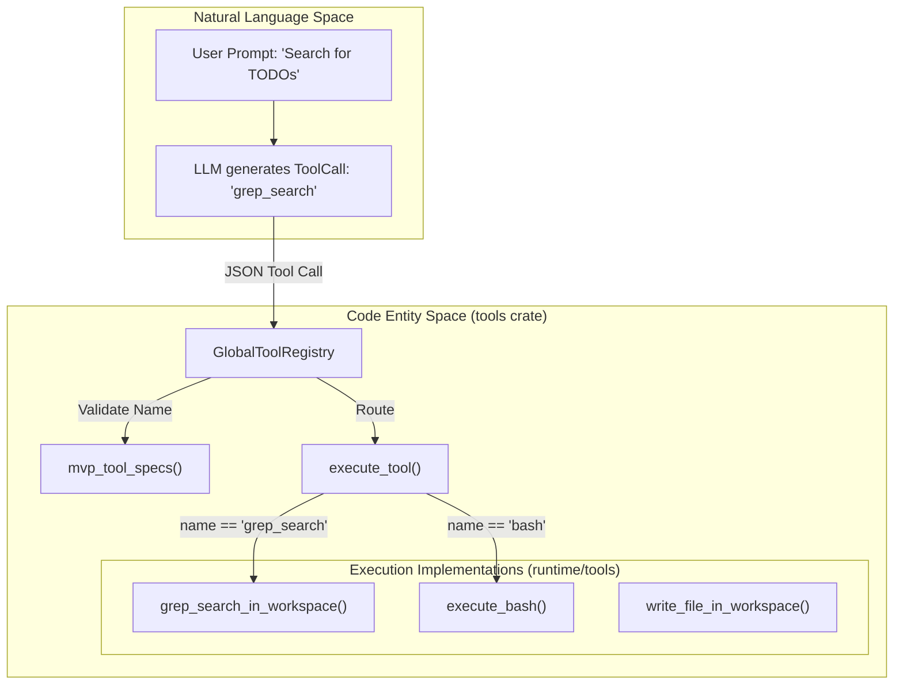
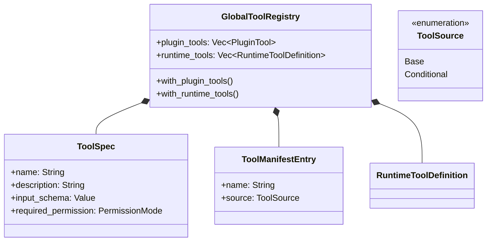

<!-- source: DeepWiki mcp.deepwiki.com · repo ultraworkers/claw-code · page 2.4 Tool Execution Engine · fetched 2026-10-27 -->

# Tool Execution Engine

Relevant source files

The following files were used as context for generating this wiki page:

- [.claude/sessions/session-1775007846522.json](.claude/sessions/session-1775007846522.json)
- [rust/Cargo.lock](rust/Cargo.lock)
- [rust/crates/runtime/src/sandbox.rs](rust/crates/runtime/src/sandbox.rs)
- [rust/crates/rusty-claude-cli/Cargo.toml](rust/crates/rusty-claude-cli/Cargo.toml)
- [rust/crates/rusty-claude-cli/src/input.rs](rust/crates/rusty-claude-cli/src/input.rs)
- [rust/crates/tools/Cargo.toml](rust/crates/tools/Cargo.toml)
- [rust/crates/tools/GIT_TOOLS_README.md](rust/crates/tools/GIT_TOOLS_README.md)
- [rust/crates/tools/src/lib.rs](rust/crates/tools/src/lib.rs)
- [rust/crates/tools/src/pdf_extract.rs](rust/crates/tools/src/pdf_extract.rs)
- [rust/crates/tools/tests/path_scope_enforcement.rs](rust/crates/tools/tests/path_scope_enforcement.rs)

The `tools` crate serves as the centralized registry and dispatcher for all capabilities exposed to the LLM. It abstracts built-in system tools, plugin-provided tools, and external skills into a unified interface, while enforcing strict permission gating and providing execution environments for shell commands, file operations, and web searches.

## Tool Registry and Management

The `tools` crate manages tool discovery through the `GlobalToolRegistry`. This registry merges built-in "MVP" tools with dynamic tools provided by the `plugins` crate, MCP (Model Context Protocol) servers, and runtime-defined tools.

### GlobalToolRegistry
The `GlobalToolRegistry` is the primary entry point for the `runtime` to discover what tools are available and to route execution requests [rust/crates/tools/src/lib.rs:113-117]().

*   **`builtin()`**: Initializes a registry with only core system tools [rust/crates/tools/src/lib.rs:129-135]().
*   **`with_plugin_tools()`**: Extends the registry with tools from loaded plugins, ensuring no name collisions with built-in tools [rust/crates/tools/src/lib.rs:137-161]().
*   **`with_runtime_tools()`**: Adds tools defined dynamically at runtime, such as those generated by the sub-agent system [rust/crates/tools/src/lib.rs:163-188]().
*   **`normalize_allowed_tools()`**: Maps user-provided strings or shorthand aliases (like `read` for `read_file`, `write` for `write_file`, and `edit` for `edit_file`) to canonical tool names [rust/crates/tools/src/lib.rs:196-233]().

Sources: [rust/crates/tools/src/lib.rs:113-188](), [rust/crates/tools/src/lib.rs:196-233]().

## Tool Execution Pipeline

When the LLM requests a tool call, the `runtime` crate invokes the execution logic via the `GlobalToolRegistry`.

### Dispatch Logic
The dispatch pipeline follows a strict priority order to resolve tool names to their implementations:
1.  **Built-in Check**: If the tool name exists in `mvp_tool_specs`, it routes to internal Rust implementations [rust/crates/tools/src/lib.rs:138-141]().
2.  **Plugin Dispatch**: If not a built-in, it searches `plugin_tools` provided by the `plugins` crate [rust/crates/tools/src/lib.rs:114-114]().
3.  **Runtime Tool Dispatch**: Finally, it checks `runtime_tools` for dynamic definitions [rust/crates/tools/src/lib.rs:115-115]().

### Data Flow: Natural Language to Tool Execution
The following diagram illustrates how a natural language request results in a code-level tool execution, bridging the prompt space to the Rust implementation.

**Tool Dispatch Pipeline**

Sources: [rust/crates/tools/src/lib.rs:113-125](), [rust/crates/tools/src/lib.rs:137-154](), [rust/crates/tools/src/lib.rs:28-34]().

## Permission Modes and Security

Every tool is associated with a `PermissionMode` which determines the level of user authorization required before the `runtime` allows the tool to run [rust/crates/tools/src/lib.rs:109-110]().

| Mode | Description | Example Tools |
| :--- | :--- | :--- |
| `ReadOnly` | Can read files or state but cannot modify the workspace. | `read_file`, `ls`, `grep_search`, `GitStatus` |
| `WorkspaceWrite` | Can modify files within the project directory. | `write_file`, `edit_file`, `notebook_edit` |
| `DangerFullAccess` | Can execute arbitrary code or access external networks. | `bash`, `fetch_url`, `google_search` |

### Permission Gating
The `PermissionEnforcer` acts as the primary guard during execution, evaluating the `PermissionPolicy` against the tool's `required_permission` [rust/crates/tools/src/lib.rs:116-117](), [rust/crates/tools/src/lib.rs:124-124](). 

The engine enforces strict path-scope restrictions. Tools are denied if they attempt to escape the workspace via absolute paths, parent directory traversal (`..`), or symlinks that resolve outside the root [rust/crates/tools/tests/path_scope_enforcement.rs:75-159](). These checks occur in the `PermissionEnforcer` before execution [rust/crates/tools/tests/path_scope_enforcement.rs:41-51]().

Sources: [rust/crates/tools/src/lib.rs:105-110](), [rust/crates/tools/src/lib.rs:124-124](), [rust/crates/tools/tests/path_scope_enforcement.rs:21-27](), [rust/crates/tools/tests/path_scope_enforcement.rs:75-159]().

## Core Capabilities

### Git-Aware Context Tools
The engine includes native Git tools that provide structured, read-only access to repository state, replacing ad-hoc bash commands [rust/crates/tools/GIT_TOOLS_README.md:1-4]().
*   **`GitStatus`**: Returns `git status --short --branch` [rust/crates/tools/GIT_TOOLS_README.md:7-13]().
*   **`GitDiff`**: Supports staged changes, commit ranges, and path filtering [rust/crates/tools/GIT_TOOLS_README.md:29-38]().
*   **`GitLog`**: Provides commit history with filtering by author, date, and path [rust/crates/tools/GIT_TOOLS_README.md:56-67]().
*   **`GitBlame`**: Shows revision/author info for line ranges [rust/crates/tools/GIT_TOOLS_README.md:102-110]().

### Shell Execution (`bash`)
The engine provides a `bash` tool for executing shell commands via `execute_bash` [rust/crates/tools/src/lib.rs:18-18]().
*   **Sandbox Isolation**: Commands can be restricted via `FilesystemIsolationMode` (e.g., `WorkspaceOnly`) and network isolation [rust/crates/runtime/src/sandbox.rs:7-14]().
*   **Container Detection**: The engine detects if it is running inside Docker or Podman to adjust sandbox status [rust/crates/runtime/src/sandbox.rs:109-153]().

### File Operations
The `tools` crate leverages optimized file manipulation primitives from the `runtime` crate [rust/crates/tools/src/lib.rs:17-34]():
*   **`read_file_in_workspace`**: Reads text files with size limits [rust/crates/tools/src/lib.rs:23-23]().
*   **`write_file_in_workspace`**: Performs atomic full-file writes [rust/crates/tools/src/lib.rs:28-28]().
*   **`edit_file_in_workspace`**: Executes targeted string-replacement edits [rust/crates/tools/src/lib.rs:18-18]().
*   **`grep_search_in_workspace`**: Implements regex-based searching [rust/crates/tools/src/lib.rs:19-19]().

### PDF Extraction
The `pdf_extract` module parses PDF bytes, decompresses `FlateDecode` streams using `flate2`, and extracts text from `BT/ET` (Begin Text/End Text) operators [rust/crates/tools/src/pdf_extract.rs:15-18](), [rust/crates/tools/src/pdf_extract.rs:78-85](). It handles common text-showing operators like `Tj`, `TJ`, `'`, and `"` [rust/crates/tools/src/pdf_extract.rs:87-144]().

### Sub-agent Spawning
The engine supports spawning "sub-agents"—nested `ConversationRuntime` instances. This is managed via the `WorkerRegistry` [rust/crates/tools/src/lib.rs:69-73](). Sub-agents can perform specialized tasks and return a `WorkerTaskReceipt` to the main agent [rust/crates/tools/src/lib.rs:27-27]().

## Skill System

The Skill system allows for higher-level abstractions over basic tools. While a tool is a single function, a Skill is represented as a `ToolManifestEntry` that may be `Base` or `Conditional` [rust/crates/tools/src/lib.rs:76-85]().

**Skill and Tool Relationship**

### Registry Singletons
The `tools` crate leverages singleton registries to maintain state across tool invocations within a session:
*   `LspRegistry`: Manages language server connections [rust/crates/tools/src/lib.rs:39-43]().
*   `McpToolRegistry`: Bridges to Model Context Protocol servers [rust/crates/tools/src/lib.rs:45-49]().
*   `TeamRegistry` & `CronRegistry`: Handles collaborative teams and scheduled prompts [rust/crates/tools/src/lib.rs:51-61]().
*   `TaskRegistry`: Tracks long-running background tasks [rust/crates/tools/src/lib.rs:63-67]().

Sources: [rust/crates/tools/src/lib.rs:39-85](), [rust/crates/tools/GIT_TOOLS_README.md:122-129](), [rust/crates/tools/src/pdf_extract.rs:1-144](), [rust/crates/runtime/src/sandbox.rs:7-153]().

---

